# MATH-KNOWLEDGE-R16-CT05-14-21-23 — NotebookLM temporary academic equivalence review packet

**Packet ID:** `MATH-KNOWLEDGE-PRESENTATION-EQUIVALENCE-R16-20261024`  
**Request date:** 2026-10-24  
**Version / state:** source comparison only, **NOT approved, NOT published**.  
**Source of current official knowledge:** GitHub `main` at `680e248d4d2cff59fa69b4cbd1fe2be1083f8d1f`; snapshots included verbatim below.  
**Candidate design source:** Draft PR #574 branch `design/math-knowledge-pages-and-hub-r0-20261023`; `preview-composition-r3.md` for each topic, verbatim below.  
**Blocked release attempt:** PR #575 was closed without merge because current integrity tests lock teaching-source SHAs (CT05 Wave F, CT14 Wave C, CT21/23 Grade-9 review). **Never bypass these locks.**

## Exact source selection and limits

For the independent NotebookLM review select **3 sources total**:
1. Permanent NotebookLM Math Review Rules v1.2;
2. Current canonical Self-Learning Math Master Plan (verify version is current; deselect obsolete plans);
3. **This single R16 temporary comparison packet**.

The packet reproduces the project's reviewed current article sources and draft replacements. **It does not contain new official KNTT SGK/SBT evidence**; any S1 curriculum authority decision requiring actual schoolbook evidence must be `INSUFFICIENT_EVIDENCE` without such evidence. Do not infer independent approval of source textbooks from the current-project material alone.

## Reviewer request: evaluate exactly 16 checks, not automatically PASS

Each of four topics has checks:
- `<CT>-MATH`: every original mathematical concept, definition, condition, case, result and distinction preserved or clearly accounted for in candidate; no false inference.
- `<CT>-EXAMPLE`: every old worked example and nontrivial derivation preserved; changed display equations/cases are correct and readable at school-level.
- `<CT>-VISUAL`: every hidden infographic's **distinct** mathematical teaching content either present elsewhere in candidate or identified precisely as lost; all retained/new figures mathematically correct, source notes coherent.
- `<CT>-PRACTICE`: proposed Practice skill/approved Written placement is contextually suitable and honestly labeled; no mistaken KNTT-Core/Readiness/exam-scope implication.

For all items flag any change to SGK Core boundaries, prerequisite progression, methodological caveats, visually needed geometric assumptions, counterexamples, parameters, and student-support guidance. **Do not treat a shorter article or fewer SVGs as academic improvement by default.** An exact source-heading count is not proof of semantic parity.

### Output contract (machine-checkable, no invented clearances)

```text
PACKET_ID|MATH-KNOWLEDGE-PRESENTATION-EQUIVALENCE-R16-20261024
OVERALL|PASS or REVISION_REQUIRED or INSUFFICIENT_EVIDENCE or NOT_REVIEWED
CT05-MATH|...
CT05-EXAMPLE|...
CT05-VISUAL|...
CT05-PRACTICE|...
CT14-MATH|...
CT14-EXAMPLE|...
CT14-VISUAL|...
CT14-PRACTICE|...
CT21-MATH|...
CT21-EXAMPLE|...
CT21-VISUAL|...
CT21-PRACTICE|...
CT23-MATH|...
CT23-EXAMPLE|...
CT23-VISUAL|...
CT23-PRACTICE|...
GAP|<topic section> | <P0/P1/P2> | <what was lost or distorted> | <exact repair>
CLEARANCE|ACADEMIC_PRESENTATION_EQUIVALENCE_ONLY or NONE
```

Only emit `CLEARANCE|ACADEMIC_PRESENTATION_EQUIVALENCE_ONLY` if **all 16 topic checks PASS** and `OVERALL|PASS`. This clearance means only source-equivalence review of the proposed presentation, **not** approval to modify protected original sources, rebaseline integrity SHA tests, merge, deploy, change Core/Mastery, or alter any bank item. If evidence is insufficient, state what supporting file/figure/external S1 citation is missing. The parent remains final approver.

## Candidate map and source-lock notes

| Topic | Presentation changes for review | Active Practice focus | Written destination |
|---|---|---|---|
| CT05 | Hidden original 05-01..04 text-led infographic placements; new four-area SVG for (a+b)^2 under positive side lengths. | `nhan-dang-hdt` | WX05-IDN-001 |
| CT14 | Hidden 14-01..04 text recap placements; original two triangle and Pythagoras geometry figures remain. | `so-sanh-canh-goc` | WX14-TRI-003 |
| CT21 | Hidden 21-01..03 text recaps; kept eight actual frequency/chart SVG diagrams. | `bang-tan-so` | No dedicated canonical Written item verified. |
| CT23 | Hidden 23-01..03 text recaps; kept four real probability, tree and experiment SVG diagrams. | `xac-suat-thuc-nghiem` | WX23-PRO-001 |

## Complete source snapshots (every official and candidate page)

### CT05 — official reviewed source, unchanged main index.md

- Topic: `05-7-hang-dang-thuc`
- Source path: `docs/kien-thuc/05-7-hang-dang-thuc/index.md`
- Git blob SHA: `6e34411e59ebf8589ba8ee14f2464edd5c0e822f`
- **AUTHORITY: official current project lesson; not a new S1 source in itself.**

`````markdown
# Chuyên đề 05 – 7 Hằng đẳng thức đáng nhớ


> **Trạng thái:** Đã kiểm định nội dung học thuật; cấu trúc Roadmap chuẩn 11 mục.
>
> **Lớp trọng tâm:** 8
> **Mạch kiến thức:** Đại số
> **Mức ưu tiên:** ⭐⭐⭐⭐⭐

> **Vai trò trong Roadmap:** cầu nối trực tiếp từ phép nhân đa thức sang phân tích đa thức thành nhân tử, rút gọn biểu thức và giải phương trình.
>

---

## 🧭 1. Bản đồ kiến thức

### Infographic 1 – Tổng quan chuyên đề


```text
7 HẰNG ĐẲNG THỨC ĐÁNG NHỚ
│
├── Nhóm bình phương
│   ├── (A + B)²
│   ├── (A - B)²
│   └── A² - B²
│
├── Nhóm lập phương
│   ├── (A + B)³
│   ├── (A - B)³
│   ├── A³ + B³
│   └── A³ - B³
│
├── Hai chiều sử dụng
│   ├── Khai triển: dạng tích → dạng tổng
│   └── Nhận dạng: dạng tổng → dạng tích
│
└── Ứng dụng
    ├── Tính nhanh
    ├── Rút gọn biểu thức
    ├── Phân tích đa thức
    ├── Chứng minh đẳng thức
    └── Chuẩn bị giải phương trình
```

Điều quan trọng nhất của chuyên đề không phải là học thuộc bảy dòng công thức rời rạc, mà là **nhìn ra cấu trúc** của biểu thức.

---

## 🎯 2. Mục tiêu cần đạt

Sau khi hoàn thành chuyên đề, học sinh cần có thể:

- [ ] Viết đúng cả 7 hằng đẳng thức theo hai chiều.
- [ ] Phân biệt được bình phương của một tổng và tổng các bình phương.
- [ ] Nhận dạng được `A`, `B` ngay cả khi chúng là đơn thức hoặc biểu thức phức tạp.
- [ ] Khai triển biểu thức bằng hằng đẳng thức thay vì nhân dài dòng khi phù hợp.
- [ ] Nhận dạng biểu thức để đưa từ dạng tổng về dạng tích.
- [ ] Vận dụng hằng đẳng thức để tính nhanh, rút gọn và chứng minh.
- [ ] Biết kiểm tra dấu ở các công thức có phép trừ.
- [ ] Phân biệt được tổng hai lập phương với hiệu hai lập phương.
- [ ] Kết nối kiến thức này với phân tích đa thức thành nhân tử và phương trình.

---

## 📖 3. Kiến thức cốt lõi

> **Ghi nhớ:** hằng đẳng thức là đẳng thức đúng với mọi giá trị của các biến làm cho hai vế có nghĩa. Trong các công thức dưới đây, `A` và `B` có thể là số, đơn thức hoặc biểu thức đại số.

### Infographic 2 – Nhóm bình phương


### 3.1. Bình phương của một tổng

$$
(A+B)^2=A^2+2AB+B^2
$$

**Cách đọc:** bình phương biểu thức thứ nhất + hai lần tích hai biểu thức + bình phương biểu thức thứ hai.

Ví dụ:

$$
(x+3)^2=x^2+6x+9
$$

Vì:

- `A = x`
- `B = 3`
- `2AB = 2·x·3 = 6x`

---

### 3.2. Bình phương của một hiệu

$$
(A-B)^2=A^2-2AB+B^2
$$

Ví dụ:

$$
(2x-5)^2=4x^2-20x+25
$$

> ⚠️ Hạng tử cuối vẫn là `+B²`, không phải `-B²`.

---

### 3.3. Hiệu hai bình phương

$$
A^2-B^2=(A-B)(A+B)
$$

Ví dụ:

$$
x^2-16=(x-4)(x+4)
$$

Đây là một trong những công thức quan trọng nhất khi học **phân tích đa thức thành nhân tử**.

---

### Infographic 3 – Nhóm lập phương


### 3.4. Lập phương của một tổng

$$
(A+B)^3=A^3+3A^2B+3AB^2+B^3
$$

Ví dụ:

$$
(x+2)^3=x^3+6x^2+12x+8
$$

Một cách nhớ theo hệ số:

```text
1 – 3 – 3 – 1
```

---

### 3.5. Lập phương của một hiệu

$$
(A-B)^3=A^3-3A^2B+3AB^2-B^3
$$

Ví dụ:

$$
(x-2)^3=x^3-6x^2+12x-8
$$

Dấu của bốn hạng tử lần lượt là:

```text
+   −   +   −
```

---

### 3.6. Tổng hai lập phương

$$
A^3+B^3=(A+B)(A^2-AB+B^2)
$$

Ví dụ:

$$
x^3+8=x^3+2^3=(x+2)(x^2-2x+4)
$$

---

### 3.7. Hiệu hai lập phương

$$
A^3-B^3=(A-B)(A^2+AB+B^2)
$$

Ví dụ:

$$
8x^3-27=(2x)^3-3^3=(2x-3)(4x^2+6x+9)
$$

---

### 3.8. Bảng tổng hợp 7 công thức

| # | Hằng đẳng thức |
|---:|---|
| 1 | `(A + B)² = A² + 2AB + B²` |
| 2 | `(A − B)² = A² − 2AB + B²` |
| 3 | `A² − B² = (A − B)(A + B)` |
| 4 | `(A + B)³ = A³ + 3A²B + 3AB² + B³` |
| 5 | `(A − B)³ = A³ − 3A²B + 3AB² − B³` |
| 6 | `A³ + B³ = (A + B)(A² − AB + B²)` |
| 7 | `A³ − B³ = (A − B)(A² + AB + B²)` |

---

## 🔗 4. Kiến thức liên quan

### 4.1. Vì sao `(A+B)²` có hạng tử `2AB`?

Từ phép nhân đa thức:

$$
(A+B)^2=(A+B)(A+B)
$$

Khai triển:

$$
=A^2+AB+AB+B^2
$$

Do đó:

$$
=A^2+2AB+B^2
$$

Vì vậy:

> **Bình phương của một tổng không bằng tổng các bình phương.**

Sai:

$$
(A+B)^2=A^2+B^2
$$

Đúng:

$$
(A+B)^2=A^2+2AB+B^2
$$

### 4.2. Hằng đẳng thức dùng theo hai chiều

**Chiều khai triển:**

```text
(A + B)² → A² + 2AB + B²
```

**Chiều nhận dạng / phân tích:**

```text
A² + 2AB + B² → (A + B)²
```

Học sinh cần thành thạo cả hai chiều. Chỉ biết khai triển là chưa đủ.

### 4.3. Kiến thức cần biết trước

- Phép nhân đơn thức và đa thức.
- Thu gọn hạng tử đồng dạng.
- Lũy thừa.
- Quy tắc dấu.

Xem lại [Chuyên đề 04 – Biểu thức và biến đổi đại số](../04-bieu-thuc-dai-so/index.md).

### 4.4. Kiến thức sẽ dùng tiếp

Hằng đẳng thức là công cụ trực tiếp cho:

- [Chuyên đề 06 – Phân tích đa thức thành nhân tử](../06-phan-tich-da-thuc/index.md)
- [Chuyên đề 07 – Phân thức đại số](../07-phan-thuc-dai-so/index.md)
- [Chuyên đề 08 – Phương trình và bất phương trình](../08-phuong-trinh-bat-phuong-trinh/index.md)

---

## 🧩 5. Các dạng bài cần nắm vững

### Infographic 4 – Dạng bài trọng tâm & lỗi sai


### Dạng 1 – Khai triển bằng hằng đẳng thức

**Dấu hiệu nhận biết:** biểu thức có dạng bình phương hoặc lập phương của một tổng/hiệu.

**Phương pháp:**

1. Xác định `A`, `B`.
2. Chọn đúng công thức.
3. Thay vào từng thành phần.
4. Thu gọn nếu cần.

Ví dụ:

$$
(3x+2)^2
$$

Ta có `A = 3x`, `B = 2`:

$$
(3x+2)^2=9x^2+12x+4
$$

---

### Dạng 2 – Nhận dạng bình phương hoàn chỉnh

**Dấu hiệu:** biểu thức có ba hạng tử, trong đó:

- hạng tử đầu là một bình phương;
- hạng tử cuối là một bình phương;
- hạng tử giữa bằng `±2AB`.

Ví dụ:

$$
x^2+10x+25
$$

Ta có:

- `x² = A²`
- `25 = 5² = B²`
- `10x = 2·x·5`

Do đó:

$$
x^2+10x+25=(x+5)^2
$$

---

### Dạng 2A – Nhận diện hằng đẳng thức khi có hệ số phân số (mở rộng)

Khi \(A\) hoặc \(B\) là một phân số chứa biến, **cách nhận diện không đổi**: trước hết xác định hai bình phương ở hai đầu, sau đó kiểm tra hạng tử giữa có bằng \(\pm2AB\) không.

**Ví dụ theo hai chiều:** Khai triển và phân tích trở lại \(\left(\frac{x}{2}-1\right)^2\).

1. Chọn \(A=x/2\), \(B=1\).
2. Khai triển: \((A-B)^2=A^2-2AB+B^2\).
3. Suy ra \(\left(\frac{x}{2}-1\right)^2=\frac{x^2}{4}-x+1\).
4. Đọc ngược: \(\frac{x^2}{4}=(\frac{x}{2})^2\), \(1=1^2\), hạng tử giữa \(-x=-2\cdot\frac{x}{2}\cdot1\). Vậy \(\frac{x^2}{4}-x+1=(\frac{x}{2}-1)^2\).

**Thử giá trị:** Với \(x=2\), cả hai vế đều bằng 0. Đây là cách phát hiện nhanh lỗi quên nhân 2 trong hạng tử giữa, nhưng phép thử **không thay thế chứng minh bằng hằng đẳng thức**.

> Đừng bỏ ngoặc quanh \(x/2\) khi bình phương: \((x/2)^2=x^2/4\), không phải \(x^2/2\). Ví dụ này dùng để **hiểu cấu trúc và tự kiểm tra**, không phải thêm một hằng đẳng thức thứ tám.

### Dạng 3 – Phân tích hiệu hai bình phương

**Dấu hiệu:** hai hạng tử đều là bình phương và ở giữa là dấu trừ.

Ví dụ:

$$
9x^2-25=(3x)^2-5^2=(3x-5)(3x+5)
$$

> `A² + B²` không có công thức phân tích tương tự trong 7 hằng đẳng thức.

---

### Dạng 4 – Tổng hoặc hiệu hai lập phương

**Dấu hiệu:** hai hạng tử đều viết được dưới dạng lập phương.

Ví dụ:

$$
27x^3+8=(3x)^3+2^3
$$

Suy ra:

$$
27x^3+8=(3x+2)(9x^2-6x+4)
$$

---

### Dạng 5 – Tính nhanh

**Dấu hiệu:** các số gần số tròn chục, tròn trăm hoặc tạo được cấu trúc hằng đẳng thức.

Ví dụ:

$$
99^2=(100-1)^2
$$

$$
=10000-200+1=9801
$$

Ví dụ khác:

$$
103·97=(100+3)(100-3)=100^2-3^2=9991
$$

---

### Dạng 6 – Rút gọn biểu thức

Ví dụ:

$$
A=(x+2)^2-(x-2)^2
$$

Khai triển:

$$
A=(x^2+4x+4)-(x^2-4x+4)=8x
$$

Có thể nhìn nhanh hơn bằng hiệu hai bình phương:

$$
A=[(x+2)-(x-2)][(x+2)+(x-2)]=4·2x=8x
$$

---

### Dạng 7 – Chứng minh đẳng thức

**Nguyên tắc:** biến đổi một vế về vế còn lại, hoặc biến đổi cả hai vế về cùng một biểu thức bằng các phép biến đổi tương đương.

> Cần phân biệt **hằng đẳng thức** với **phương trình**: hằng đẳng thức đúng với mọi giá trị thích hợp của biến, còn phương trình chỉ đúng với những giá trị thỏa mãn nó.

Ví dụ, chứng minh:

$$
(a+b)^2+(a-b)^2=2a^2+2b^2
$$

Ta có:

$$
(a+b)^2+(a-b)^2
$$

$$
=a^2+2ab+b^2+a^2-2ab+b^2
$$

$$
=2a^2+2b^2
$$

---

### Dạng 8 – Tìm giá trị chưa biết nhờ cấu trúc

Ví dụ:

Cho `x + y = 10`, `xy = 21`. Tính `x² + y²`.

Từ:

$$
(x+y)^2=x^2+2xy+y^2
$$

Suy ra:

$$
x^2+y^2=(x+y)^2-2xy=100-42=58
$$

---

## 🚀 6. Dạng bài thi vào lớp 10

| Dạng | Mức ưu tiên Roadmap | Vai trò |
|---|:---:|---|
| Khai triển và thu gọn | ⭐⭐⭐⭐ | Kỹ năng nền |
| Phân tích bằng hiệu hai bình phương | ⭐⭐⭐⭐⭐ | Rất quan trọng cho biến đổi đại số |
| Nhận dạng bình phương hoàn chỉnh | ⭐⭐⭐⭐⭐ | Dùng trong rút gọn, phương trình, bất đẳng thức |
| Tổng/hiệu hai lập phương | ⭐⭐⭐⭐ | Công cụ quan trọng khi phân tích đa thức |
| Rút gọn biểu thức nhiều bước | ⭐⭐⭐⭐⭐ | Kết nối với phân thức và căn thức |
| Tính nhanh / biến đổi thông minh | ⭐⭐⭐ | Rèn nhận dạng cấu trúc |
| Chứng minh đẳng thức | ⭐⭐⭐⭐ | Kiểm tra năng lực biến đổi |

> Mức sao thể hiện **mức ưu tiên ôn tập trong Roadmap**, không phải cam kết dạng bài xuất hiện trong mọi đề thi.

---

## ⚠️ 7. Lỗi sai thường gặp

### ❌ Lỗi 1 – Bình phương của tổng thành tổng bình phương

Sai:

$$
(a+b)^2=a^2+b^2
$$

Đúng:

$$
(a+b)^2=a^2+2ab+b^2
$$

**Cách tự kiểm tra:** thử `a = b = 1`. Vế trái bằng `4`, còn biểu thức sai chỉ bằng `2`.

---

### ❌ Lỗi 2 – Sai dấu ở `(A-B)²`

Sai:

$$
(A-B)^2=A^2-2AB-B^2
$$

Đúng:

$$
(A-B)^2=A^2-2AB+B^2
$$

Vì `(-B)² = B²`.

---

### ❌ Lỗi 3 – Nhầm công thức tổng hai lập phương

Sai:

$$
A^3+B^3=(A+B)(A^2+AB+B^2)
$$

Đúng:

$$
A^3+B^3=(A+B)(A^2-AB+B^2)
$$

Mẹo kiểm tra: nhân ngược lại để xem hai hạng tử giữa có triệt tiêu hay không.

---

### ❌ Lỗi 4 – Nhìn thấy hai số chính phương là áp dụng hiệu hai bình phương

Công thức:

$$
A^2-B^2=(A-B)(A+B)
$$

chỉ dùng cho **hiệu**, không dùng trực tiếp cho `A² + B²`.

---

### ❌ Lỗi 5 – Không đặt ngoặc khi `A` hoặc `B` là biểu thức

Nếu `A = 2x`, thì:

$$
A^2=(2x)^2=4x^2
$$

không phải `2x²`.

---

### ❌ Lỗi 6 – Học thuộc công thức nhưng không nhận dạng được

Ví dụ:

$$
4x^2+12xy+9y^2
$$

Phải nhìn ra:

- `4x² = (2x)²`
- `9y² = (3y)²`
- `12xy = 2·2x·3y`

nên:

$$
4x^2+12xy+9y^2=(2x+3y)^2
$$

---

## 📝 8. Luyện tập tiếp theo

Micro-practice trong các Learning Cards dùng để kiểm tra nhanh ngay sau khi học. Khi muốn luyện sâu hơn, luyện từng skill hoặc làm bài tự luận, hãy chuyển sang **Practice Room**.

[🎯 Mở Practice Room – Chuyên đề 05](bai-tap.md){ .md-button .md-button--primary }

Trong Practice Room:

- **Luyện nhanh tương tác:** Practice Engine chọn câu từ ngân hàng lớn, có feedback, gợi ý và Tutor.
- **Luyện tự luận & trình bày:** tự giải trên giấy/vở rồi mở gợi ý hoặc lời giải để tự đối chiếu.
- Core / Entrance10 / Challenge được tách rõ.

!!! info "Phân biệt mục đích"
    Micro-practice kiểm tra hiểu ngay; Practice Room dùng để **rèn kỹ năng**. Kết quả luyện tập là formative evidence, không phải điểm kiểm tra cuối chuyên đề.

---

## ✅ 9. Tự kiểm tra mức độ sẵn sàng

Khi đã luyện tương đối chắc, hãy làm **Core Readiness Check**.

[✅ Bắt đầu Core Readiness Check](tu-kiem-tra.md){ .md-button .md-button--primary }

Trong Readiness Check:

- không hint và không Tutor khi đang làm;
- không báo đúng/sai từng câu;
- chỉ chấm sau khi bấm **Nộp bài**;
- kết quả phân tích theo assessed skill;
- là **Soft Mastery**: không khóa chuyên đề tiếp theo;
- Entrance10 / Challenge không tính vào Core readiness.

---

## 🔄 10. Liên kết Roadmap

```text
04. Biểu thức và biến đổi đại số
                 │
                 ↓
       05. 7 HẰNG ĐẲNG THỨC
                 │
          ┌──────┴──────┐
          ↓             ↓
06. Phân tích       07. Phân thức
    đa thức             đại số
          └──────┬──────┘
                 ↓
08. Phương trình và bất phương trình
```

- **← Trước:** [04. Biểu thức và biến đổi đại số](../04-bieu-thuc-dai-so/index.md)
- **→ Tiếp theo:** [06. Phân tích đa thức thành nhân tử](../06-phan-tich-da-thuc/index.md)
- **Liên hệ:** [07. Phân thức đại số](../07-phan-thuc-dai-so/index.md)
- **Ứng dụng tiếp:** [08. Phương trình và bất phương trình](../08-phuong-trinh-bat-phuong-trinh/index.md)

Xem toàn bộ hệ thống tại [Blueprint 25 chuyên đề](../../roadmap/blueprint-25-chuyen-de.md).

---

## 🏁 11. Điều kiện hoàn thành

Chuyên đề được xem là **đủ sẵn sàng để học tiếp** khi học sinh có phần lớn các bằng chứng sau:

- [ ] Hiểu và giải thích được các quy tắc Core của chuyên đề.
- [ ] Làm tương đối ổn định các skill Core trong Practice Room.
- [ ] Không lặp lại ổn định cùng một lỗi nền tảng sau khi đã được chữa.
- [ ] Core Readiness Check đạt khoảng **80%** hoặc học sinh đã hiểu và chữa được các lỗi còn lại.
- [ ] Có thể trình bày ít nhất một số bài tự luận Core mà không mở lời giải trước.

!!! note "Soft Mastery"
    Không cần đạt 100% mới được học tiếp. Nếu Readiness Check cho thấy một vài kỹ năng còn yếu, hệ thống khuyến nghị luyện lại đúng kỹ năng đó; học sinh vẫn có thể chuyển sang chuyên đề tiếp theo.

!!! warning "Core độc lập Extension"
    Entrance10 và Specialized-Challenge không phải điều kiện để hoàn thành KNTT Core.

---

## ➡️ Tiếp tục học

<div class="topic-workspace-actions" markdown>

[🎯 Sang Phòng Luyện Tập](bai-tap.md){ .md-button .md-button--primary }

[✅ Kiểm Tra Độ Sẵn Sàng](tu-kiem-tra.md){ .md-button }

[→ 06 – Phân tích đa thức thành nhân tử](../06-phan-tich-da-thuc/index.md){ .md-button }

</div>
`````

### CT05 — design-only R3 candidate, NOT published

- Topic: `05-7-hang-dang-thuc`
- Candidate path: `docs/kien-thuc/05-7-hang-dang-thuc/preview-composition-r3.md` in PR #574
- Git blob SHA: `96274938c99cb7a41e8be9fd43267bbbb87b2110`
- **AUTHORITY: proposed authoring change only, must be reviewed against source above.**

`````markdown
> **BẢN THỬ BỐ CỤC R3 · CHƯA PHÁT HÀNH:** Chỉ thay đổi cách trình bày một phần ngắn; các kiến thức còn lại giữ theo nguồn chính thức.

<link rel="stylesheet" href="../../../assets/stylesheets/math-knowledge-composition-v1.css">

# Chuyên đề 05 – 7 Hằng đẳng thức đáng nhớ


> **Trạng thái:** Đã kiểm định nội dung học thuật; cấu trúc Roadmap chuẩn 11 mục.
>
> **Lớp trọng tâm:** 8
> **Mạch kiến thức:** Đại số
> **Mức ưu tiên:** ⭐⭐⭐⭐⭐

> **Vai trò trong Roadmap:** cầu nối trực tiếp từ phép nhân đa thức sang phân tích đa thức thành nhân tử, rút gọn biểu thức và giải phương trình.
>

---

## 🧭 1. Bản đồ kiến thức


```text
7 HẰNG ĐẲNG THỨC ĐÁNG NHỚ
│
├── Nhóm bình phương
│   ├── (A + B)²
│   ├── (A - B)²
│   └── A² - B²
│
├── Nhóm lập phương
│   ├── (A + B)³
│   ├── (A - B)³
│   ├── A³ + B³
│   └── A³ - B³
│
├── Hai chiều sử dụng
│   ├── Khai triển: dạng tích → dạng tổng
│   └── Nhận dạng: dạng tổng → dạng tích
│
└── Ứng dụng
    ├── Tính nhanh
    ├── Rút gọn biểu thức
    ├── Phân tích đa thức
    ├── Chứng minh đẳng thức
    └── Chuẩn bị giải phương trình
```

Điều quan trọng nhất của chuyên đề không phải là học thuộc bảy dòng công thức rời rạc, mà là **nhìn ra cấu trúc** của biểu thức.

---

## 🎯 2. Mục tiêu cần đạt

Sau khi hoàn thành chuyên đề, học sinh cần có thể:

- [ ] Viết đúng cả 7 hằng đẳng thức theo hai chiều.
- [ ] Phân biệt được bình phương của một tổng và tổng các bình phương.
- [ ] Nhận dạng được `A`, `B` ngay cả khi chúng là đơn thức hoặc biểu thức phức tạp.
- [ ] Khai triển biểu thức bằng hằng đẳng thức thay vì nhân dài dòng khi phù hợp.
- [ ] Nhận dạng biểu thức để đưa từ dạng tổng về dạng tích.
- [ ] Vận dụng hằng đẳng thức để tính nhanh, rút gọn và chứng minh.
- [ ] Biết kiểm tra dấu ở các công thức có phép trừ.
- [ ] Phân biệt được tổng hai lập phương với hiệu hai lập phương.
- [ ] Kết nối kiến thức này với phân tích đa thức thành nhân tử và phương trình.

---

## 📖 3. Kiến thức cốt lõi

> **Ghi nhớ:** hằng đẳng thức là đẳng thức đúng với mọi giá trị của các biến làm cho hai vế có nghĩa. Trong các công thức dưới đây, `A` và `B` có thể là số, đơn thức hoặc biểu thức đại số.


### 3.1. Bình phương của một tổng

$
(A+B)^2=A^2+2AB+B^2
$

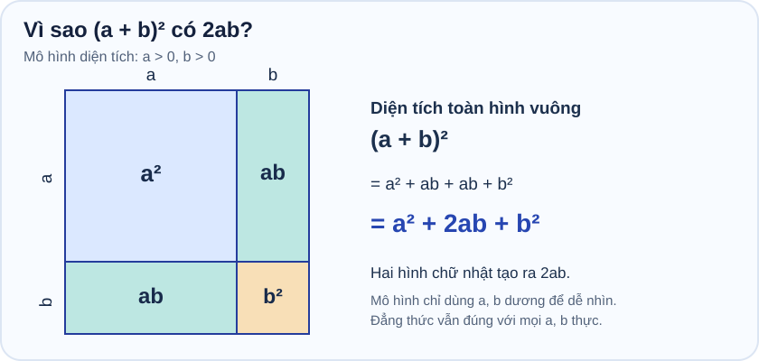

*Hình diện tích giải thích hai phần $ab$ khi $a,b>0$. Công thức đại số vẫn đúng với mọi số thực.*

**Cách đọc:** bình phương biểu thức thứ nhất + hai lần tích hai biểu thức + bình phương biểu thức thứ hai.

Ví dụ:

$$
(x+3)^2=x^2+6x+9
$$

Vì:

- `A = x`
- `B = 3`
- `2AB = 2·x·3 = 6x`

---

### 3.2. Bình phương của một hiệu

$$
(A-B)^2=A^2-2AB+B^2
$$

Ví dụ:

$$
(2x-5)^2=4x^2-20x+25
$$

> ⚠️ Hạng tử cuối vẫn là `+B²`, không phải `-B²`.

---

### 3.3. Hiệu hai bình phương

$$
A^2-B^2=(A-B)(A+B)
$$

Ví dụ:

$$
x^2-16=(x-4)(x+4)
$$

Đây là một trong những công thức quan trọng nhất khi học **phân tích đa thức thành nhân tử**.

---


### 3.4. Lập phương của một tổng

$$
(A+B)^3=A^3+3A^2B+3AB^2+B^3
$$

Ví dụ:

$$
(x+2)^3=x^3+6x^2+12x+8
$$

Một cách nhớ theo hệ số:

```text
1 – 3 – 3 – 1
```

---

### 3.5. Lập phương của một hiệu

$$
(A-B)^3=A^3-3A^2B+3AB^2-B^3
$$

Ví dụ:

$$
(x-2)^3=x^3-6x^2+12x-8
$$

Dấu của bốn hạng tử lần lượt là:

```text
+   −   +   −
```

---

### 3.6. Tổng hai lập phương

$$
A^3+B^3=(A+B)(A^2-AB+B^2)
$$

Ví dụ:

$$
x^3+8=x^3+2^3=(x+2)(x^2-2x+4)
$$

---

### 3.7. Hiệu hai lập phương

$$
A^3-B^3=(A-B)(A^2+AB+B^2)
$$

Ví dụ:

$$
8x^3-27=(2x)^3-3^3=(2x-3)(4x^2+6x+9)
$$

---

### 3.8. Bảng tổng hợp 7 công thức

| # | Hằng đẳng thức |
|---:|---|
| 1 | `(A + B)² = A² + 2AB + B²` |
| 2 | `(A − B)² = A² − 2AB + B²` |
| 3 | `A² − B² = (A − B)(A + B)` |
| 4 | `(A + B)³ = A³ + 3A²B + 3AB² + B³` |
| 5 | `(A − B)³ = A³ − 3A²B + 3AB² − B³` |
| 6 | `A³ + B³ = (A + B)(A² − AB + B²)` |
| 7 | `A³ − B³ = (A − B)(A² + AB + B²)` |

---

## 🔗 4. Kiến thức liên quan

### 4.1. Vì sao `(A+B)²` có hạng tử `2AB`?

Từ phép nhân đa thức:

$$
(A+B)^2=(A+B)(A+B)
$$

Khai triển:

$$
=A^2+AB+AB+B^2
$$

Do đó:

$$
=A^2+2AB+B^2
$$

Vì vậy:

> **Bình phương của một tổng không bằng tổng các bình phương.**

Sai:

$$
(A+B)^2=A^2+B^2
$$

Đúng:

$$
(A+B)^2=A^2+2AB+B^2
$$

### 4.2. Hằng đẳng thức dùng theo hai chiều

Cùng một hằng đẳng thức được dùng theo **hai chiều**. Khi khai triển, ta chuyển từ dạng tích sang tổng; khi nhận dạng, ta làm theo chiều ngược lại.

| **Chiều khai triển →** | **← Chiều nhận dạng / phân tích** |
|:---:|:---:|
| $(A+B)^2\rightarrow A^2+2AB+B^2$ | $A^2+2AB+B^2\rightarrow(A+B)^2$ |

**Điểm cần nhớ:** Học sinh cần thành thạo cả hai chiều; chỉ biết khai triển là chưa đủ.

<div class="math-composition"><nav class="math-related-practice" aria-label="Bài tập liên quan đến nội dung vừa học">
<span>Thực hành kiến thức này:</span>
<a href="../bai-tap/?mode=remediation&amp;focus=nhan-dang-hdt">Luyện ngay →</a>
<a href="../../../luyen-tap/tu-luan/?topic=CT05#wx05-idn-001">Làm tự luận · WX05-IDN-001 →</a>
</nav></div>

### 4.3. Kiến thức cần biết trước

- Phép nhân đơn thức và đa thức.
- Thu gọn hạng tử đồng dạng.
- Lũy thừa.
- Quy tắc dấu.

Xem lại [Chuyên đề 04 – Biểu thức và biến đổi đại số](../04-bieu-thuc-dai-so/index.md).

### 4.4. Kiến thức sẽ dùng tiếp

Hằng đẳng thức là công cụ trực tiếp cho:

- [Chuyên đề 06 – Phân tích đa thức thành nhân tử](../06-phan-tich-da-thuc/index.md)
- [Chuyên đề 07 – Phân thức đại số](../07-phan-thuc-dai-so/index.md)
- [Chuyên đề 08 – Phương trình và bất phương trình](../08-phuong-trinh-bat-phuong-trinh/index.md)

---

## 🧩 5. Các dạng bài cần nắm vững


### Dạng 1 – Khai triển bằng hằng đẳng thức

**Dấu hiệu nhận biết:** biểu thức có dạng bình phương hoặc lập phương của một tổng/hiệu.

**Phương pháp:**

1. Xác định `A`, `B`.
2. Chọn đúng công thức.
3. Thay vào từng thành phần.
4. Thu gọn nếu cần.

Ví dụ:

$$
(3x+2)^2
$$

Ta có `A = 3x`, `B = 2`:

$$
(3x+2)^2=9x^2+12x+4
$$

---

### Dạng 2 – Nhận dạng bình phương hoàn chỉnh

**Dấu hiệu:** biểu thức có ba hạng tử, trong đó:

- hạng tử đầu là một bình phương;
- hạng tử cuối là một bình phương;
- hạng tử giữa bằng `±2AB`.

Ví dụ:

$$
x^2+10x+25
$$

Ta có:

- `x² = A²`
- `25 = 5² = B²`
- `10x = 2·x·5`

Do đó:

$$
x^2+10x+25=(x+5)^2
$$

---

### Dạng 2A – Nhận diện hằng đẳng thức khi có hệ số phân số (mở rộng)

Khi $A$ hoặc $B$ là một phân số chứa biến, **cách nhận diện không đổi**: trước hết xác định hai bình phương ở hai đầu, sau đó kiểm tra hạng tử giữa có bằng $\pm2AB$ không.

**Ví dụ theo hai chiều:** Khai triển và phân tích trở lại $\left(\frac{x}{2}-1\right)^2$.

1. Chọn $A=x/2$, $B=1$.
2. Khai triển: $(A-B)^2=A^2-2AB+B^2$.
3. Suy ra $\left(\frac{x}{2}-1\right)^2=\frac{x^2}{4}-x+1$.
4. Đọc ngược: $\frac{x^2}{4}=(\frac{x}{2})^2$, $1=1^2$, hạng tử giữa $-x=-2\cdot\frac{x}{2}\cdot1$. Vậy $\frac{x^2}{4}-x+1=(\frac{x}{2}-1)^2$.

**Thử giá trị:** Với $x=2$, cả hai vế đều bằng 0. Đây là cách phát hiện nhanh lỗi quên nhân 2 trong hạng tử giữa, nhưng phép thử **không thay thế chứng minh bằng hằng đẳng thức**.

> Đừng bỏ ngoặc quanh $x/2$ khi bình phương: $(x/2)^2=x^2/4$, không phải $x^2/2$. Ví dụ này dùng để **hiểu cấu trúc và tự kiểm tra**, không phải thêm một hằng đẳng thức thứ tám.

### Dạng 3 – Phân tích hiệu hai bình phương

**Dấu hiệu:** hai hạng tử đều là bình phương và ở giữa là dấu trừ.

Ví dụ:

$$
9x^2-25=(3x)^2-5^2=(3x-5)(3x+5)
$$

> `A² + B²` không có công thức phân tích tương tự trong 7 hằng đẳng thức.

---

### Dạng 4 – Tổng hoặc hiệu hai lập phương

**Dấu hiệu:** hai hạng tử đều viết được dưới dạng lập phương.

Ví dụ:

$$
27x^3+8=(3x)^3+2^3
$$

Suy ra:

$$
27x^3+8=(3x+2)(9x^2-6x+4)
$$

---

### Dạng 5 – Tính nhanh

**Dấu hiệu:** các số gần số tròn chục, tròn trăm hoặc tạo được cấu trúc hằng đẳng thức.

Ví dụ:

$$
99^2=(100-1)^2
$$

$$
=10000-200+1=9801
$$

Ví dụ khác:

$$
103·97=(100+3)(100-3)=100^2-3^2=9991
$$

---

### Dạng 6 – Rút gọn biểu thức

Ví dụ:

$$
A=(x+2)^2-(x-2)^2
$$

Khai triển:

$$
A=(x^2+4x+4)-(x^2-4x+4)=8x
$$

Có thể nhìn nhanh hơn bằng hiệu hai bình phương:

$$
A=[(x+2)-(x-2)][(x+2)+(x-2)]=4·2x=8x
$$

---

### Dạng 7 – Chứng minh đẳng thức

**Nguyên tắc:** biến đổi một vế về vế còn lại, hoặc biến đổi cả hai vế về cùng một biểu thức bằng các phép biến đổi tương đương.

> Cần phân biệt **hằng đẳng thức** với **phương trình**: hằng đẳng thức đúng với mọi giá trị thích hợp của biến, còn phương trình chỉ đúng với những giá trị thỏa mãn nó.

Ví dụ, chứng minh:

$$
(a+b)^2+(a-b)^2=2a^2+2b^2
$$

Ta có:

$$
(a+b)^2+(a-b)^2
$$

$$
=a^2+2ab+b^2+a^2-2ab+b^2
$$

$$
=2a^2+2b^2
$$

---

### Dạng 8 – Tìm giá trị chưa biết nhờ cấu trúc

Ví dụ:

Cho `x + y = 10`, `xy = 21`. Tính `x² + y²`.

Từ:

$$
(x+y)^2=x^2+2xy+y^2
$$

Suy ra:

$$
x^2+y^2=(x+y)^2-2xy=100-42=58
$$

---

## 🚀 6. Dạng bài thi vào lớp 10

| Dạng | Mức ưu tiên Roadmap | Vai trò |
|---|:---:|---|
| Khai triển và thu gọn | ⭐⭐⭐⭐ | Kỹ năng nền |
| Phân tích bằng hiệu hai bình phương | ⭐⭐⭐⭐⭐ | Rất quan trọng cho biến đổi đại số |
| Nhận dạng bình phương hoàn chỉnh | ⭐⭐⭐⭐⭐ | Dùng trong rút gọn, phương trình, bất đẳng thức |
| Tổng/hiệu hai lập phương | ⭐⭐⭐⭐ | Công cụ quan trọng khi phân tích đa thức |
| Rút gọn biểu thức nhiều bước | ⭐⭐⭐⭐⭐ | Kết nối với phân thức và căn thức |
| Tính nhanh / biến đổi thông minh | ⭐⭐⭐ | Rèn nhận dạng cấu trúc |
| Chứng minh đẳng thức | ⭐⭐⭐⭐ | Kiểm tra năng lực biến đổi |

> Mức sao thể hiện **mức ưu tiên ôn tập trong Roadmap**, không phải cam kết dạng bài xuất hiện trong mọi đề thi.

---

## ⚠️ 7. Lỗi sai thường gặp

### ❌ Lỗi 1 – Bình phương của tổng thành tổng bình phương

Sai:

$$
(a+b)^2=a^2+b^2
$$

Đúng:

$$
(a+b)^2=a^2+2ab+b^2
$$

**Cách tự kiểm tra:** thử `a = b = 1`. Vế trái bằng `4`, còn biểu thức sai chỉ bằng `2`.

---

### ❌ Lỗi 2 – Sai dấu ở `(A-B)²`

Sai:

$$
(A-B)^2=A^2-2AB-B^2
$$

Đúng:

$$
(A-B)^2=A^2-2AB+B^2
$$

Vì `(-B)² = B²`.

---

### ❌ Lỗi 3 – Nhầm công thức tổng hai lập phương

Sai:

$$
A^3+B^3=(A+B)(A^2+AB+B^2)
$$

Đúng:

$$
A^3+B^3=(A+B)(A^2-AB+B^2)
$$

Mẹo kiểm tra: nhân ngược lại để xem hai hạng tử giữa có triệt tiêu hay không.

---

### ❌ Lỗi 4 – Nhìn thấy hai số chính phương là áp dụng hiệu hai bình phương

Công thức:

$$
A^2-B^2=(A-B)(A+B)
$$

chỉ dùng cho **hiệu**, không dùng trực tiếp cho `A² + B²`.

---

### ❌ Lỗi 5 – Không đặt ngoặc khi `A` hoặc `B` là biểu thức

Nếu `A = 2x`, thì:

$$
A^2=(2x)^2=4x^2
$$

không phải `2x²`.

---

### ❌ Lỗi 6 – Học thuộc công thức nhưng không nhận dạng được

Ví dụ:

$$
4x^2+12xy+9y^2
$$

Phải nhìn ra:

- `4x² = (2x)²`
- `9y² = (3y)²`
- `12xy = 2·2x·3y`

nên:

$$
4x^2+12xy+9y^2=(2x+3y)^2
$$

---

## 📝 8. Luyện tập tiếp theo

Micro-practice trong các Learning Cards dùng để kiểm tra nhanh ngay sau khi học. Khi muốn luyện sâu hơn, luyện từng skill hoặc làm bài tự luận, hãy chuyển sang **Practice Room**.

[🎯 Mở Practice Room – Chuyên đề 05](bai-tap.md){ .md-button .md-button--primary }

Trong Practice Room:

- **Luyện nhanh tương tác:** Practice Engine chọn câu từ ngân hàng lớn, có feedback, gợi ý và Tutor.
- **Luyện tự luận & trình bày:** tự giải trên giấy/vở rồi mở gợi ý hoặc lời giải để tự đối chiếu.
- Core / Entrance10 / Challenge được tách rõ.

!!! info "Phân biệt mục đích"
    Micro-practice kiểm tra hiểu ngay; Practice Room dùng để **rèn kỹ năng**. Kết quả luyện tập là formative evidence, không phải điểm kiểm tra cuối chuyên đề.

---

## ✅ 9. Tự kiểm tra mức độ sẵn sàng

Khi đã luyện tương đối chắc, hãy làm **Core Readiness Check**.

[✅ Bắt đầu Core Readiness Check](tu-kiem-tra.md){ .md-button .md-button--primary }

Trong Readiness Check:

- không hint và không Tutor khi đang làm;
- không báo đúng/sai từng câu;
- chỉ chấm sau khi bấm **Nộp bài**;
- kết quả phân tích theo assessed skill;
- là **Soft Mastery**: không khóa chuyên đề tiếp theo;
- Entrance10 / Challenge không tính vào Core readiness.

---

## 🔄 10. Liên kết Roadmap

```text
04. Biểu thức và biến đổi đại số
                 │
                 ↓
       05. 7 HẰNG ĐẲNG THỨC
                 │
          ┌──────┴──────┐
          ↓             ↓
06. Phân tích       07. Phân thức
    đa thức             đại số
          └──────┬──────┘
                 ↓
08. Phương trình và bất phương trình
```

- **← Trước:** [04. Biểu thức và biến đổi đại số](../04-bieu-thuc-dai-so/index.md)
- **→ Tiếp theo:** [06. Phân tích đa thức thành nhân tử](../06-phan-tich-da-thuc/index.md)
- **Liên hệ:** [07. Phân thức đại số](../07-phan-thuc-dai-so/index.md)
- **Ứng dụng tiếp:** [08. Phương trình và bất phương trình](../08-phuong-trinh-bat-phuong-trinh/index.md)

Xem toàn bộ hệ thống tại [Blueprint 25 chuyên đề](../../roadmap/blueprint-25-chuyen-de.md).

---

## 🏁 11. Điều kiện hoàn thành

Chuyên đề được xem là **đủ sẵn sàng để học tiếp** khi học sinh có phần lớn các bằng chứng sau:

- [ ] Hiểu và giải thích được các quy tắc Core của chuyên đề.
- [ ] Làm tương đối ổn định các skill Core trong Practice Room.
- [ ] Không lặp lại ổn định cùng một lỗi nền tảng sau khi đã được chữa.
- [ ] Core Readiness Check đạt khoảng **80%** hoặc học sinh đã hiểu và chữa được các lỗi còn lại.
- [ ] Có thể trình bày ít nhất một số bài tự luận Core mà không mở lời giải trước.

!!! note "Soft Mastery"
    Không cần đạt 100% mới được học tiếp. Nếu Readiness Check cho thấy một vài kỹ năng còn yếu, hệ thống khuyến nghị luyện lại đúng kỹ năng đó; học sinh vẫn có thể chuyển sang chuyên đề tiếp theo.

!!! warning "Core độc lập Extension"
    Entrance10 và Specialized-Challenge không phải điều kiện để hoàn thành KNTT Core.

---

## ➡️ Tiếp tục học

<div class="topic-workspace-actions" markdown>

[🎯 Sang Phòng Luyện Tập](bai-tap.md){ .md-button .md-button--primary }

[✅ Kiểm Tra Độ Sẵn Sàng](tu-kiem-tra.md){ .md-button }

[→ 06 – Phân tích đa thức thành nhân tử](../06-phan-tich-da-thuc/index.md){ .md-button }

</div>
`````

### CT14 — official reviewed source, unchanged main index.md

- Topic: `14-tam-giac`
- Source path: `docs/kien-thuc/14-tam-giac/index.md`
- Git blob SHA: `f9fae782453f7126b39f123d728188d49787c149`
- **AUTHORITY: official current project lesson; not a new S1 source in itself.**

`````markdown
# Chuyên đề 14 – Tam giác


> **Trạng thái:** Đã kiểm định nội dung học thuật; cấu trúc Roadmap chuẩn 11 mục.
>
> **Lớp trọng tâm:** 7
> **Mạch kiến thức:** Hình học
> **Mức ưu tiên:** ⭐⭐⭐⭐⭐

> **Vai trò trong Roadmap:** nền tảng trung tâm của Hình học THCS, nối trực tiếp từ Chuyên đề 13 sang các chuyên đề 15, 17, 18 và 19.
>

---

## 🧭 1. Bản đồ kiến thức

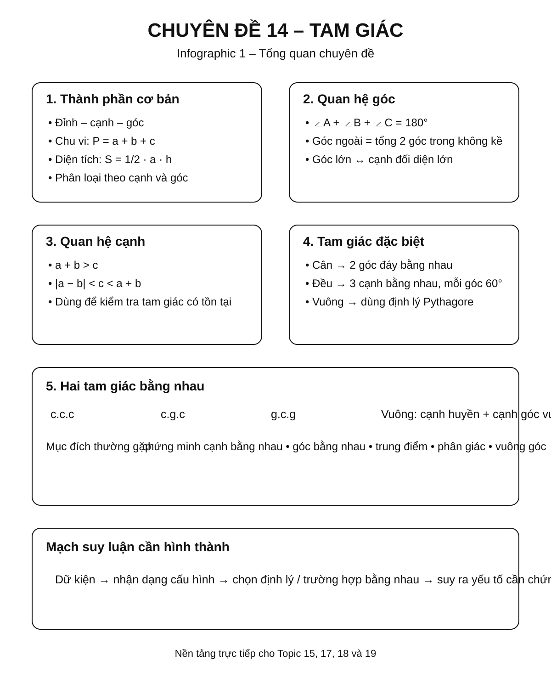

> **Xem nhanh:** dùng infographic để nhìn toàn cảnh các mạch góc, cạnh, tam giác đặc biệt và hai tam giác bằng nhau trước khi học chi tiết.

```text
TAM GIÁC
│
├── 1. Thành phần cơ bản
│   ├── Đỉnh – cạnh – góc
│   ├── Chu vi – diện tích
│   └── Phân loại tam giác
│
├── 2. Quan hệ góc
│   ├── Tổng ba góc bằng 180°
│   ├── Góc ngoài
│   └── So sánh góc – cạnh
│
├── 3. Quan hệ cạnh
│   ├── Bất đẳng thức tam giác
│   ├── So sánh cạnh – góc đối diện
│   └── Điều kiện tồn tại tam giác
│
├── 4. Tam giác đặc biệt
│   ├── Tam giác cân
│   ├── Tam giác đều
│   └── Tam giác vuông
│
└── 5. Hai tam giác bằng nhau
    ├── c.c.c
    ├── c.g.c
    ├── g.c.g
    └── Trường hợp tam giác vuông
```

---

### Minh họa trực quan

#### 1. Tam giác cân

<p align="center">
  
</p>

> Trong tam giác cân, hai góc ở đáy bằng nhau. Đặc biệt, **đường trung tuyến kẻ từ đỉnh cân xuống đáy** đồng thời là đường cao và đường phân giác của góc ở đỉnh.

#### 2. Định lý Pythagore

<p align="center">
  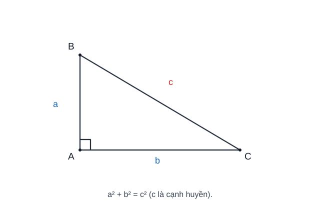
</p>

> Với tam giác `ABC` vuông tại `A`, cạnh huyền là `BC` và định lý Pythagore cho: `BC² = AB² + AC²`.

---

## 🎯 2. Mục tiêu cần đạt

Sau khi hoàn thành chuyên đề, học sinh cần:

- [ ] Nhận biết và phân loại được các loại tam giác.
- [ ] Sử dụng thành thạo tổng ba góc trong tam giác và góc ngoài.
- [ ] Hiểu và áp dụng bất đẳng thức tam giác.
- [ ] Biết so sánh cạnh dựa vào góc và ngược lại.
- [ ] Nắm chắc tính chất và dấu hiệu nhận biết tam giác cân, đều, vuông.
- [ ] Nhận dạng đúng các trường hợp bằng nhau của hai tam giác.
- [ ] Biết chọn cặp tam giác thích hợp để chứng minh hai đoạn thẳng hoặc hai góc bằng nhau.
- [ ] Trình bày được một chứng minh hình học theo chuỗi giả thiết → lập luận → kết luận.

---

## 📖 3. Kiến thức cốt lõi

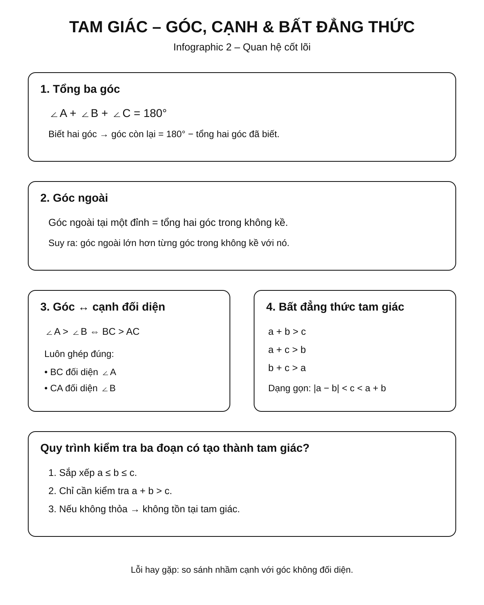

> Infographic này tóm tắt ba công cụ nền: tổng góc, quan hệ cạnh–góc đối diện và điều kiện tồn tại tam giác.

### 3.1. Tam giác và ký hiệu

Tam giác `ABC` được tạo bởi ba điểm `A, B, C` không thẳng hàng và ba đoạn thẳng:

- `AB`
- `BC`
- `CA`

Ba góc tương ứng là:

- `∠A = ∠BAC`
- `∠B = ∠ABC`
- `∠C = ∠ACB`

Chu vi:

`P = AB + BC + CA`

Diện tích:

`S = 1/2 · a · h`

trong đó `a` là độ dài đáy và `h` là chiều cao tương ứng.

---

### 3.2. Phân loại tam giác

#### Theo cạnh

- **Tam giác thường:** ba cạnh không có quan hệ đặc biệt.
- **Tam giác cân:** có hai cạnh bằng nhau.
- **Tam giác đều:** có ba cạnh bằng nhau.

#### Theo góc

- **Tam giác nhọn:** ba góc đều nhỏ hơn `90°`.
- **Tam giác vuông:** có một góc bằng `90°`.
- **Tam giác tù:** có một góc lớn hơn `90°`.

> Một tam giác không thể có hai góc vuông hoặc hai góc tù vì tổng ba góc chỉ bằng `180°`.

---

### 3.3. Tổng ba góc trong tam giác

Với mọi tam giác `ABC`:

`∠A + ∠B + ∠C = 180°`

#### Ví dụ

Nếu `∠A = 50°`, `∠B = 60°` thì:

`∠C = 180° - 50° - 60° = 70°`

---

### 3.4. Góc ngoài của tam giác

Góc ngoài tại một đỉnh bằng tổng hai góc trong không kề với nó.

Ví dụ, kéo dài `BC` qua `C` đến `D`:

`∠ACD = ∠A + ∠B`

Do đó góc ngoài luôn lớn hơn mỗi góc trong không kề với nó.

---

### 3.5. Quan hệ giữa cạnh và góc đối diện

Trong một tam giác:

- Góc lớn hơn đối diện cạnh lớn hơn.
- Cạnh lớn hơn đối diện góc lớn hơn.

Ví dụ:

Nếu `∠A > ∠B` thì `BC > AC`.

Ngược lại, nếu `BC > AC` thì `∠A > ∠B`.

> ⚠️ Khi so sánh phải ghép **đúng cạnh với góc đối diện**.

---

### 3.6. Bất đẳng thức tam giác

Trong một tam giác, tổng độ dài hai cạnh bất kỳ lớn hơn cạnh còn lại:

`AB + AC > BC`

`AB + BC > AC`

`AC + BC > AB`

Tương đương, nếu ba độ dài là `a, b, c`, điều kiện tồn tại tam giác có thể viết gọn:

`|a - b| < c < a + b`

#### Ví dụ

Ba đoạn `3 cm, 4 cm, 8 cm` không lập thành tam giác vì:

`3 + 4 < 8`

---

### 3.6A. Đường vuông góc, đường xiên và đường trung trực

Từ điểm \(A\) ngoài đường thẳng \(d\), nếu \(AH\perp d\) và \(B\in d, B\ne H\), thì:

\[
AH<AB.
\]

Nói cách khác, đoạn vuông góc là đoạn ngắn nhất từ một điểm đến một đường thẳng.

**Đường trung trực** của đoạn \(AB\) là đường thẳng vuông góc với \(AB\) tại trung điểm của \(AB\).

Tính chất hai chiều:

- nếu \(P\) nằm trên trung trực \(AB\) thì \(PA=PB\);
- nếu \(PA=PB\) thì \(P\) nằm trên trung trực \(AB\).

> Đây là Core lớp 7; không được thay bằng việc nhìn hình thấy hai đoạn “có vẻ bằng nhau”.

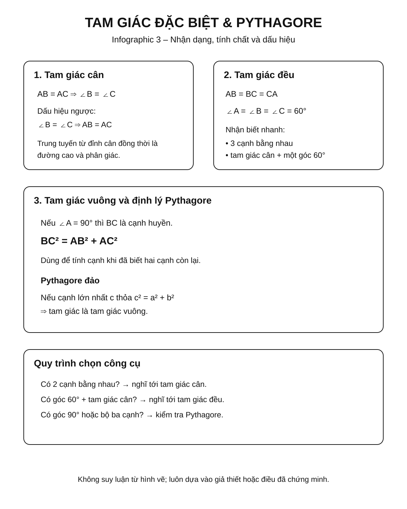

> Dùng bản này để phân biệt nhanh tam giác cân, đều, vuông và hai chiều của định lý Pythagore.

### 3.7. Tam giác đặc biệt

#### Tam giác cân

Tam giác `ABC` cân tại `A` nếu:

`AB = AC`

Khi đó:

`∠B = ∠C`

Nếu `M` là trung điểm của đáy `BC` thì trong tam giác cân tại `A`, đường trung tuyến `AM` đồng thời là đường cao và đường phân giác:

`AM ⟂ BC`

và:

`∠BAM = ∠MAC`

##### Dấu hiệu nhận biết

Nếu trong một tam giác có hai góc bằng nhau thì tam giác đó cân.

Tức là:

`∠B = ∠C ⇒ AB = AC`

---

#### Tam giác đều

Tam giác đều có ba cạnh bằng nhau:

`AB = BC = CA`

Suy ra:

`∠A = ∠B = ∠C = 60°`

##### Dấu hiệu thường dùng

- Ba cạnh bằng nhau.
- Ba góc bằng nhau.
- Một tam giác cân có một góc bằng `60°` thì là tam giác đều.

---

#### Tam giác vuông

Tam giác vuông có một góc bằng `90°`.

Nếu `∠A = 90°` thì:

- `BC` là cạnh huyền.
- `AB`, `AC` là hai cạnh góc vuông.

> **Core-Support / kết nối CĐ18:** Pythagore được giữ trên trang này như kiến thức liên hệ, nhưng không tính vào Core Readiness CĐ14 theo mapping KNTT hiện tại.

##### Định lý Pythagore

Trong tam giác vuông:

`BC² = AB² + AC²`

##### Định lý Pythagore đảo

Nếu một tam giác có:

`BC² = AB² + AC²`

thì tam giác vuông tại `A`.

##### Ví dụ

Tam giác có các cạnh `3, 4, 5` là tam giác vuông vì:

`3² + 4² = 5²`

---

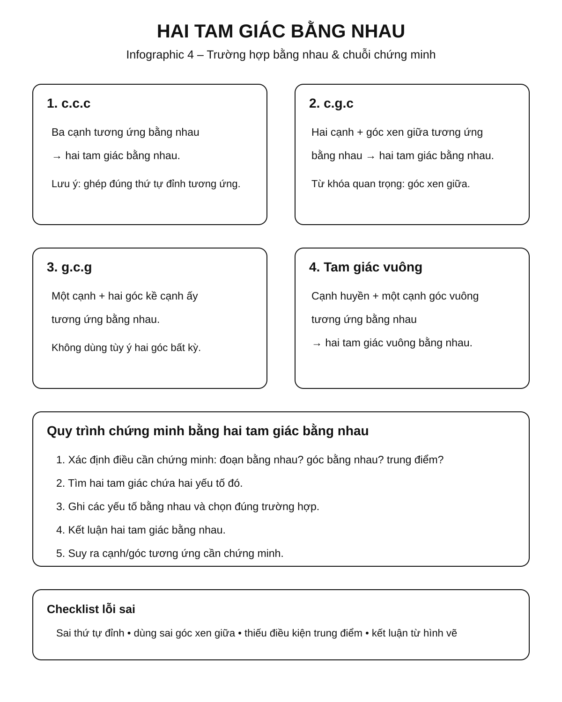

> Trước khi chứng minh, hãy xác định cặp tam giác chứa hai yếu tố cần so sánh rồi chọn đúng trường hợp bằng nhau.

### 3.8. Hai tam giác bằng nhau

Hai tam giác bằng nhau khi các cạnh và góc tương ứng bằng nhau.

Ký hiệu:

`ΔABC = ΔDEF`

thì thứ tự chữ cái phải thể hiện đúng sự tương ứng:

- `A ↔ D`
- `B ↔ E`
- `C ↔ F`

---

### 3.8A. Thứ tự đỉnh tương ứng

Khi viết \(\triangle ABC=\triangle DEF\), thứ tự chữ phải biểu diễn đúng:

\[
A\leftrightarrow D,\quad B\leftrightarrow E,\quad C\leftrightarrow F.
\]

Từ đó mới suy ra đúng các cạnh/góc tương ứng. Viết sai thứ tự có thể làm toàn bộ phần suy luận sau sai dù tiêu chuẩn bằng nhau được chọn đúng.

#### Trường hợp cạnh – cạnh – cạnh (c.c.c)

Nếu ba cạnh của tam giác này lần lượt bằng ba cạnh của tam giác kia thì hai tam giác bằng nhau.

`AB = DE`

`BC = EF`

`CA = FD`

⇒ `ΔABC = ΔDEF`

---

#### Trường hợp cạnh – góc – cạnh (c.g.c)

Nếu hai cạnh và góc xen giữa của tam giác này lần lượt bằng hai cạnh và góc xen giữa của tam giác kia thì hai tam giác bằng nhau.

> Từ khóa quan trọng: **góc xen giữa**.

---

#### Trường hợp góc – cạnh – góc (g.c.g)

Nếu một cạnh và hai góc kề cạnh ấy của tam giác này lần lượt bằng một cạnh và hai góc kề cạnh tương ứng của tam giác kia thì hai tam giác bằng nhau.

---

#### Trường hợp tam giác vuông

Một trường hợp quan trọng:

Hai tam giác vuông có cạnh huyền và một cạnh góc vuông tương ứng bằng nhau thì bằng nhau.

Đây là công cụ rất hay dùng trong các bài chứng minh trung điểm, phân giác và vuông góc.

---

#### Hai trường hợp thường dùng thêm cho tam giác vuông

Xét hai tam giác `ABC`, `DEF` **vuông lần lượt tại `A` và `D`**. Ngoài trường hợp cạnh huyền – cạnh góc vuông đã học, có hai cách nhận biết thuận tiện:

> **Gợi ý tự phác hình:** Vẽ riêng hai tam giác vuông `ABC` và `DEF`, đánh dấu góc vuông tại `A`, `D`. Với **cạnh huyền – góc nhọn**, đánh dấu `BC = EF` và `∠B = ∠E`. Với **cạnh góc vuông – góc nhọn kề**, dùng một hình khác và đánh dấu `AB = DE` cùng `∠B = ∠E`. **Chỉ đánh dấu dữ kiện của từng trường hợp**, không gộp cả hai bộ điều kiện lên một hình.

| Dữ kiện tương ứng | Vì sao đủ để kết luận bằng nhau? |
|---|---|
| `BC = EF` (cạnh huyền) và `∠B = ∠E` (góc nhọn) | Hai góc vuông đã bằng nhau; thêm một góc nhọn và cạnh huyền tương ứng xác định được hai tam giác bằng nhau |
| `AB = DE` (cạnh góc vuông) và `∠B = ∠E` (góc nhọn kề cạnh ấy) | `∠A = ∠D = 90°`, `∠B = ∠E`, cạnh `AB` nằm giữa hai góc tương ứng ⇒ áp dụng `g.c.g` |

**Ví dụ chọn dấu hiệu.** Hai tam giác vuông có `BC = EF` và `∠B = ∠E` thì bằng nhau theo **cạnh huyền – góc nhọn**, không cần đo thêm cạnh góc vuông còn lại. Kết luận theo đúng đỉnh tương ứng: `ΔABC = ΔDEF`.

**Tự kiểm tra:** Có xác nhận hai góc vuông không? Cạnh và góc nhọn được ghép **đúng vị trí tương ứng** chưa? Không kết luận bằng nhau chỉ vì hình vẽ trông giống nhau.

---

## 🔗 4. Kiến thức liên quan

### Kiến thức cần trước

- [13. Góc và quan hệ giữa các đường thẳng](../13-goc-va-duong-thang/index.md)

Học sinh cần chắc:

- góc đối đỉnh;
- góc kề bù;
- song song;
- vuông góc;
- so le trong, đồng vị.

### Kiến thức sử dụng tiếp

- [15. Các đường đồng quy trong tam giác](../15-duong-dong-quy/index.md)
- [17. Định lý Thales và tam giác đồng dạng](../17-thales-dong-dang/index.md)
- [18. Hệ thức lượng trong tam giác vuông](../18-he-thuc-luong/index.md)
- [19. Đường tròn](../19-duong-tron/index.md)

---

## 🧩 5. Các dạng bài cần nắm vững

### Dạng 1 – Tính góc trong tam giác

#### Dấu hiệu

Biết hai góc, hoặc biết quan hệ giữa các góc.

#### Phương pháp

Dùng:

`∠A + ∠B + ∠C = 180°`

#### Ví dụ

Tam giác `ABC` có:

`∠A = 2∠B`, `∠C = 60°`.

Ta có:

`2∠B + ∠B + 60° = 180°`

`3∠B = 120°`

`∠B = 40°`

`∠A = 80°`

---

### Dạng 2 – Tính góc ngoài

Dùng một trong hai cách:

- góc ngoài + góc trong kề = `180°`;
- góc ngoài = tổng hai góc trong không kề.

---

### Dạng 3 – Kiểm tra ba đoạn có tạo thành tam giác không

Sắp xếp `a ≤ b ≤ c`, chỉ cần kiểm tra:

`a + b > c`

Nếu không thỏa, không tồn tại tam giác.

---

### Dạng 4 – Tìm khoảng giá trị của một cạnh

Nếu biết hai cạnh `a, b`, cạnh thứ ba `x` phải thỏa:

`|a - b| < x < a + b`

Ví dụ với hai cạnh `5` và `8`:

`3 < x < 13`

---

### Dạng 5 – So sánh cạnh và góc

Muốn so sánh cạnh → tìm góc đối diện.

Muốn so sánh góc → tìm cạnh đối diện.

---

### Dạng 6 – Nhận biết tam giác cân hoặc đều

#### Chứng minh tam giác cân

Có thể chứng minh:

- hai cạnh bằng nhau;
- hoặc hai góc bằng nhau.

#### Chứng minh tam giác đều

Có thể chứng minh:

- ba cạnh bằng nhau;
- ba góc bằng nhau;
- tam giác cân và có một góc `60°`.

---

### Dạng 7 – Dùng Pythagore

#### Tính cạnh

Nếu vuông tại `A`:

`BC² = AB² + AC²`

#### Nhận biết tam giác vuông

Nếu cạnh lớn nhất là `c` và:

`c² = a² + b²`

thì tam giác vuông.

---

### Dạng 8 – Chứng minh hai tam giác bằng nhau

Quy trình:

1. Chọn đúng hai tam giác cần xét.
2. Ghi các yếu tố đã biết bằng nhau.
3. Nhận dạng trường hợp bằng nhau.
4. Kết luận hai tam giác bằng nhau.
5. Suy ra cặp cạnh/góc cần chứng minh.

#### Mẹo quan trọng

Nếu cần chứng minh `AM = AN`, hãy tìm hai tam giác chứa `AM` và `AN` rồi thử chứng minh chúng bằng nhau.

---

### Dạng 9 – Chứng minh trung điểm

Muốn chứng minh `M` là trung điểm của `AB`, cần hai điều kiện:

1. `M ∈ AB`
2. `MA = MB`

Không được chỉ chứng minh `MA = MB`.

---

### Dạng 10 – Chứng minh phân giác hoặc vuông góc

Thường dùng hai tam giác bằng nhau để suy ra:

- hai góc bằng nhau → tia phân giác;
- hai góc kề bù bằng nhau → mỗi góc `90°` → vuông góc.

---

## 🚀 6. Dạng bài thi vào lớp 10

| Dạng | Mức ưu tiên |
|---|:---:|
| Tính góc từ quan hệ hình học | ⭐⭐⭐⭐ |
| Tam giác cân – tam giác đều | ⭐⭐⭐⭐ |
| Hai tam giác bằng nhau | ⭐⭐⭐⭐⭐ |
| Chứng minh đoạn thẳng bằng nhau | ⭐⭐⭐⭐⭐ |
| Chứng minh góc bằng nhau | ⭐⭐⭐⭐⭐ |
| Pythagore và tam giác vuông | ⭐⭐⭐⭐⭐ |
| Kết hợp tam giác với đường tròn | ⭐⭐⭐⭐⭐ |
| Kết hợp tam giác với đồng dạng | ⭐⭐⭐⭐⭐ |

Trong Roadmap ôn thi vào lớp 10, kiến thức tam giác được xem là nền tảng để xử lý nhiều chuỗi chứng minh kết hợp với các chuyên đề hình học khác.

---

## ⚠️ 7. Lỗi sai thường gặp

#### ❌ Lỗi 1 – Ghép sai cạnh và góc đối diện

Trong `ΔABC`:

- cạnh `BC` đối diện `∠A`;
- cạnh `CA` đối diện `∠B`;
- cạnh `AB` đối diện `∠C`.

---

#### ❌ Lỗi 2 – Dùng bất đẳng thức tam giác thiếu điều kiện

Không được chỉ kiểm tra một tổng bất kỳ nếu chưa xác định cạnh lớn nhất.

---

#### ❌ Lỗi 3 – Dùng c.g.c nhưng góc không xen giữa

Hai cạnh và một góc bất kỳ chưa đủ để kết luận hai tam giác bằng nhau.

---

#### ❌ Lỗi 4 – Viết sai thứ tự hai tam giác bằng nhau

Nếu `A ↔ D`, `B ↔ E`, `C ↔ F` thì phải viết:

`ΔABC = ΔDEF`

Thứ tự sai sẽ dẫn đến suy luận cạnh/góc tương ứng sai.

---

#### ❌ Lỗi 5 – Quên điều kiện thuộc đoạn khi chứng minh trung điểm

`MA = MB` chưa đủ để kết luận `M` là trung điểm của `AB`.

---

#### ❌ Lỗi 6 – Dùng Pythagore cho tam giác chưa chứng minh vuông

Định lý Pythagore chỉ được dùng sau khi biết tam giác vuông.

---

## 📝 8. Luyện tập tiếp theo

Micro-practice trong Learning Cards kiểm tra nhanh ngay sau khi học. Luyện sâu tại **Practice Room**.

[🎯 Mở Practice Room](bai-tap.md){ .md-button .md-button--primary }

!!! info "Geometry Architecture v1"
    Hình vẽ chỉ minh họa; mọi quan hệ dùng trong lời giải phải đến từ giả thiết, dựng hình hợp lệ hoặc bước đã chứng minh.

## ✅ 9. Tự kiểm tra mức độ sẵn sàng

[✅ Bắt đầu Core Readiness Check](tu-kiem-tra.md){ .md-button .md-button--primary }

Readiness chỉ tính KNTT Core, chấm sau khi nộp và dùng Soft Mastery.

## 🔄 10. Liên kết Roadmap

- **← Trước:** [13. Góc và quan hệ giữa các đường thẳng](../13-goc-va-duong-thang/index.md)
- **→ Tiếp theo:** [15. Các đường đồng quy trong tam giác](../15-duong-dong-quy/index.md)
- **→ Liên hệ mạnh:** [17. Định lý Thales và tam giác đồng dạng](../17-thales-dong-dang/index.md)
- **→ Liên hệ mạnh:** [18. Hệ thức lượng trong tam giác vuông](../18-he-thuc-luong/index.md)

- **✏️ Luyện tập:** [Bài tập Chuyên đề 14](bai-tap.md)
- **✅ Tự kiểm tra:** [Tự kiểm tra Chuyên đề 14](tu-kiem-tra.md)

Xem toàn bộ hệ thống tại [Blueprint 25 chuyên đề](../../roadmap/blueprint-25-chuyen-de.md).

---

## 🏁 11. Điều kiện hoàn thành

- [ ] Nắm chắc tổng góc, cạnh–góc và bất đẳng thức tam giác.
- [ ] Biết đường vuông góc ngắn hơn đường xiên.
- [ ] Dùng đúng hai chiều của tính chất đường trung trực.
- [ ] Viết đúng thứ tự đỉnh tương ứng khi chứng minh hai tam giác bằng nhau.
- [ ] Dùng đúng c.c.c, c.g.c, g.c.g và trường hợp tam giác vuông.
- [ ] Core Readiness đạt khoảng **80%** hoặc đã chữa hiểu các lỗi còn lại.

!!! note "Soft Mastery"
    Không cần đạt 100% mới được học tiếp.

[🎯 Practice Room](bai-tap.md){ .md-button .md-button--primary }
[✅ Core Readiness](tu-kiem-tra.md){ .md-button }
[→ 15 – Các đường đồng quy](../15-duong-dong-quy/index.md){ .md-button }
`````

### CT14 — design-only R3 candidate, NOT published

- Topic: `14-tam-giac`
- Candidate path: `docs/kien-thuc/14-tam-giac/preview-composition-r3.md` in PR #574
- Git blob SHA: `236b987f1dd1c905174df9bd09edbbfe60f22885`
- **AUTHORITY: proposed authoring change only, must be reviewed against source above.**

`````markdown
> **BẢN THỬ BỐ CỤC R3 · CHƯA PHÁT HÀNH:** Chỉ thay đổi cách trình bày một phần ngắn; các kiến thức còn lại giữ theo nguồn chính thức.

<link rel="stylesheet" href="../../../assets/stylesheets/math-knowledge-composition-v1.css">

# Chuyên đề 14 – Tam giác


> **Trạng thái:** Đã kiểm định nội dung học thuật; cấu trúc Roadmap chuẩn 11 mục.
>
> **Lớp trọng tâm:** 7
> **Mạch kiến thức:** Hình học
> **Mức ưu tiên:** ⭐⭐⭐⭐⭐

> **Vai trò trong Roadmap:** nền tảng trung tâm của Hình học THCS, nối trực tiếp từ Chuyên đề 13 sang các chuyên đề 15, 17, 18 và 19.
>

---

## 🧭 1. Bản đồ kiến thức

> **Bản đồ dưới đây:** cho thấy mạch kiến thức từ cạnh, góc đến các tính chất và chứng minh bằng nhau.

```text
TAM GIÁC
│
├── 1. Thành phần cơ bản
│   ├── Đỉnh – cạnh – góc
│   ├── Chu vi – diện tích
│   └── Phân loại tam giác
│
├── 2. Quan hệ góc
│   ├── Tổng ba góc bằng 180°
│   ├── Góc ngoài
│   └── So sánh góc – cạnh
│
├── 3. Quan hệ cạnh
│   ├── Bất đẳng thức tam giác
│   ├── So sánh cạnh – góc đối diện
│   └── Điều kiện tồn tại tam giác
│
├── 4. Tam giác đặc biệt
│   ├── Tam giác cân
│   ├── Tam giác đều
│   └── Tam giác vuông
│
└── 5. Hai tam giác bằng nhau
    ├── c.c.c
    ├── c.g.c
    ├── g.c.g
    └── Trường hợp tam giác vuông
```

---

### Minh họa trực quan

#### 1. Tam giác cân

<p align="center">
  
</p>

> Trong tam giác cân, hai góc ở đáy bằng nhau. Đặc biệt, **đường trung tuyến kẻ từ đỉnh cân xuống đáy** đồng thời là đường cao và đường phân giác của góc ở đỉnh.

#### 2. Định lý Pythagore

<p align="center">
  
</p>

> Với tam giác `ABC` vuông tại `A`, cạnh huyền là `BC` và định lý Pythagore cho: `BC² = AB² + AC²`.

---

## 🎯 2. Mục tiêu cần đạt

Sau khi hoàn thành chuyên đề, học sinh cần:

- [ ] Nhận biết và phân loại được các loại tam giác.
- [ ] Sử dụng thành thạo tổng ba góc trong tam giác và góc ngoài.
- [ ] Hiểu và áp dụng bất đẳng thức tam giác.
- [ ] Biết so sánh cạnh dựa vào góc và ngược lại.
- [ ] Nắm chắc tính chất và dấu hiệu nhận biết tam giác cân, đều, vuông.
- [ ] Nhận dạng đúng các trường hợp bằng nhau của hai tam giác.
- [ ] Biết chọn cặp tam giác thích hợp để chứng minh hai đoạn thẳng hoặc hai góc bằng nhau.
- [ ] Trình bày được một chứng minh hình học theo chuỗi giả thiết → lập luận → kết luận.

---

## 📖 3. Kiến thức cốt lõi

Kiến thức phần này gồm tổng góc, quan hệ cạnh–góc đối diện và điều kiện tồn tại tam giác; ví dụ và hình minh họa nằm đúng tại nội dung cần học.

### 3.1. Tam giác và ký hiệu

Tam giác `ABC` được tạo bởi ba điểm `A, B, C` không thẳng hàng. Ba cạnh và ba góc có thể nhìn song song:

| **Ba cạnh của tam giác** | **Ba góc của tam giác** |
|:---|:---|
| $AB,\ BC,\ CA$ | $\angle A=\angle BAC$ |
| | $\angle B=\angle ABC$ |
| | $\angle C=\angle ACB$ |

Chu vi:

`P = AB + BC + CA`

Diện tích:

`S = 1/2 · a · h`

trong đó `a` là độ dài đáy và `h` là chiều cao tương ứng.

---

### 3.2. Phân loại tam giác

#### Theo cạnh

- **Tam giác thường:** ba cạnh không có quan hệ đặc biệt.
- **Tam giác cân:** có hai cạnh bằng nhau.
- **Tam giác đều:** có ba cạnh bằng nhau.

#### Theo góc

- **Tam giác nhọn:** ba góc đều nhỏ hơn `90°`.
- **Tam giác vuông:** có một góc bằng `90°`.
- **Tam giác tù:** có một góc lớn hơn `90°`.

> Một tam giác không thể có hai góc vuông hoặc hai góc tù vì tổng ba góc chỉ bằng `180°`.

---

### 3.3. Tổng ba góc trong tam giác

Với mọi tam giác `ABC`:

`∠A + ∠B + ∠C = 180°`

#### Ví dụ

Nếu `∠A = 50°`, `∠B = 60°` thì:

`∠C = 180° - 50° - 60° = 70°`

---

### 3.4. Góc ngoài của tam giác

Góc ngoài tại một đỉnh bằng tổng hai góc trong không kề với nó.

Ví dụ, kéo dài `BC` qua `C` đến `D`:

`∠ACD = ∠A + ∠B`

Do đó góc ngoài luôn lớn hơn mỗi góc trong không kề với nó.

---

### 3.5. Quan hệ giữa cạnh và góc đối diện

Trong một tam giác:

- Góc lớn hơn đối diện cạnh lớn hơn.
- Cạnh lớn hơn đối diện góc lớn hơn.

Ví dụ:

Nếu `∠A > ∠B` thì `BC > AC`.

Ngược lại, nếu `BC > AC` thì `∠A > ∠B`.

> ⚠️ Khi so sánh phải ghép **đúng cạnh với góc đối diện**.

---


<div class="math-composition"><nav class="math-related-practice" aria-label="Bài tập liên quan đến nội dung vừa học">
<span>Thực hành kiến thức này:</span>
<a href="../bai-tap/?mode=remediation&amp;focus=so-sanh-canh-goc">Luyện ngay →</a>
<a href="../../../luyen-tap/tu-luan/?topic=CT14#wx14-tri-003">Làm tự luận · WX14-TRI-003 →</a>
</nav></div>

### 3.6. Bất đẳng thức tam giác

Trong một tam giác, tổng độ dài hai cạnh bất kỳ lớn hơn cạnh còn lại:

`AB + AC > BC`

`AB + BC > AC`

`AC + BC > AB`

Tương đương, nếu ba độ dài là `a, b, c`, điều kiện tồn tại tam giác có thể viết gọn:

`|a - b| < c < a + b`

#### Ví dụ

Ba đoạn `3 cm, 4 cm, 8 cm` không lập thành tam giác vì:

`3 + 4 < 8`

---

### 3.6A. Đường vuông góc, đường xiên và đường trung trực

Từ điểm $A$ ngoài đường thẳng $d$, nếu $AH\perp d$ và $B\in d, B\ne H$, thì:

\[
AH<AB.
\]

Nói cách khác, đoạn vuông góc là đoạn ngắn nhất từ một điểm đến một đường thẳng.

**Đường trung trực** của đoạn $AB$ là đường thẳng vuông góc với $AB$ tại trung điểm của $AB$.

Tính chất hai chiều:

- nếu $P$ nằm trên trung trực $AB$ thì $PA=PB$;
- nếu $PA=PB$ thì $P$ nằm trên trung trực $AB$.

> Đây là Core lớp 7; không được thay bằng việc nhìn hình thấy hai đoạn “có vẻ bằng nhau”.

**Ghi nhớ khi nhận dạng:** phân biệt tam giác cân, đều, vuông và hai chiều của định lý Pythagore.

### 3.7. Tam giác đặc biệt

#### Tam giác cân

Tam giác `ABC` cân tại `A` nếu:

`AB = AC`

Khi đó:

`∠B = ∠C`

Nếu `M` là trung điểm của đáy `BC` thì trong tam giác cân tại `A`, đường trung tuyến `AM` đồng thời là đường cao và đường phân giác:

`AM ⟂ BC`

và:

`∠BAM = ∠MAC`

##### Dấu hiệu nhận biết

Nếu trong một tam giác có hai góc bằng nhau thì tam giác đó cân.

Tức là:

`∠B = ∠C ⇒ AB = AC`

---

#### Tam giác đều

Tam giác đều có ba cạnh bằng nhau:

`AB = BC = CA`

Suy ra:

`∠A = ∠B = ∠C = 60°`

##### Dấu hiệu thường dùng

- Ba cạnh bằng nhau.
- Ba góc bằng nhau.
- Một tam giác cân có một góc bằng `60°` thì là tam giác đều.

---

#### Tam giác vuông

Tam giác vuông có một góc bằng `90°`.

Nếu `∠A = 90°` thì:

- `BC` là cạnh huyền.
- `AB`, `AC` là hai cạnh góc vuông.

> **Core-Support / kết nối CĐ18:** Pythagore được giữ trên trang này như kiến thức liên hệ, nhưng không tính vào Core Readiness CĐ14 theo mapping KNTT hiện tại.

##### Định lý Pythagore

Trong tam giác vuông:

`BC² = AB² + AC²`

##### Định lý Pythagore đảo

Nếu một tam giác có:

`BC² = AB² + AC²`

thì tam giác vuông tại `A`.

##### Ví dụ

Tam giác có các cạnh `3, 4, 5` là tam giác vuông vì:

`3² + 4² = 5²`

---

> Trước khi chứng minh, hãy xác định cặp tam giác chứa hai yếu tố cần so sánh rồi chọn đúng trường hợp bằng nhau.

### 3.8. Hai tam giác bằng nhau

Hai tam giác bằng nhau khi các cạnh và góc tương ứng bằng nhau.

Ký hiệu:

`ΔABC = ΔDEF`

thì thứ tự chữ cái phải thể hiện đúng sự tương ứng:

- `A ↔ D`
- `B ↔ E`
- `C ↔ F`

---

### 3.8A. Thứ tự đỉnh tương ứng

Khi viết $\triangle ABC=\triangle DEF$, thứ tự chữ phải biểu diễn đúng:

\[
A\leftrightarrow D,\quad B\leftrightarrow E,\quad C\leftrightarrow F.
\]

Từ đó mới suy ra đúng các cạnh/góc tương ứng. Viết sai thứ tự có thể làm toàn bộ phần suy luận sau sai dù tiêu chuẩn bằng nhau được chọn đúng.

#### Trường hợp cạnh – cạnh – cạnh (c.c.c)

Nếu ba cạnh của tam giác này lần lượt bằng ba cạnh của tam giác kia thì hai tam giác bằng nhau.

`AB = DE`

`BC = EF`

`CA = FD`

⇒ `ΔABC = ΔDEF`

---

#### Trường hợp cạnh – góc – cạnh (c.g.c)

Nếu hai cạnh và góc xen giữa của tam giác này lần lượt bằng hai cạnh và góc xen giữa của tam giác kia thì hai tam giác bằng nhau.

> Từ khóa quan trọng: **góc xen giữa**.

---

#### Trường hợp góc – cạnh – góc (g.c.g)

Nếu một cạnh và hai góc kề cạnh ấy của tam giác này lần lượt bằng một cạnh và hai góc kề cạnh tương ứng của tam giác kia thì hai tam giác bằng nhau.

---

#### Trường hợp tam giác vuông

Một trường hợp quan trọng:

Hai tam giác vuông có cạnh huyền và một cạnh góc vuông tương ứng bằng nhau thì bằng nhau.

Đây là công cụ rất hay dùng trong các bài chứng minh trung điểm, phân giác và vuông góc.

---

#### Hai trường hợp thường dùng thêm cho tam giác vuông

Xét hai tam giác `ABC`, `DEF` **vuông lần lượt tại `A` và `D`**. Ngoài trường hợp cạnh huyền – cạnh góc vuông đã học, có hai cách nhận biết thuận tiện:

> **Gợi ý tự phác hình:** Vẽ riêng hai tam giác vuông `ABC` và `DEF`, đánh dấu góc vuông tại `A`, `D`. Với **cạnh huyền – góc nhọn**, đánh dấu `BC = EF` và `∠B = ∠E`. Với **cạnh góc vuông – góc nhọn kề**, dùng một hình khác và đánh dấu `AB = DE` cùng `∠B = ∠E`. **Chỉ đánh dấu dữ kiện của từng trường hợp**, không gộp cả hai bộ điều kiện lên một hình.

| Dữ kiện tương ứng | Vì sao đủ để kết luận bằng nhau? |
|---|---|
| `BC = EF` (cạnh huyền) và `∠B = ∠E` (góc nhọn) | Hai góc vuông đã bằng nhau; thêm một góc nhọn và cạnh huyền tương ứng xác định được hai tam giác bằng nhau |
| `AB = DE` (cạnh góc vuông) và `∠B = ∠E` (góc nhọn kề cạnh ấy) | `∠A = ∠D = 90°`, `∠B = ∠E`, cạnh `AB` nằm giữa hai góc tương ứng ⇒ áp dụng `g.c.g` |

**Ví dụ chọn dấu hiệu.** Hai tam giác vuông có `BC = EF` và `∠B = ∠E` thì bằng nhau theo **cạnh huyền – góc nhọn**, không cần đo thêm cạnh góc vuông còn lại. Kết luận theo đúng đỉnh tương ứng: `ΔABC = ΔDEF`.

**Tự kiểm tra:** Có xác nhận hai góc vuông không? Cạnh và góc nhọn được ghép **đúng vị trí tương ứng** chưa? Không kết luận bằng nhau chỉ vì hình vẽ trông giống nhau.

---

## 🔗 4. Kiến thức liên quan

### Kiến thức cần trước

- [13. Góc và quan hệ giữa các đường thẳng](../13-goc-va-duong-thang/index.md)

Học sinh cần chắc:

- góc đối đỉnh;
- góc kề bù;
- song song;
- vuông góc;
- so le trong, đồng vị.

### Kiến thức sử dụng tiếp

- [15. Các đường đồng quy trong tam giác](../15-duong-dong-quy/index.md)
- [17. Định lý Thales và tam giác đồng dạng](../17-thales-dong-dang/index.md)
- [18. Hệ thức lượng trong tam giác vuông](../18-he-thuc-luong/index.md)
- [19. Đường tròn](../19-duong-tron/index.md)

---

## 🧩 5. Các dạng bài cần nắm vững

### Dạng 1 – Tính góc trong tam giác

#### Dấu hiệu

Biết hai góc, hoặc biết quan hệ giữa các góc.

#### Phương pháp

Dùng:

`∠A + ∠B + ∠C = 180°`

#### Ví dụ

Tam giác `ABC` có:

`∠A = 2∠B`, `∠C = 60°`.

Ta có:

`2∠B + ∠B + 60° = 180°`

`3∠B = 120°`

`∠B = 40°`

`∠A = 80°`

---

### Dạng 2 – Tính góc ngoài

Dùng một trong hai cách:

- góc ngoài + góc trong kề = `180°`;
- góc ngoài = tổng hai góc trong không kề.

---

### Dạng 3 – Kiểm tra ba đoạn có tạo thành tam giác không

Sắp xếp `a ≤ b ≤ c`, chỉ cần kiểm tra:

`a + b > c`

Nếu không thỏa, không tồn tại tam giác.

---

### Dạng 4 – Tìm khoảng giá trị của một cạnh

Nếu biết hai cạnh `a, b`, cạnh thứ ba `x` phải thỏa:

`|a - b| < x < a + b`

Ví dụ với hai cạnh `5` và `8`:

`3 < x < 13`

---

### Dạng 5 – So sánh cạnh và góc

Muốn so sánh cạnh → tìm góc đối diện.

Muốn so sánh góc → tìm cạnh đối diện.

---

### Dạng 6 – Nhận biết tam giác cân hoặc đều

#### Chứng minh tam giác cân

Có thể chứng minh:

- hai cạnh bằng nhau;
- hoặc hai góc bằng nhau.

#### Chứng minh tam giác đều

Có thể chứng minh:

- ba cạnh bằng nhau;
- ba góc bằng nhau;
- tam giác cân và có một góc `60°`.

---

### Dạng 7 – Dùng Pythagore

#### Tính cạnh

Nếu vuông tại `A`:

`BC² = AB² + AC²`

#### Nhận biết tam giác vuông

Nếu cạnh lớn nhất là `c` và:

`c² = a² + b²`

thì tam giác vuông.

---

### Dạng 8 – Chứng minh hai tam giác bằng nhau

Quy trình:

1. Chọn đúng hai tam giác cần xét.
2. Ghi các yếu tố đã biết bằng nhau.
3. Nhận dạng trường hợp bằng nhau.
4. Kết luận hai tam giác bằng nhau.
5. Suy ra cặp cạnh/góc cần chứng minh.

#### Mẹo quan trọng

Nếu cần chứng minh `AM = AN`, hãy tìm hai tam giác chứa `AM` và `AN` rồi thử chứng minh chúng bằng nhau.

---

### Dạng 9 – Chứng minh trung điểm

Muốn chứng minh `M` là trung điểm của `AB`, cần hai điều kiện:

1. `M ∈ AB`
2. `MA = MB`

Không được chỉ chứng minh `MA = MB`.

---

### Dạng 10 – Chứng minh phân giác hoặc vuông góc

Thường dùng hai tam giác bằng nhau để suy ra:

- hai góc bằng nhau → tia phân giác;
- hai góc kề bù bằng nhau → mỗi góc `90°` → vuông góc.

---

## 🚀 6. Dạng bài thi vào lớp 10

| Dạng | Mức ưu tiên |
|---|:---:|
| Tính góc từ quan hệ hình học | ⭐⭐⭐⭐ |
| Tam giác cân – tam giác đều | ⭐⭐⭐⭐ |
| Hai tam giác bằng nhau | ⭐⭐⭐⭐⭐ |
| Chứng minh đoạn thẳng bằng nhau | ⭐⭐⭐⭐⭐ |
| Chứng minh góc bằng nhau | ⭐⭐⭐⭐⭐ |
| Pythagore và tam giác vuông | ⭐⭐⭐⭐⭐ |
| Kết hợp tam giác với đường tròn | ⭐⭐⭐⭐⭐ |
| Kết hợp tam giác với đồng dạng | ⭐⭐⭐⭐⭐ |

Trong Roadmap ôn thi vào lớp 10, kiến thức tam giác được xem là nền tảng để xử lý nhiều chuỗi chứng minh kết hợp với các chuyên đề hình học khác.

---

## ⚠️ 7. Lỗi sai thường gặp

#### ❌ Lỗi 1 – Ghép sai cạnh và góc đối diện

Trong `ΔABC`:

- cạnh `BC` đối diện `∠A`;
- cạnh `CA` đối diện `∠B`;
- cạnh `AB` đối diện `∠C`.

---

#### ❌ Lỗi 2 – Dùng bất đẳng thức tam giác thiếu điều kiện

Không được chỉ kiểm tra một tổng bất kỳ nếu chưa xác định cạnh lớn nhất.

---

#### ❌ Lỗi 3 – Dùng c.g.c nhưng góc không xen giữa

Hai cạnh và một góc bất kỳ chưa đủ để kết luận hai tam giác bằng nhau.

---

#### ❌ Lỗi 4 – Viết sai thứ tự hai tam giác bằng nhau

Nếu `A ↔ D`, `B ↔ E`, `C ↔ F` thì phải viết:

`ΔABC = ΔDEF`

Thứ tự sai sẽ dẫn đến suy luận cạnh/góc tương ứng sai.

---

#### ❌ Lỗi 5 – Quên điều kiện thuộc đoạn khi chứng minh trung điểm

`MA = MB` chưa đủ để kết luận `M` là trung điểm của `AB`.

---

#### ❌ Lỗi 6 – Dùng Pythagore cho tam giác chưa chứng minh vuông

Định lý Pythagore chỉ được dùng sau khi biết tam giác vuông.

---

## 📝 8. Luyện tập tiếp theo

Micro-practice trong Learning Cards kiểm tra nhanh ngay sau khi học. Luyện sâu tại **Practice Room**.

[🎯 Mở Practice Room](bai-tap.md){ .md-button .md-button--primary }

!!! info "Geometry Architecture v1"
    Hình vẽ chỉ minh họa; mọi quan hệ dùng trong lời giải phải đến từ giả thiết, dựng hình hợp lệ hoặc bước đã chứng minh.

## ✅ 9. Tự kiểm tra mức độ sẵn sàng

[✅ Bắt đầu Core Readiness Check](tu-kiem-tra.md){ .md-button .md-button--primary }

Readiness chỉ tính KNTT Core, chấm sau khi nộp và dùng Soft Mastery.

## 🔄 10. Liên kết Roadmap

- **← Trước:** [13. Góc và quan hệ giữa các đường thẳng](../13-goc-va-duong-thang/index.md)
- **→ Tiếp theo:** [15. Các đường đồng quy trong tam giác](../15-duong-dong-quy/index.md)
- **→ Liên hệ mạnh:** [17. Định lý Thales và tam giác đồng dạng](../17-thales-dong-dang/index.md)
- **→ Liên hệ mạnh:** [18. Hệ thức lượng trong tam giác vuông](../18-he-thuc-luong/index.md)

- **✏️ Luyện tập:** [Bài tập Chuyên đề 14](bai-tap.md)
- **✅ Tự kiểm tra:** [Tự kiểm tra Chuyên đề 14](tu-kiem-tra.md)

Xem toàn bộ hệ thống tại [Blueprint 25 chuyên đề](../../roadmap/blueprint-25-chuyen-de.md).

---

## 🏁 11. Điều kiện hoàn thành

- [ ] Nắm chắc tổng góc, cạnh–góc và bất đẳng thức tam giác.
- [ ] Biết đường vuông góc ngắn hơn đường xiên.
- [ ] Dùng đúng hai chiều của tính chất đường trung trực.
- [ ] Viết đúng thứ tự đỉnh tương ứng khi chứng minh hai tam giác bằng nhau.
- [ ] Dùng đúng c.c.c, c.g.c, g.c.g và trường hợp tam giác vuông.
- [ ] Core Readiness đạt khoảng **80%** hoặc đã chữa hiểu các lỗi còn lại.

!!! note "Soft Mastery"
    Không cần đạt 100% mới được học tiếp.

[🎯 Practice Room](bai-tap.md){ .md-button .md-button--primary }
[✅ Core Readiness](tu-kiem-tra.md){ .md-button }
[→ 15 – Các đường đồng quy](../15-duong-dong-quy/index.md){ .md-button }
`````

### CT21 — official reviewed source, unchanged main index.md

- Topic: `21-thong-ke`
- Source path: `docs/kien-thuc/21-thong-ke/index.md`
- Git blob SHA: `27b0938c5ee263a8c60dd73cf6d42d3d52d0d89a`
- **AUTHORITY: official current project lesson; not a new S1 source in itself.**

`````markdown
# Chuyên đề 21 – Thống kê và thu thập dữ liệu

> **Trạng thái:** Đã kiểm định nội dung học thuật; cấu trúc Roadmap chuẩn 11 mục.
>
> **Lớp trọng tâm:** 6–9
> **Mạch kiến thức:** Thống kê
> **Mức ưu tiên:** ⭐⭐⭐⭐
>
> **Lưu ý tầng học:** Năm Learning Cards KNTT Core trong [trang học theo chặng](core/index.md) là lộ trình nền tảng lớp 6–8. Các mục tổng hợp, tần suất và dữ liệu ghép nhóm bên dưới cần học đúng bài/lớp phù hợp; không tự động tính vào Core Readiness.

---

## 🧭 1. Bản đồ kiến thức

### Infographic tổng quan

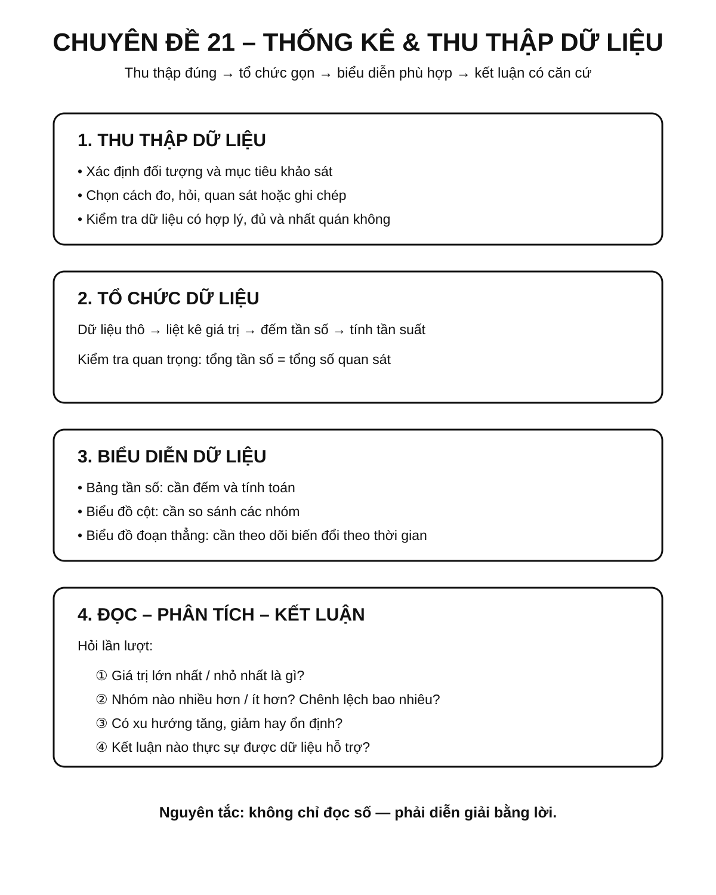

```text
THỐNG KÊ & THU THẬP DỮ LIỆU
│
├── Thu thập dữ liệu
│   ├── xác định đối tượng
│   ├── chọn cách thu thập
│   └── kiểm tra tính hợp lý
│
├── Tổ chức dữ liệu
│   ├── bảng dữ liệu
│   ├── bảng tần số
│   ├── bảng tần suất / tần số tương đối
│   └── bảng tần số ghép nhóm
│
├── Biểu diễn dữ liệu
│   ├── biểu đồ cột / cột kép
│   ├── biểu đồ đoạn thẳng
│   ├── biểu đồ hình quạt tròn
│   └── biểu đồ cho dữ liệu ghép nhóm
│
└── Đọc và phân tích
    ├── lớn nhất / nhỏ nhất
    ├── xu hướng
    └── kết luận từ dữ liệu
```

Mạch tư duy trọng tâm:

**thu thập đúng → tổ chức gọn → biểu diễn phù hợp → đọc chính xác → kết luận có căn cứ.**

---

## Minh họa trực quan

### 1. Bảng tần số

<p align="center">
  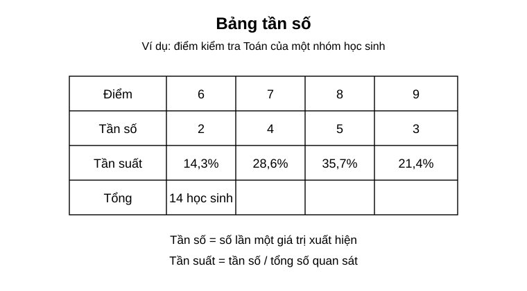
</p>

> Bảng tần số giúp ta sắp xếp dữ liệu theo từng giá trị và đếm số lần xuất hiện của mỗi giá trị.

Các khái niệm cần nhớ:

- **Dữ liệu**: các số liệu hoặc thông tin thu thập được;
- **Giá trị dữ liệu**: các giá trị cụ thể xuất hiện trong bộ dữ liệu;
- **Tần số**: số lần một giá trị xuất hiện;
- **Tần suất**: tỉ lệ giữa tần số và tổng số quan sát.

Ví dụ trong bảng trên:

- điểm `8` xuất hiện `5` lần;
- tổng số quan sát là `14`;
- tần suất của điểm `8` là `5/14 ≈ 35,7%`.

---

### 2. Biểu đồ cột

<p align="center">
  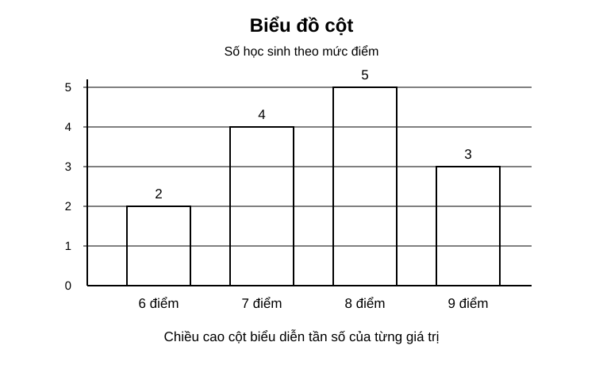
</p>

> Biểu đồ cột thường dùng để so sánh số lượng hoặc tần số giữa các nhóm giá trị khác nhau.

Cách đọc:

1. nhìn tên các cột trên trục ngang;
2. nhìn chiều cao cột;
3. đối chiếu với trục dọc để đọc giá trị;
4. so sánh cột cao nhất, thấp nhất và chênh lệch giữa các cột.

Trong ví dụ:

- cột `8 điểm` cao nhất, nghĩa là xuất hiện nhiều nhất;
- cột `6 điểm` thấp nhất, nghĩa là xuất hiện ít nhất.

---

### 3. Biểu đồ đoạn thẳng

<p align="center">
  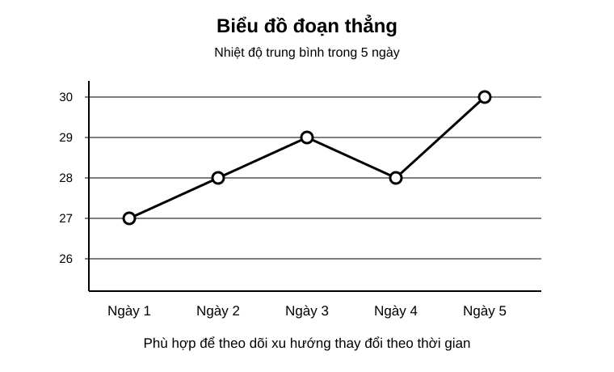
</p>

> Biểu đồ đoạn thẳng phù hợp khi ta muốn theo dõi sự thay đổi của dữ liệu theo thời gian.

Cách đọc:

- xác định từng mốc thời gian trên trục ngang;
- đọc giá trị tương ứng trên trục dọc;
- quan sát xu hướng tăng, giảm hoặc giữ nguyên.

Trong ví dụ:

- nhiệt độ tăng từ ngày 1 đến ngày 3;
- giảm ở ngày 4;
- tăng mạnh ở ngày 5.

---

### Khi nào dùng dạng biểu diễn nào?

| Dạng biểu diễn | Phù hợp khi nào? | Điểm mạnh |
|---|---|---|
| Bảng tần số | Cần thống kê dữ liệu gốc | Gọn, dễ tính toán |
| Biểu đồ cột | Cần so sánh các nhóm | Dễ nhìn, trực quan |
| Biểu đồ cột kép | Cần so sánh hai dãy số liệu theo cùng các nhóm | Thấy chênh lệch giữa hai đối tượng |
| Biểu đồ đoạn thẳng | Cần theo dõi sự thay đổi theo thời gian | Thể hiện xu hướng rõ |
| Biểu đồ hình quạt tròn | Cần mô tả cơ cấu các phần trong một tổng thể | Thấy nhanh tỉ trọng của từng phần |
| Bảng/biểu đồ ghép nhóm | Có nhiều số liệu số cần gom theo khoảng | Gọn và dễ nhìn phân bố theo nhóm |

---

### Mẹo làm bài thống kê

- Đọc kỹ đề để xác định **dữ liệu là gì**.
- Khi lập bảng, phải kiểm tra **tổng tần số** có đúng bằng số quan sát hay không.
- Khi đọc biểu đồ, luôn xem rõ **trục ngang**, **trục dọc** và **đơn vị**.
- Không chỉ đọc từng giá trị riêng lẻ, mà còn nên nhận xét **lớn nhất**, **nhỏ nhất**, **xu hướng chung**.
- Với bài thực tế, nên viết kết luận bằng lời sau khi đọc xong số liệu.

---

### Quy trình xử lý dữ liệu cơ bản

```text
Thu thập dữ liệu
      ↓
Sắp xếp dữ liệu
      ↓
Lập bảng tần số / tần suất
      ↓
Vẽ biểu đồ phù hợp
      ↓
Đọc, nhận xét và rút ra kết luận
```

---

## 🎯 2. Mục tiêu cần đạt

Sau khi hoàn thành chuyên đề, học sinh cần:

- [ ] Phân biệt được dữ liệu, giá trị, tần số và tần suất.
- [ ] Biết thu thập và kiểm tra dữ liệu cơ bản.
- [ ] Lập được bảng tần số và tần suất.
- [ ] Đọc và lập được biểu đồ cột kép, biểu đồ hình quạt tròn trong tình huống phù hợp.
- [ ] Nhận biết được dữ liệu ghép nhóm; lập được bảng tần số và tần số tương đối ghép nhóm ở mức THCS.
- [ ] Đọc chính xác biểu đồ cột và biểu đồ đoạn thẳng.
- [ ] Chọn được dạng biểu diễn phù hợp với mục tiêu.
- [ ] Nhận xét được xu hướng, giá trị lớn nhất, nhỏ nhất và chênh lệch.
- [ ] Viết được kết luận bằng lời từ dữ liệu đã cho.

---

## 📖 3. Kiến thức cốt lõi

### 3.1. Dữ liệu và giá trị dữ liệu

**Dữ liệu** là thông tin thu thập được từ quan sát, đo đạc, khảo sát hoặc ghi chép.

Ví dụ:
- điểm kiểm tra của một lớp;
- chiều cao của học sinh;
- nhiệt độ theo ngày;
- số sản phẩm bán được theo tháng.

Một dữ liệu có thể là số hoặc phân loại.

### 3.1A. Nhận diện kiểu dữ liệu trước khi lập bảng và biểu đồ

Không phải cứ nhìn thấy chữ số thì dữ liệu đã là một **đại lượng đo được**. Cần hỏi: *Giá trị này dùng để phân loại, đếm hay đo lường?*

| Kiểu dữ liệu | Ví dụ | Cách hiểu |
|---|---|---|
| **Định tính** (phân loại) | Màu áo: xanh, đỏ; mức xếp loại: tốt, khá, đạt | Mô tả **nhóm hoặc loại**; một số loại có thể sắp theo thứ tự, nhưng không cộng/trừ các nhãn |
| **Định lượng rời rạc** | Số anh chị em: `0, 1, 2, ...` | Thu được bằng **đếm**; chỉ có những giá trị phù hợp đơn vị đếm |
| **Định lượng liên tục** | Chiều cao `151,5 cm`, khối lượng `42,3 kg` | Thu được bằng **đo lường**; phép đo thực tế được ghi với độ chính xác nhất định |
| **Mã định danh** | Số áo cầu thủ, mã học sinh | Dù viết bằng chữ số, nó chỉ dùng **nhận diện**, không phải số lượng để cộng hay tính trung bình |

**Ví dụ phân biệt:** Khảo sát một lớp về **phương tiện đi học** và **thời gian đi học (phút)**. Phương tiện là dữ liệu định tính; thời gian là dữ liệu định lượng. Vì vậy, ta có thể lập bảng tần số cho *xe đạp, đi bộ, xe buýt*, nhưng **không được tính thời gian đi học trung bình từ các nhãn phương tiện**.

**Từ loại dữ liệu đến cách trình bày:**
- Với dữ liệu phân loại, thường dùng bảng tần số, biểu đồ cột hoặc quạt tròn khi các nhóm tạo thành một tổng thể.
- Với số lượng đếm được, có thể lập bảng tần số theo từng giá trị.
- Với nhiều số đo liên tục, có thể cần ghép nhóm theo **khoảng không chồng lấn**, như mục 3.6B.

> **Tự kiểm tra:** “Số” trên nhãn có thật sự mang nghĩa độ lớn không? Nếu đổi mã học sinh từ `12` thành `120` mà không thay đổi người được ghi nhận, đó không phải sự tăng gấp 10 lần một đại lượng đo.

### 3.2. Tần số

**Tần số** của một giá trị là số lần giá trị đó xuất hiện.

Nếu giá trị `8` xuất hiện `5` lần thì tần số của `8` là:

`n = 5`

Tổng các tần số phải bằng tổng số quan sát.

### 3.3. Tần suất (tần số tương đối)

Tần suất, hay **tần số tương đối**, cho biết một giá trị chiếm bao nhiêu phần trong toàn bộ dữ liệu:

`tần suất = tần số / tổng số quan sát`

Nếu muốn biểu diễn theo phần trăm:

`tần suất (%) = tần số / tổng số quan sát × 100%`

### 3.4. Bảng tần số và bảng tần suất

Quy trình:
1. liệt kê các giá trị khác nhau;
2. đếm số lần xuất hiện;
3. kiểm tra tổng tần số;
4. nếu cần, tính tần suất.

### Infographic – Tần số và tần suất

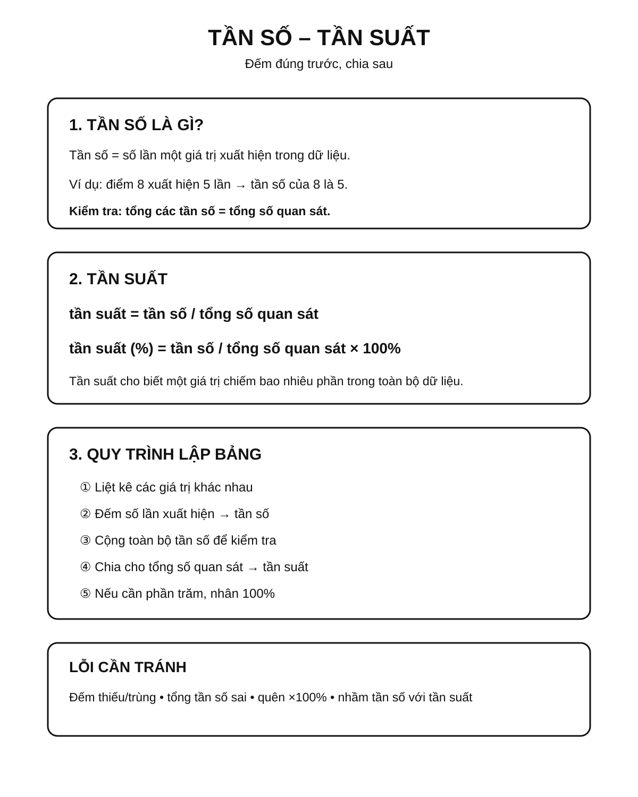

### 3.5. Biểu đồ cột

Phù hợp khi cần:
- so sánh các nhóm;
- nhìn nhanh nhóm lớn nhất, nhỏ nhất;
- so sánh chênh lệch.

Khi đọc biểu đồ cột phải kiểm tra:
- tên biểu đồ;
- trục ngang;
- trục dọc;
- đơn vị;
- thang chia.

<p align="center">
  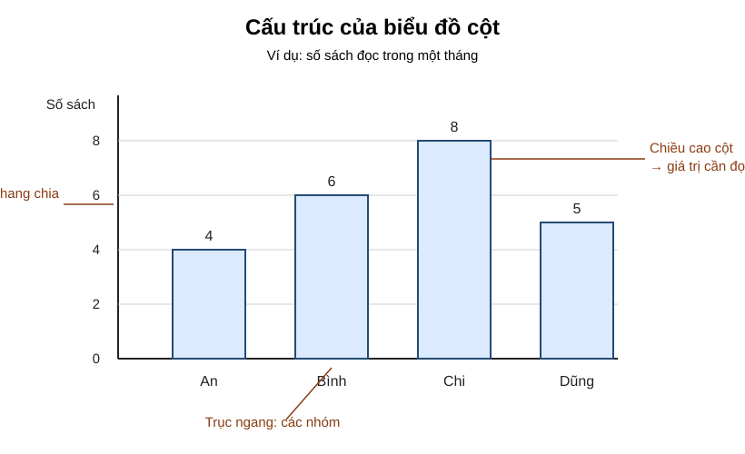
</p>

> Khi đọc một cột, hãy dóng chiều cao của cột sang **thang chia trên trục dọc** thay vì ước lượng bằng mắt.

### 3.6. Biểu đồ đoạn thẳng

Phù hợp khi dữ liệu thay đổi theo thời gian.

Cần quan sát:
- xu hướng tăng;
- xu hướng giảm;
- điểm cao nhất, thấp nhất;
- đoạn thay đổi mạnh.

<p align="center">
  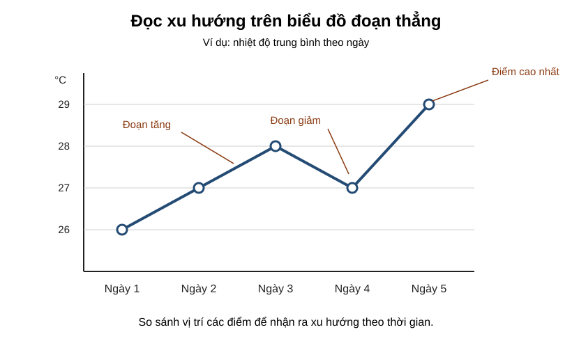
</p>

> Không chỉ đọc từng điểm riêng lẻ; mục tiêu chính của biểu đồ đoạn thẳng là nhìn được **xu hướng thay đổi theo thời gian**.

### 3.6A. Biểu đồ cột kép và biểu đồ hình quạt tròn

**Biểu đồ cột kép** phù hợp khi cần so sánh **hai dãy số liệu theo cùng các nhóm**. Khi đọc phải đối chiếu đúng chú giải, vì hai cột đứng cạnh nhau nhưng biểu diễn hai đối tượng khác nhau.

<p align="center">
  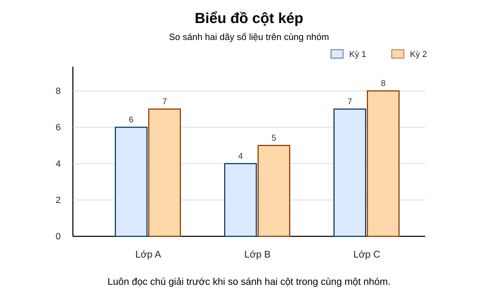
</p>

> Với mỗi nhóm, hãy so sánh **hai cột cùng vị trí** và luôn đọc chú giải trước khi kết luận.

**Biểu đồ hình quạt tròn** phù hợp khi cần mô tả **cơ cấu các phần trong một tổng thể**. Toàn bộ hình tròn tương ứng `100%` hay `360°`.

Nếu một nhóm chiếm `p%` thì góc ở tâm của hình quạt tương ứng là:

`góc = p/100 × 360° = 3,6p°`

<p align="center">
  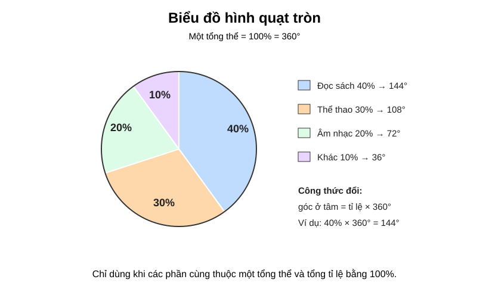
</p>

> Chỉ dùng biểu đồ quạt tròn khi các phần thuộc cùng một tổng thể. Tổng các tỉ lệ phải bằng `100%` (sai khác rất nhỏ có thể xuất hiện do làm tròn).

### 3.6B. Dữ liệu ghép nhóm, tần số và tần số tương đối ghép nhóm

Khi có nhiều số liệu số và cần trình bày gọn, có thể chia dữ liệu thành các **nhóm không chồng lấn** như:

`[a₁; a₂), [a₂; a₃), ..., [aₖ; aₖ₊₁)`

Mỗi giá trị chỉ được thuộc **một** nhóm.

- **Tần số của một nhóm**: số giá trị nằm trong nhóm đó.
- **Tần số tương đối của một nhóm**: `tần số nhóm / cỡ mẫu`.

Luôn kiểm tra:

`∑ tần số nhóm = N`

và:

`∑ tần số tương đối = 1` (hoặc `100%`).

Khi cần biểu diễn dữ liệu ghép nhóm bằng biểu đồ đoạn thẳng, có thể dùng **giá trị đại diện của nhóm**, thường là trung điểm của khoảng:

`xᵢ = (aᵢ + aᵢ₊₁)/2`

<p align="center">
  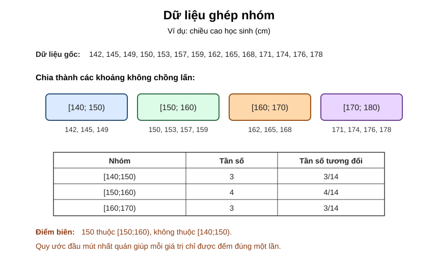
</p>

> Các nhóm phải bao phủ toàn bộ dữ liệu và quy ước đầu mút phải nhất quán; nếu nhóm bị chồng lấn, một giá trị ở biên có thể bị đếm hai lần.

### 3.7. Chất lượng dữ liệu

Khi đánh giá dữ liệu cần xem xét:
- dữ liệu có đúng đối tượng và đúng mục tiêu khảo sát hay không;
- cách chọn đối tượng có hợp lý, tránh thiên lệch rõ ràng hay không;
- số lượng quan sát có phù hợp với mục tiêu mô tả hay không;
- cách đo, hỏi và ghi chép có nhất quán hay không;
- đơn vị có thống nhất hay không;
- có bỏ sót, đếm trùng hoặc ghi sai dữ liệu hay không.

> Một bảng số liệu được ghi đúng chưa chắc đã đại diện tốt cho toàn bộ nhóm cần nghiên cứu nếu cách chọn mẫu bị thiên lệch.

### 3.8. Bảng chọn cách biểu diễn

| Mục tiêu | Cách biểu diễn phù hợp |
|---|---|
| Đếm số lần xuất hiện | Bảng tần số |
| So sánh các nhóm | Biểu đồ cột |
| So sánh hai dãy trên cùng nhóm | Biểu đồ cột kép |
| Theo dõi theo thời gian | Biểu đồ đoạn thẳng |
| Mô tả cơ cấu trong một tổng thể | Biểu đồ hình quạt tròn |
| Nhiều số liệu số cần gom theo khoảng | Bảng/biểu đồ tần số ghép nhóm |
| So sánh theo tỉ lệ | Bảng tần suất / tần số tương đối / phần trăm |

---

## 🔗 4. Kiến thức liên quan

- **Kiến thức nên ôn trước:** tỉ số, phần trăm và kỹ năng đọc bảng số liệu; có thể xem lại [03 – Tỉ lệ và tỉ lệ thức](../03-ti-le-ti-le-thuc/index.md).
- **Liên hệ mạnh:** phần trăm, đọc bảng, biểu đồ và diễn giải dữ liệu.
- **Chuyên đề sử dụng tiếp:** [22 – Các đại lượng đặc trưng của dữ liệu](../22-dai-luong-dac-trung/index.md), [24 – Bài toán thực tế](../24-bai-toan-thuc-te/index.md)

---

## 🧩 5. Các dạng bài cần nắm vững

### Infographic – Biểu đồ, chất lượng dữ liệu và lỗi sai

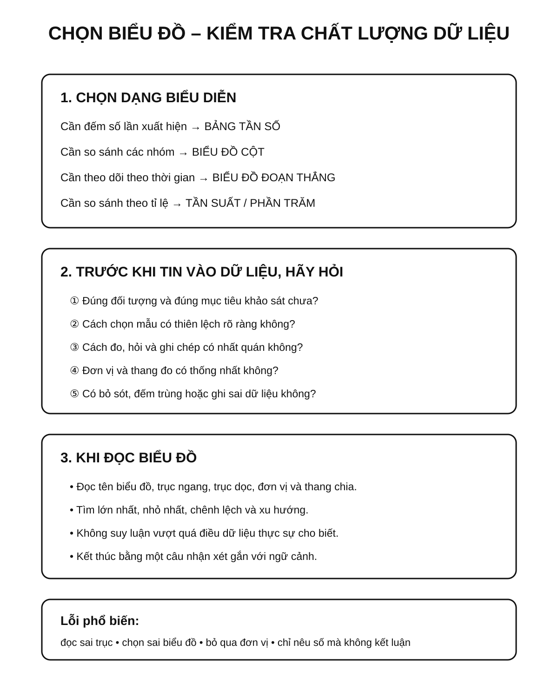

### Dạng 1. Đọc bảng dữ liệu

Xác định số quan sát, giá trị lớn nhất, nhỏ nhất và số lần xuất hiện.

### Dạng 2. Lập bảng tần số

Đếm chính xác số lần mỗi giá trị xuất hiện và kiểm tra tổng.

### Dạng 3. Tính tần suất

Dùng:

`tần suất = tần số / tổng số quan sát`

### Dạng 4. Đọc biểu đồ cột

So sánh các nhóm, tính chênh lệch và rút ra nhận xét.

### Dạng 5. Đọc biểu đồ đoạn thẳng

Mô tả xu hướng theo thời gian và xác định các giai đoạn tăng/giảm.

### Dạng 6. Chuyển đổi giữa bảng và biểu đồ

Từ bảng → vẽ biểu đồ, hoặc từ biểu đồ → lập lại bảng.

### Dạng 6A. Biểu đồ cột kép và biểu đồ hình quạt tròn

So sánh đúng hai dãy số liệu trên cột kép; với quạt tròn, kiểm tra tổng tỉ lệ và đổi `p% ↔ 3,6p°` khi cần.

### Dạng 6B. Dữ liệu ghép nhóm

Chọn các khoảng nhóm không chồng lấn, đếm tần số từng nhóm, tính tần số tương đối và đọc/vẽ biểu đồ tương ứng.

### Dạng 7. Bài toán thực tế từ dữ liệu

Đọc dữ liệu, tính toán rồi viết kết luận phù hợp với ngữ cảnh.

---

## 🚀 6. Dạng bài thi vào lớp 10

Trong Roadmap ôn thi vào lớp 10, thống kê được xếp ở mức ưu tiên cao vừa phải và cần chắc kỹ năng đọc, tính toán và diễn giải dữ liệu.

Các kỹ năng cần chắc:
1. Đọc đúng bảng hoặc biểu đồ.
2. Tính tần số, tần suất/tần số tương đối, phần trăm.
3. Đọc biểu đồ cột kép, quạt tròn và dữ liệu ghép nhóm khi xuất hiện.
4. So sánh hai nhóm dữ liệu và nhận xét xu hướng.
5. Kết hợp với số trung bình, trung vị ở Chuyên đề 22.

Mức ưu tiên ôn thi: **⭐⭐⭐⭐**.

---

## ⚠️ 7. Lỗi sai thường gặp

| Lỗi sai | Cách tránh |
|---|---|
| Đếm sai tần số | Đánh dấu từng dữ liệu khi đếm |
| Tổng tần số không bằng số quan sát | Luôn kiểm tra dòng tổng |
| Quên nhân `100%` khi tính tần suất phần trăm | Phân biệt tần suất dạng số và dạng % |
| Đọc sai trục biểu đồ | Xem kỹ đơn vị và thang chia |
| Nhầm biểu đồ cột với biểu đồ theo thời gian | Xác định mục tiêu dữ liệu trước |
| Đọc cột kép nhưng quên chú giải | Xác định rõ mỗi màu/cột thuộc dãy số liệu nào |
| Chia nhóm bị chồng lấn hoặc bỏ hở | Dùng các khoảng liên tiếp và thống nhất quy ước đầu mút |
| Biểu đồ quạt tròn có tổng tỉ lệ khác xa `100%` | Kiểm tra lại phần trăm trước khi vẽ/đọc |
| Chỉ nêu số mà không kết luận | Viết một câu nhận xét theo ngữ cảnh |

---

## 📝 8. Luyện tập

Thực hiện 15 câu **micro-practice** trong [5 Learning Cards ở trang Core riêng](core/index.md) (Base → Trap → Apply) để nhận phản hồi ngay. Sau đó mở Practice Room để luyện sâu và theo dõi lượt làm theo skill. Practice là **formative evidence**, không gộp cơ học với Core Readiness.

- **→ [Mở Practice Room CĐ21](bai-tap.md)**

---

## ✅ 9. Tự kiểm tra

**Core Readiness tương tác** gồm 12 câu trắc nghiệm theo các kỹ năng nền tảng lớp 6–8. Không gợi ý/Tutor; chỉ chấm sau khi nộp và không khóa tiến độ. Học sinh chưa học phần lớp 7–8 không dùng điểm toàn bài để đánh giá riêng mức độ lớp 6.

- **→ [Làm Core Readiness CĐ21](tu-kiem-tra.md)**
- [Bài tự luận cũ (luyện bổ sung, không tính vào Core Readiness)](tu-kiem-tra-tu-luan.md)

---

## 🔄 10. Liên kết Roadmap

- **← Trước:** [20 – Hình học tổng hợp, đo lường và hình khối](../20-hinh-hoc-tong-hop/index.md)
- **→ Tiếp theo:** [22 – Các đại lượng đặc trưng](../22-dai-luong-dac-trung/index.md)
- **→ Kiến thức nền liên hệ:** [03 – Tỉ lệ và tỉ lệ thức](../03-ti-le-ti-le-thuc/index.md)
- **→ Liên hệ:** [24 – Bài toán thực tế](../24-bai-toan-thuc-te/index.md)

- **✏️ Luyện tập:** [Bài tập Chuyên đề 21](bai-tap.md)
- **✅ Tự kiểm tra:** [Tự kiểm tra Chuyên đề 21](tu-kiem-tra.md)

Xem toàn bộ hệ thống tại [Blueprint 25 chuyên đề](../../roadmap/blueprint-25-chuyen-de.md).

---

## 🏁 11. Điều kiện hoàn thành

- [ ] Học đủ năm chặng KNTT Core đúng lớp đã học; đọc ví dụ và chữa lại câu micro-practice sai.
- [ ] Làm Practice Room và ôn lại đúng skill còn yếu.
- [ ] Đọc đúng dữ liệu, đơn vị, chú giải; viết nhận xét có căn cứ trong phạm vi khảo sát.
- [ ] Làm Core Readiness sau khi học phần lớp 6–8 tương ứng; chữa các câu sai nhưng vẫn có thể học tiếp.

!!! note "Soft Mastery"
    Không lấy bài mở rộng hoặc điểm tự luận làm cổng khóa tiến độ. Kết quả là tín hiệu để học sinh lựa chọn nội dung cần củng cố.
`````

### CT21 — design-only R3 candidate, NOT published

- Topic: `21-thong-ke`
- Candidate path: `docs/kien-thuc/21-thong-ke/preview-composition-r3.md` in PR #574
- Git blob SHA: `22ae5fd87a4a5c8f698a0a77e5116d989c899e58`
- **AUTHORITY: proposed authoring change only, must be reviewed against source above.**

`````markdown
> **BẢN THỬ BỐ CỤC R3 · CHƯA PHÁT HÀNH:** Chỉ thay đổi cách trình bày một phần ngắn; các kiến thức còn lại giữ theo nguồn chính thức.

<link rel="stylesheet" href="../../../assets/stylesheets/math-knowledge-composition-v1.css">

# Chuyên đề 21 – Thống kê và thu thập dữ liệu

> **Trạng thái:** Đã kiểm định nội dung học thuật; cấu trúc Roadmap chuẩn 11 mục.
>
> **Lớp trọng tâm:** 6–9
> **Mạch kiến thức:** Thống kê
> **Mức ưu tiên:** ⭐⭐⭐⭐
>
> **Lưu ý tầng học:** Năm Learning Cards KNTT Core trong [trang học theo chặng](core/index.md) là lộ trình nền tảng lớp 6–8. Các mục tổng hợp, tần suất và dữ liệu ghép nhóm bên dưới cần học đúng bài/lớp phù hợp; không tự động tính vào Core Readiness.

---

## 🧭 1. Bản đồ kiến thức


```text
THỐNG KÊ & THU THẬP DỮ LIỆU
│
├── Thu thập dữ liệu
│   ├── xác định đối tượng
│   ├── chọn cách thu thập
│   └── kiểm tra tính hợp lý
│
├── Tổ chức dữ liệu
│   ├── bảng dữ liệu
│   ├── bảng tần số
│   ├── bảng tần suất / tần số tương đối
│   └── bảng tần số ghép nhóm
│
├── Biểu diễn dữ liệu
│   ├── biểu đồ cột / cột kép
│   ├── biểu đồ đoạn thẳng
│   ├── biểu đồ hình quạt tròn
│   └── biểu đồ cho dữ liệu ghép nhóm
│
└── Đọc và phân tích
    ├── lớn nhất / nhỏ nhất
    ├── xu hướng
    └── kết luận từ dữ liệu
```

Mạch tư duy trọng tâm:

**thu thập đúng → tổ chức gọn → biểu diễn phù hợp → đọc chính xác → kết luận có căn cứ.**

---

## Minh họa trực quan

### 1. Bảng tần số

<p align="center">
  
</p>

> Bảng tần số giúp ta sắp xếp dữ liệu theo từng giá trị và đếm số lần xuất hiện của mỗi giá trị.

Các khái niệm cần nhớ:

- **Dữ liệu**: các số liệu hoặc thông tin thu thập được;
- **Giá trị dữ liệu**: các giá trị cụ thể xuất hiện trong bộ dữ liệu;
- **Tần số**: số lần một giá trị xuất hiện;
- **Tần suất**: tỉ lệ giữa tần số và tổng số quan sát.

Ví dụ trong bảng trên:

- điểm `8` xuất hiện `5` lần;
- tổng số quan sát là `14`;
- tần suất của điểm `8` là `5/14 ≈ 35,7%`.

---

### 2. Biểu đồ cột

<p align="center">
  
</p>

> Biểu đồ cột thường dùng để so sánh số lượng hoặc tần số giữa các nhóm giá trị khác nhau.

Cách đọc:

1. nhìn tên các cột trên trục ngang;
2. nhìn chiều cao cột;
3. đối chiếu với trục dọc để đọc giá trị;
4. so sánh cột cao nhất, thấp nhất và chênh lệch giữa các cột.

Trong ví dụ:

- cột `8 điểm` cao nhất, nghĩa là xuất hiện nhiều nhất;
- cột `6 điểm` thấp nhất, nghĩa là xuất hiện ít nhất.

---

### 3. Biểu đồ đoạn thẳng

<p align="center">
  
</p>

> Biểu đồ đoạn thẳng phù hợp khi ta muốn theo dõi sự thay đổi của dữ liệu theo thời gian.

Cách đọc:

- xác định từng mốc thời gian trên trục ngang;
- đọc giá trị tương ứng trên trục dọc;
- quan sát xu hướng tăng, giảm hoặc giữ nguyên.

Trong ví dụ:

- nhiệt độ tăng từ ngày 1 đến ngày 3;
- giảm ở ngày 4;
- tăng mạnh ở ngày 5.

---

### Khi nào dùng dạng biểu diễn nào?

| Dạng biểu diễn | Phù hợp khi nào? | Điểm mạnh |
|---|---|---|
| Bảng tần số | Cần thống kê dữ liệu gốc | Gọn, dễ tính toán |
| Biểu đồ cột | Cần so sánh các nhóm | Dễ nhìn, trực quan |
| Biểu đồ cột kép | Cần so sánh hai dãy số liệu theo cùng các nhóm | Thấy chênh lệch giữa hai đối tượng |
| Biểu đồ đoạn thẳng | Cần theo dõi sự thay đổi theo thời gian | Thể hiện xu hướng rõ |
| Biểu đồ hình quạt tròn | Cần mô tả cơ cấu các phần trong một tổng thể | Thấy nhanh tỉ trọng của từng phần |
| Bảng/biểu đồ ghép nhóm | Có nhiều số liệu số cần gom theo khoảng | Gọn và dễ nhìn phân bố theo nhóm |

---

### Mẹo làm bài thống kê

- Đọc kỹ đề để xác định **dữ liệu là gì**.
- Khi lập bảng, phải kiểm tra **tổng tần số** có đúng bằng số quan sát hay không.
- Khi đọc biểu đồ, luôn xem rõ **trục ngang**, **trục dọc** và **đơn vị**.
- Không chỉ đọc từng giá trị riêng lẻ, mà còn nên nhận xét **lớn nhất**, **nhỏ nhất**, **xu hướng chung**.
- Với bài thực tế, nên viết kết luận bằng lời sau khi đọc xong số liệu.

---

### Quy trình xử lý dữ liệu cơ bản

```text
Thu thập dữ liệu
      ↓
Sắp xếp dữ liệu
      ↓
Lập bảng tần số / tần suất
      ↓
Vẽ biểu đồ phù hợp
      ↓
Đọc, nhận xét và rút ra kết luận
```

---

## 🎯 2. Mục tiêu cần đạt

Sau khi hoàn thành chuyên đề, học sinh cần:

- [ ] Phân biệt được dữ liệu, giá trị, tần số và tần suất.
- [ ] Biết thu thập và kiểm tra dữ liệu cơ bản.
- [ ] Lập được bảng tần số và tần suất.
- [ ] Đọc và lập được biểu đồ cột kép, biểu đồ hình quạt tròn trong tình huống phù hợp.
- [ ] Nhận biết được dữ liệu ghép nhóm; lập được bảng tần số và tần số tương đối ghép nhóm ở mức THCS.
- [ ] Đọc chính xác biểu đồ cột và biểu đồ đoạn thẳng.
- [ ] Chọn được dạng biểu diễn phù hợp với mục tiêu.
- [ ] Nhận xét được xu hướng, giá trị lớn nhất, nhỏ nhất và chênh lệch.
- [ ] Viết được kết luận bằng lời từ dữ liệu đã cho.

---

## 📖 3. Kiến thức cốt lõi

### 3.1. Dữ liệu và giá trị dữ liệu

**Dữ liệu** là thông tin thu thập được từ quan sát, đo đạc, khảo sát hoặc ghi chép.

Ví dụ:
- điểm kiểm tra của một lớp;
- chiều cao của học sinh;
- nhiệt độ theo ngày;
- số sản phẩm bán được theo tháng.

Một dữ liệu có thể là số hoặc phân loại.

### 3.1A. Nhận diện kiểu dữ liệu trước khi lập bảng và biểu đồ

Không phải cứ nhìn thấy chữ số thì dữ liệu đã là một **đại lượng đo được**. Cần hỏi: *Giá trị này dùng để phân loại, đếm hay đo lường?*

| Kiểu dữ liệu | Ví dụ | Cách hiểu |
|---|---|---|
| **Định tính** (phân loại) | Màu áo: xanh, đỏ; mức xếp loại: tốt, khá, đạt | Mô tả **nhóm hoặc loại**; một số loại có thể sắp theo thứ tự, nhưng không cộng/trừ các nhãn |
| **Định lượng rời rạc** | Số anh chị em: `0, 1, 2, ...` | Thu được bằng **đếm**; chỉ có những giá trị phù hợp đơn vị đếm |
| **Định lượng liên tục** | Chiều cao `151,5 cm`, khối lượng `42,3 kg` | Thu được bằng **đo lường**; phép đo thực tế được ghi với độ chính xác nhất định |
| **Mã định danh** | Số áo cầu thủ, mã học sinh | Dù viết bằng chữ số, nó chỉ dùng **nhận diện**, không phải số lượng để cộng hay tính trung bình |

**Ví dụ phân biệt:** Khảo sát một lớp về **phương tiện đi học** và **thời gian đi học (phút)**. Phương tiện là dữ liệu định tính; thời gian là dữ liệu định lượng. Vì vậy, ta có thể lập bảng tần số cho *xe đạp, đi bộ, xe buýt*, nhưng **không được tính thời gian đi học trung bình từ các nhãn phương tiện**.

**Từ loại dữ liệu đến cách trình bày:**
- Với dữ liệu phân loại, thường dùng bảng tần số, biểu đồ cột hoặc quạt tròn khi các nhóm tạo thành một tổng thể.
- Với số lượng đếm được, có thể lập bảng tần số theo từng giá trị.
- Với nhiều số đo liên tục, có thể cần ghép nhóm theo **khoảng không chồng lấn**, như mục 3.6B.

> **Tự kiểm tra:** “Số” trên nhãn có thật sự mang nghĩa độ lớn không? Nếu đổi mã học sinh từ `12` thành `120` mà không thay đổi người được ghi nhận, đó không phải sự tăng gấp 10 lần một đại lượng đo.

### 3.2. Tần số

**Tần số** của một giá trị là số lần giá trị đó xuất hiện.

Nếu giá trị `8` xuất hiện `5` lần thì tần số của `8` là:

`n = 5`

Tổng các tần số phải bằng tổng số quan sát.

### 3.3. Tần suất (tần số tương đối)

Tần suất, hay **tần số tương đối**, cho biết một giá trị chiếm bao nhiêu phần trong toàn bộ dữ liệu:

`tần suất = tần số / tổng số quan sát`

Nếu muốn biểu diễn theo phần trăm:

`tần suất (%) = tần số / tổng số quan sát × 100%`

### 3.4. Bảng tần số và bảng tần suất

Quy trình lập bảng:

| **Bước 1** | **Bước 2** | **Bước 3** | **Bước 4 (khi cần)** |
|:---|:---|:---|:---|
| Liệt kê các giá trị khác nhau. | Đếm số lần xuất hiện. | Kiểm tra tổng tần số. | Tính tần suất. |

**Trình tự:** Bước 1 → Bước 2 → Bước 3 → Bước 4 (nếu cần).


<div class="math-composition"><nav class="math-related-practice" aria-label="Bài tập liên quan đến nội dung vừa học">
<span>Thực hành kiến thức này:</span>
<a href="../bai-tap/?mode=remediation&amp;focus=bang-tan-so">Luyện ngay →</a>
</nav></div>

### 3.5. Biểu đồ cột

Phù hợp khi cần:
- so sánh các nhóm;
- nhìn nhanh nhóm lớn nhất, nhỏ nhất;
- so sánh chênh lệch.

Khi đọc biểu đồ cột phải kiểm tra:
- tên biểu đồ;
- trục ngang;
- trục dọc;
- đơn vị;
- thang chia.

<p align="center">
  
</p>

> Khi đọc một cột, hãy dóng chiều cao của cột sang **thang chia trên trục dọc** thay vì ước lượng bằng mắt.

### 3.6. Biểu đồ đoạn thẳng

Phù hợp khi dữ liệu thay đổi theo thời gian.

Cần quan sát:
- xu hướng tăng;
- xu hướng giảm;
- điểm cao nhất, thấp nhất;
- đoạn thay đổi mạnh.

<p align="center">
  
</p>

> Không chỉ đọc từng điểm riêng lẻ; mục tiêu chính của biểu đồ đoạn thẳng là nhìn được **xu hướng thay đổi theo thời gian**.

### 3.6A. Biểu đồ cột kép và biểu đồ hình quạt tròn

**Biểu đồ cột kép** phù hợp khi cần so sánh **hai dãy số liệu theo cùng các nhóm**. Khi đọc phải đối chiếu đúng chú giải, vì hai cột đứng cạnh nhau nhưng biểu diễn hai đối tượng khác nhau.

<p align="center">
  
</p>

> Với mỗi nhóm, hãy so sánh **hai cột cùng vị trí** và luôn đọc chú giải trước khi kết luận.

**Biểu đồ hình quạt tròn** phù hợp khi cần mô tả **cơ cấu các phần trong một tổng thể**. Toàn bộ hình tròn tương ứng `100%` hay `360°`.

Nếu một nhóm chiếm `p%` thì góc ở tâm của hình quạt tương ứng là:

`góc = p/100 × 360° = 3,6p°`

<p align="center">
  
</p>

> Chỉ dùng biểu đồ quạt tròn khi các phần thuộc cùng một tổng thể. Tổng các tỉ lệ phải bằng `100%` (sai khác rất nhỏ có thể xuất hiện do làm tròn).

### 3.6B. Dữ liệu ghép nhóm, tần số và tần số tương đối ghép nhóm

Khi có nhiều số liệu số và cần trình bày gọn, có thể chia dữ liệu thành các **nhóm không chồng lấn** như:

`[a₁; a₂), [a₂; a₃), ..., [aₖ; aₖ₊₁)`

Mỗi giá trị chỉ được thuộc **một** nhóm.

- **Tần số của một nhóm**: số giá trị nằm trong nhóm đó.
- **Tần số tương đối của một nhóm**: `tần số nhóm / cỡ mẫu`.

Luôn kiểm tra:

`∑ tần số nhóm = N`

và:

`∑ tần số tương đối = 1` (hoặc `100%`).

Khi cần biểu diễn dữ liệu ghép nhóm bằng biểu đồ đoạn thẳng, có thể dùng **giá trị đại diện của nhóm**, thường là trung điểm của khoảng:

`xᵢ = (aᵢ + aᵢ₊₁)/2`

<p align="center">
  
</p>

> Các nhóm phải bao phủ toàn bộ dữ liệu và quy ước đầu mút phải nhất quán; nếu nhóm bị chồng lấn, một giá trị ở biên có thể bị đếm hai lần.

### 3.7. Chất lượng dữ liệu

Khi đánh giá dữ liệu cần xem xét:
- dữ liệu có đúng đối tượng và đúng mục tiêu khảo sát hay không;
- cách chọn đối tượng có hợp lý, tránh thiên lệch rõ ràng hay không;
- số lượng quan sát có phù hợp với mục tiêu mô tả hay không;
- cách đo, hỏi và ghi chép có nhất quán hay không;
- đơn vị có thống nhất hay không;
- có bỏ sót, đếm trùng hoặc ghi sai dữ liệu hay không.

> Một bảng số liệu được ghi đúng chưa chắc đã đại diện tốt cho toàn bộ nhóm cần nghiên cứu nếu cách chọn mẫu bị thiên lệch.

### 3.8. Bảng chọn cách biểu diễn

| Mục tiêu | Cách biểu diễn phù hợp |
|---|---|
| Đếm số lần xuất hiện | Bảng tần số |
| So sánh các nhóm | Biểu đồ cột |
| So sánh hai dãy trên cùng nhóm | Biểu đồ cột kép |
| Theo dõi theo thời gian | Biểu đồ đoạn thẳng |
| Mô tả cơ cấu trong một tổng thể | Biểu đồ hình quạt tròn |
| Nhiều số liệu số cần gom theo khoảng | Bảng/biểu đồ tần số ghép nhóm |
| So sánh theo tỉ lệ | Bảng tần suất / tần số tương đối / phần trăm |

---

## 🔗 4. Kiến thức liên quan

- **Kiến thức nên ôn trước:** tỉ số, phần trăm và kỹ năng đọc bảng số liệu; có thể xem lại [03 – Tỉ lệ và tỉ lệ thức](../03-ti-le-ti-le-thuc/index.md).
- **Liên hệ mạnh:** phần trăm, đọc bảng, biểu đồ và diễn giải dữ liệu.
- **Chuyên đề sử dụng tiếp:** [22 – Các đại lượng đặc trưng của dữ liệu](../22-dai-luong-dac-trung/index.md), [24 – Bài toán thực tế](../24-bai-toan-thuc-te/index.md)

---

## 🧩 5. Các dạng bài cần nắm vững


### Dạng 1. Đọc bảng dữ liệu

Xác định số quan sát, giá trị lớn nhất, nhỏ nhất và số lần xuất hiện.

### Dạng 2. Lập bảng tần số

Đếm chính xác số lần mỗi giá trị xuất hiện và kiểm tra tổng.

### Dạng 3. Tính tần suất

Dùng:

`tần suất = tần số / tổng số quan sát`

### Dạng 4. Đọc biểu đồ cột

So sánh các nhóm, tính chênh lệch và rút ra nhận xét.

### Dạng 5. Đọc biểu đồ đoạn thẳng

Mô tả xu hướng theo thời gian và xác định các giai đoạn tăng/giảm.

### Dạng 6. Chuyển đổi giữa bảng và biểu đồ

Từ bảng → vẽ biểu đồ, hoặc từ biểu đồ → lập lại bảng.

### Dạng 6A. Biểu đồ cột kép và biểu đồ hình quạt tròn

So sánh đúng hai dãy số liệu trên cột kép; với quạt tròn, kiểm tra tổng tỉ lệ và đổi `p% ↔ 3,6p°` khi cần.

### Dạng 6B. Dữ liệu ghép nhóm

Chọn các khoảng nhóm không chồng lấn, đếm tần số từng nhóm, tính tần số tương đối và đọc/vẽ biểu đồ tương ứng.

### Dạng 7. Bài toán thực tế từ dữ liệu

Đọc dữ liệu, tính toán rồi viết kết luận phù hợp với ngữ cảnh.

---

## 🚀 6. Dạng bài thi vào lớp 10

Trong Roadmap ôn thi vào lớp 10, thống kê được xếp ở mức ưu tiên cao vừa phải và cần chắc kỹ năng đọc, tính toán và diễn giải dữ liệu.

Các kỹ năng cần chắc:
1. Đọc đúng bảng hoặc biểu đồ.
2. Tính tần số, tần suất/tần số tương đối, phần trăm.
3. Đọc biểu đồ cột kép, quạt tròn và dữ liệu ghép nhóm khi xuất hiện.
4. So sánh hai nhóm dữ liệu và nhận xét xu hướng.
5. Kết hợp với số trung bình, trung vị ở Chuyên đề 22.

Mức ưu tiên ôn thi: **⭐⭐⭐⭐**.

---

## ⚠️ 7. Lỗi sai thường gặp

| Lỗi sai | Cách tránh |
|---|---|
| Đếm sai tần số | Đánh dấu từng dữ liệu khi đếm |
| Tổng tần số không bằng số quan sát | Luôn kiểm tra dòng tổng |
| Quên nhân `100%` khi tính tần suất phần trăm | Phân biệt tần suất dạng số và dạng % |
| Đọc sai trục biểu đồ | Xem kỹ đơn vị và thang chia |
| Nhầm biểu đồ cột với biểu đồ theo thời gian | Xác định mục tiêu dữ liệu trước |
| Đọc cột kép nhưng quên chú giải | Xác định rõ mỗi màu/cột thuộc dãy số liệu nào |
| Chia nhóm bị chồng lấn hoặc bỏ hở | Dùng các khoảng liên tiếp và thống nhất quy ước đầu mút |
| Biểu đồ quạt tròn có tổng tỉ lệ khác xa `100%` | Kiểm tra lại phần trăm trước khi vẽ/đọc |
| Chỉ nêu số mà không kết luận | Viết một câu nhận xét theo ngữ cảnh |

---

## 📝 8. Luyện tập

Thực hiện 15 câu **micro-practice** trong [5 Learning Cards ở trang Core riêng](core/index.md) (Base → Trap → Apply) để nhận phản hồi ngay. Sau đó mở Practice Room để luyện sâu và theo dõi lượt làm theo skill. Practice là **formative evidence**, không gộp cơ học với Core Readiness.

- **→ [Mở Practice Room CĐ21](bai-tap.md)**

---

## ✅ 9. Tự kiểm tra

**Core Readiness tương tác** gồm 12 câu trắc nghiệm theo các kỹ năng nền tảng lớp 6–8. Không gợi ý/Tutor; chỉ chấm sau khi nộp và không khóa tiến độ. Học sinh chưa học phần lớp 7–8 không dùng điểm toàn bài để đánh giá riêng mức độ lớp 6.

- **→ [Làm Core Readiness CĐ21](tu-kiem-tra.md)**
- [Bài tự luận cũ (luyện bổ sung, không tính vào Core Readiness)](tu-kiem-tra-tu-luan.md)

---

## 🔄 10. Liên kết Roadmap

- **← Trước:** [20 – Hình học tổng hợp, đo lường và hình khối](../20-hinh-hoc-tong-hop/index.md)
- **→ Tiếp theo:** [22 – Các đại lượng đặc trưng](../22-dai-luong-dac-trung/index.md)
- **→ Kiến thức nền liên hệ:** [03 – Tỉ lệ và tỉ lệ thức](../03-ti-le-ti-le-thuc/index.md)
- **→ Liên hệ:** [24 – Bài toán thực tế](../24-bai-toan-thuc-te/index.md)

- **✏️ Luyện tập:** [Bài tập Chuyên đề 21](bai-tap.md)
- **✅ Tự kiểm tra:** [Tự kiểm tra Chuyên đề 21](tu-kiem-tra.md)

Xem toàn bộ hệ thống tại [Blueprint 25 chuyên đề](../../roadmap/blueprint-25-chuyen-de.md).

---

## 🏁 11. Điều kiện hoàn thành

- [ ] Học đủ năm chặng KNTT Core đúng lớp đã học; đọc ví dụ và chữa lại câu micro-practice sai.
- [ ] Làm Practice Room và ôn lại đúng skill còn yếu.
- [ ] Đọc đúng dữ liệu, đơn vị, chú giải; viết nhận xét có căn cứ trong phạm vi khảo sát.
- [ ] Làm Core Readiness sau khi học phần lớp 6–8 tương ứng; chữa các câu sai nhưng vẫn có thể học tiếp.

!!! note "Soft Mastery"
    Không lấy bài mở rộng hoặc điểm tự luận làm cổng khóa tiến độ. Kết quả là tín hiệu để học sinh lựa chọn nội dung cần củng cố.
`````

### CT23 — official reviewed source, unchanged main index.md

- Topic: `23-xac-suat`
- Source path: `docs/kien-thuc/23-xac-suat/index.md`
- Git blob SHA: `1b69ae97f0597a3c7b521ecb315cf2a5d3d82187`
- **AUTHORITY: official current project lesson; not a new S1 source in itself.**

`````markdown
# Chuyên đề 23 – Xác suất

> **Trạng thái:** Đã kiểm định nội dung học thuật; cấu trúc Roadmap chuẩn 11 mục.
>
> **Core theo mapping hiện có:** lớp 6–8, học đúng chặng theo lớp; phần nhiều bước là mở rộng không bắt buộc.
> **Mạch kiến thức:** Xác suất
> **Mức ưu tiên:** ⭐⭐⭐⭐

---

!!! info "Ranh giới Core / bài mở rộng"
    Toán 6 KNTT Bài 42–43: kết quả có thể, sự kiện và xác suất thực nghiệm. Toán 7 Bài 29–30: biến cố và xác suất đơn giản. Toán 8 Bài 30–32: phép thử và tỉ số xác suất. Các bài nhiều xúc xắc, sơ đồ cây nâng cao, biến cố đối và rút không hoàn lại được luyện bổ sung, **không tự động tính vào KNTT Core Readiness**. Mapping lớp 9 hiện chưa có liên kết PRIMARY tới CĐ23; không suy ra mọi nội dung xác suất lớp 9 đều nằm ngoài chương trình.

## 🧭 1. Bản đồ kiến thức

```text
XÁC SUẤT
│
├── Phép thử ngẫu nhiên
│   └── kết quả không biết trước
│
├── Không gian mẫu Ω
│   └── tập hợp mọi kết quả có thể
│
├── Biến cố
│   ├── biến cố chắc chắn
│   ├── biến cố không thể
│   └── biến cố ngẫu nhiên
│
├── Xác suất thực nghiệm
│   └── số lần A xảy ra / số lần thử
│
├── Xác suất cổ điển
│   └── P(A) = n(A) / n(Ω) khi đồng khả năng
│
└── Thí nghiệm nhiều bước
    ├── bảng liệt kê
    └── sơ đồ cây
```

Mạch tư duy trọng tâm:

**xác định phép thử → liệt kê đúng không gian mẫu → mô tả biến cố → đếm kết quả thuận lợi → tính xác suất → kiểm tra kết quả nằm trong `[0,1]`.**

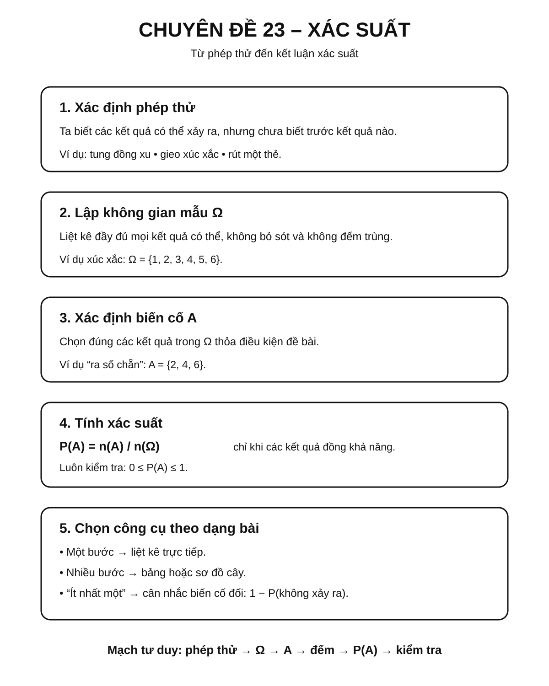

---

## Minh họa trực quan

### 1. Không gian mẫu và biến cố

<p align="center">
  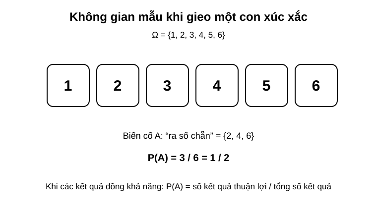
</p>

> **Không gian mẫu** là tập hợp tất cả các kết quả có thể xảy ra của một phép thử ngẫu nhiên.

Ví dụ, khi gieo một con xúc xắc một lần:

`Ω = {1, 2, 3, 4, 5, 6}`

Nếu xét biến cố `A`: “ra số chẵn”, thì:

`A = {2, 4, 6}`

Vì có `3` kết quả thuận lợi trên `6` kết quả có thể, nên:

`P(A) = 3/6 = 1/2`

---

### 2. Xác suất của một biến cố đơn giản

<p align="center">
  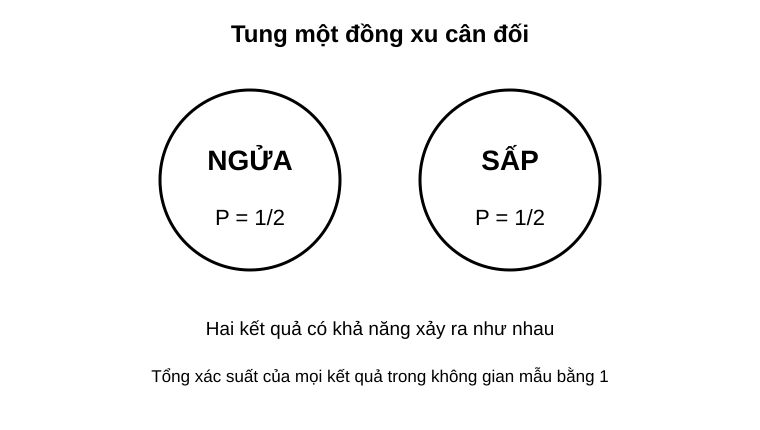
</p>

> Với một phép thử có các kết quả **đồng khả năng**, xác suất của biến cố được tính bằng:

`P(A) = số kết quả thuận lợi / tổng số kết quả có thể`

Ví dụ, khi tung một đồng xu cân đối:

- không gian mẫu gồm `Ngửa`, `Sấp`;
- mỗi kết quả có khả năng như nhau;
- nên:

`P(Ngửa) = 1/2`

`P(Sấp) = 1/2`

Lưu ý quan trọng:

> Xác suất của một biến cố luôn nằm trong khoảng từ `0` đến `1`.

---

### 3. Sơ đồ cây cho thí nghiệm nhiều bước

<p align="center">
  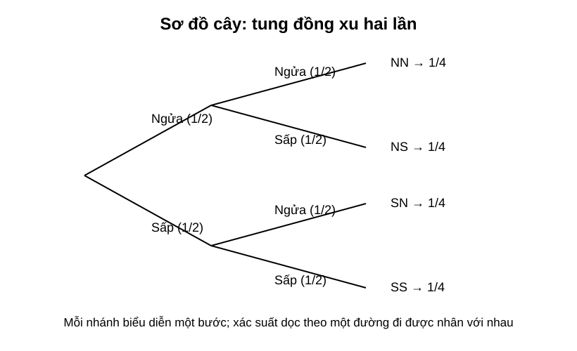
</p>

> Khi thí nghiệm có nhiều bước liên tiếp, **sơ đồ cây** là công cụ rất hữu ích để liệt kê kết quả.

Ví dụ, tung đồng xu hai lần:

Không gian mẫu là:

`{NN, NS, SN, SS}`

Nếu đồng xu cân đối, mỗi kết quả có xác suất:

`1/4`

Ví dụ:

- `NN` nghĩa là lần 1 ngửa, lần 2 ngửa;
- `NS` nghĩa là lần 1 ngửa, lần 2 sấp.

Khi đi theo một nhánh trong sơ đồ cây, ta nhân các xác suất của từng bước trên nhánh đó. Với các bước độc lập, có thể nhân trực tiếp các xác suất riêng của từng bước; nếu các bước phụ thuộc nhau thì phải dùng xác suất phù hợp với điều kiện đã xảy ra trước đó.

---

### Các khái niệm cần nhớ

| Khái niệm | Ý nghĩa |
|---|---|
| Phép thử ngẫu nhiên | Thao tác có nhiều kết quả không biết trước |
| Không gian mẫu `Ω` | Tập hợp tất cả các kết quả có thể xảy ra |
| Biến cố | Một tập con của không gian mẫu |
| Xác suất của biến cố `A` | Mức độ có thể xảy ra của `A` |

---

### Tính chất cơ bản của xác suất

- `0 ≤ P(A) ≤ 1`
- Biến cố chắc chắn có xác suất bằng `1`
- Biến cố không thể xảy ra có xác suất bằng `0`

Nếu mọi kết quả đều đồng khả năng:

`P(A) = n(A) / n(Ω)`

trong đó:

- `n(A)` là số kết quả thuận lợi cho biến cố `A`;
- `n(Ω)` là số phần tử của không gian mẫu.

---

### Khi nào nên dùng sơ đồ cây?

Sơ đồ cây đặc biệt hữu ích khi:

- thí nghiệm có **nhiều bước liên tiếp**;
- cần liệt kê **toàn bộ kết quả**;
- dễ nhầm nếu chỉ liệt kê bằng lời;
- cần tính xác suất của các biến cố như “ít nhất một lần”, “cả hai lần”, “đúng một lần”.

---

### Mẹo làm bài xác suất

- Luôn xác định **phép thử** trước.
- Viết rõ **không gian mẫu**.
- Xác định đúng **biến cố cần tính**.
- Kiểm tra xem các kết quả có **đồng khả năng** hay không.
- Với bài nhiều bước, ưu tiên dùng **sơ đồ cây** hoặc bảng liệt kê.

---

### Quy trình giải bài xác suất

```text
Xác định phép thử
      ↓
Lập không gian mẫu
      ↓
Xác định biến cố cần xét
      ↓
Đếm số kết quả thuận lợi
      ↓
Áp dụng công thức xác suất
      ↓
Kết luận
```

---

## 🎯 2. Mục tiêu cần đạt

Sau khi hoàn thành chuyên đề, học sinh cần:

- [ ] Phân biệt được phép thử ngẫu nhiên, không gian mẫu và biến cố.
- [ ] Lập đúng không gian mẫu trong các phép thử đơn giản.
- [ ] Tính được xác suất cổ điển khi các kết quả đồng khả năng.
- [ ] Tính và diễn giải được xác suất thực nghiệm từ một thí nghiệm lặp lại.
- [ ] Phân biệt được xác suất thực nghiệm với xác suất theo mô hình đồng khả năng.
- [ ] Nhận biết biến cố chắc chắn và biến cố không thể.
- [ ] Dùng được bảng hoặc sơ đồ cây cho thí nghiệm nhiều bước.
- [ ] Giải được các bài “ít nhất một”, “đúng một”, “cả hai”.
- [ ] Biết kiểm tra tính hợp lý của kết quả xác suất.

---

## 📖 3. Kiến thức cốt lõi

### 3.1. Phép thử ngẫu nhiên

Phép thử ngẫu nhiên là một thao tác mà ta biết các kết quả có thể xảy ra nhưng **không biết chắc kết quả nào sẽ xuất hiện trước khi thực hiện**.

Ví dụ:
- tung đồng xu;
- gieo xúc xắc;
- rút một thẻ từ hộp.

### 3.2. Không gian mẫu

Không gian mẫu, ký hiệu `Ω`, là tập hợp tất cả các kết quả có thể xảy ra.

Ví dụ gieo một xúc xắc:

`Ω = {1, 2, 3, 4, 5, 6}`

Do đó:

`n(Ω) = 6`

### 3.3. Biến cố

Biến cố là một tập con của không gian mẫu.

Ví dụ:
- `A`: “ra số chẵn”
- `A = {2, 4, 6}`

Có:
- biến cố chắc chắn: luôn xảy ra;
- biến cố không thể: không thể xảy ra;
- biến cố ngẫu nhiên: có thể xảy ra hoặc không.

### 3.4. Xác suất cổ điển

Khi không gian mẫu hữu hạn và các kết quả trong không gian mẫu **đồng khả năng**:

`P(A) = n(A) / n(Ω)`

Trong đó:
- `n(A)` là số kết quả thuận lợi;
- `n(Ω)` là tổng số kết quả có thể.

Luôn có:

`0 ≤ P(A) ≤ 1`


#### Hiểu sâu (mở rộng): Vì sao không thể chia đều cho 11 tổng của hai xúc xắc?

Gieo **hai xúc xắc cân đối và phân biệt**. Tổng số chấm có thể nhận 11 giá trị, từ `2` đến `12`, nhưng **11 giá trị tổng này không đồng khả năng**:

- Tổng bằng `2` chỉ có một cách: `(1;1)`.
- Tổng bằng `7` có sáu cách: `(1;6)`, `(2;5)`, `(3;4)`, `(4;3)`, `(5;2)`, `(6;1)`.

Nếu coi 11 tổng là 11 kết quả đồng khả năng rồi tính `P(tổng = 2) = 1/11` thì **sai**.

Cách đếm đúng là lấy **cặp có thứ tự (mặt xúc xắc thứ nhất; mặt xúc xắc thứ hai)** làm kết quả. Có `6 × 6 = 36` cặp đồng khả năng, nên:

- `P(tổng = 2) = 1/36`.
- `P(tổng = 7) = 6/36 = 1/6`.

**Tự kiểm tra:** Trước khi dùng `n(A)/n(Ω)`, hãy hỏi: *Các kết quả mình đang đếm có thực sự đồng khả năng không?*

---

### 3.4A. Xác suất thực nghiệm

Thực hiện cùng một phép thử `n` lần. Nếu biến cố `A` xảy ra `m` lần thì **xác suất thực nghiệm** của `A` trong loạt thử đó là:

`P_thực nghiệm(A) = m/n`

Ví dụ, gieo một đồng xu `50` lần và quan sát được `27` lần ngửa thì:

`P_thực nghiệm(Ngửa) = 27/50 = 0,54`

Cần phân biệt:

- `m/n` được tính từ **kết quả quan sát thực tế**;
- `n(A)/n(Ω)` là xác suất theo **mô hình có các kết quả đồng khả năng**.

Khi một thí nghiệm ổn định được lặp lại nhiều lần, tần số tương đối của biến cố thường có xu hướng ổn định quanh xác suất của biến cố trong mô hình. Tuy nhiên, với một số lần thử hữu hạn, hai giá trị **không bắt buộc bằng nhau**.

<p align="center">
  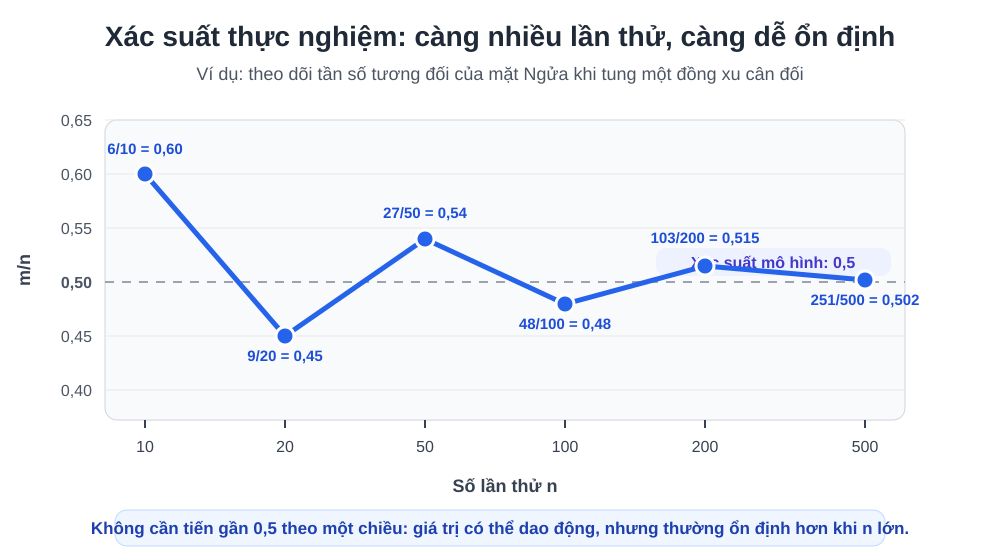
</p>

> Hình trên nhấn mạnh một điểm quan trọng: xác suất thực nghiệm **không cần tiến về 0,5 theo một chiều**. Nó có thể lúc cao hơn, lúc thấp hơn; điều đáng chú ý là khi số lần thử lớn, mức dao động thường nhỏ hơn và giá trị có xu hướng ổn định quanh xác suất của mô hình.

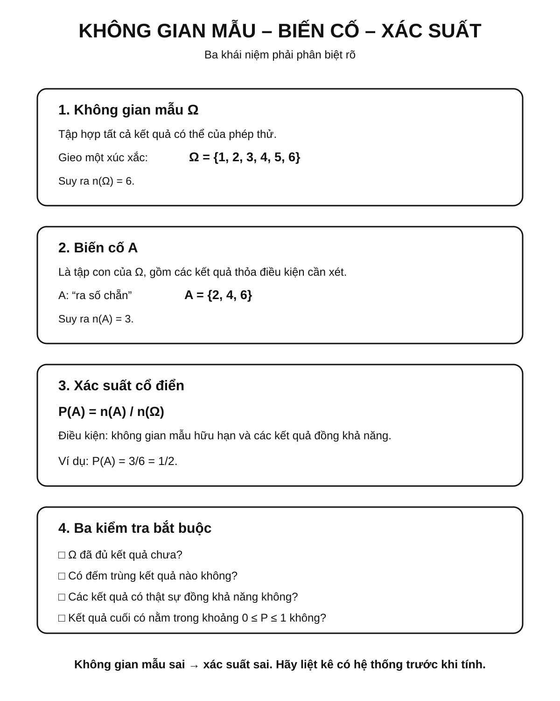

### 3.5. Biến cố đối

Nếu `A` là một biến cố thì biến cố đối của `A` là biến cố “A không xảy ra”.

Khi đó:

`P(không A) = 1 - P(A)`

Công thức này đặc biệt hữu ích với các bài “ít nhất một”.

Ví dụ:

`P(ít nhất một lần ngửa) = 1 - P(không có lần nào ngửa)`

### 3.6. Thí nghiệm nhiều bước

Với nhiều bước liên tiếp, có thể dùng:
- bảng liệt kê;
- sơ đồ cây.

Ví dụ tung đồng xu hai lần:

`Ω = {NN, NS, SN, SS}`

Nếu đồng xu cân đối thì mỗi kết quả có xác suất `1/4`.

### 3.7. Quy tắc nhân trên sơ đồ cây

Xác suất của một nhánh nhiều bước được tính bằng tích các xác suất tương ứng trên đường đi.

- Nếu các bước **độc lập**, dùng trực tiếp xác suất của từng bước.
- Nếu bước sau **phụ thuộc** vào kết quả trước, xác suất ở bước sau phải là xác suất ứng với điều kiện đã xảy ra.

> Ví dụ khi rút vật **không hoàn lại**, thành phần còn lại trong hộp đã thay đổi. Vì vậy không được tự động dùng lại xác suất ban đầu ở bước sau; phải cập nhật số trường hợp còn lại trên từng nhánh.

Ví dụ, khi tung một đồng xu cân đối hai lần độc lập:

`P(NN) = 1/2 × 1/2 = 1/4`

### 3.8. Bảng chọn chiến lược

| Dạng câu hỏi | Hướng xử lý |
|---|---|
| Một phép thử đơn giản | Liệt kê không gian mẫu |
| Các kết quả đồng khả năng | Dùng `P(A)=n(A)/n(Ω)` |
| Có số liệu từ nhiều lần thử thực tế | Dùng `P_thực nghiệm(A)=m/n` |
| Hai hoặc nhiều bước | Dùng bảng hoặc sơ đồ cây |
| “Ít nhất một” | Cân nhắc dùng biến cố đối |
| “Đúng một” | Liệt kê các trường hợp phù hợp |
| “Cả hai” | Xét nhánh thỏa đồng thời hai điều kiện |

---

## 🔗 4. Kiến thức liên quan

- **Kiến thức nên ôn trước:** [22 – Các đại lượng đặc trưng của dữ liệu](../22-dai-luong-dac-trung/index.md); đồng thời cần chắc phân số, tỉ lệ và kỹ năng đếm trường hợp từ [02 – Số và phép tính](../02-so-va-phep-tinh/index.md).
- **Liên hệ mạnh:** phân số, tỉ lệ, đếm trường hợp.
- **Chuyên đề sử dụng tiếp:** [24 – Bài toán thực tế](../24-bai-toan-thuc-te/index.md), [25 – Tổng hợp ôn thi vào 10](../25-tong-hop-on-thi-10/index.md)

---

## 🧩 5. Các dạng bài cần nắm vững

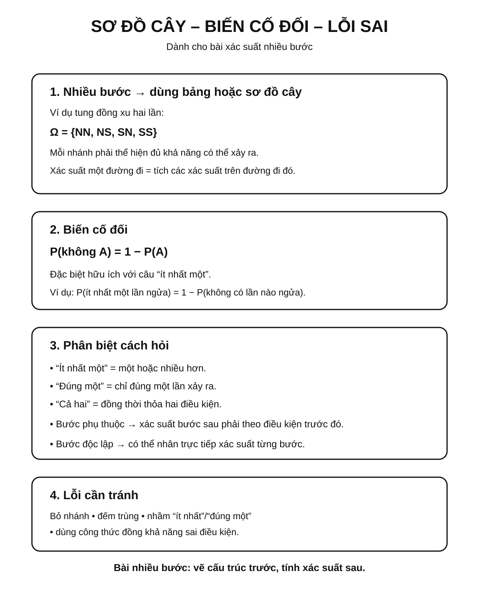

### Dạng 1. Lập không gian mẫu

Liệt kê đầy đủ, không bỏ sót và không trùng.

### Dạng 2. Tính xác suất một biến cố đơn giản

Dùng:

`P(A) = n(A)/n(Ω)`

khi các kết quả đồng khả năng.

### Dạng 2A. Xác suất thực nghiệm

Từ số lần biến cố xảy ra trong `n` lần thử, tính `m/n` và diễn giải kết quả theo đúng loạt thí nghiệm đã thực hiện.

### Dạng 3. Biến cố chắc chắn và không thể

Nhận biết nhanh qua điều kiện của phép thử.

### Dạng 4. Tung đồng xu / gieo xúc xắc nhiều lần

Dùng bảng hoặc sơ đồ cây để liệt kê kết quả.

### Dạng 5. Bài “ít nhất một”

Thường nhanh hơn nếu dùng:

`1 - P(không xảy ra lần nào)`

### Dạng 6. Bài “đúng một”

Liệt kê các trường hợp thỏa đúng một điều kiện.

### Dạng 7. Bài toán thực tế

Mô hình hóa tình huống thành phép thử, không gian mẫu và biến cố.

---

## 🚀 6. Dạng bài thi vào lớp 10

Trong Roadmap ôn thi vào lớp 10, xác suất được xếp ở mức ưu tiên cao vừa phải và nên luyện cùng các bài đếm trường hợp, sơ đồ cây và tình huống thực tế.

Các kỹ năng cần chắc:
1. Lập đúng không gian mẫu.
2. Đếm đúng số kết quả thuận lợi.
3. Phân biệt xác suất thực nghiệm với xác suất theo mô hình đồng khả năng.
4. Dùng xác suất cổ điển đúng điều kiện.
5. Dùng sơ đồ cây cho nhiều bước và cập nhật đúng khi bước sau phụ thuộc bước trước.
6. Xử lý các câu “ít nhất một”, “đúng một”.
7. Viết kết luận phù hợp ngữ cảnh.

Mức ưu tiên ôn thi: **⭐⭐⭐⭐**.

---

## ⚠️ 7. Lỗi sai thường gặp

| Lỗi sai | Cách tránh |
|---|---|
| Bỏ sót kết quả trong không gian mẫu | Liệt kê có hệ thống |
| Đếm trùng một kết quả | Dùng ký hiệu rõ từng bước |
| Dùng `n(A)/n(Ω)` khi kết quả không đồng khả năng | Kiểm tra điều kiện trước |
| Nhầm xác suất thực nghiệm với xác suất lý thuyết | Xác định giá trị đang đến từ dữ liệu quan sát hay từ mô hình |
| Rút không hoàn lại nhưng vẫn dùng xác suất ban đầu ở bước sau | Cập nhật số phần tử còn lại trên từng nhánh |
| Nhầm “ít nhất một” với “đúng một” | Viết lại bằng lời đơn giản |
| Quên kiểm tra `0 ≤ P ≤ 1` | Kiểm tra sau khi tính |
| Sơ đồ cây thiếu một nhánh | Mỗi nút phải có đủ khả năng xảy ra |

---

## 📝 8. Luyện tập

Học [**5 Learning Cards KNTT Core**](core/index.md) trên trang riêng theo thứ tự lớp 6–8; mỗi thẻ gồm kiến thức, ví dụ mẫu và ba câu kiểm tra nhanh **Base → Trap → Apply**. Làm sai sẽ có giải thích và gợi ý để thử lại.

- **→ [Mở Practice Room CĐ23](bai-tap.md)** để luyện ngân hàng 120 câu; hệ thống hiện nhãn tầng Core / Core-Support / Entrance10.
- Các câu về biến cố đối, sơ đồ cây, hai xúc xắc và rút không hoàn lại là nội dung bổ trợ/mở rộng, không tính vào Core Readiness.

---

## ✅ 9. Tự kiểm tra

Bài tự luận hiện có gồm cả câu về thí nghiệm nhiều bước, được giữ để **tự luyện bổ sung**, không phải bài kiểm tra Core Readiness tương tác. Bài Core Readiness 12 câu được tách riêng và chỉ chấm khi nộp, không khóa chuyên đề tiếp theo.

- **→ [Mở Core Readiness tương tác](tu-kiem-tra.md)** (12 câu, chấm sau khi nộp).
- **→ [Mở bài tự luận bổ sung](tu-kiem-tra-tu-luan.md)** (có nội dung mở rộng).

---

## 🔄 10. Liên kết Roadmap

- **← Trước:** [22 – Các đại lượng đặc trưng của dữ liệu](../22-dai-luong-dac-trung/index.md)
- **→ Tiếp theo:** [24 – Bài toán thực tế](../24-bai-toan-thuc-te/index.md)
- **→ Kiến thức nền liên hệ:** [02 – Số và phép tính](../02-so-va-phep-tinh/index.md), [21 – Thống kê](../21-thong-ke/index.md)
- **→ Tổng hợp:** [25 – Ôn thi vào 10](../25-tong-hop-on-thi-10/index.md)

- **✏️ Luyện tập:** [Bài tập Chuyên đề 23](bai-tap.md)
- **✅ Tự kiểm tra:** [Tự kiểm tra Chuyên đề 23](tu-kiem-tra.md)

Xem toàn bộ hệ thống tại [Blueprint 25 chuyên đề](../../roadmap/blueprint-25-chuyen-de.md).

---

## 🏁 11. Điều kiện hoàn thành

Tự theo dõi tiến độ theo nội dung từng lớp:

- [ ] Lập đúng không gian mẫu.
- [ ] Xác định đúng biến cố.
- [ ] Dùng đúng công thức xác suất cổ điển.
- [ ] Tính và phân biệt được xác suất thực nghiệm.
- [ ] Nếu học mở rộng, thử bài nhiều bước và sơ đồ cây; không tính vào KNTT Core.
- [ ] Nếu học mở rộng, tìm hiểu biến cố đối; không tính vào KNTT Core.
- [ ] Kiểm tra được tính hợp lý của kết quả.
- [ ] Chữa lại câu micro-practice sai; có thể học tiếp CĐ24 bất kể điểm bài tự luận. Core Readiness tương tác là tín hiệu ôn tập mềm, không khóa việc học tiếp.
`````

### CT23 — design-only R3 candidate, NOT published

- Topic: `23-xac-suat`
- Candidate path: `docs/kien-thuc/23-xac-suat/preview-composition-r3.md` in PR #574
- Git blob SHA: `7992d8a9b9182893cba413a575cd6da029852759`
- **AUTHORITY: proposed authoring change only, must be reviewed against source above.**

`````markdown
> **BẢN THỬ BỐ CỤC R3 · CHƯA PHÁT HÀNH:** Chỉ thay đổi cách trình bày một phần ngắn; các kiến thức còn lại giữ theo nguồn chính thức.

<link rel="stylesheet" href="../../../assets/stylesheets/math-knowledge-composition-v1.css">

# Chuyên đề 23 – Xác suất

> **Trạng thái:** Đã kiểm định nội dung học thuật; cấu trúc Roadmap chuẩn 11 mục.
>
> **Core theo mapping hiện có:** lớp 6–8, học đúng chặng theo lớp; phần nhiều bước là mở rộng không bắt buộc.
> **Mạch kiến thức:** Xác suất
> **Mức ưu tiên:** ⭐⭐⭐⭐

---

!!! info "Ranh giới Core / bài mở rộng"
    Toán 6 KNTT Bài 42–43: kết quả có thể, sự kiện và xác suất thực nghiệm. Toán 7 Bài 29–30: biến cố và xác suất đơn giản. Toán 8 Bài 30–32: phép thử và tỉ số xác suất. Các bài nhiều xúc xắc, sơ đồ cây nâng cao, biến cố đối và rút không hoàn lại được luyện bổ sung, **không tự động tính vào KNTT Core Readiness**. Mapping lớp 9 hiện chưa có liên kết PRIMARY tới CĐ23; không suy ra mọi nội dung xác suất lớp 9 đều nằm ngoài chương trình.

## 🧭 1. Bản đồ kiến thức

```text
XÁC SUẤT
│
├── Phép thử ngẫu nhiên
│   └── kết quả không biết trước
│
├── Không gian mẫu Ω
│   └── tập hợp mọi kết quả có thể
│
├── Biến cố
│   ├── biến cố chắc chắn
│   ├── biến cố không thể
│   └── biến cố ngẫu nhiên
│
├── Xác suất thực nghiệm
│   └── số lần A xảy ra / số lần thử
│
├── Xác suất cổ điển
│   └── P(A) = n(A) / n(Ω) khi đồng khả năng
│
└── Thí nghiệm nhiều bước
    ├── bảng liệt kê
    └── sơ đồ cây
```

Mạch tư duy trọng tâm:

**xác định phép thử → liệt kê đúng không gian mẫu → mô tả biến cố → đếm kết quả thuận lợi → tính xác suất → kiểm tra kết quả nằm trong `[0,1]`.**

---

## Minh họa trực quan

### 1. Không gian mẫu và biến cố

<p align="center">
  
</p>

> **Không gian mẫu** là tập hợp tất cả các kết quả có thể xảy ra của một phép thử ngẫu nhiên.

Ví dụ, khi gieo một con xúc xắc một lần:

`Ω = {1, 2, 3, 4, 5, 6}`

Nếu xét biến cố `A`: “ra số chẵn”, thì:

`A = {2, 4, 6}`

Vì có `3` kết quả thuận lợi trên `6` kết quả có thể, nên:

`P(A) = 3/6 = 1/2`

---

### 2. Xác suất của một biến cố đơn giản

<p align="center">
  
</p>

> Với một phép thử có các kết quả **đồng khả năng**, xác suất của biến cố được tính bằng:

`P(A) = số kết quả thuận lợi / tổng số kết quả có thể`

Ví dụ, khi tung một đồng xu cân đối:

- không gian mẫu gồm `Ngửa`, `Sấp`;
- mỗi kết quả có khả năng như nhau;
- nên:

`P(Ngửa) = 1/2`

`P(Sấp) = 1/2`

Lưu ý quan trọng:

> Xác suất của một biến cố luôn nằm trong khoảng từ `0` đến `1`.

---

### 3. Sơ đồ cây cho thí nghiệm nhiều bước

<p align="center">
  
</p>

> Khi thí nghiệm có nhiều bước liên tiếp, **sơ đồ cây** là công cụ rất hữu ích để liệt kê kết quả.

Ví dụ, tung đồng xu hai lần:

Không gian mẫu là:

`{NN, NS, SN, SS}`

Nếu đồng xu cân đối, mỗi kết quả có xác suất:

`1/4`

Ví dụ:

- `NN` nghĩa là lần 1 ngửa, lần 2 ngửa;
- `NS` nghĩa là lần 1 ngửa, lần 2 sấp.

Khi đi theo một nhánh trong sơ đồ cây, ta nhân các xác suất của từng bước trên nhánh đó. Với các bước độc lập, có thể nhân trực tiếp các xác suất riêng của từng bước; nếu các bước phụ thuộc nhau thì phải dùng xác suất phù hợp với điều kiện đã xảy ra trước đó.

---

### Các khái niệm cần nhớ

| Khái niệm | Ý nghĩa |
|---|---|
| Phép thử ngẫu nhiên | Thao tác có nhiều kết quả không biết trước |
| Không gian mẫu `Ω` | Tập hợp tất cả các kết quả có thể xảy ra |
| Biến cố | Một tập con của không gian mẫu |
| Xác suất của biến cố `A` | Mức độ có thể xảy ra của `A` |

---

### Tính chất cơ bản của xác suất

- `0 ≤ P(A) ≤ 1`
- Biến cố chắc chắn có xác suất bằng `1`
- Biến cố không thể xảy ra có xác suất bằng `0`

Nếu mọi kết quả đều đồng khả năng:

`P(A) = n(A) / n(Ω)`

trong đó:

- `n(A)` là số kết quả thuận lợi cho biến cố `A`;
- `n(Ω)` là số phần tử của không gian mẫu.

---

### Khi nào nên dùng sơ đồ cây?

Sơ đồ cây đặc biệt hữu ích khi:

- thí nghiệm có **nhiều bước liên tiếp**;
- cần liệt kê **toàn bộ kết quả**;
- dễ nhầm nếu chỉ liệt kê bằng lời;
- cần tính xác suất của các biến cố như “ít nhất một lần”, “cả hai lần”, “đúng một lần”.

---

### Mẹo làm bài xác suất

- Luôn xác định **phép thử** trước.
- Viết rõ **không gian mẫu**.
- Xác định đúng **biến cố cần tính**.
- Kiểm tra xem các kết quả có **đồng khả năng** hay không.
- Với bài nhiều bước, ưu tiên dùng **sơ đồ cây** hoặc bảng liệt kê.

---

### Quy trình giải bài xác suất

```text
Xác định phép thử
      ↓
Lập không gian mẫu
      ↓
Xác định biến cố cần xét
      ↓
Đếm số kết quả thuận lợi
      ↓
Áp dụng công thức xác suất
      ↓
Kết luận
```

---

## 🎯 2. Mục tiêu cần đạt

Sau khi hoàn thành chuyên đề, học sinh cần:

- [ ] Phân biệt được phép thử ngẫu nhiên, không gian mẫu và biến cố.
- [ ] Lập đúng không gian mẫu trong các phép thử đơn giản.
- [ ] Tính được xác suất cổ điển khi các kết quả đồng khả năng.
- [ ] Tính và diễn giải được xác suất thực nghiệm từ một thí nghiệm lặp lại.
- [ ] Phân biệt được xác suất thực nghiệm với xác suất theo mô hình đồng khả năng.
- [ ] Nhận biết biến cố chắc chắn và biến cố không thể.
- [ ] Dùng được bảng hoặc sơ đồ cây cho thí nghiệm nhiều bước.
- [ ] Giải được các bài “ít nhất một”, “đúng một”, “cả hai”.
- [ ] Biết kiểm tra tính hợp lý của kết quả xác suất.

---

## 📖 3. Kiến thức cốt lõi

### 3.1. Phép thử ngẫu nhiên

Phép thử ngẫu nhiên là một thao tác mà ta biết các kết quả có thể xảy ra nhưng **không biết chắc kết quả nào sẽ xuất hiện trước khi thực hiện**.

Ví dụ:
- tung đồng xu;
- gieo xúc xắc;
- rút một thẻ từ hộp.

### 3.2. Không gian mẫu

Không gian mẫu, ký hiệu `Ω`, là tập hợp tất cả các kết quả có thể xảy ra.

Ví dụ gieo một xúc xắc:

`Ω = {1, 2, 3, 4, 5, 6}`

Do đó:

`n(Ω) = 6`

### 3.3. Biến cố

Biến cố là một tập con của không gian mẫu.

Ví dụ:
- `A`: “ra số chẵn”
- `A = {2, 4, 6}`

Có:
- biến cố chắc chắn: luôn xảy ra;
- biến cố không thể: không thể xảy ra;
- biến cố ngẫu nhiên: có thể xảy ra hoặc không.

### 3.4. Xác suất cổ điển

Khi không gian mẫu hữu hạn và các kết quả trong không gian mẫu **đồng khả năng**:

`P(A) = n(A) / n(Ω)`

Trong đó:
- `n(A)` là số kết quả thuận lợi;
- `n(Ω)` là tổng số kết quả có thể.

Luôn có:

`0 ≤ P(A) ≤ 1`


#### Hiểu sâu (mở rộng): Vì sao không thể chia đều cho 11 tổng của hai xúc xắc?

Gieo **hai xúc xắc cân đối và phân biệt**. Tổng số chấm có thể nhận 11 giá trị, từ `2` đến `12`, nhưng **11 giá trị tổng này không đồng khả năng**:

- Tổng bằng `2` chỉ có một cách: `(1;1)`.
- Tổng bằng `7` có sáu cách: `(1;6)`, `(2;5)`, `(3;4)`, `(4;3)`, `(5;2)`, `(6;1)`.

Nếu coi 11 tổng là 11 kết quả đồng khả năng rồi tính `P(tổng = 2) = 1/11` thì **sai**.

Cách đếm đúng là lấy **cặp có thứ tự (mặt xúc xắc thứ nhất; mặt xúc xắc thứ hai)** làm kết quả. Có `6 × 6 = 36` cặp đồng khả năng, nên:

- `P(tổng = 2) = 1/36`.
- `P(tổng = 7) = 6/36 = 1/6`.

**Tự kiểm tra:** Trước khi dùng `n(A)/n(Ω)`, hãy hỏi: *Các kết quả mình đang đếm có thực sự đồng khả năng không?*

---

### 3.4A. Xác suất thực nghiệm

Thực hiện cùng một phép thử `n` lần. Nếu biến cố `A` xảy ra `m` lần thì **xác suất thực nghiệm** của `A` trong loạt thử đó là:

`P_thực nghiệm(A) = m/n`

Ví dụ, gieo một đồng xu `50` lần và quan sát được `27` lần ngửa thì:

`P_thực nghiệm(Ngửa) = 27/50 = 0,54`

Cần phân biệt hai cách tính:

| **Xác suất thực nghiệm** | **Xác suất cổ điển** |
|:---|:---|
| $\dfrac{m}{n}$ | $\dfrac{n(A)}{n(\Omega)}$ |
| Tính từ **kết quả quan sát thực tế** qua $n$ lần thử. | Áp dụng khi các kết quả trong không gian mẫu **đồng khả năng**. |

Khi một thí nghiệm ổn định được lặp lại nhiều lần, tần số tương đối của biến cố thường có xu hướng ổn định quanh xác suất của biến cố trong mô hình. Tuy nhiên, với một số lần thử hữu hạn, hai giá trị **không bắt buộc bằng nhau**.

<p align="center">
  
</p>

> Hình trên nhấn mạnh một điểm quan trọng: xác suất thực nghiệm **không cần tiến về 0,5 theo một chiều**. Nó có thể lúc cao hơn, lúc thấp hơn; điều đáng chú ý là khi số lần thử lớn, mức dao động thường nhỏ hơn và giá trị có xu hướng ổn định quanh xác suất của mô hình.


<div class="math-composition"><nav class="math-related-practice" aria-label="Bài tập liên quan đến nội dung vừa học">
<span>Thực hành kiến thức này:</span>
<a href="../bai-tap/?mode=remediation&amp;focus=xac-suat-thuc-nghiem">Luyện ngay →</a>
<a href="../../../luyen-tap/tu-luan/?topic=CT23#wx23-pro-001">Làm tự luận · WX23-PRO-001 →</a>
</nav></div>

### 3.5. Biến cố đối

Nếu `A` là một biến cố thì biến cố đối của `A` là biến cố “A không xảy ra”.

Khi đó:

`P(không A) = 1 - P(A)`

Công thức này đặc biệt hữu ích với các bài “ít nhất một”.

Ví dụ:

`P(ít nhất một lần ngửa) = 1 - P(không có lần nào ngửa)`

### 3.6. Thí nghiệm nhiều bước

Với nhiều bước liên tiếp, có thể dùng:
- bảng liệt kê;
- sơ đồ cây.

Ví dụ tung đồng xu hai lần:

`Ω = {NN, NS, SN, SS}`

Nếu đồng xu cân đối thì mỗi kết quả có xác suất `1/4`.

### 3.7. Quy tắc nhân trên sơ đồ cây

Xác suất của một nhánh nhiều bước được tính bằng tích các xác suất tương ứng trên đường đi.

- Nếu các bước **độc lập**, dùng trực tiếp xác suất của từng bước.
- Nếu bước sau **phụ thuộc** vào kết quả trước, xác suất ở bước sau phải là xác suất ứng với điều kiện đã xảy ra.

> Ví dụ khi rút vật **không hoàn lại**, thành phần còn lại trong hộp đã thay đổi. Vì vậy không được tự động dùng lại xác suất ban đầu ở bước sau; phải cập nhật số trường hợp còn lại trên từng nhánh.

Ví dụ, khi tung một đồng xu cân đối hai lần độc lập:

`P(NN) = 1/2 × 1/2 = 1/4`

### 3.8. Bảng chọn chiến lược

| Dạng câu hỏi | Hướng xử lý |
|---|---|
| Một phép thử đơn giản | Liệt kê không gian mẫu |
| Các kết quả đồng khả năng | Dùng `P(A)=n(A)/n(Ω)` |
| Có số liệu từ nhiều lần thử thực tế | Dùng `P_thực nghiệm(A)=m/n` |
| Hai hoặc nhiều bước | Dùng bảng hoặc sơ đồ cây |
| “Ít nhất một” | Cân nhắc dùng biến cố đối |
| “Đúng một” | Liệt kê các trường hợp phù hợp |
| “Cả hai” | Xét nhánh thỏa đồng thời hai điều kiện |

---

## 🔗 4. Kiến thức liên quan

- **Kiến thức nên ôn trước:** [22 – Các đại lượng đặc trưng của dữ liệu](../22-dai-luong-dac-trung/index.md); đồng thời cần chắc phân số, tỉ lệ và kỹ năng đếm trường hợp từ [02 – Số và phép tính](../02-so-va-phep-tinh/index.md).
- **Liên hệ mạnh:** phân số, tỉ lệ, đếm trường hợp.
- **Chuyên đề sử dụng tiếp:** [24 – Bài toán thực tế](../24-bai-toan-thuc-te/index.md), [25 – Tổng hợp ôn thi vào 10](../25-tong-hop-on-thi-10/index.md)

---

## 🧩 5. Các dạng bài cần nắm vững

### Dạng 1. Lập không gian mẫu

Liệt kê đầy đủ, không bỏ sót và không trùng.

### Dạng 2. Tính xác suất một biến cố đơn giản

Dùng:

`P(A) = n(A)/n(Ω)`

khi các kết quả đồng khả năng.

### Dạng 2A. Xác suất thực nghiệm

Từ số lần biến cố xảy ra trong `n` lần thử, tính `m/n` và diễn giải kết quả theo đúng loạt thí nghiệm đã thực hiện.

### Dạng 3. Biến cố chắc chắn và không thể

Nhận biết nhanh qua điều kiện của phép thử.

### Dạng 4. Tung đồng xu / gieo xúc xắc nhiều lần

Dùng bảng hoặc sơ đồ cây để liệt kê kết quả.

### Dạng 5. Bài “ít nhất một”

Thường nhanh hơn nếu dùng:

`1 - P(không xảy ra lần nào)`

### Dạng 6. Bài “đúng một”

Liệt kê các trường hợp thỏa đúng một điều kiện.

### Dạng 7. Bài toán thực tế

Mô hình hóa tình huống thành phép thử, không gian mẫu và biến cố.

---

## 🚀 6. Dạng bài thi vào lớp 10

Trong Roadmap ôn thi vào lớp 10, xác suất được xếp ở mức ưu tiên cao vừa phải và nên luyện cùng các bài đếm trường hợp, sơ đồ cây và tình huống thực tế.

Các kỹ năng cần chắc:
1. Lập đúng không gian mẫu.
2. Đếm đúng số kết quả thuận lợi.
3. Phân biệt xác suất thực nghiệm với xác suất theo mô hình đồng khả năng.
4. Dùng xác suất cổ điển đúng điều kiện.
5. Dùng sơ đồ cây cho nhiều bước và cập nhật đúng khi bước sau phụ thuộc bước trước.
6. Xử lý các câu “ít nhất một”, “đúng một”.
7. Viết kết luận phù hợp ngữ cảnh.

Mức ưu tiên ôn thi: **⭐⭐⭐⭐**.

---

## ⚠️ 7. Lỗi sai thường gặp

| Lỗi sai | Cách tránh |
|---|---|
| Bỏ sót kết quả trong không gian mẫu | Liệt kê có hệ thống |
| Đếm trùng một kết quả | Dùng ký hiệu rõ từng bước |
| Dùng `n(A)/n(Ω)` khi kết quả không đồng khả năng | Kiểm tra điều kiện trước |
| Nhầm xác suất thực nghiệm với xác suất lý thuyết | Xác định giá trị đang đến từ dữ liệu quan sát hay từ mô hình |
| Rút không hoàn lại nhưng vẫn dùng xác suất ban đầu ở bước sau | Cập nhật số phần tử còn lại trên từng nhánh |
| Nhầm “ít nhất một” với “đúng một” | Viết lại bằng lời đơn giản |
| Quên kiểm tra `0 ≤ P ≤ 1` | Kiểm tra sau khi tính |
| Sơ đồ cây thiếu một nhánh | Mỗi nút phải có đủ khả năng xảy ra |

---

## 📝 8. Luyện tập

Học [**5 Learning Cards KNTT Core**](core/index.md) trên trang riêng theo thứ tự lớp 6–8; mỗi thẻ gồm kiến thức, ví dụ mẫu và ba câu kiểm tra nhanh **Base → Trap → Apply**. Làm sai sẽ có giải thích và gợi ý để thử lại.

- **→ [Mở Practice Room CĐ23](bai-tap.md)** để luyện ngân hàng 120 câu; hệ thống hiện nhãn tầng Core / Core-Support / Entrance10.
- Các câu về biến cố đối, sơ đồ cây, hai xúc xắc và rút không hoàn lại là nội dung bổ trợ/mở rộng, không tính vào Core Readiness.

---

## ✅ 9. Tự kiểm tra

Bài tự luận hiện có gồm cả câu về thí nghiệm nhiều bước, được giữ để **tự luyện bổ sung**, không phải bài kiểm tra Core Readiness tương tác. Bài Core Readiness 12 câu được tách riêng và chỉ chấm khi nộp, không khóa chuyên đề tiếp theo.

- **→ [Mở Core Readiness tương tác](tu-kiem-tra.md)** (12 câu, chấm sau khi nộp).
- **→ [Mở bài tự luận bổ sung](tu-kiem-tra-tu-luan.md)** (có nội dung mở rộng).

---

## 🔄 10. Liên kết Roadmap

- **← Trước:** [22 – Các đại lượng đặc trưng của dữ liệu](../22-dai-luong-dac-trung/index.md)
- **→ Tiếp theo:** [24 – Bài toán thực tế](../24-bai-toan-thuc-te/index.md)
- **→ Kiến thức nền liên hệ:** [02 – Số và phép tính](../02-so-va-phep-tinh/index.md), [21 – Thống kê](../21-thong-ke/index.md)
- **→ Tổng hợp:** [25 – Ôn thi vào 10](../25-tong-hop-on-thi-10/index.md)

- **✏️ Luyện tập:** [Bài tập Chuyên đề 23](bai-tap.md)
- **✅ Tự kiểm tra:** [Tự kiểm tra Chuyên đề 23](tu-kiem-tra.md)

Xem toàn bộ hệ thống tại [Blueprint 25 chuyên đề](../../roadmap/blueprint-25-chuyen-de.md).

---

## 🏁 11. Điều kiện hoàn thành

Tự theo dõi tiến độ theo nội dung từng lớp:

- [ ] Lập đúng không gian mẫu.
- [ ] Xác định đúng biến cố.
- [ ] Dùng đúng công thức xác suất cổ điển.
- [ ] Tính và phân biệt được xác suất thực nghiệm.
- [ ] Nếu học mở rộng, thử bài nhiều bước và sơ đồ cây; không tính vào KNTT Core.
- [ ] Nếu học mở rộng, tìm hiểu biến cố đối; không tính vào KNTT Core.
- [ ] Kiểm tra được tính hợp lý của kết quả.
- [ ] Chữa lại câu micro-practice sai; có thể học tiếp CĐ24 bất kể điểm bài tự luận. Core Readiness tương tác là tín hiệu ôn tập mềm, không khóa việc học tiếp.
`````

---

**Owner/CI reminder:** passing the 16 academic comparison checks does not invalidate existing source-lock tests or authorize deployment. Source-governance re-baselining must be a separately reviewed change with the original SHA recorded, exact academic delta, source provenance and rollback plan. Never reset learner history or edit the canonical 87 Written objects for a layout-only change.
