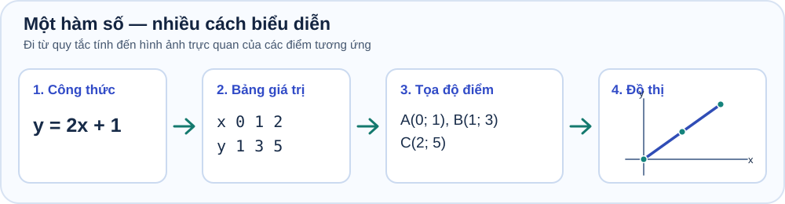
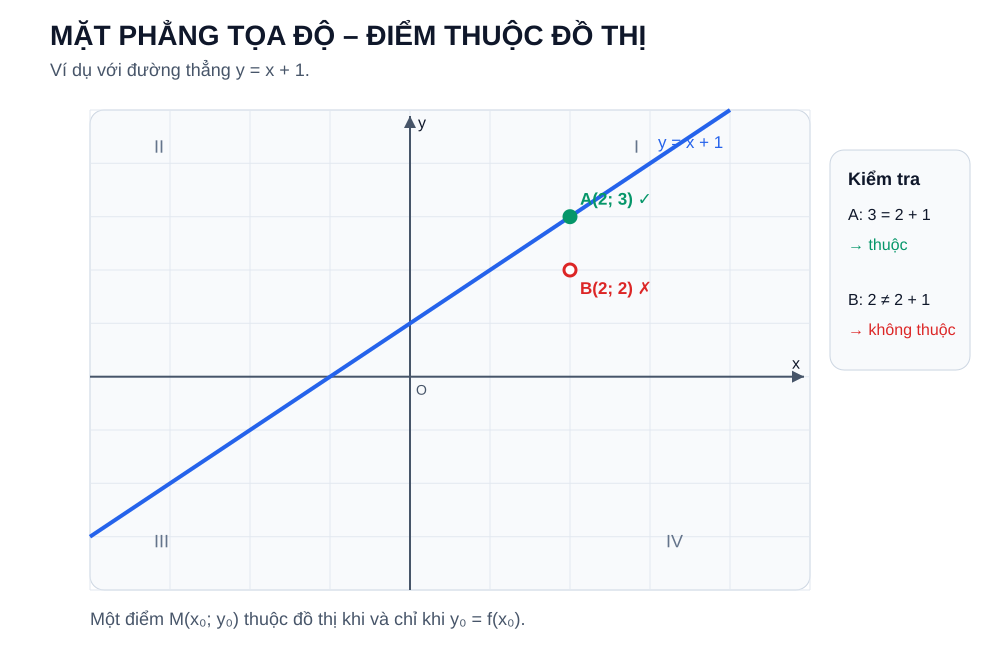
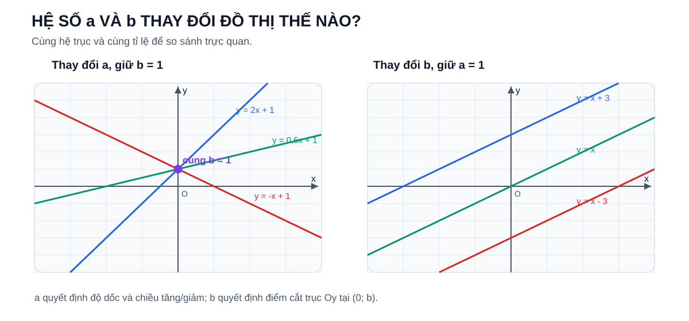
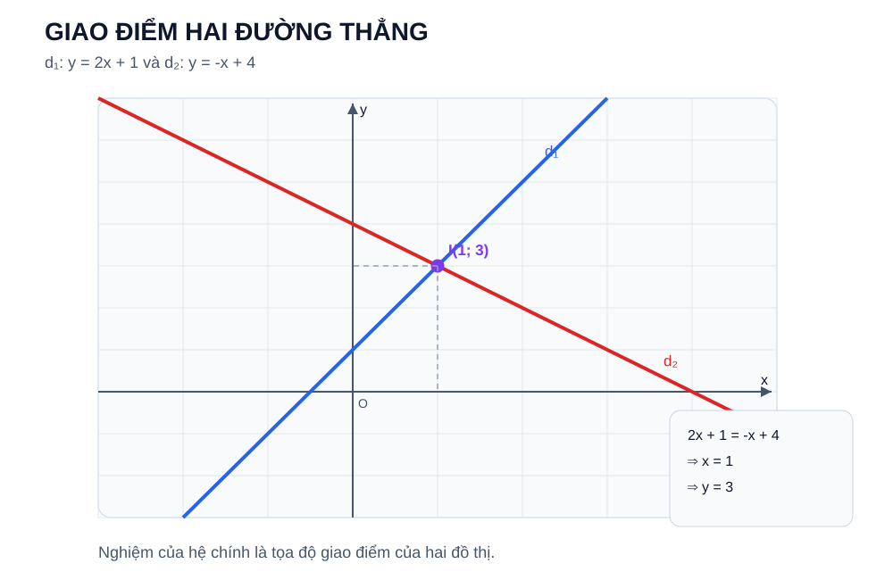
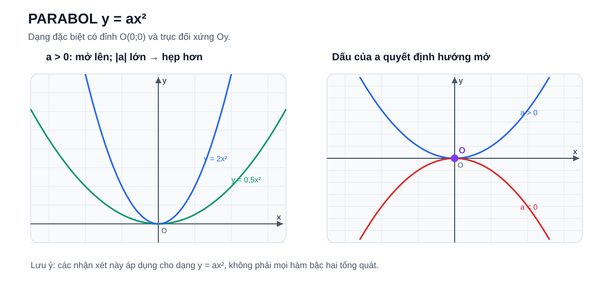
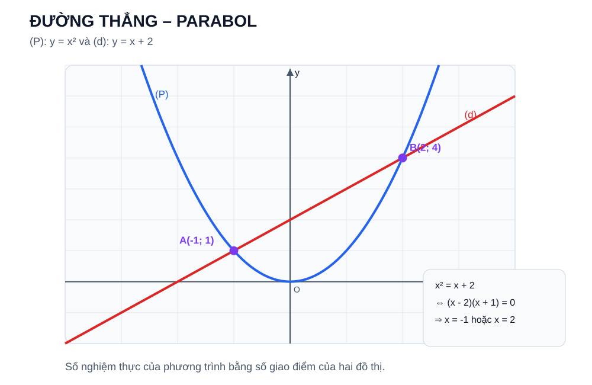

# Chuyên đề 10 – Hàm số và đồ thị

<span id="ct10-pilot-r4"></span>
<link rel="stylesheet" href="../../../assets/stylesheets/math-topic-knowledge-tabs-pilot-r5.css">

> **BẢN THỬ R6 — CHƯA PHÁT HÀNH:** Chuyên đề 10 dùng nội dung thật; hình minh họa và điều hướng đã biên tập để đối chiếu. Không ghi điểm và không thay đổi chương trình THCS chính thức.

<nav class="math-topic-quicknav" aria-label="Vị trí đọc trong chuyên đề">
<a href="#ct10-section-map">Bản đồ</a><a href="#ct10-section-knowledge">Kiến thức</a><a href="#ct10-section-types">Các dạng bài</a><a href="#ct10-section-practice">Luyện tập</a><a href="#ct10-section-ready">Readiness</a>
</nav>


> **Trạng thái:** Đã kiểm định nội dung học thuật; cấu trúc Roadmap chuẩn 11 mục.
>
> **Lớp trọng tâm:** 7–9
> **Mạch kiến thức:** Đại số
> **Mức ưu tiên:** ⭐⭐⭐⭐⭐

> **Vai trò trong Roadmap:** cầu nối giữa đại số và hình học tọa độ; giúp học sinh hiểu quan hệ giữa công thức, bảng giá trị, điểm trên mặt phẳng và hình dạng đồ thị.
>

---


<span id="ct10-section-map"></span>

## 🧭 1. Bản đồ kiến thức

```text
HÀM SỐ VÀ ĐỒ THỊ
│
├── 1. Quan hệ giữa hai đại lượng
│   ├── Biến số
│   ├── Giá trị của hàm số
│   └── Bảng giá trị
│
├── 2. Mặt phẳng tọa độ
│   ├── Trục Ox, Oy
│   ├── Tọa độ điểm M(x; y)
│   └── Biểu diễn điểm
│
├── 3. Hàm số bậc nhất
│   ├── y = ax + b
│   ├── Hệ số góc a
│   ├── Tung độ gốc b
│   └── Đồ thị là đường thẳng
│
├── 4. Quan hệ hai đường thẳng
│   ├── Cắt nhau
│   ├── Song song
│   └── Trùng nhau
│
├── 5. Giao điểm đồ thị
│   ├── Giải hệ phương trình
│   └── Ý nghĩa hình học
│
└── 6. Mở rộng lớp 9
    ├── y = ax² (a ≠ 0)
    ├── Parabol
    └── Chuẩn bị cho phương trình bậc hai
```

---

## 🎯 2. Mục tiêu cần đạt

Sau khi hoàn thành chuyên đề, học sinh cần có thể:

- [ ] Hiểu khái niệm hàm số theo nghĩa một đại lượng phụ thuộc vào đại lượng khác.
- [ ] Tính được giá trị của hàm số tại một giá trị cho trước của biến.
- [ ] Đọc và lập được bảng giá trị đơn giản.
- [ ] Xác định và biểu diễn đúng tọa độ của điểm trên mặt phẳng.
- [ ] Nhận biết hàm số bậc nhất \(y = ax + b\) với \(a \ne  0\).
- [ ] Vẽ được đồ thị hàm số bậc nhất bằng hai điểm phù hợp.
- [ ] Hiểu ý nghĩa của hệ số góc \(a\) và tung độ gốc \(b\).
- [ ] Nhận biết hai đường thẳng cắt nhau, song song hoặc trùng nhau từ hệ số.
- [ ] Tìm giao điểm của hai đồ thị bằng phương pháp đại số.
- [ ] Hiểu sự liên hệ giữa giao điểm đồ thị và nghiệm của hệ phương trình.
- [ ] Nhận biết đồ thị \(y = ax^2\) và hình dạng parabol ở mức chuẩn bị cho lớp 9.

---

## 📖 3. Kiến thức cốt lõi

<span id="ct10-section-knowledge"></span>


**Sơ đồ trực quan:** Một quan hệ hàm số có thể được đọc qua công thức, bảng giá trị, tọa độ điểm và đồ thị.



<div class="math-topic-figure-caption">Sơ đồ cho thấy bốn cách biểu diễn cùng một quan hệ toán học, thay cho infographic chép lại các định nghĩa.</div>


=== "01 · Khái niệm & bảng giá trị"

    ### 3.1. Khái niệm hàm số

    Nếu với mỗi giá trị \(x\) thuộc tập xác định ta xác định được **duy nhất một giá trị tương ứng của \(y\)**, thì \(y\) được gọi là hàm số của \(x\).

    Ví dụ:

    \(y = 2x + 3\)

    Khi:

    - \(x = 0\) thì \(y = 3\)
    - \(x = 1\) thì \(y = 5\)
    - \(x = -2\) thì \(y = -1\)

    Có thể viết:

    \(f(x) = 2x + 3\)

    Khi đó:

    \(f(1) = 5\)

    > **Điểm cốt lõi:** với mỗi \(x\) thuộc tập xác định, hàm số chỉ gán **một** giá trị \(y\) tương ứng.

    ---

    ### 3.2. Bảng giá trị

    Với hàm số:

    \(y = 2x - 1\)

    Ta có thể lập bảng:

    | x | -1 | 0 | 1 | 2 |
    |---:|---:|---:|---:|---:|
    | y | -3 | -1 | 1 | 3 |

    Bảng giá trị giúp chuyển từ **công thức đại số** sang **các điểm trên đồ thị**.

    ---


=== "02 · Tọa độ & điểm trên đồ thị"

    ### 3.3. Mặt phẳng tọa độ

    Mặt phẳng tọa độ gồm hai trục vuông góc:

    - trục hoành \(Ox\)
    - trục tung \(Oy\)

    Một điểm \(M(x; y)\) có:

    - \(x\): hoành độ
    - \(y\): tung độ

    Ví dụ:

    \(A(2; 3)\) nghĩa là từ gốc \(O\) đi 2 đơn vị theo chiều dương \(Ox\), rồi 3 đơn vị theo chiều dương \(Oy\).

    ### Bốn góc phần tư

    - Góc phần tư I: \(x > 0, y > 0\)
    - Góc phần tư II: \(x < 0, y > 0\)
    - Góc phần tư III: \(x < 0, y < 0\)
    - Góc phần tư IV: \(x > 0, y < 0\)

    > ⚠️ Không đảo thứ tự \((x; y)\) thành \((y; x)\).

    ---

    ### 3.4. Điểm thuộc đồ thị

    Điểm \(M(x_0; y_0)\) thuộc đồ thị của hàm số \(y = f(x)\) khi và chỉ khi \(x_0\) thuộc tập xác định của hàm số và:

    \(y_0 = f(x_0)\)

    Ví dụ:

    Xét \(y = 2x + 1\).

    Điểm \(A(2; 5)\) thuộc đồ thị vì:

    \(2\cdot 2 + 1 = 5\)

    Điểm \(B(2; 4)\) không thuộc đồ thị vì:

    \(2\cdot 2 + 1 \ne  4\)

    #### Trực quan – điểm thuộc và không thuộc đồ thị

    

    Điểm nằm “gần” đường thẳng chưa đủ. Muốn kết luận một điểm thuộc đồ thị, tọa độ của nó phải thỏa **đúng phương trình** của đồ thị.

    ---


=== "03 · Hàm số bậc nhất"

    ### 3.5. Hàm số bậc nhất

    #### Dạng tổng quát

    Hàm số bậc nhất có dạng:

    \[
    y=ax+b,\qquad a\ne 0
    \]

    Trong đó:

    - \(a\) là hệ số góc
    - \(b\) là tung độ gốc

    Đồ thị là một **đường thẳng**.

    ---

    #### Trường hợp đặc biệt \(y = ax\)

    Khi \(b = 0\):

    \(y = ax\)

    Đồ thị luôn đi qua gốc tọa độ \(O(0; 0)\).

    Ví dụ:

    \(y = 2x\)

    Chọn hai điểm:

    - \(O(0; 0)\)
    - \(A(1; 2)\)

    Nối hai điểm ta được đồ thị.

    ---

    #### Cách vẽ đồ thị \(y=ax+b\)

    Vì đồ thị của \(y=ax+b\), với \(a\ne0\), là một đường thẳng, ta cần xác định **hai điểm phân biệt**.

    <div class="math-topic-step-grid" aria-label="Hai bước xác định hai điểm của đường thẳng">
      <article class="math-topic-step">
        <p class="math-topic-step-label">BƯỚC 1 · TÌM ĐIỂM A</p>
        <p>Cho <strong>\(x=0\)</strong>, suy ra:</p>
        <p class="math-topic-step-math">\(y=b\)</p>
        <p class="math-topic-step-result">\(A(0;b)\)</p>
        <p class="math-topic-step-note">Giao điểm với trục tung \(Oy\).</p>
      </article>
      <div class="math-topic-step-arrow" aria-hidden="true">→</div>
      <article class="math-topic-step">
        <p class="math-topic-step-label">BƯỚC 2 · TÌM ĐIỂM B</p>
        <p>Nếu <strong>\(b\ne0\)</strong>, cho <strong>\(y=0\)</strong>:</p>
        <p class="math-topic-step-math">\(ax+b=0\Rightarrow x=-\frac{b}{a}\)</p>
        <p class="math-topic-step-result">\(B(-\frac{b}{a};0)\)</p>
        <p class="math-topic-step-note">Giao điểm với trục hoành \(Ox\).</p>
      </article>
    </div>

    <p class="math-topic-step-conclude"><strong>Hoàn tất:</strong> Đánh dấu hai điểm \(A\) và \(B\), rồi nối chúng bằng đường thẳng.</p>

    <div class="math-topic-warning"><strong>Trường hợp đặc biệt \(b=0\):</strong> Hai thao tác \(x=0\) và \(y=0\) đều cho điểm \(O(0;0)\), nên chưa đủ hai điểm phân biệt. Hãy lấy thêm \(x=1\), được \(B(1;a)\), rồi nối \(O\) với \(B\).</div>

    ##### Ví dụ: Vẽ đường thẳng \(y=2x-4\)

    <div class="math-topic-worked-row">
      <div><span class="math-topic-worked-label">Bước 1 · \(x=0\)</span><strong>\(y=-4\)</strong><span>\(A(0;-4)\)</span></div>
      <span class="math-topic-worked-arrow" aria-hidden="true">→</span>
      <div><span class="math-topic-worked-label">Bước 2 · \(y=0\)</span><strong>\(2x-4=0\Rightarrow x=2\)</strong><span>\(B(2;0)\)</span></div>
      <span class="math-topic-worked-arrow" aria-hidden="true">→</span>
      <div><span class="math-topic-worked-label">Kết luận</span><strong>Nối \(A\) và \(B\)</strong><span>Ta được đồ thị cần vẽ.</span></div>
    </div>

    ---

    
    #### Ý nghĩa của hệ số góc \(a\)

    Trong \(y = ax + b\):

    - nếu \(a > 0\): hàm số đồng biến
    - nếu \(a < 0\): hàm số nghịch biến

    Trên cùng một hệ trục tọa độ và cùng tỉ lệ đơn vị, có thể hiểu trực quan:

    - với \(a > 0\), \(a\) càng lớn thì đường thẳng càng dốc lên;
    - với \(a < 0\), \(|a|\) càng lớn thì đường thẳng càng dốc xuống.

    Ví dụ:

    - \(y = 3x + 1\): tăng
    - \(y = -2x + 1\): giảm

    ---

    #### Ý nghĩa của \(b\)

    Trong \(y = ax + b\), khi \(x = 0\):

    \(y = b\)

    Do đó đồ thị luôn cắt trục \(Oy\) tại:

    \((0; b)\)

    Ví dụ:

    \(y = 2x - 5\)

    cắt \(Oy\) tại \((0; -5)\).

    #### Trực quan – vai trò của \(a\) và \(b\)

    

    Đọc hình theo hai câu hỏi:

    1. **Giữ \(b\) cố định, đổi \(a\):** các đường thẳng vẫn đi qua cùng điểm trên \(Oy\), nhưng độ dốc và chiều tăng/giảm thay đổi.
    2. **Giữ \(a\) cố định, đổi \(b\):** các đường thẳng song song với nhau và chỉ dịch lên/xuống.

    Cách nhìn này giúp tránh học thuộc rời rạc “\(a\) là hệ số góc, \(b\) là tung độ gốc”.

    ---


=== "04 · Quan hệ & giao điểm"

    ### 3.6. Mở rộng / Entrance10 – Vị trí tương đối của hai đường thẳng

    Xét:

    \(d_1: y = a_1x + b_1\)

    \(d_2: y = a_2x + b_2\)

    #### Hai đường thẳng cắt nhau

    Nếu:

    \(a_1 \ne  a_2\)

    thì hai đường thẳng cắt nhau tại đúng một điểm.

    ---

    #### Hai đường thẳng song song

    Nếu:

    \(a_1 = a_2\)

    và:

    \(b_1 \ne  b_2\)

    thì hai đường thẳng song song.

    ---

    #### Hai đường thẳng trùng nhau

    Nếu:

    \(a_1 = a_2\)

    và:

    \(b_1 = b_2\)

    thì hai đường thẳng trùng nhau.

    ##### Bảng ghi nhớ

    | Quan hệ | Điều kiện |
    |---|---|
    | Cắt nhau | \(a_1 \ne  a_2\) |
    | Song song | \(a_1 = a_2\), \(b_1 \ne  b_2\) |
    | Trùng nhau | \(a_1 = a_2\), \(b_1 = b_2\) |

    ---

    ### 3.7. Mở rộng / Entrance10 – Giao điểm của hai đồ thị

    Giả sử:

    \(d_1: y = 2x + 1\)

    \(d_2: y = -x + 4\)

    Tại giao điểm, cùng một \(x\) phải cho cùng một \(y\).

    Do đó:

    \(2x + 1 = -x + 4\)

    \(3x = 3\)

    \(x = 1\)

    Thay vào:

    \(y = 3\)

    Vậy giao điểm là:

    \(I(1; 3)\)

    ##### Liên hệ với hệ phương trình

    Giao điểm trên chính là nghiệm của hệ:

    ```text
    y = 2x + 1
    y = -x + 4
    ```

    Hay viết dưới dạng chuẩn của hệ hai phương trình bậc nhất hai ẩn.

    > Đây là cầu nối trực tiếp với [Chuyên đề 09 – Hệ phương trình bậc nhất hai ẩn](../09-he-phuong-trinh/index.md).

    #### Trực quan – nghiệm hệ là giao điểm đồ thị

    

    Hình cho thấy cùng một kết quả theo hai ngôn ngữ:

    - **đại số:** giải \(2x + 1 = -x + 4\) được \(x = 1\), rồi \(y = 3\);
    - **hình học:** hai đường thẳng gặp nhau tại \(I(1; 3)\).

    Vì vậy, giải hệ và tìm giao điểm thực chất là hai cách mô tả cùng một bài toán.

    ---


=== "05 · Parabol và mở rộng"

    ### 3.8. Mở rộng – Đồ thị \(y = ax^2\)

    Với \(a \ne  0\), hàm số:

    \(y = ax^2\)

    có đồ thị là một **parabol**.

    #### Một số tính chất quan trọng

    - có đỉnh tại \(O(0; 0)\);
    - nhận trục \(Oy\) làm trục đối xứng;
    - nếu \(a > 0\), parabol mở lên;
    - nếu \(a < 0\), parabol mở xuống.

    #### Trực quan – dấu và độ lớn của \(a\)

    

    Với dạng đặc biệt \(y = ax^2\):

    - dấu của \(a\) quyết định parabol mở **lên** hay **xuống**;
    - với cùng dấu, \(|a|\) lớn hơn làm parabol **hẹp hơn**;
    - mọi đồ thị dạng này đều đi qua \(O(0;0)\) và đối xứng qua \(Oy\).

    Ví dụ:

    \(y = x^2\)

    Bảng giá trị:

    | x | -2 | -1 | 0 | 1 | 2 |
    |---:|---:|---:|---:|---:|---:|
    | y | 4 | 1 | 0 | 1 | 4 |

    Ta thấy các giá trị tại \(x\) và \(-x\) bằng nhau.

    > Phần này là bước chuẩn bị trực tiếp cho [Chuyên đề 12 – Phương trình bậc hai & Viète](../12-phuong-trinh-bac-hai-viete/index.md).

    > **Phạm vi:** các tính chất “đỉnh tại \(O\)” và “trục đối xứng là \(Oy\)” ở trên chỉ áp dụng cho dạng đặc biệt \(y = ax^2\). Không được suy rộng chúng cho mọi hàm bậc hai \(y = ax^2 + bx + c\); dạng tổng quát được dùng như nội dung kết nối ở Chuyên đề 12 và sẽ học sâu hơn ở THPT.

    ---


## 🔗 4. Kiến thức liên quan

- **Cần nắm trước:** [03 – Tỉ lệ, tỉ lệ thức](../03-ti-le-ti-le-thuc/index.md), [08 – Phương trình và bất phương trình](../08-phuong-trinh-bat-phuong-trinh/index.md), [09 – Hệ phương trình](../09-he-phuong-trinh/index.md).
- **Liên hệ mạnh:** mặt phẳng tọa độ, quan hệ giữa hai đại lượng và ý nghĩa hình học của nghiệm hệ phương trình.
- **Sử dụng tiếp:** [12 – Phương trình bậc hai và Viète](../12-phuong-trinh-bac-hai-viete/index.md), [24 – Bài toán thực tế và mô hình hóa](../24-bai-toan-thuc-te/index.md).

## 🧩 5. Các dạng bài cần nắm vững

<span id="ct10-section-types"></span>


**Đọc theo phương pháp:** Mỗi dạng có dấu hiệu nhận biết, cách giải và ví dụ. Ngay sau dạng bài là liên kết đến bài luyện đã có; một số dạng nâng cao còn cần bổ sung bài đại diện riêng.


=== "01 · Tính giá trị & kiểm tra điểm"

    ### Dạng 1 – Tính giá trị hàm số

    #### Dấu hiệu

    Đề cho công thức \(y = f(x)\) và yêu cầu tính \(f(a)\).

    #### Phương pháp

    Thay \(x = a\) vào công thức.

    #### Ví dụ

    Cho \(f(x) = 3x - 2\).

    Tính \(f(4)\).

    \(f(4) = 3\cdot 4 - 2 = 10\).

    ---

    <div class="math-topic-links"><a href="../bai-tap/?mode=remediation&amp;focus=tinh-gia-tri-ham">Luyện ngay →</a></div>

    ### Dạng 2 – Kiểm tra điểm thuộc đồ thị

    #### Dấu hiệu

    Đề cho điểm \(M(x_0; y_0)\) và hàm số.

    #### Phương pháp

    Tính \(f(x_0)\) rồi so sánh với \(y_0\).

    #### Ví dụ

    Điểm \(A(2; 7)\) có thuộc \(y = 3x + 1\) không?

    \(3\cdot 2 + 1 = 7\).

    Vậy có.

    ---

    <div class="math-topic-links"><a href="../bai-tap/?mode=remediation&amp;focus=diem-thuoc-do-thi">Luyện ngay →</a><a href="../../../luyen-tap/tu-luan/?topic=CT10#wx10-fun-002">Bài tự luận parabol WX10-FUN-002 →</a></div>

    ### Dạng 3 – Tìm tham số để điểm thuộc đồ thị

    > Khi tham số xuất hiện trong hệ số của \(x\), sau khi tìm được tham số cần kiểm tra điều kiện của dạng hàm đang xét, chẳng hạn \(a \ne  0\) nếu đề yêu cầu hàm số bậc nhất.

    Ví dụ:

    Điểm \(A(2; 5)\) thuộc đường thẳng:

    \(y = mx + 1\)

    Ta có:

    \(5 = 2m + 1\)

    \(2m = 4\)

    \(m = 2\).

    ---

    <div class="math-topic-links"><a href="../">Xem hướng giải về tham số trong bài giảng →</a></div>

    > **Bài đại diện:** Chưa xác minh được bài riêng cho dạng này trong ngân hàng đã đối chiếu. Đây là nội dung đang chờ bổ sung/kiểm định, không phải link bài đã có.


=== "02 · Vẽ và đọc đường thẳng"

    ### Dạng 4 – Vẽ đồ thị hàm số bậc nhất

    #### Quy trình

    1. Chọn hai giá trị \(x\) thuận tiện.
    2. Tính \(y\) tương ứng.
    3. Xác định hai điểm.
    4. Nối hai điểm bằng đường thẳng.

    > Khi có thể, ưu tiên hai giao điểm với các trục tọa độ.

    ---

    <div class="math-topic-links"><a href="../../../luyen-tap/tu-luan/?topic=CT10#wx10-fun-001">Bài tự luận WX10-FUN-001 →</a><a href="../bai-tap/?mode=remediation&amp;focus=ve-do-thi-ham-bac-nhat">Luyện ngay →</a></div>

    ### Dạng 5 – Tìm giao điểm với các trục

    Với:

    \(y = ax + b\)

    #### Giao với \(Oy\)

    Cho \(x = 0\).

    #### Giao với \(Ox\)

    Cho \(y = 0\).

    ---

    <div class="math-topic-links"><a href="../../../luyen-tap/tu-luan/?topic=CT10#wx10-fun-001">Bài tự luận WX10-FUN-001 →</a></div>

    ### Dạng 6 – Xét đồng biến, nghịch biến

    Với \(y = ax + b\):

    - \(a > 0\) → đồng biến
    - \(a < 0\) → nghịch biến

    ---

    <div class="math-topic-links"><a href="../../../luyen-tap/tu-luan/?topic=CT10#wx10-fun-001">Bài tự luận WX10-FUN-001 →</a></div>


=== "03 · Quan hệ giữa hai đường"

    ### Dạng 7 – Xét vị trí hai đường thẳng

    So sánh \(a_1, a_2\) và \(b_1, b_2\).

    Không cần vẽ hình nếu đề chỉ hỏi quan hệ song song/cắt nhau/trùng nhau.

    ---

    <div class="math-topic-links"><a href="../bai-tap/?mode=remediation&amp;focus=vi-tri-hai-duong-thang">Luyện ngay →</a></div>

    ### Dạng 8 – Tìm giao điểm hai đường thẳng

    Giải phương trình:

    \(a_1x + b_1 = a_2x + b_2\)

    Sau đó tính \(y\).

    ---

    <div class="math-topic-links"><a href="../../../luyen-tap/tu-luan/?topic=CT10#wx10-fun-003">Bài mỏ neo WX10-FUN-003 →</a></div>


=== "04 · Tham số trong phương trình"

    ### Dạng 9 – Tìm tham số để hai đường thẳng song song

    Ví dụ:

    \(d_1: y = (m + 1)x + 2\)

    \(d_2: y = 3x - 5\)

    Để song song:

    \(m + 1 = 3\)

    \(m = 2\)

    và hai tung độ gốc phải khác nhau, ở đây \(2 \ne  -5\), nên thỏa mãn.

    ---

    <div class="math-topic-links"><span class="math-topic-pending">Chưa có bài đại diện đã xác minh</span></div>

    > **Bài đại diện:** Chưa xác minh được bài riêng cho dạng này trong ngân hàng đã đối chiếu. Đây là nội dung đang chờ bổ sung/kiểm định, không phải link bài đã có.


    ### Dạng 10 – Tìm tham số để hai đường thẳng cắt nhau

    Với hai đường thẳng viết dưới dạng \(y = a_1x + b_1\) và \(y = a_2x + b_2\), điều kiện để chúng cắt nhau tại đúng một điểm là:

    \(a_1 \ne  a_2\)

    Ví dụ:

    \(y = (m - 2)x + 1\)

    và:

    \(y = 3x + 4\)

    Cắt nhau khi:

    \(m - 2 \ne  3\)

    \(m \ne  5\).

    ---

    <div class="math-topic-links"><span class="math-topic-pending">Chưa có bài đại diện đã xác minh</span></div>

    > **Bài đại diện:** Chưa xác minh được bài riêng cho dạng này trong ngân hàng đã đối chiếu. Đây là nội dung đang chờ bổ sung/kiểm định, không phải link bài đã có.


=== "05 · Đường thẳng & parabol"

    ### Dạng 11 – Mở rộng: giao điểm đường thẳng và parabol \(y = ax^2\)

    > Nên quay lại dạng này sau khi đã học Chuyên đề 12 về phương trình bậc hai.

    Giả sử cần tìm giao điểm của:

    ```text
    (P): y = ax²      (a ≠ 0)
    (d): y = mx + n
    ```

    Tại giao điểm, hai giá trị \(y\) bằng nhau nên:

    ```text
    ax² = mx + n
    ```

    hay:

    ```text
    ax² - mx - n = 0
    ```

    Vì vậy:

    - mỗi nghiệm thực \(x\) cho một giao điểm;
    - phương trình có hai nghiệm phân biệt → đường thẳng cắt parabol tại hai điểm;
    - có nghiệm kép → đường thẳng tiếp xúc parabol tại một điểm;
    - vô nghiệm thực → hai đồ thị không có điểm chung.

    Ví dụ với \(y = x^2\) và \(y = x + 2\):

    ```text
    x² = x + 2
    ⇔ x² - x - 2 = 0
    ⇔ (x - 2)(x + 1) = 0
    ```

    nên có hai giao điểm ứng với \(x = 2\) và \(x = -1\).

    Đây là cầu nối trực tiếp giữa **đồ thị** và **phương trình bậc hai**, không phải một kỹ thuật tách rời.

    #### Trực quan – đường thẳng và parabol

    

    Ở ví dụ trên, hai giao điểm xuất hiện đúng tại hai nghiệm của:

    \(x^2 = x + 2\).

    Do đó, số nghiệm thực của phương trình thu được sau khi cho hai biểu thức bằng nhau chính là số giao điểm của hai đồ thị. Đây là cầu nối quan trọng sang Chuyên đề 12.

    <div class="math-topic-links"><a href="../../../luyen-tap/tu-luan/?topic=CT10#wx10-fun-002">Ôn kiến thức nền parabol · WX10-FUN-002 →</a></div>

> **Bài giao điểm đường thẳng–parabol:** Chưa có bài đại diện đúng dạng được xác minh trong ngân hàng đang hiển thị; cần kiểm định bài tự luận mới trước khi gắn liên kết trực tiếp.


## 🚀 6. Dạng bài thi vào lớp 10

Các dạng được giới thiệu để định hướng ôn tập. **Chọn đúng hoạt động đã có trên website**; phần nào chưa có bài đại diện sẽ được ghi rõ, không dẫn sang bài chỉ gần giống.

<div class="math-topic-exam-table-wrap">
<table class="math-topic-exam-table">
<thead><tr><th scope="col">Dạng bài</th><th scope="col">Ưu tiên</th><th scope="col">Vị trí bài luyện</th><th scope="col">Mở bài</th></tr></thead>
<tbody>

<tr><th scope="row">Tính giá trị hàm số</th><td data-label="Ưu tiên" class="math-topic-stars" aria-label="3 trên 5">★★★</td><td data-label="Vị trí">Luyện kỹ năng · CĐ10</td><td data-label="Thực hành"><div class="math-topic-exam-actions"><a class="math-topic-exam-link practice" href="../bai-tap/?mode=remediation&amp;focus=tinh-gia-tri-ham">Luyện ngay →</a></div></td></tr>
<tr><th scope="row">Kiểm tra điểm thuộc đồ thị</th><td data-label="Ưu tiên" class="math-topic-stars" aria-label="4 trên 5">★★★★</td><td data-label="Vị trí">Luyện kỹ năng · CĐ10</td><td data-label="Thực hành"><div class="math-topic-exam-actions"><a class="math-topic-exam-link practice" href="../bai-tap/?mode=remediation&amp;focus=diem-thuoc-do-thi">Luyện ngay →</a></div></td></tr>
<tr><th scope="row">Vẽ đường thẳng</th><td data-label="Ưu tiên" class="math-topic-stars" aria-label="4 trên 5">★★★★</td><td data-label="Vị trí">Luyện kỹ năng + Tự luận</td><td data-label="Thực hành"><div class="math-topic-exam-actions"><a class="math-topic-exam-link practice" href="../bai-tap/?mode=remediation&amp;focus=ve-do-thi-ham-bac-nhat">Luyện ngay →</a><a class="math-topic-exam-link written" href="../../../luyen-tap/tu-luan/?topic=CT10#wx10-fun-001">Làm tự luận · WX10-FUN-001 →</a></div></td></tr>
<tr><th scope="row">Tìm giao điểm hai đường thẳng</th><td data-label="Ưu tiên" class="math-topic-stars" aria-label="5 trên 5">★★★★★</td><td data-label="Vị trí">Luyện kỹ năng + Bài mỏ neo</td><td data-label="Thực hành"><div class="math-topic-exam-actions"><a class="math-topic-exam-link practice" href="../bai-tap/?mode=remediation&amp;focus=giao-diem-do-thi">Luyện ngay →</a><a class="math-topic-exam-link written" href="../../../luyen-tap/tu-luan/?topic=CT10#wx10-fun-003">Làm tự luận · WX10-FUN-003 →</a></div></td></tr>
<tr><th scope="row">Tìm tham số để đường thẳng qua điểm</th><td data-label="Ưu tiên" class="math-topic-stars" aria-label="5 trên 5">★★★★★</td><td data-label="Vị trí">Chưa có bài đúng dạng</td><td data-label="Thực hành"><div class="math-topic-exam-actions"><span class="math-topic-exam-pending">Chờ kiểm định bài đại diện</span></div></td></tr>
<tr><th scope="row">Song song / cắt nhau / trùng nhau</th><td data-label="Ưu tiên" class="math-topic-stars" aria-label="5 trên 5">★★★★★</td><td data-label="Vị trí">Luyện kỹ năng · CĐ10</td><td data-label="Thực hành"><div class="math-topic-exam-actions"><a class="math-topic-exam-link practice" href="../bai-tap/?mode=remediation&amp;focus=vi-tri-hai-duong-thang">Luyện ngay →</a></div></td></tr>
<tr><th scope="row">Bài toán tham số với hệ số góc</th><td data-label="Ưu tiên" class="math-topic-stars" aria-label="5 trên 5">★★★★★</td><td data-label="Vị trí">Chưa có bài đúng dạng</td><td data-label="Thực hành"><div class="math-topic-exam-actions"><span class="math-topic-exam-pending">Chờ kiểm định bài đại diện</span></div></td></tr>
<tr><th scope="row">Liên hệ giao điểm với hệ phương trình</th><td data-label="Ưu tiên" class="math-topic-stars" aria-label="5 trên 5">★★★★★</td><td data-label="Vị trí">Luyện kỹ năng + Bài mỏ neo</td><td data-label="Thực hành"><div class="math-topic-exam-actions"><a class="math-topic-exam-link practice" href="../bai-tap/?mode=remediation&amp;focus=lien-he-he-phuong-trinh">Luyện ngay →</a><a class="math-topic-exam-link written" href="../../../luyen-tap/tu-luan/?topic=CT10#wx10-fun-003">Làm tự luận · WX10-FUN-003 →</a></div></td></tr>
<tr><th scope="row">Đường thẳng và parabol</th><td data-label="Ưu tiên" class="math-topic-stars" aria-label="5 trên 5">★★★★★</td><td data-label="Vị trí">Chưa có bài đúng dạng · mở rộng</td><td data-label="Thực hành"><div class="math-topic-exam-actions"><span class="math-topic-exam-pending">Chờ kiểm định bài đại diện</span></div></td></tr>
<tr><th scope="row">Mô hình hóa bằng đồ thị</th><td data-label="Ưu tiên" class="math-topic-stars" aria-label="4 trên 5">★★★★</td><td data-label="Vị trí">Chưa có bài đúng dạng</td><td data-label="Thực hành"><div class="math-topic-exam-actions"><span class="math-topic-exam-pending">Chờ kiểm định bài đại diện</span></div></td></tr>
</tbody></table></div>

> **Cách hiểu bảng:** Cột ưu tiên kế thừa mức đánh giá ôn tập hiện có của Roadmap, không phải xác suất xuất hiện trong đề thi chính thức. Nút **Luyện kỹ năng** mở đúng nhóm câu tương tác đang có; mã **WX** mở bài tự luận hoặc mỏ neo trong thư viện. Các dạng chứa tham số, đường thẳng–parabol và mô hình hóa bằng đồ thị đang chờ bài đại diện được kiểm định học thuật. Phần mở rộng không tính vào Core Readiness.

---

## ⚠️ 7. Lỗi sai thường gặp

### ❌ Lỗi 1 – Đảo tọa độ

Điểm \(A(2; -3)\) không phải \(A(-3; 2)\).

Luôn nhớ:

\((hoành độ; tung độ)\).

---

### ❌ Lỗi 2 – Vẽ đường thẳng chỉ bằng một điểm

Một điểm chưa xác định duy nhất một đường thẳng.

Cần ít nhất **hai điểm phân biệt**.

---

### ❌ Lỗi 3 – Quên rằng \(a \ne  0\)

Trong hàm bậc nhất:

\(y = ax + b\)

phải có:

\(a \ne  0\).

Nếu \(a = 0\) thì \(y = b\) là hàm hằng.

---

### ❌ Lỗi 4 – Nhầm điều kiện song song

Chỉ \(a_1 = a_2\) chưa đủ để kết luận song song.

Nếu thêm \(b_1 = b_2\), hai đường thẳng trùng nhau.

---

### ❌ Lỗi 5 – Tìm giao điểm nhưng chỉ tìm \(x\)

Giao điểm phải có dạng:

\(I(x; y)\).

Sau khi tìm \(x\), phải tính tiếp \(y\).

---

### ❌ Lỗi 6 – Thay tọa độ sai vị trí

Với điểm \(M(x_0; y_0)\) thuộc \(y = ax + b\), phải thay:

\(y_0 = ax_0 + b\).

---

### ❌ Lỗi 7 – Nhầm đồng biến và nghịch biến

Dấu của \(a\) quyết định:

- \(a > 0\): đồng biến
- \(a < 0\): nghịch biến

Không dùng dấu của \(b\) để kết luận.

---


<span id="ct10-section-practice"></span>

## 📝 8. Luyện tập tiếp theo

Micro-practice trong các Learning Cards dùng để kiểm tra nhanh ngay sau khi học. Khi muốn luyện sâu hơn, luyện từng skill hoặc làm bài tự luận, hãy chuyển sang **Practice Room**.

[🎯 Mở Practice Room – Chuyên đề 10](bai-tap.md){ .md-button .md-button--primary }

Trong Practice Room:

- **Luyện nhanh tương tác:** Practice Engine chọn câu từ ngân hàng lớn, có feedback, gợi ý và Tutor.
- **Luyện tự luận & trình bày:** tự giải trên giấy/vở rồi mở gợi ý hoặc lời giải để tự đối chiếu.
- Core / Entrance10 / Challenge được tách rõ.

!!! info "Phân biệt mục đích"
    Micro-practice kiểm tra hiểu ngay; Practice Room dùng để **rèn kỹ năng**. Kết quả luyện tập là formative evidence, không phải điểm kiểm tra cuối chuyên đề.

---


<span id="ct10-section-ready"></span>

## ✅ 9. Tự kiểm tra mức độ sẵn sàng

Khi đã luyện tương đối chắc, hãy làm **Core Readiness Check**.

[✅ Bắt đầu Core Readiness Check](tu-kiem-tra.md){ .md-button .md-button--primary }

Trong Readiness Check:

- không hint và không Tutor khi đang làm;
- không báo đúng/sai từng câu;
- chỉ chấm sau khi bấm **Nộp bài**;
- kết quả phân tích theo assessed skill;
- là **Soft Mastery**: không khóa chuyên đề tiếp theo;
- Entrance10 / Challenge không tính vào Core readiness.

---

## 🔄 10. Liên kết Roadmap

- **→ Tiếp theo:** [11 – Căn thức và biến đổi căn thức](../11-can-thuc/index.md)

### Kiến thức nên ôn trước

- [03. Tỉ lệ – Tỉ lệ thức – Đại lượng tỉ lệ](../03-ti-le-ti-le-thuc/index.md)
- [08. Phương trình và bất phương trình](../08-phuong-trinh-bat-phuong-trinh/index.md)
- [09. Hệ phương trình bậc nhất hai ẩn](../09-he-phuong-trinh/index.md)

### Chuyên đề sử dụng tiếp

- [12. Phương trình bậc hai & Viète](../12-phuong-trinh-bac-hai-viete/index.md)
- [24. Bài toán thực tế và mô hình hóa](../24-bai-toan-thuc-te/index.md)

### Mạch chính

```text
08. Phương trình
        ↓
09. Hệ phương trình
        ↓
10. HÀM SỐ VÀ ĐỒ THỊ
        ↓
12. Phương trình bậc hai & Viète
        ↓
25. Tổng hợp ôn thi vào 10
```

- **✏️ Luyện tập:** [Bài tập Chuyên đề 10](bai-tap.md)
- **✅ Tự kiểm tra:** [Tự kiểm tra Chuyên đề 10](tu-kiem-tra.md)

Xem toàn bộ hệ thống tại [Blueprint 25 chuyên đề](../../roadmap/blueprint-25-chuyen-de.md).

---

## 🏁 11. Điều kiện hoàn thành

Chuyên đề được xem là **đủ sẵn sàng để học tiếp** khi học sinh có phần lớn các bằng chứng sau:

- [ ] Hiểu và giải thích được các quy tắc Core của chuyên đề.
- [ ] Làm tương đối ổn định các skill Core trong Practice Room.
- [ ] Không lặp lại ổn định cùng một lỗi nền tảng sau khi đã được chữa.
- [ ] Core Readiness Check đạt khoảng **80%** hoặc học sinh đã hiểu và chữa được các lỗi còn lại.
- [ ] Có thể trình bày ít nhất một số bài tự luận Core mà không mở lời giải trước.

!!! note "Soft Mastery"
    Không cần đạt 100% mới được học tiếp. Nếu Readiness Check cho thấy một vài kỹ năng còn yếu, hệ thống khuyến nghị luyện lại đúng kỹ năng đó; học sinh vẫn có thể chuyển sang chuyên đề tiếp theo.

!!! warning "Core độc lập Extension"
    Entrance10 và Specialized-Challenge không phải điều kiện để hoàn thành KNTT Core.

---

## ➡️ Tiếp tục học

<div class="topic-workspace-actions" markdown>

[🎯 Sang Phòng Luyện Tập](bai-tap.md){ .md-button .md-button--primary }

[✅ Kiểm Tra Độ Sẵn Sàng](tu-kiem-tra.md){ .md-button }

[→ 11 – Căn thức và biến đổi căn thức](../11-can-thuc/index.md){ .md-button }

</div>


<script src="../../../assets/javascripts/math-topic-knowledge-tabs-pilot-r4.js" defer></script>
