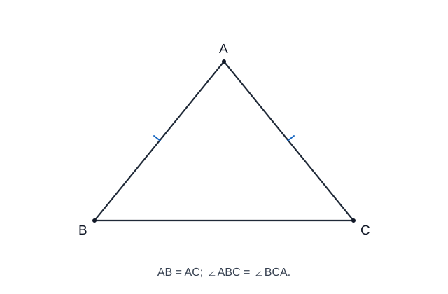

> **BẢN THỬ BỐ CỤC & INFOGRAPHIC · CHƯA PHÁT HÀNH:** Chỉ thay đổi cách trình bày một phần ngắn; các kiến thức còn lại giữ theo nguồn chính thức.

<link rel="stylesheet" href="../../../assets/stylesheets/math-knowledge-composition-v1.css">

# Chuyên đề 14 – Tam giác


> **Trạng thái:** Đã kiểm định nội dung học thuật; cấu trúc Roadmap chuẩn 11 mục.
>
> **Lớp trọng tâm:** 7
> **Mạch kiến thức:** Hình học
> **Mức ưu tiên:** ⭐⭐⭐⭐⭐

> **Vai trò trong Roadmap:** nền tảng trung tâm của Hình học THCS, nối trực tiếp từ Chuyên đề 13 sang các chuyên đề 15, 17, 18 và 19.
>

---

## 🧭 1. Bản đồ kiến thức

> **Xem nhanh:** dùng infographic để nhìn toàn cảnh các mạch góc, cạnh, tam giác đặc biệt và hai tam giác bằng nhau trước khi học chi tiết.

```text
TAM GIÁC
│
├── 1. Thành phần cơ bản
│   ├── Đỉnh – cạnh – góc
│   ├── Chu vi – diện tích
│   └── Phân loại tam giác
│
├── 2. Quan hệ góc
│   ├── Tổng ba góc bằng 180°
│   ├── Góc ngoài
│   └── So sánh góc – cạnh
│
├── 3. Quan hệ cạnh
│   ├── Bất đẳng thức tam giác
│   ├── So sánh cạnh – góc đối diện
│   └── Điều kiện tồn tại tam giác
│
├── 4. Tam giác đặc biệt
│   ├── Tam giác cân
│   ├── Tam giác đều
│   └── Tam giác vuông
│
└── 5. Hai tam giác bằng nhau
    ├── c.c.c
    ├── c.g.c
    ├── g.c.g
    └── Trường hợp tam giác vuông
```

---

### Minh họa trực quan

#### 1. Tam giác cân

<p align="center">
  
</p>

> Trong tam giác cân, hai góc ở đáy bằng nhau. Đặc biệt, **đường trung tuyến kẻ từ đỉnh cân xuống đáy** đồng thời là đường cao và đường phân giác của góc ở đỉnh.

#### 2. Định lý Pythagore

<p align="center">
  
</p>

> Với tam giác `ABC` vuông tại `A`, cạnh huyền là `BC` và định lý Pythagore cho: `BC² = AB² + AC²`.

---

## 🎯 2. Mục tiêu cần đạt

Sau khi hoàn thành chuyên đề, học sinh cần:

- [ ] Nhận biết và phân loại được các loại tam giác.
- [ ] Sử dụng thành thạo tổng ba góc trong tam giác và góc ngoài.
- [ ] Hiểu và áp dụng bất đẳng thức tam giác.
- [ ] Biết so sánh cạnh dựa vào góc và ngược lại.
- [ ] Nắm chắc tính chất và dấu hiệu nhận biết tam giác cân, đều, vuông.
- [ ] Nhận dạng đúng các trường hợp bằng nhau của hai tam giác.
- [ ] Biết chọn cặp tam giác thích hợp để chứng minh hai đoạn thẳng hoặc hai góc bằng nhau.
- [ ] Trình bày được một chứng minh hình học theo chuỗi giả thiết → lập luận → kết luận.

---

## 📖 3. Kiến thức cốt lõi

> Infographic này tóm tắt ba công cụ nền: tổng góc, quan hệ cạnh–góc đối diện và điều kiện tồn tại tam giác.

### 3.1. Tam giác và ký hiệu

Tam giác `ABC` được tạo bởi ba điểm `A, B, C` không thẳng hàng. Ba cạnh và ba góc có thể nhìn song song:

<div class="math-composition"><div class="math-compare">
  <article><h4>Ba cạnh</h4><p>\(AB\), \(BC\), \(CA\)</p></article>
  <article><h4>Ba góc</h4><p>\(\angle A=\angle BAC\)</p><p>\(\angle B=\angle ABC\)</p><p>\(\angle C=\angle ACB\)</p></article>
</div></div>

Chu vi:

`P = AB + BC + CA`

Diện tích:

`S = 1/2 · a · h`

trong đó `a` là độ dài đáy và `h` là chiều cao tương ứng.

---

### 3.2. Phân loại tam giác

#### Theo cạnh

- **Tam giác thường:** ba cạnh không có quan hệ đặc biệt.
- **Tam giác cân:** có hai cạnh bằng nhau.
- **Tam giác đều:** có ba cạnh bằng nhau.

#### Theo góc

- **Tam giác nhọn:** ba góc đều nhỏ hơn `90°`.
- **Tam giác vuông:** có một góc bằng `90°`.
- **Tam giác tù:** có một góc lớn hơn `90°`.

> Một tam giác không thể có hai góc vuông hoặc hai góc tù vì tổng ba góc chỉ bằng `180°`.

---

### 3.3. Tổng ba góc trong tam giác

Với mọi tam giác `ABC`:

`∠A + ∠B + ∠C = 180°`

#### Ví dụ

Nếu `∠A = 50°`, `∠B = 60°` thì:

`∠C = 180° - 50° - 60° = 70°`

---

### 3.4. Góc ngoài của tam giác

Góc ngoài tại một đỉnh bằng tổng hai góc trong không kề với nó.

Ví dụ, kéo dài `BC` qua `C` đến `D`:

`∠ACD = ∠A + ∠B`

Do đó góc ngoài luôn lớn hơn mỗi góc trong không kề với nó.

---

### 3.5. Quan hệ giữa cạnh và góc đối diện

Trong một tam giác:

- Góc lớn hơn đối diện cạnh lớn hơn.
- Cạnh lớn hơn đối diện góc lớn hơn.

Ví dụ:

Nếu `∠A > ∠B` thì `BC > AC`.

Ngược lại, nếu `BC > AC` thì `∠A > ∠B`.

> ⚠️ Khi so sánh phải ghép **đúng cạnh với góc đối diện**.

---


<div class="math-composition"><nav class="math-related-practice" aria-label="Bài tập liên quan đến nội dung vừa học">
<span>Thực hành kiến thức này:</span>
<a href="../bai-tap/?mode=remediation&amp;focus=so-sanh-canh-goc">Luyện ngay →</a>
<a href="../../../luyen-tap/tu-luan/?topic=CT14#wx14-tri-003">Làm tự luận · WX14-TRI-003 →</a>
</nav></div>

### 3.6. Bất đẳng thức tam giác

Trong một tam giác, tổng độ dài hai cạnh bất kỳ lớn hơn cạnh còn lại:

`AB + AC > BC`

`AB + BC > AC`

`AC + BC > AB`

Tương đương, nếu ba độ dài là `a, b, c`, điều kiện tồn tại tam giác có thể viết gọn:

`|a - b| < c < a + b`

#### Ví dụ

Ba đoạn `3 cm, 4 cm, 8 cm` không lập thành tam giác vì:

`3 + 4 < 8`

---

### 3.6A. Đường vuông góc, đường xiên và đường trung trực

Từ điểm \(A\) ngoài đường thẳng \(d\), nếu \(AH\perp d\) và \(B\in d, B\ne H\), thì:

\[
AH<AB.
\]

Nói cách khác, đoạn vuông góc là đoạn ngắn nhất từ một điểm đến một đường thẳng.

**Đường trung trực** của đoạn \(AB\) là đường thẳng vuông góc với \(AB\) tại trung điểm của \(AB\).

Tính chất hai chiều:

- nếu \(P\) nằm trên trung trực \(AB\) thì \(PA=PB\);
- nếu \(PA=PB\) thì \(P\) nằm trên trung trực \(AB\).

> Đây là Core lớp 7; không được thay bằng việc nhìn hình thấy hai đoạn “có vẻ bằng nhau”.

> Dùng bản này để phân biệt nhanh tam giác cân, đều, vuông và hai chiều của định lý Pythagore.

### 3.7. Tam giác đặc biệt

#### Tam giác cân

Tam giác `ABC` cân tại `A` nếu:

`AB = AC`

Khi đó:

`∠B = ∠C`

Nếu `M` là trung điểm của đáy `BC` thì trong tam giác cân tại `A`, đường trung tuyến `AM` đồng thời là đường cao và đường phân giác:

`AM ⟂ BC`

và:

`∠BAM = ∠MAC`

##### Dấu hiệu nhận biết

Nếu trong một tam giác có hai góc bằng nhau thì tam giác đó cân.

Tức là:

`∠B = ∠C ⇒ AB = AC`

---

#### Tam giác đều

Tam giác đều có ba cạnh bằng nhau:

`AB = BC = CA`

Suy ra:

`∠A = ∠B = ∠C = 60°`

##### Dấu hiệu thường dùng

- Ba cạnh bằng nhau.
- Ba góc bằng nhau.
- Một tam giác cân có một góc bằng `60°` thì là tam giác đều.

---

#### Tam giác vuông

Tam giác vuông có một góc bằng `90°`.

Nếu `∠A = 90°` thì:

- `BC` là cạnh huyền.
- `AB`, `AC` là hai cạnh góc vuông.

> **Core-Support / kết nối CĐ18:** Pythagore được giữ trên trang này như kiến thức liên hệ, nhưng không tính vào Core Readiness CĐ14 theo mapping KNTT hiện tại.

##### Định lý Pythagore

Trong tam giác vuông:

`BC² = AB² + AC²`

##### Định lý Pythagore đảo

Nếu một tam giác có:

`BC² = AB² + AC²`

thì tam giác vuông tại `A`.

##### Ví dụ

Tam giác có các cạnh `3, 4, 5` là tam giác vuông vì:

`3² + 4² = 5²`

---

> Trước khi chứng minh, hãy xác định cặp tam giác chứa hai yếu tố cần so sánh rồi chọn đúng trường hợp bằng nhau.

### 3.8. Hai tam giác bằng nhau

Hai tam giác bằng nhau khi các cạnh và góc tương ứng bằng nhau.

Ký hiệu:

`ΔABC = ΔDEF`

thì thứ tự chữ cái phải thể hiện đúng sự tương ứng:

- `A ↔ D`
- `B ↔ E`
- `C ↔ F`

---

### 3.8A. Thứ tự đỉnh tương ứng

Khi viết \(\triangle ABC=\triangle DEF\), thứ tự chữ phải biểu diễn đúng:

\[
A\leftrightarrow D,\quad B\leftrightarrow E,\quad C\leftrightarrow F.
\]

Từ đó mới suy ra đúng các cạnh/góc tương ứng. Viết sai thứ tự có thể làm toàn bộ phần suy luận sau sai dù tiêu chuẩn bằng nhau được chọn đúng.

#### Trường hợp cạnh – cạnh – cạnh (c.c.c)

Nếu ba cạnh của tam giác này lần lượt bằng ba cạnh của tam giác kia thì hai tam giác bằng nhau.

`AB = DE`

`BC = EF`

`CA = FD`

⇒ `ΔABC = ΔDEF`

---

#### Trường hợp cạnh – góc – cạnh (c.g.c)

Nếu hai cạnh và góc xen giữa của tam giác này lần lượt bằng hai cạnh và góc xen giữa của tam giác kia thì hai tam giác bằng nhau.

> Từ khóa quan trọng: **góc xen giữa**.

---

#### Trường hợp góc – cạnh – góc (g.c.g)

Nếu một cạnh và hai góc kề cạnh ấy của tam giác này lần lượt bằng một cạnh và hai góc kề cạnh tương ứng của tam giác kia thì hai tam giác bằng nhau.

---

#### Trường hợp tam giác vuông

Một trường hợp quan trọng:

Hai tam giác vuông có cạnh huyền và một cạnh góc vuông tương ứng bằng nhau thì bằng nhau.

Đây là công cụ rất hay dùng trong các bài chứng minh trung điểm, phân giác và vuông góc.

---

#### Hai trường hợp thường dùng thêm cho tam giác vuông

Xét hai tam giác `ABC`, `DEF` **vuông lần lượt tại `A` và `D`**. Ngoài trường hợp cạnh huyền – cạnh góc vuông đã học, có hai cách nhận biết thuận tiện:

> **Gợi ý tự phác hình:** Vẽ riêng hai tam giác vuông `ABC` và `DEF`, đánh dấu góc vuông tại `A`, `D`. Với **cạnh huyền – góc nhọn**, đánh dấu `BC = EF` và `∠B = ∠E`. Với **cạnh góc vuông – góc nhọn kề**, dùng một hình khác và đánh dấu `AB = DE` cùng `∠B = ∠E`. **Chỉ đánh dấu dữ kiện của từng trường hợp**, không gộp cả hai bộ điều kiện lên một hình.

| Dữ kiện tương ứng | Vì sao đủ để kết luận bằng nhau? |
|---|---|
| `BC = EF` (cạnh huyền) và `∠B = ∠E` (góc nhọn) | Hai góc vuông đã bằng nhau; thêm một góc nhọn và cạnh huyền tương ứng xác định được hai tam giác bằng nhau |
| `AB = DE` (cạnh góc vuông) và `∠B = ∠E` (góc nhọn kề cạnh ấy) | `∠A = ∠D = 90°`, `∠B = ∠E`, cạnh `AB` nằm giữa hai góc tương ứng ⇒ áp dụng `g.c.g` |

**Ví dụ chọn dấu hiệu.** Hai tam giác vuông có `BC = EF` và `∠B = ∠E` thì bằng nhau theo **cạnh huyền – góc nhọn**, không cần đo thêm cạnh góc vuông còn lại. Kết luận theo đúng đỉnh tương ứng: `ΔABC = ΔDEF`.

**Tự kiểm tra:** Có xác nhận hai góc vuông không? Cạnh và góc nhọn được ghép **đúng vị trí tương ứng** chưa? Không kết luận bằng nhau chỉ vì hình vẽ trông giống nhau.

---

## 🔗 4. Kiến thức liên quan

### Kiến thức cần trước

- [13. Góc và quan hệ giữa các đường thẳng](../13-goc-va-duong-thang/index.md)

Học sinh cần chắc:

- góc đối đỉnh;
- góc kề bù;
- song song;
- vuông góc;
- so le trong, đồng vị.

### Kiến thức sử dụng tiếp

- [15. Các đường đồng quy trong tam giác](../15-duong-dong-quy/index.md)
- [17. Định lý Thales và tam giác đồng dạng](../17-thales-dong-dang/index.md)
- [18. Hệ thức lượng trong tam giác vuông](../18-he-thuc-luong/index.md)
- [19. Đường tròn](../19-duong-tron/index.md)

---

## 🧩 5. Các dạng bài cần nắm vững

### Dạng 1 – Tính góc trong tam giác

#### Dấu hiệu

Biết hai góc, hoặc biết quan hệ giữa các góc.

#### Phương pháp

Dùng:

`∠A + ∠B + ∠C = 180°`

#### Ví dụ

Tam giác `ABC` có:

`∠A = 2∠B`, `∠C = 60°`.

Ta có:

`2∠B + ∠B + 60° = 180°`

`3∠B = 120°`

`∠B = 40°`

`∠A = 80°`

---

### Dạng 2 – Tính góc ngoài

Dùng một trong hai cách:

- góc ngoài + góc trong kề = `180°`;
- góc ngoài = tổng hai góc trong không kề.

---

### Dạng 3 – Kiểm tra ba đoạn có tạo thành tam giác không

Sắp xếp `a ≤ b ≤ c`, chỉ cần kiểm tra:

`a + b > c`

Nếu không thỏa, không tồn tại tam giác.

---

### Dạng 4 – Tìm khoảng giá trị của một cạnh

Nếu biết hai cạnh `a, b`, cạnh thứ ba `x` phải thỏa:

`|a - b| < x < a + b`

Ví dụ với hai cạnh `5` và `8`:

`3 < x < 13`

---

### Dạng 5 – So sánh cạnh và góc

Muốn so sánh cạnh → tìm góc đối diện.

Muốn so sánh góc → tìm cạnh đối diện.

---

### Dạng 6 – Nhận biết tam giác cân hoặc đều

#### Chứng minh tam giác cân

Có thể chứng minh:

- hai cạnh bằng nhau;
- hoặc hai góc bằng nhau.

#### Chứng minh tam giác đều

Có thể chứng minh:

- ba cạnh bằng nhau;
- ba góc bằng nhau;
- tam giác cân và có một góc `60°`.

---

### Dạng 7 – Dùng Pythagore

#### Tính cạnh

Nếu vuông tại `A`:

`BC² = AB² + AC²`

#### Nhận biết tam giác vuông

Nếu cạnh lớn nhất là `c` và:

`c² = a² + b²`

thì tam giác vuông.

---

### Dạng 8 – Chứng minh hai tam giác bằng nhau

Quy trình:

1. Chọn đúng hai tam giác cần xét.
2. Ghi các yếu tố đã biết bằng nhau.
3. Nhận dạng trường hợp bằng nhau.
4. Kết luận hai tam giác bằng nhau.
5. Suy ra cặp cạnh/góc cần chứng minh.

#### Mẹo quan trọng

Nếu cần chứng minh `AM = AN`, hãy tìm hai tam giác chứa `AM` và `AN` rồi thử chứng minh chúng bằng nhau.

---

### Dạng 9 – Chứng minh trung điểm

Muốn chứng minh `M` là trung điểm của `AB`, cần hai điều kiện:

1. `M ∈ AB`
2. `MA = MB`

Không được chỉ chứng minh `MA = MB`.

---

### Dạng 10 – Chứng minh phân giác hoặc vuông góc

Thường dùng hai tam giác bằng nhau để suy ra:

- hai góc bằng nhau → tia phân giác;
- hai góc kề bù bằng nhau → mỗi góc `90°` → vuông góc.

---

## 🚀 6. Dạng bài thi vào lớp 10

| Dạng | Mức ưu tiên |
|---|:---:|
| Tính góc từ quan hệ hình học | ⭐⭐⭐⭐ |
| Tam giác cân – tam giác đều | ⭐⭐⭐⭐ |
| Hai tam giác bằng nhau | ⭐⭐⭐⭐⭐ |
| Chứng minh đoạn thẳng bằng nhau | ⭐⭐⭐⭐⭐ |
| Chứng minh góc bằng nhau | ⭐⭐⭐⭐⭐ |
| Pythagore và tam giác vuông | ⭐⭐⭐⭐⭐ |
| Kết hợp tam giác với đường tròn | ⭐⭐⭐⭐⭐ |
| Kết hợp tam giác với đồng dạng | ⭐⭐⭐⭐⭐ |

Trong Roadmap ôn thi vào lớp 10, kiến thức tam giác được xem là nền tảng để xử lý nhiều chuỗi chứng minh kết hợp với các chuyên đề hình học khác.

---

## ⚠️ 7. Lỗi sai thường gặp

#### ❌ Lỗi 1 – Ghép sai cạnh và góc đối diện

Trong `ΔABC`:

- cạnh `BC` đối diện `∠A`;
- cạnh `CA` đối diện `∠B`;
- cạnh `AB` đối diện `∠C`.

---

#### ❌ Lỗi 2 – Dùng bất đẳng thức tam giác thiếu điều kiện

Không được chỉ kiểm tra một tổng bất kỳ nếu chưa xác định cạnh lớn nhất.

---

#### ❌ Lỗi 3 – Dùng c.g.c nhưng góc không xen giữa

Hai cạnh và một góc bất kỳ chưa đủ để kết luận hai tam giác bằng nhau.

---

#### ❌ Lỗi 4 – Viết sai thứ tự hai tam giác bằng nhau

Nếu `A ↔ D`, `B ↔ E`, `C ↔ F` thì phải viết:

`ΔABC = ΔDEF`

Thứ tự sai sẽ dẫn đến suy luận cạnh/góc tương ứng sai.

---

#### ❌ Lỗi 5 – Quên điều kiện thuộc đoạn khi chứng minh trung điểm

`MA = MB` chưa đủ để kết luận `M` là trung điểm của `AB`.

---

#### ❌ Lỗi 6 – Dùng Pythagore cho tam giác chưa chứng minh vuông

Định lý Pythagore chỉ được dùng sau khi biết tam giác vuông.

---

## 📝 8. Luyện tập tiếp theo

Micro-practice trong Learning Cards kiểm tra nhanh ngay sau khi học. Luyện sâu tại **Practice Room**.

[🎯 Mở Practice Room](bai-tap.md){ .md-button .md-button--primary }

!!! info "Geometry Architecture v1"
    Hình vẽ chỉ minh họa; mọi quan hệ dùng trong lời giải phải đến từ giả thiết, dựng hình hợp lệ hoặc bước đã chứng minh.

## ✅ 9. Tự kiểm tra mức độ sẵn sàng

[✅ Bắt đầu Core Readiness Check](tu-kiem-tra.md){ .md-button .md-button--primary }

Readiness chỉ tính KNTT Core, chấm sau khi nộp và dùng Soft Mastery.

## 🔄 10. Liên kết Roadmap

- **← Trước:** [13. Góc và quan hệ giữa các đường thẳng](../13-goc-va-duong-thang/index.md)
- **→ Tiếp theo:** [15. Các đường đồng quy trong tam giác](../15-duong-dong-quy/index.md)
- **→ Liên hệ mạnh:** [17. Định lý Thales và tam giác đồng dạng](../17-thales-dong-dang/index.md)
- **→ Liên hệ mạnh:** [18. Hệ thức lượng trong tam giác vuông](../18-he-thuc-luong/index.md)

- **✏️ Luyện tập:** [Bài tập Chuyên đề 14](bai-tap.md)
- **✅ Tự kiểm tra:** [Tự kiểm tra Chuyên đề 14](tu-kiem-tra.md)

Xem toàn bộ hệ thống tại [Blueprint 25 chuyên đề](../../roadmap/blueprint-25-chuyen-de.md).

---

## 🏁 11. Điều kiện hoàn thành

- [ ] Nắm chắc tổng góc, cạnh–góc và bất đẳng thức tam giác.
- [ ] Biết đường vuông góc ngắn hơn đường xiên.
- [ ] Dùng đúng hai chiều của tính chất đường trung trực.
- [ ] Viết đúng thứ tự đỉnh tương ứng khi chứng minh hai tam giác bằng nhau.
- [ ] Dùng đúng c.c.c, c.g.c, g.c.g và trường hợp tam giác vuông.
- [ ] Core Readiness đạt khoảng **80%** hoặc đã chữa hiểu các lỗi còn lại.

!!! note "Soft Mastery"
    Không cần đạt 100% mới được học tiếp.

[🎯 Practice Room](bai-tap.md){ .md-button .md-button--primary }
[✅ Core Readiness](tu-kiem-tra.md){ .md-button }
[→ 15 – Các đường đồng quy](../15-duong-dong-quy/index.md){ .md-button }
