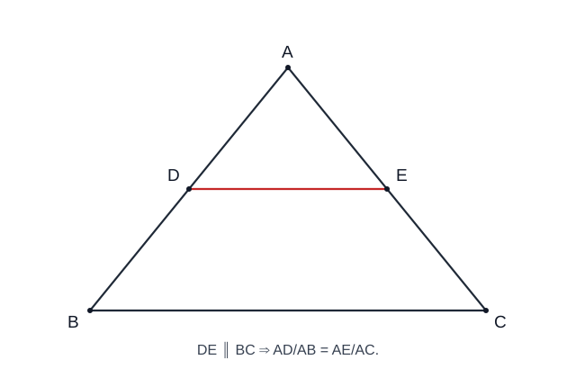
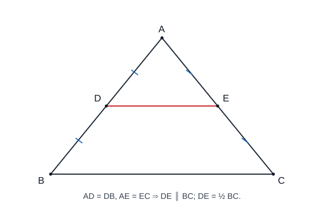
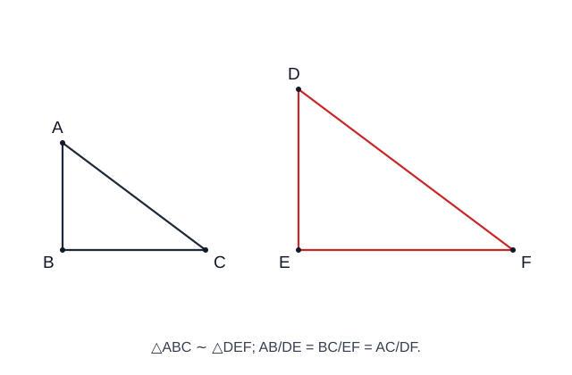

> **BẢN THỬ R12 — CHƯA PHÁT HÀNH:** Sử dụng toàn bộ nguồn kiến thức đã kiểm định, chỉ điều chỉnh cách đọc, infographic và liên kết bài luyện; không tác động bài học chính thức.

<link rel="stylesheet" href="../../../assets/stylesheets/math-knowledge-composition-v1.css">

# Chuyên đề 17 – Định lý Thales và tam giác đồng dạng

> **Trạng thái:** Đã kiểm định nội dung học thuật; cấu trúc Roadmap chuẩn 11 mục.
>
> **Lớp trọng tâm:** 8
> **Mạch kiến thức:** Hình học
> **Mức ưu tiên:** ⭐⭐⭐⭐⭐

---

## 🧭 1. Bản đồ kiến thức

```text
THALES & TAM GIÁC ĐỒNG DẠNG
│
├── Định lý Thales thuận
│   └── Đường song song → các đoạn tương ứng tỉ lệ
│
├── Định lý Thales đảo
│   └── Các đoạn tương ứng tỉ lệ → suy ra song song
│
├── Đường trung bình tam giác
│   ├── Song song với cạnh thứ ba
│   └── Bằng một nửa cạnh thứ ba
│
└── Tam giác đồng dạng
    ├── g-g
    ├── c-g-c
    └── c-c-c
```

Mạch tư duy trọng tâm:

**song song ↔ tỉ lệ → đồng dạng → suy ra góc, độ dài và các hệ thức hình học.**

---

## Minh họa trực quan

### 1. Định lý Thales trong tam giác

<p align="center">
  
</p>

> Nếu một đường thẳng song song với một cạnh của tam giác và cắt hai cạnh còn lại, thì nó tạo ra các đoạn thẳng tương ứng tỉ lệ.

Với `DE ∥ BC` trong tam giác `ABC`:

`AD/AB = AE/AC = DE/BC`

Ngoài ra:

`AD/DB = AE/EC`

---

### 2. Đường trung bình trong tam giác

<p align="center">
  
</p>

> Đường trung bình của tam giác là đoạn thẳng nối trung điểm của hai cạnh.

Nếu `M`, `N` lần lượt là trung điểm của `AB`, `AC` thì:

`MN ∥ BC`

và:

`MN = 1/2 BC`

Đây có thể xem là một hệ quả rất quan trọng của định lý Thales.

---

### 3. Tam giác đồng dạng

<p align="center">
  
</p>

> Hai tam giác đồng dạng có các góc tương ứng bằng nhau và các cạnh tương ứng tỉ lệ.

Nếu:

`△ABC ∼ △A'B'C'`

thì:

`AB/A'B' = BC/B'C' = AC/A'C'`

và:

`∠A = ∠A'`, `∠B = ∠B'`, `∠C = ∠C'`

---

### Ba trường hợp đồng dạng cần nhớ

| Trường hợp | Điều kiện nhận biết | Viết tắt |
|---|---|---|
| Góc – góc | Hai góc của tam giác này bằng hai góc tương ứng của tam giác kia | `g-g` |
| Cạnh – góc – cạnh | Hai cặp cạnh tương ứng tỉ lệ và góc xen giữa bằng nhau | `c-g-c` |
| Cạnh – cạnh – cạnh | Ba cặp cạnh tương ứng tỉ lệ | `c-c-c` |

---

### Mối liên hệ giữa Thales và đồng dạng

Một cách nhìn rất quan trọng là Thales và tam giác đồng dạng **liên hệ chặt chẽ** qua cấu hình đường thẳng song song:

```text
DE ∥ BC
   ↓
Các góc tương ứng bằng nhau
   ↓
△ADE ∼ △ABC
   ↓
Các cạnh tương ứng tỉ lệ
```

Trong Roadmap, sơ đồ trên dùng để kết nối hai công cụ; không nhằm thay thế cách phát biểu hay chứng minh riêng của định lý Thales.

Vì vậy, khi gặp bài toán có **đường thẳng song song trong tam giác**, nên nghĩ ngay đến hai hướng:

- dùng định lý Thales;
- chứng minh hai tam giác đồng dạng.

---

### Mẹo giải bài

- Thấy `∥` → nghĩ đến **Thales** hoặc **góc bằng nhau**.
- Thấy nhiều tỉ số cạnh → nghĩ đến **tam giác đồng dạng**.
- Thấy trung điểm hai cạnh → nghĩ đến **đường trung bình**.
- Khi viết đồng dạng, phải ghi **đúng thứ tự các đỉnh tương ứng**.

Ví dụ:

`△ABC ∼ △DEF`

thì phải hiểu:

`A ↔ D`, `B ↔ E`, `C ↔ F`.

---

## 🎯 2. Mục tiêu cần đạt

Sau khi hoàn thành chuyên đề, học sinh cần:

- [ ] Phát biểu và vận dụng được định lý Thales thuận và đảo.
- [ ] Nhận biết và sử dụng được đường trung bình trong tam giác.
- [ ] Nắm chắc ba trường hợp đồng dạng `g-g`, `c-g-c`, `c-c-c`.
- [ ] Viết đúng thứ tự các đỉnh tương ứng khi lập hai tam giác đồng dạng.
- [ ] Dùng đồng dạng để tính độ dài, chứng minh tỉ số/hệ thức và xử lý tỉ số chu vi, diện tích.
- [ ] Biết chuyển đổi linh hoạt giữa song song, góc bằng nhau và tỉ lệ cạnh.

---

## 📖 3. Kiến thức cốt lõi

### 3.1. Định lý Thales thuận

Trong tam giác `ABC`, nếu `D ∈ AB`, `E ∈ AC` và `DE ∥ BC` thì:

`AD/AB = AE/AC = DE/BC`

và:

`AD/DB = AE/EC`

Từ đây có thể tính một đoạn chưa biết khi biết các đoạn còn lại.

### 3.2. Định lý Thales đảo

Trong tam giác `ABC`, nếu `D` nằm trên cạnh `AB`, `E` nằm trên cạnh `AC` và:

`AD/DB = AE/EC`

thì:

`DE ∥ BC`

Ở đây đang xét cấu hình các điểm nằm **trên hai cạnh của tam giác**, nên các độ dài đều là độ dài đoạn thẳng dương.

Đây là công cụ rất mạnh để **chứng minh hai đường thẳng song song**.

### 3.3. Đường trung bình của tam giác

Nếu `M`, `N` lần lượt là trung điểm của `AB`, `AC` thì:

`MN ∥ BC`

và:

`MN = 1/2 BC`

Một dạng đảo thường dùng:

- nếu một đường thẳng đi qua trung điểm của một cạnh của tam giác, song song với cạnh thứ hai và cắt cạnh còn lại, thì giao điểm đó là trung điểm của cạnh còn lại.

### 3.3A. Tính chất đường phân giác trong tam giác

Trong tam giác `ABC`, lấy `D` **nằm trên cạnh `BC`**. Nếu `AD` là tia phân giác của góc `BAC`, thì:

`BD/DC = AB/AC`

Nói cách khác, **đường phân giác chia cạnh đối diện theo tỉ lệ hai cạnh kề**. Đây là mối liên hệ giữa kiến thức về góc (CĐ13) và tỉ lệ đoạn thẳng (CĐ17).

**Ví dụ từng bước.** Cho `AB = 6 cm`, `AC = 9 cm`, `BC = 10 cm`, `AD` là đường phân giác góc `A` với `D ∈ BC`. Tính `BD`, `DC`.

1. Vì `AD` là phân giác nên `BD/DC = AB/AC = 6/9 = 2/3`.
2. Đồng thời `BD + DC = BC = 10`.
3. Chia `BC` thành `2 + 3 = 5` phần bằng nhau: `BD = 10 × 2/5 = 4 cm`, `DC = 10 × 3/5 = 6 cm`.
4. Kiểm tra: `4/6 = 6/9` và `4 + 6 = 10`.

**Vì sao đúng?** Có thể chứng minh từ định lý Thales: qua `C` kẻ đường thẳng song song với `AD`, cắt tia `BA` tại `E` (với `A` nằm giữa `B`, `E`). Khi đó `∠ACE = ∠CAD`, `∠CEA = ∠DAB`. Vì `AD` là phân giác nên tam giác `ACE` cân tại `A`, suy ra `AE = AC`. Áp dụng Thales trong tam giác `BCE` với `AD ∥ CE`: `BD/DC = BA/AE = BA/AC`.

> **Điều kiện trước khi áp dụng:** Phải có `D` trên cạnh `BC` và `AD` là phân giác của **góc trong** tại `A`. Không lấy tỉ lệ từ hình vẽ chỉ vì đoạn thẳng trông giống đường phân giác. Phân giác ngoài là cấu hình khác, không dùng ngay công thức này.

### 3.4. Tam giác đồng dạng

Nếu `△ABC ∼ △DEF` thì:

`∠A = ∠D`, `∠B = ∠E`, `∠C = ∠F`

và:

`AB/DE = BC/EF = AC/DF`

Điểm rất quan trọng là thứ tự ký hiệu:

`△ABC ∼ △DEF`

nghĩa là:

`A ↔ D`, `B ↔ E`, `C ↔ F`.

### 3.5. Ba trường hợp đồng dạng

Ba dấu hiệu đồng dạng cần phân biệt:

| **Góc – góc (g-g)** | **Cạnh – góc – cạnh (c-g-c)** | **Cạnh – cạnh – cạnh (c-c-c)** |
|:---|:---|:---|
| Hai góc tương ứng bằng nhau. | Hai cặp cạnh tương ứng tỉ lệ **và góc xen giữa bằng nhau**. | Ba cặp cạnh tương ứng tỉ lệ. |

**Lưu ý:** Luôn ghép đúng thứ tự các đỉnh tương ứng trước khi lập tỉ lệ cạnh.

<div class="math-composition"><nav class="math-related-practice" aria-label="Luyện bài đã học">
<span>Thực hành nội dung vừa học:</span>
<a href="../bai-tap/?mode=remediation&amp;focus=dong-dang-gg">Luyện ngay →</a>
<a href="../../../luyen-tap/tu-luan/?topic=CT17#wx17-sim-002">Làm tự luận · WX17-SIM-002 →</a>
</nav></div>

### 3.5A. Tỉ số đồng dạng và các hệ quả đo lường

Nếu `△ABC ∼ △DEF` và:

`AB/DE = BC/EF = CA/FD = k`

thì `k` gọi là **tỉ số đồng dạng** của tam giác `ABC` đối với tam giác `DEF`. Khi đó:

- tỉ số chu vi bằng `k`;
- tỉ số các đường cao tương ứng bằng `k`;
- tỉ số các trung tuyến tương ứng bằng `k`;
- tỉ số các đường phân giác tương ứng bằng `k`;
- tỉ số diện tích bằng `k²`.

Đặc biệt:

`S_ABC / S_DEF = k²`

> Lỗi hay gặp: hai tam giác có tỉ số cạnh bằng `k` **không** có tỉ số diện tích bằng `k`; diện tích thay đổi theo bình phương tỉ số đồng dạng.

### 3.6. Quy trình chọn công cụ

| Dấu hiệu | Nên nghĩ tới |
|---|---|
| Có đường song song trong tam giác | Thales hoặc đồng dạng |
| Có nhiều tỉ số đoạn thẳng | Thales đảo hoặc đồng dạng |
| Có hai góc bằng nhau | Đồng dạng `g-g` |
| Có trung điểm hai cạnh | Đường trung bình |
| Cần chứng minh song song | Thales đảo |
| Cần tính độ dài | Tỉ lệ từ Thales / đồng dạng |

---

## 🔗 4. Kiến thức liên quan

- **Kiến thức nên ôn trước:** [14 – Tam giác](../14-tam-giac/index.md), [16 – Tứ giác](../16-tu-giac/index.md)
- **Liên hệ mạnh:** góc so le trong, đồng vị, song song, trung điểm.
- **Chuyên đề sử dụng tiếp:** [18 – Hệ thức lượng](../18-he-thuc-luong/index.md), [19 – Đường tròn](../19-duong-tron/index.md), [20 – Hình học tổng hợp](../20-hinh-hoc-tong-hop/index.md)

---

## 🧩 5. Các dạng bài cần nắm vững

### Dạng 1. Tính độ dài bằng định lý Thales

Lập đúng tỉ lệ giữa các đoạn tương ứng rồi giải phương trình.

### Dạng 2. Chứng minh hai đường thẳng song song

Dùng Thales đảo sau khi chứng minh được các tỉ số cần thiết.

### Dạng 3. Đường trung bình

Khai thác trung điểm để suy ra song song và độ dài bằng nửa cạnh thứ ba.

### Dạng 4. Chứng minh hai tam giác đồng dạng

Chọn một trong ba tiêu chuẩn `g-g`, `c-g-c`, `c-c-c`.

### Dạng 5. Tính độ dài bằng đồng dạng

Sau khi có đồng dạng, viết đúng tỉ số các cạnh tương ứng.

### Dạng 6. Chứng minh hệ thức tích

Biến hệ thức tích thành tỉ số, sau đó tìm hai tam giác đồng dạng thích hợp.

**Ví dụ đổi hệ thức tích về tỉ số (từ infographic gốc 17-04):** Với các đoạn thẳng có độ dài dương, muốn chứng minh `AB·CD = EF·GH`, ta có thể đổi tương đương thành `AB/EF = GH/CD` (vì `EF` và `CD` khác `0`). Sau đó tìm hai tam giác đồng dạng tạo đúng hai tỉ số tương ứng; không được tự ý đổi thứ tự cạnh.

### Dạng 7. Bài tổng hợp

Kết hợp song song → góc bằng nhau → đồng dạng → tỉ lệ → kết luận.

---

## 🚀 6. Dạng bài thi vào lớp 10

Trong Roadmap ôn thi vào lớp 10, đây là một chuyên đề nền tảng có mức ưu tiên rất cao.

Các kỹ năng cần chắc:
1. Chứng minh hai tam giác đồng dạng.
2. Tính hoặc chứng minh tỉ số đoạn thẳng.
3. Chứng minh một hệ thức tích.
4. Chứng minh song song bằng Thales đảo.
5. Dùng đồng dạng làm bước trung gian trong bài đường tròn.

Mức ưu tiên ôn thi: **⭐⭐⭐⭐⭐**.

---

## ⚠️ 7. Lỗi sai thường gặp

| Lỗi sai | Cách tránh |
|---|---|
| Viết sai thứ tự tam giác đồng dạng | Ghép đúng các đỉnh tương ứng trước khi viết |
| Lập tỉ lệ cạnh không tương ứng | Viết sơ đồ `A↔D, B↔E, C↔F` |
| Dùng Thales khi chưa có song song | Kiểm tra giả thiết hoặc chứng minh song song trước |
| Dùng Thales đảo nhưng chọn sai tỉ lệ | Hai điểm phải nằm trên hai cạnh tương ứng |
| Quên điều kiện góc xen giữa trong `c-g-c` | Phải là góc nằm giữa hai cạnh đang xét |
| Tính đúng nhưng kết luận sai đơn vị | Ghi đơn vị ở bước cuối |

---

## 📝 8. Luyện tập

Phần luyện tập chính đã chuyển sang **Practice Room** để tách rõ Core với Entrance10/Challenge và ghi learner evidence theo skill.

- **→ [Mở Practice Room](bai-tap.md)**

---

## ✅ 9. Tự kiểm tra

Sau khi luyện, làm **Core Readiness Check** 10 câu. Kết quả là **soft mastery**: dùng để gợi ý ôn lại, không khóa lộ trình.

- **→ [Mở Core Readiness Check](tu-kiem-tra.md)**

---

## 🔄 10. Liên kết Roadmap

- **← Trước:** [14 – Tam giác](../14-tam-giac/index.md), [16 – Tứ giác](../16-tu-giac/index.md)
- **→ Tiếp theo:** [18 – Hệ thức lượng](../18-he-thuc-luong/index.md)
- **→ Liên hệ:** [19 – Đường tròn](../19-duong-tron/index.md), [20 – Hình học tổng hợp](../20-hinh-hoc-tong-hop/index.md)

- **✏️ Luyện tập:** [Bài tập Chuyên đề 17](bai-tap.md)
- **✅ Tự kiểm tra:** [Tự kiểm tra Chuyên đề 17](tu-kiem-tra.md)

Xem toàn bộ hệ thống tại [Blueprint 25 chuyên đề](../../roadmap/blueprint-25-chuyen-de.md).

---

## 🏁 11. Điều kiện hoàn thành

- [ ] Đã học đủ 5 chặng KNTT Core ở đầu trang.
- [ ] Đã luyện Practice Room và chữa lại các câu sai.
- [ ] Đã làm Core Readiness Check; khoảng 80% trở lên là tín hiệu sẵn sàng.
- [ ] Mọi kết luận hình học dựa trên giả thiết/định lí, không dựa vào hình vẽ.

!!! note "Soft Mastery"
    Kết quả không khóa chuyên đề tiếp theo; evidence yếu chỉ tạo gợi ý ôn đúng skill.
