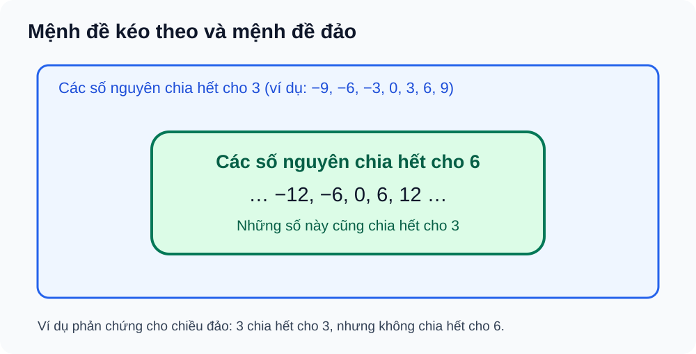

# Bài 1. Mệnh đề

TOÁN 10 · CHƯƠNG I · KIẾN THỨC SGK KNTT

Học kiến thức, xem ví dụ và hình minh họa rồi tự luyện. Gợi ý/lời giải chỉ mở khi em chọn; không ghi điểm thành thạo.

<nav class="thpt-r4-lesson-tabs"><a href="../">Tổng quan chương</a><a href="../luyen-tap/">Core và Luyện tập</a><a href="../tu-kiem-tra-chuong/">Tự kiểm tra · chưa kích hoạt</a></nav>

## 1. Kiến thức SGK

### 1.1. Mệnh đề và mệnh đề chứa biến
- **Mệnh đề** là câu khẳng định có giá trị đúng hoặc sai, không đồng thời cả hai. Câu hỏi/câu cảm thán không phải mệnh đề. Mệnh đề chứa biến P(x) có giá trị chân lý khi thay x bằng một giá trị xác định trong miền đang xét; nếu x chưa được gán, phải có lượng từ cùng miền xét mới thành mệnh đề xác định.
- **Miền xét (domain)** cần được ghi rõ: “n chia hết cho 2” có nghĩa khi n là số nguyên; P(x) với x∈ℝ khác P(n) với n∈ℕ.
### 1.2. Phủ định
- Ký hiệu phủ định `¬P` hoặc `\overline P`. Nếu P đúng thì ¬P sai và ngược lại. Phủ định “x≥a” là “x<a”, phủ định “A⊆B” là tồn tại phần tử thuộc A mà không thuộc B.
### 1.3. Kéo theo, đảo và tương đương
- `P⇒Q` chỉ sai khi P đúng và Q sai; các trường hợp khác được xem là đúng theo quy ước giá trị chân lý. **Không** tự suy từ P⇒Q ra Q⇒P. Với P⇒Q, P là điều kiện **đủ** cho Q, còn Q là điều kiện **cần** cho P.
- `P⇔Q` đúng khi hai chiều P⇒Q và Q⇒P đều đúng. Khi chứng minh một phát biểu “khi và chỉ khi”, phải chứng minh đủ hai chiều (hoặc dùng lập luận tương đương logic).
### 1.4. Lượng từ
- `∀x∈D, P(x)` nghĩa là mọi phần tử x trong D thỏa P(x); chỉ cần **một phản ví dụ** để bác bỏ. `∃x∈D, P(x)` chỉ cần một chứng cứ thỏa. Phủ định: `¬(∀x∈D, P(x)) ⇔ ∃x∈D, ¬P(x)` và `¬(∃x∈D, P(x)) ⇔ ∀x∈D, ¬P(x)`.

## 2. Ví dụ

**Ví dụ 01.** “12 là số nguyên tố” là mệnh đề sai; “n+1=5” là mệnh đề chứa biến nếu n chưa có giá trị. Giải thích bằng sự tồn tại giá trị chân lý độc lập với biến chưa xác định.

**Ví dụ 02.** Với n∈ℤ, P:“n chia hết cho 6”, Q:“n chia hết cho 3”. Chứng minh P⇒Q vì n=6k=3(2k). Q⇒P sai; n=3 là phản ví dụ. Minh họa FIG-G10-B01-01 là hình tập con, không thay chứng minh.

**Ví dụ 03.** Phủ định của “∀x∈ℝ, x²≥0” là “∃x∈ℝ: x²<0”; do x² không âm nên phủ định sai. Luôn đổi ∀ thành ∃ và đổi bất đẳng thức tương ứng.

**Ví dụ 04.** Với n∈ℤ, “n chẵn ⇔ n² chẵn”: nếu n=2k thì n²=4k² chẵn; nếu n lẻ thì n² lẻ, nên nếu n² chẵn thì n chẵn.

## 3. Hình minh họa và hỗ trợ tự khắc phục

<figure class="thpt-r4-plot thpt-r4-probability-figure"><figcaption>Quan hệ kéo theo và mệnh đề đảo: cần chứng minh, không suy từ riêng hình.</figcaption></figure>

Nhầm mệnh đề với mệnh đề chứa biến

<strong>Dấu hiệu:</strong> Thấy x+2=5 thì khẳng định đúng/sai dù x chưa xác định.

<strong>Bản chất:</strong> Một mệnh đề cần chân lý xác định; phát biểu có biến phải nêu x hoặc miền x và lượng từ.

<strong>Tự sửa:</strong> Hỏi: phát biểu có biến nào chưa định? Gán hai giá trị x khác nhau để thử. Nếu đúng/sai đổi theo x, đó là P(x) chưa phải mệnh đề xác định.

<strong>Tiền đề:</strong> EX-G10-B01-01

<strong>Luyện lại:</strong> <a data-thpt-formative-id="THPT-G10-B01-C01" href="../luyen-tap/?item=THPT-G10-B01-C01">B01-C01</a>

Nhầm chiều kéo theo, đảo và lượng từ

<strong>Dấu hiệu:</strong> Từ P⇒Q kết luận Q⇒P, hoặc phủ định “mọi” thành “mọi không”.

<strong>Bản chất:</strong> P⇒Q không đảm bảo Q⇒P; phủ định ∀ là ∃ với mệnh đề phủ định.

<strong>Tự sửa:</strong> Viết P,Q rõ bằng lời; chứng minh chiều có cơ sở; thử tìm phản ví dụ cho chiều đảo; khi phủ định ∀, chỉ cần một trường hợp không đạt.

<strong>Tiền đề:</strong> EX-G10-B01-02/03

<strong>Luyện lại:</strong> <a data-thpt-formative-id="THPT-G10-B01-P03" href="../luyen-tap/?item=THPT-G10-B01-P03">B01-P03</a> · <a data-thpt-formative-id="THPT-G10-B01-P05" href="../luyen-tap/?item=THPT-G10-B01-P05">B01-P05</a>

## 4. Tiếp tục học

[Luyện tập Bài 1](luyen-tap.md) · [Tự luận Chương I](../../thu-vien/tu-luan-chuong-i.md)

Nguồn: SGK Toán 10 KNTT tập 1, Bài 1 trang 5–11; SBT Bài 1 trang 5–7. Học liệu tự luyện không dùng làm bài đánh giá độc lập.

