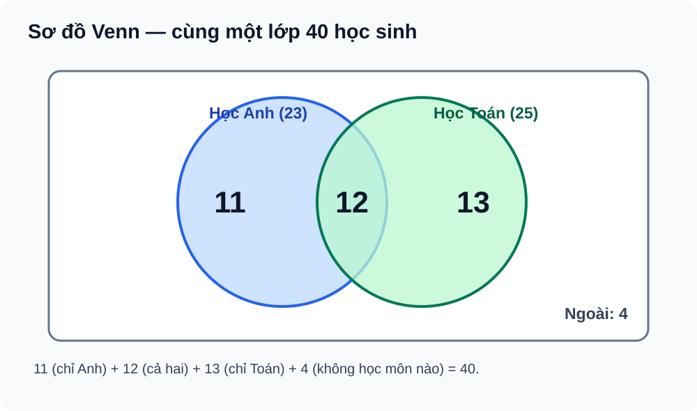

# Bài 2. Tập hợp và các phép toán trên tập hợp

TOÁN 10 · CHƯƠNG I · KIẾN THỨC SGK KNTT

Học kiến thức, xem ví dụ và hình minh họa rồi tự luyện. Gợi ý/lời giải chỉ mở khi em chọn; không ghi điểm thành thạo.

<nav class="thpt-r4-lesson-tabs"><a href="../">Tổng quan chương</a><a href="../luyen-tap/">Core và Luyện tập</a><a href="../tu-kiem-tra-chuong/">Tự kiểm tra · chưa kích hoạt</a></nav>

## 1. Kiến thức SGK

### 2. Phần tử, tập hợp, tập con và tập bằng nhau
- `x∈A` phát biểu x là phần tử của tập A. `A⊆B` khi **mọi** phần tử của A đều nằm trong B. Hai tập bằng nhau A=B khi A⊆B và B⊆A. Tập rỗng `∅` không có phần tử và là tập con của mọi tập.
- Phải phân biệt `x∈A` (phần tử) với `A⊆B` (tập con); tập `{1}` và phần tử `1` là hai đối tượng khác nhau. Biểu diễn tập qua liệt kê hoặc tính chất đặc trưng kèm miền xét.
### 2. Hợp, giao, hiệu và phần bù
- `A∪B={x|x∈A hoặc x∈B}` (“hoặc” có thể đồng thời). `A∩B={x|x∈A và x∈B}`; `A\B={x∈A|x∉B}`. Nếu A⊆U, **phần bù** của A trong U là `U\A`; phải biết U để tính phần bù.
- Với tập hữu hạn, `n(A∪B)=n(A)+n(B)−n(A∩B)`. Không cộng hai tập khi có phần chung mà không trừ giao.
### 2. Khoảng, đoạn, nửa khoảng trên ℝ
- `(a,b)`, `[a,b]`, `(a,b]`, `[a,b)` lần lượt biểu thị điều kiện nghiêm ngặt hoặc bao gồm đầu mút. Với vô cực luôn dùng ngoặc tròn; `(-∞,b]` có x≤b, `(a,+∞)` có x>a. Dùng trục số để xem hợp (một trong hai) và giao (cả hai).
### 2. Ứng dụng — sơ đồ Venn
- Đếm bốn miền **chỉ A**, **A∩B**, **chỉ B**, **ngoài cả hai**. Tổng bốn miền bằng số phần tử U. Đây là mô hình tập hợp; không suy năng lực xác suất, không nhầm số phần tử với điểm Mastery.

## 2. Ví dụ giải mẫu

**Ví dụ 01.** **Ví dụ giải mẫu:** A={1,2,3,4}, B={3,4,5}. A∩B={3,4}; A∪B={1,2,3,4,5}; A\B={1,2}; B\A={5}. Nêu rõ hiệu không giao hoán.

**Ví dụ 02.** **Ví dụ giải mẫu:** X=(-∞,3], Y=(1,+∞). X∩Y=(1,3], X∪Y=ℝ. Xét riêng 1 không thuộc Y và 3 thuộc cả hai.

**Ví dụ 03.** **Ví dụ giải mẫu:** Trong lớp 40 học sinh, 23 học Anh, 25 học Toán, 12 học cả hai: chỉ Anh=11, chỉ Toán=13, hợp=36, không học môn nào=4. Hình FIG-G10-B02-01 minh họa bốn miền.

## 3. Hình minh họa và hỗ trợ tự khắc phục

<figure class="thpt-r4-plot thpt-r4-probability-figure"><figcaption>Sơ đồ Venn minh họa cách tránh đếm trùng ở giao hai tập.</figcaption></figure>

Nhầm phần tử và tập con

<strong>Dấu hiệu:</strong> Viết 1⊆A thay vì 1∈A, hoặc cho rằng A=B khi chỉ kiểm một chiều A⊆B.

<strong>Bản chất:</strong> Một số là phần tử; một tập được so bằng quan hệ tập con. Để kết luận hai tập bằng nhau cần đủ hai chiều.

<strong>Tự sửa:</strong> Ghi loại đối tượng mỗi vế. Khi là tập, liệt kê phần tử; kiểm mọi phần tử A trong B và mọi phần tử B trong A.

<strong>Tiền đề:</strong> EX-G10-B02-01

<strong>Luyện lại:</strong> <a data-thpt-formative-id="THPT-G10-B02-C01" href="../luyen-tap/?item=THPT-G10-B02-C01">B02-C01</a> · <a data-thpt-formative-id="THPT-G10-B02-P06" href="../luyen-tap/?item=THPT-G10-B02-P06">B02-P06</a>

Nhầm giao, hợp, phần bù và đếm trùng

<strong>Dấu hiệu:</strong> Khi có 12 người ở giao, cộng 23+25 không trừ; hoặc tìm U\A mà quên U.

<strong>Bản chất:</strong> Giao là “và”, hợp là “hoặc”; tổng hai tập đếm giao hai lần. Phần bù phụ thuộc tập vũ trụ.

<strong>Tự sửa:</strong> Vẽ bốn miền Venn; điền giao trước, trừ ra hai miền chỉ một tập, cuối cùng lấy tổng U trừ hợp. Với khoảng, tô đúng đầu mút và dùng giao/hợp.

<strong>Tiền đề:</strong> EX-G10-B02-03

<strong>Luyện lại:</strong> <a data-thpt-formative-id="THPT-G10-B02-C02" href="../luyen-tap/?item=THPT-G10-B02-C02">B02-C02</a> · <a data-thpt-formative-id="THPT-G10-B02-P02" href="../luyen-tap/?item=THPT-G10-B02-P02">B02-P02</a> · <a data-thpt-formative-id="THPT-G10-B02-P05" href="../luyen-tap/?item=THPT-G10-B02-P05">B02-P05</a>

## 4. Tiếp tục học

[Luyện tập Bài 2](../luyen-tap/) · [Tự luận Chương I](../../../thu-vien/tu-luan-chuong-i/)

Nguồn: SGK Toán 10 KNTT tập 1, Bài 2 trang 12–19; SBT Bài 2 trang 8–11. Học liệu tự luyện không dùng làm bài đánh giá độc lập.

