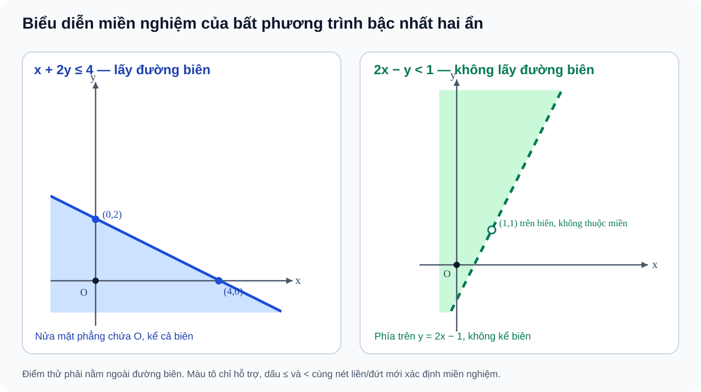

# Bài 3. Bất phương trình bậc nhất hai ẩn

TOÁN 10 · CHƯƠNG II · KIẾN THỨC SGK KNTT

Lý thuyết, ví dụ và sơ đồ nửa mặt phẳng/đa giác từ học liệu đã duyệt. Em tự luyện trước khi mở đáp án, không ghi điểm thành thạo.
<nav class="thpt-r4-lesson-tabs"><a href="../">Chương II</a><a href="../luyen-tap/">Core và Luyện tập</a><a href="../tu-kiem-tra-chuong/">Tự kiểm tra · chưa kích hoạt</a></nav>

## 1. Kiến thức SGK

**Định nghĩa:** Bất phương trình bậc nhất hai ẩn có dạng \(ax+by<c\), \(ax+by\le c\), \(ax+by>c\) hoặc \(ax+by\ge c\), trong đó \(a,b,c\in\mathbb R\) và \((a,b)\ne(0,0)\). Ví dụ \(0x-3y>1\) vẫn hợp lệ; \(x^2+y>3\) và \(0x+0y\le2\) không phải dạng này.

**Cặp nghiệm:** Một cặp thực \((x_0,y_0)\) là nghiệm khi phép thế làm bất phương trình đúng. Đường \(d:ax+by=c\) chia mặt phẳng thành hai nửa; miền nghiệm là một nửa mặt phẳng, **có** đường biên nếu dấu \(\le/\ge\), **không** có đường biên nếu \(</>\).

**Quy trình 5 bước:** (1) Xác định đường biên \(d\), vẽ bằng hai điểm phân biệt hoặc dạng phù hợp; (2) chọn một điểm kiểm tra **không thuộc** \(d\) — có thể chọn \(O(0,0)\) khi \(c\ne0\); (3) thế và xét đúng/sai; (4) chọn phía thỏa; (5) kết luận lấy/không lấy biên. Khi giải \(-y<2-3x\) phải **đảo chiều** để được \(y>3x-2\).

**Điều kiện thực tiễn:** Với giá, thời lượng, số lượng, phải nêu miền của biến, dấu không âm, đơn vị. Nếu \(x,y\) là sản phẩm/ghế/vé, thường yêu cầu nguyên không âm. Nếu dùng trung bình phân thức, phải xác nhận mẫu dương; không thể chỉ giữ bất phương trình sau nhân mẫu rồi bỏ điều kiện ban đầu.

## 2. Ví dụ đã giải

**EX-G10-B03-01 — Vẽ miền có lấy đường biên.** Biểu diễn \(x+2y\le4\). Đường biên \(x+2y=4\) qua \((4,0),(0,2)\). Tại \(O\), \(0\le4\) đúng → tô nửa mặt phẳng chứa O, **kể cả biên**. Điểm \((2,1)\) thỏa dấu bằng.

**EX-G10-B03-02 — Miền nghiêm ngặt.** \(2x-y<1\iff y>2x-1\). Tô phần **phía trên** đường \(y=2x-1\), không lấy biên (nét đứt). O thỏa; \((1,1)\) nằm trên đường biên nên **không** là nghiệm.

**EX-G10-B03-03 — Pha trộn giá trung bình.** Trộn \(x\) kg hàng 140 nghìn/kg và \(y\) kg hàng 180 nghìn/kg, cần đơn giá trung bình không quá 170 nghìn/kg. Với \(x,y\ge0\) và \(x+y>0\):
\[
\frac{140x+180y}{x+y}\le170 \iff 140x+180y\le170(x+y) \iff y\le3x.
\]
\((1,3)\) cho 170, thỏa; \((1,4)\) cho 172, không thỏa. **Không xóa điều kiện \(x+y>0\).**

## 3. Hình minh họa và tự khắc phục lỗi

<figure class="thpt-r4-plot thpt-r4-probability-figure"><figcaption>Phân biệt đường biên nét liền và nét đứt theo dấu bất phương trình.</figcaption></figure>

Thử điểm trên đường biên

<strong>Trigger:</strong> B03-P03, B03-C02. <strong>Sai lầm:</strong> chọn O(0,0) để tìm phía nghiệm khi c=0, rồi kết luận phía nào cũng được.

<strong>Nguyên lí:</strong> Điểm thử phải nằm ngoài đường thẳng ax+by=c. Nếu O nằm trên đường thì đổi sang (1,0) hoặc (0,1) nếu điểm đó không nằm trên biên.

<strong>Tự sửa:</strong> Với 2x+y≥0, chọn (1,0): 2≥0 đúng, xác định phía chứa điểm thử; dấu ≥ lấy cả biên. Soát lại bằng một điểm ở phía ngược (−1,0) sai.

<strong>Tiền đề:</strong> phương trình đường thẳng; thay tọa độ; đọc dấu bất đẳng thức.

<strong>Luyện lại:</strong> `THPT-G10-B03-P03` → `THPT-G10-B03-P01`; không cập nhật Mastery từ xem lời giải.

<strong>Mở câu đã có:</strong> <a data-thpt-formative-id="THPT-G10-B03-P03" href="../luyen-tap/?item=THPT-G10-B03-P03">Luyện lại B03-P03</a> · <a data-thpt-formative-id="THPT-G10-B03-P01" href="../luyen-tap/?item=THPT-G10-B03-P01">Luyện lại B03-P01</a>

Nhầm đổi dấu và đường biên

<strong>Trigger:</strong> B03-P01, B03-P02, B03-P05. <strong>Sai lầm:</strong> chuyển −y sang vế còn lại mà không đổi chiều, hoặc tô cả đường biên khi có &lt;, &gt;.

<strong>Nguyên lí:</strong> Nhân/chia với số âm làm đảo chiều bất đẳng thức; ≤/≥ nhận dấu bằng, &lt;/&gt; không nhận.

<strong>Tự sửa:</strong> 3x−y&lt;2 ⇔ y&gt;3x−2; chọn một điểm phía trên đường, thử lại; vẽ đường biên nét đứt hoặc có nhãn loại biên.

<strong>Tiền đề:</strong> bất phương trình một ẩn, đường thẳng.

<strong>Luyện lại:</strong> `THPT-G10-B03-P02` → `THPT-G10-B03-P05`.

<strong>Mở câu đã có:</strong> <a data-thpt-formative-id="THPT-G10-B03-P02" href="../luyen-tap/?item=THPT-G10-B03-P02">Luyện lại B03-P02</a> · <a data-thpt-formative-id="THPT-G10-B03-P05" href="../luyen-tap/?item=THPT-G10-B03-P05">Luyện lại B03-P05</a>

## 4. Tiếp tục

[Luyện tập Bài 3](luyen-tap.md) · [Tự luận Chương II](../../thu-vien/tu-luan-chuong-ii.md)

Nguồn: SGK Toán 10 KNTT tập 1 Bài 3 trang 22–25; SBT Bài 3 trang 16–18. Luyện tập tự đối chiếu không phải Tự kiểm tra độc lập.

