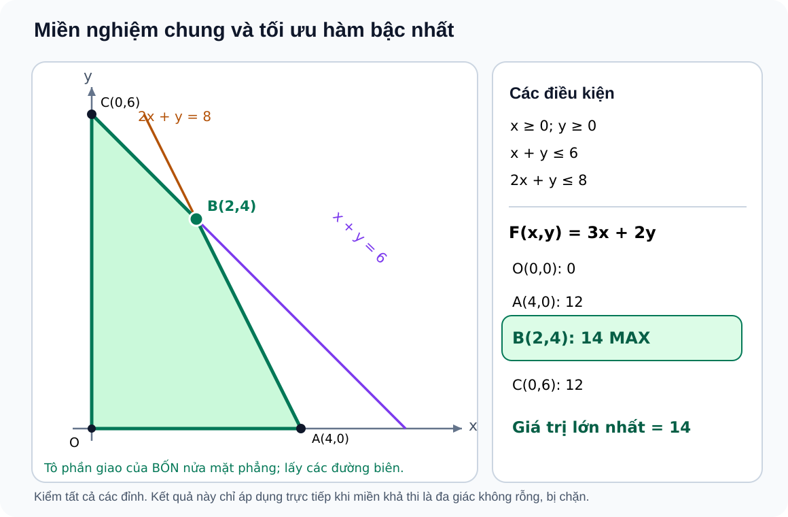

# Bài 4. Hệ bất phương trình bậc nhất hai ẩn

TOÁN 10 · CHƯƠNG II · KIẾN THỨC SGK KNTT

Lý thuyết, ví dụ và sơ đồ nửa mặt phẳng/đa giác từ học liệu đã duyệt. Em tự luyện trước khi mở đáp án, không ghi điểm thành thạo.
<nav class="thpt-r4-lesson-tabs"><a href="../">Chương II</a><a href="../luyen-tap/">Core và Luyện tập</a><a href="../tu-kiem-tra-chuong/">Tự kiểm tra · chưa kích hoạt</a></nav>

## 1. Kiến thức SGK

**Hệ và miền chung:** Cặp \((x,y)\) là nghiệm hệ khi thỏa **đồng thời từng bất phương trình**. Miền nghiệm là **giao** các nửa mặt phẳng (không phải hợp), có thể rỗng, bị chặn hoặc không bị chặn. Phần đường biên của từng ràng buộc được lấy tùy dấu của bất phương trình; các nét liền/đứt trên hình phải tương ứng chính xác.

**Giá trị lớn nhất/nhỏ nhất của hàm bậc nhất:** Với hàm \(F(x,y)=px+qy\) trên một **đa giác nghiệm không rỗng, đóng và bị chặn**, tồn tại giá trị lớn nhất, nhỏ nhất và có thể tìm chúng bằng các **đỉnh**. Trường hợp \(F\) song song một cạnh, có thể có cả cạnh cùng tối ưu. Nếu miền rỗng thì không tối ưu; nếu miền không bị chặn, vẫn có thể tồn tại *một* cực trị hữu hạn, phải xét riêng, không mặc định.

**Bài toán đếm sản phẩm:** Trước tiên có thể tối ưu trên miền liên tục để tìm chặn trên. Nếu điểm tối ưu liên tục có tọa độ nguyên thì đạt tối ưu cả bài toán nguyên; nếu tọa độ phân số thì phải tối ưu lại trên các điểm nguyên khả thi, không tự làm tròn từng tọa độ hoặc dùng giá trị phân số làm đáp án sản phẩm nguyên.

**Tự học 5 bước:** đặt biến và điều kiện → lập các ràng buộc/đơn vị → xác định miền giao → nhận diện mục tiêu và thử các đỉnh phù hợp → đối chiếu đơn vị, nghiệm nguyên, ý nghĩa thực tế và trường hợp rỗng/không bị chặn.

## 2. Ví dụ

**EX-G10-B04-01 — Giao nửa mặt phẳng và cực trị.** Hệ \(x\ge0,y\ge0,x+y\le6,2x+y\le8\) cho các đỉnh \(O(0,0),A(4,0),B(2,4),C(0,6)\). Xét \(F=3x+2y\): giá trị \(0,12,14,12\) → cực đại \(14\) tại B, cực tiểu \(0\) tại O. Kiểm tra B: \(2+4=6, 2\cdot2+4=8\).

**EX-G10-B04-02 — Hệ vô nghiệm.** Hai điều kiện \(x+y\le1\) và \(x+y\ge3\) không thể đồng thời đúng → miền nghiệm chung rỗng. Vẽ hợp hai miền sẽ cho kết luận sai.

**EX-G10-B04-03 — Tối ưu doanh nghiệp có nghiệm nguyên.** Sản phẩm A/B mua lần lượt 20/10 triệu mỗi chiếc; vốn không quá 1200 triệu và sức chứa không quá 100 chiếc. \(x,y\in\mathbb Z_{\ge0}\), \(20x+10y\le1200, x+y\le100\). Lợi nhuận \(F=3{,}5x+2y\) triệu đồng; miền liên tục có đỉnh \((0,0),(60,0),(20,80),(0,100)\). Lợi nhuận tại đỉnh tương ứng \(0,210,230,200\). Cực đại 230 tại \((20,80)\) có tọa độ nguyên nên đạt tối ưu cả mô hình nguyên. Đơn vị và điều kiện không âm không được bỏ.

## 3. Hình minh họa và tự khắc phục lỗi

<figure class="thpt-r4-plot thpt-r4-probability-figure"><figcaption>Miền giao và bài toán tối ưu: cần xét đầy đủ ràng buộc và điều kiện nguyên nếu có.</figcaption></figure>

Nhầm hợp với giao trong hệ

<strong>Trigger:</strong> B04-C01, B04-C02, B04-P01, B04-P04. <strong>Sai lầm:</strong> chỉ cần đúng một bất phương trình nên tô hợp các miền.

<strong>Nguyên lí:</strong> Nghiệm hệ phải thỏa đồng thời toàn bộ điều kiện, tức lấy giao; miền có thể rỗng.

<strong>Tự sửa:</strong> Bắt đầu từ một cặp cụ thể, thế vào từng hàng; loại ngay khi một hàng sai. Vẽ từng miền, chỉ giữ phần không bị loại bởi bất cứ điều kiện nào.

<strong>Tiền đề:</strong> phép giao tập hợp, biểu diễn nửa mặt phẳng.

<strong>Luyện lại:</strong> `THPT-G10-B04-C01` → `THPT-G10-B04-P04`.

<strong>Mở câu đã có:</strong> <a data-thpt-formative-id="THPT-G10-B04-C01" href="../luyen-tap/?item=THPT-G10-B04-C01">Luyện lại B04-C01</a> · <a data-thpt-formative-id="THPT-G10-B04-P04" href="../luyen-tap/?item=THPT-G10-B04-P04">Luyện lại B04-P04</a>

Tối ưu sai miền hoặc bỏ điều kiện nguyên

<strong>Trigger:</strong> B04-P02, B04-P03, B04-P05, B04-P06, W04. <strong>Sai lầm:</strong> chỉ kiểm một đỉnh, giả định nghiệm tối ưu duy nhất, hoặc làm tròn đỉnh phân số để trả bài nguyên.

<strong>Nguyên lí:</strong> Trên đa giác kín, bị chặn, không rỗng, so F tại <strong>mọi</strong> đỉnh; có thể đồng tối ưu trên cả cạnh. Với miền không bị chặn xét riêng cực trị. Sản phẩm nguyên bắt buộc nghiệm nguyên.

<strong>Tự sửa:</strong> Lập bảng đỉnh → F → chọn giá trị phù hợp. Với B04-P06, đỉnh liên tục (5/3,5/3) không nguyên; duyệt x∈{0,1,2}, tìm y nguyên tối ưu: (2,1) cho F=8, không dùng 25/3 làm đáp án sản phẩm.

<strong>Tiền đề:</strong> giải hệ hai phương trình; miền nghiệm; số nguyên; hàm mục tiêu.

<strong>Luyện lại:</strong> `THPT-G10-B04-P06` → `THPT-G10-B04-P03` (trường hợp cả cạnh cùng tối ưu).

<strong>Mở câu đã có:</strong> <a data-thpt-formative-id="THPT-G10-B04-P06" href="../luyen-tap/?item=THPT-G10-B04-P06">Luyện lại B04-P06</a> · <a data-thpt-formative-id="THPT-G10-B04-P03" href="../luyen-tap/?item=THPT-G10-B04-P03">Luyện lại B04-P03</a>

## 4. Tiếp tục

[Luyện tập Bài 4](luyen-tap.md) · [Tự luận Chương II](../../thu-vien/tu-luan-chuong-ii.md)

Nguồn: SGK Toán 10 KNTT tập 1 Bài 4 trang 26–30; SBT Bài 4 trang 19–23. Luyện tập tự đối chiếu không phải Tự kiểm tra độc lập.

