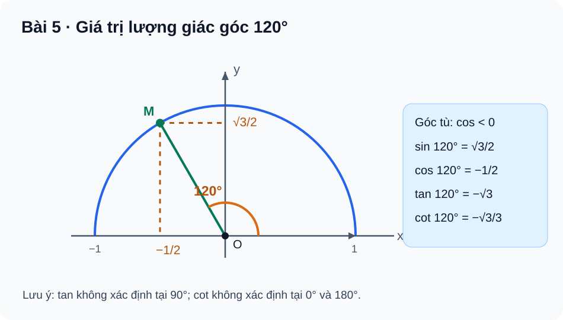

# Bài 5. Giá trị lượng giác của một góc từ 0° đến 180°

TOÁN 10 · CHƯƠNG III · KIẾN THỨC SGK KNTT

Học kiến thức và ví dụ theo Bài 5, sau đó tự luyện.
<nav class="thpt-r4-lesson-tabs"><a href="../">Chương III</a><a href="../luyen-tap/">Core và Luyện tập</a><a href="../tu-kiem-tra-chuong/">Tự kiểm tra</a></nav>

## 1. Kiến thức

### Định nghĩa trên nửa đường tròn đơn vị

Cho `0° ≤ α ≤ 180°`. Điểm `M(x,y)` trên nửa đường tròn đơn vị tâm O, từ tia Ox quay góc α ngược chiều kim đồng hồ, xác định `cos α = x`, `sin α = y` và `x²+y²=1`, `y≥0`. Sin luôn không âm; cos dương với góc nhọn, bằng 0 tại 90°, âm với góc tù.

\[
\tan\alpha=\frac{\sin\alpha}{\cos\alpha}\quad\text{chỉ khi }\cos\alpha\ne0;\qquad
\cot\alpha=\frac{\cos\alpha}{\sin\alpha}\quad\text{chỉ khi }\sin\alpha\ne0.
\]

`tan 90°` không xác định; `cot 0°` và `cot 180°` không xác định. `sin`, `cos` xác định trên toàn đoạn 0°–180°. Trên góc tù 90°–180°, cả tan và cot (khi có nghĩa) đều âm.

### Giá trị đặc biệt

| α | 0° | 30° | 45° | 60° | 90° | 120° | 135° | 150° | 180° |
|---|---:|---:|---:|---:|---:|---:|---:|---:|---:|
| sin α | 0 | 1/2 | √2/2 | √3/2 | 1 | √3/2 | √2/2 | 1/2 | 0 |
| cos α | 1 | √3/2 | √2/2 | 1/2 | 0 | −1/2 | −√2/2 | −√3/2 | −1 |

Với tan/cot, dùng tỷ số sin/cos chỉ **khi mẫu khác 0**; không ghi một số tại ô không xác định. SBT p.29–30 cung cấp bảng và những ví dụ góc đặc biệt; ở đây nêu tối thiểu các hàng sin/cos để học sinh tránh học thuộc tan/cot sai điều kiện.

### Góc bù

Với hai góc bù `α` và `180°−α`:

\[
\begin{aligned}
\sin(180^\circ-\alpha)&=\sin\alpha, & \cos(180^\circ-\alpha)&=-\cos\alpha,\\
\tan(180^\circ-\alpha)&=-\tan\alpha, & \cot(180^\circ-\alpha)&=-\cot\alpha
\end{aligned}
\]

Hai đẳng thức có tan và cot chỉ dùng khi vế tương ứng đều xác định. Đây không phải công thức sin/cos của tổng hai góc bất kỳ; không đưa nội dung công thức cộng Toán 11 vào Core.

### Hệ thức cơ bản và dấu

\[
\sin^2\alpha+\cos^2\alpha=1,\quad
1+\tan^2\alpha=\frac1{\cos^2\alpha}\;(\cos\alpha\ne0),\quad
1+\cot^2\alpha=\frac1{\sin^2\alpha}\;(\sin\alpha\ne0).
\]

Khi `sin α ≠ 0` **và** `cos α ≠ 0`, có `tan α·cot α=1`. Biết một giá trị sin/cos cần xét **góc nhọn hay tù** để chọn dấu căn còn lại.

## 2. Ví dụ

**Ví dụ 1 — Góc 120°:** `120°=180°−60°`, do đó 
\(\sin120^\circ=\sqrt3/2\), \(\cos120^\circ=-1/2\), \(\tan120^\circ=-\sqrt3\), \(\cot120^\circ=-\sqrt3/3\). Cos âm vì góc tù; hai tỷ số đều có nghĩa.

**Ví dụ 2 — Biết sin và biết góc tù:** Cho góc tù α với `sin α=3/5`. Từ `sin²+cos²=1` suy `cos²=16/25`; chọn `cos α=−4/5` vì góc tù, và `tan α=−3/4`. Lỗi thường gặp: dùng căn dương mà không xét miền của α.

**Ví dụ 3 — Tính biểu thức góc bù:** `sin150°+cos150° = 1/2−√3/2=(1−√3)/2`. Trước khi thay giá trị, nhận ra `150°=180°−30°`, sin giữ nguyên, cos đổi dấu.

## 3. Hình minh họa

<figure class="thpt-r4-plot thpt-r4-probability-figure"><figcaption>Nửa đường tròn đơn vị: xác định dấu các giá trị lượng giác và góc 120°.</figcaption></figure>

## 4. Tự khắc phục lỗi thường gặp

Nhầm dấu góc tù và hai góc bù
<ol><li><strong>Dấu hiệu:</strong> Chọn cos120° dương hoặc cos150° bằng cos30°.</li>
<li><strong>Chẩn đoán:</strong> Học sinh nhớ bảng góc nhọn nhưng bỏ nửa đường tròn phía trái trục Oy.</li>
<li><strong>Bản chất:</strong> `sin(180°−α)=sinα`, `cos(180°−α)=−cosα`; điểm M góc tù nằm phía trái, tung độ dương.</li>
<li><strong>Tự sửa:</strong> Vẽ M góc 120° trên FIG-G10-B05-01, đọc hoành/tung; giải lại không nhìn đáp án.</li></ol>
<a href="../luyen-tap/">Luyện lại các câu liên quan</a>

Bỏ điều kiện tan/cot và chọn sai dấu căn
<ol><li><strong>Dấu hiệu:</strong> Tính tan90° bằng 0; viết cot0° là vô hạn; cho cos góc tù dương khi biết sin.</li>
<li><strong>Chẩn đoán:</strong> Bỏ mẫu của tỷ số sin/cos và không sử dụng miền của góc.</li>
<li><strong>Bản chất:</strong> Tan chỉ xác định nếu cos≠0, cot nếu sin≠0; `sin²+cos²=1` cho hai dấu căn nhưng miền góc quyết định dấu.</li>
<li><strong>Tự sửa:</strong> Kiểm tra mẫu và dấu trước khi thế số; tự đối chiếu từng bước.</li></ol>
<a href="../luyen-tap/">Luyện lại các câu liên quan</a>

## 5. Luyện tập

[Luyện tập Bài 5](luyen-tap.md) · [Bài tự luận Chương III](../../thu-vien/tu-luan-chuong-iii.md)
