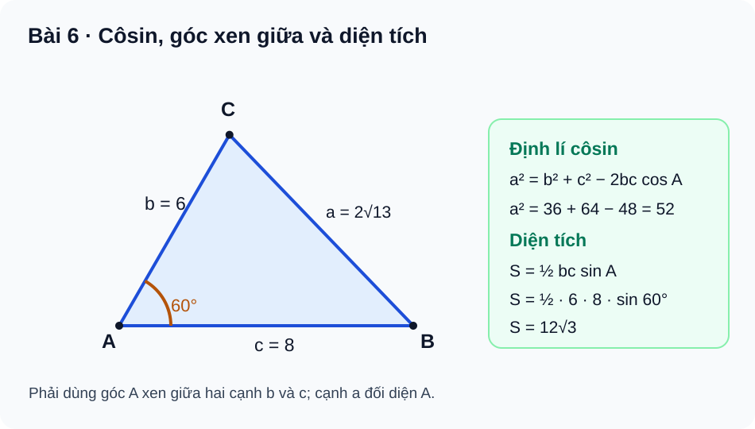

# Bài 6. Hệ thức lượng trong tam giác

TOÁN 10 · CHƯƠNG III · KIẾN THỨC SGK KNTT

Học kiến thức và ví dụ theo Bài 6, sau đó tự luyện.
<nav class="thpt-r4-lesson-tabs"><a href="../">Chương III</a><a href="../luyen-tap/">Core và Luyện tập</a><a href="../tu-kiem-tra-chuong/">Tự kiểm tra</a></nav>

## 1. Kiến thức và ví dụ

### Kí hiệu và định lí côsin

Trong tam giác **không suy biến** ABC, đặt `a=BC`, `b=CA`, `c=AB`, với các góc đối diện tương ứng A,B,C; các cạnh `a,b,c>0`, thỏa bất đẳng thức tam giác nghiêm ngặt.
\[
\begin{aligned}
a^2&=b^2+c^2-2bc\cos A,\\
b^2&=a^2+c^2-2ac\cos B,\\
c^2&=a^2+b^2-2ab\cos C.
\end{aligned}
\]
Từ đó \(\cos A=(b^2+c^2-a^2)/(2bc)\), tương tự cho B,C. Nếu `A=90°`, định lí trở thành Pitago. Không chọn nhầm góc B trong công thức liên quan `b,c`.

### Định lí sin

Với `R>0` là bán kính ngoại tiếp:
\[
\frac a{\sin A}=\frac b{\sin B}=\frac c{\sin C}=2R.
\]
Mọi góc trong của tam giác nằm trong `(0°,180°)` nên các sin dương. Nếu đã biết hai góc, góc thứ ba bằng `180°−A−B`; trước khi dùng cần `A+B<180°`. Trường hợp chỉ biết `A,a,b` có thể có hai góc B thỏa phương trình sin, nên không mặc định phép lấy arcsin trả một tam giác duy nhất.

### Diện tích, Heron và bán kính

Với `p=(a+b+c)/2` và diện tích `S>0`:
\[
S=\tfrac12bc\sin A=\tfrac12ca\sin B=\tfrac12ab\sin C,\qquad
S=\sqrt{p(p-a)(p-b)(p-c)},
\]
\[
S=pr,\qquad S=\frac{abc}{4R}.
\]
Trong đó r là bán kính đường tròn **nội tiếp**, R là bán kính **ngoại tiếp**. Đơn vị diện tích là đơn vị độ dài bình phương; không dùng Heron khi ba cạnh không tạo thành tam giác.

### Giải tam giác và ứng dụng S1

Khi biết đủ ba cạnh (SSS), thường dùng định lí côsin tìm góc; khi biết hai cạnh và góc xen giữa (SAS), tìm cạnh còn lại bằng côsin; khi biết hai góc và một cạnh (ASA/AAS), dùng định lí sin. Với đo đạc thực tế, phải khai báo đoạn mốc, góc quan sát là **góc trong của tam giác nào**, độ dài cần tìm, đơn vị và độ chính xác hợp lý. Nếu cần bán kính ngoại tiếp, dùng `2R=a/sin A` hoặc `S=abc/(4R)`.

## Ví dụ giải mẫu

**Ví dụ 1 — Côsin và diện tích:** `b=6,c=8,A=60°`. 
\(a^2=36+64-2\cdot6\cdot8\cdot\tfrac12=52\), nên \(a=2\sqrt{13}\). Đồng thời \(S=\tfrac12\cdot6\cdot8\cdot\sin60^\circ=12\sqrt3\). Nêu đúng góc xen giữa và cạnh đối diện.

**Ví dụ 2 — Định lí sin:** `A=30°,B=45°,a=5`; vậy `C=105°`. 
\(b=5\sin45^\circ/\sin30^\circ=5\sqrt2\), \(2R=5/\sin30^\circ=10\), nên `R=5`. Các góc đều hợp lệ.

**Ví dụ 3 — Heron và hai bán kính:** Ba cạnh 13,14,15 thỏa bất đẳng thức tam giác. Nửa chu vi `p=21`, 
\(S=\sqrt{21\cdot8\cdot7\cdot6}=84\), bán kính nội tiếp `r=S/p=4`, bán kính ngoại tiếp 
\(R=13\cdot14\cdot15/(4\cdot84)=65/8\). Không nhầm r và R.

## 3. Hình minh họa

<figure class="thpt-r4-plot thpt-r4-probability-figure"><figcaption>Hệ thức lượng trong tam giác, định lí côsin và công thức diện tích.</figcaption></figure>

## 4. Tự khắc phục lỗi thường gặp

Sai góc xen giữa / nhầm định lí sin và côsin
<ol><li><strong>Dấu hiệu:</strong> Lấy `a²=b²+c²−2bc cos B` hoặc dùng sin để tìm cạnh trong tình huống chỉ biết hai cạnh và góc xen giữa.</li>
<li><strong>Chẩn đoán:</strong> Không chỉ rõ cạnh đối diện góc A và hai cạnh kề góc A.</li>
<li><strong>Bản chất:</strong> Với kí hiệu chuẩn a đối diện A; hệ thức đúng là `a²=b²+c²−2bc cos A`. Định lí sin liên hệ các <strong>cặp cạnh–góc đối diện</strong>.</li>
<li><strong>Tự sửa:</strong> Ghi a,b,c lên FIG-G10-B06-01, kiểm tra góc A=60°, tính lại 52 và căn dương.</li></ol>
<a href="../luyen-tap/">Luyện lại các câu liên quan</a>

Nhầm diện tích, Heron, r/R và đơn vị
<ol><li><strong>Dấu hiệu:</strong> Dùng `S=1/2 bc cos A`, tính r từ `abc/(4S)`, hoặc ghi m thay vì m².</li>
<li><strong>Chẩn đoán:</strong> Nhớ công thức rời rạc, không phân biệt tâm nội/ngoại tiếp và góc xen giữa.</li>
<li><strong>Bản chất:</strong> `S=1/2 bc sin A`, `S=sqrt[p(p−a)(p−b)(p−c)]`, `S=pr`, `S=abc/(4R)`.</li>
<li><strong>Tự sửa:</strong> Làm tam giác 13–14–15: p=21, S=84, r=4, R=65/8; kiểm tra thứ nguyên.</li></ol>
<a href="../luyen-tap/">Luyện lại các câu liên quan</a>

## 5. Luyện tập

[Luyện tập Bài 6](luyen-tap.md) · [Bài tự luận Chương III](../../thu-vien/tu-luan-chuong-iii.md)
