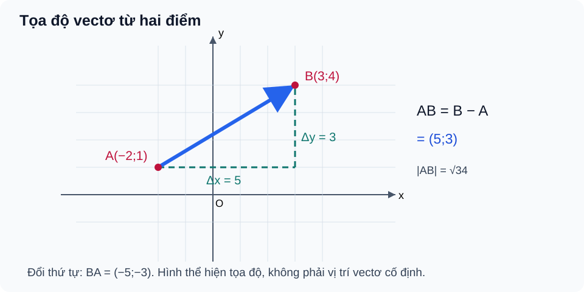

# Bài 10. Vectơ trong mặt phẳng tọa độ

TOÁN 10 · CHƯƠNG IV · KIẾN THỨC SGK KNTT

Học kiến thức và ví dụ, rồi luyện tập theo từng kĩ năng.
<nav class="thpt-r4-lesson-tabs"><a href="../">Chương IV</a><a href="../luyen-tap/">Core và Luyện tập</a><a href="../tu-kiem-tra-chuong/">Tự kiểm tra · chưa kích hoạt</a></nav>

## 1. Kiến thức SGK

**D1.1 Hệ tọa độ và vectơ.** Trong hệ tọa độ vuông góc $Oxy$ với hai vectơ đơn vị $\vec i=(1;0)$ và $\vec j=(0;1)$, vectơ $\vec u=(u_x;u_y)=u_x\vec i+u_y\vec j$. Nếu $A(x_A;y_A)$, $B(x_B;y_B)$, thì

\[
\overrightarrow{AB}=(x_B-x_A;\ y_B-y_A).
\]

Tọa độ vectơ $\overrightarrow{AB}$ **không phải** tọa độ điểm $B$ trừ khi $A=O$.

**D1.2 Các phép toán tọa độ.** Với $\vec u=(a;b)$, $\vec v=(c;d)$, $t\in\mathbb R$:

\[
\vec u+\vec v=(a+c;b+d),\quad \vec u-\vec v=(a-c;b-d),\quad t\vec u=(ta;tb).
\]

$|\vec u|=\sqrt{a^2+b^2}$, $AB=\sqrt{(x_B-x_A)^2+(y_B-y_A)^2}$. Hai vectơ **khác không** cùng phương khi $ad-bc=0$; với vectơ không cần nêu quy ước KNTT riêng.

**D1.3 Tọa độ trung điểm, trọng tâm.** $M$ là trung điểm $AB$ khi

\[
M\left(\frac{x_A+x_B}{2};\frac{y_A+y_B}{2}\right).
\]

Trọng tâm tam giác $ABC$ là

\[
G\left(\frac{x_A+x_B+x_C}{3};\frac{y_A+y_B+y_C}{3}\right).
\]

Chỉ dùng công thức trọng tâm khi $ABC$ là tam giác không suy biến. Kiểm tra lại bằng $\overrightarrow{GA}+\overrightarrow{GB}+\overrightarrow{GC}=\vec0$.

**D1.4 Ứng dụng.** Định vị/chuyển động trong bản đồ Oxy phải xác định trục, đơn vị và phân biệt độ dài đường đi thực tế với khoảng cách thẳng giữa hai vị trí.

## 2. Ví dụ

### Ví dụ 1. Tọa độ vectơ từ hai điểm

**Đề:** Cho $A(-1;2)$, $B(3;5)$. Tìm $\overrightarrow{AB}$ và $AB$.  
**Giải:** $\overrightarrow{AB}=(3-(-1);5-2)=(4;3)$, do đó $AB=\sqrt{4^2+3^2}=5$.  
**Tự kiểm:** $\overrightarrow{BA}=(-4;-3)$, không phải $(4;3)$.

### Ví dụ 2. Tính tọa độ biểu thức vectơ

**Đề:** Cho $\vec u=(2;-1)$, $\vec v=(-3;4)$. Tính $2\vec u-\vec v$.  
**Giải:** $2\vec u=(4;-2)$, vậy $2\vec u-\vec v=(4-(-3);-2-4)=(7;-6)$.  
**Tự kiểm:** Nhân hệ số lên cả hai thành phần.

### Ví dụ 3. Tọa độ trung điểm và trọng tâm

**Đề:** Cho $A(1;3)$, $B(5;-1)$, $C(-2;4)$. Tìm trung điểm $M$ của $AB$ và trọng tâm $G$ của tam giác.  
**Giải:** $M=(3;1)$; $G=((1+5-2)/3;(3-1+4)/3)=(4/3;2)$.  
**Tự kiểm:** Trọng tâm chia cho 3, không phải 2.

## 3. Hình minh họa

<figure class="thpt-r4-plot thpt-r4-probability-figure"><figcaption>Tọa độ vectơ AB bằng tọa độ điểm cuối trừ điểm đầu.</figcaption></figure>

## 4. Tự khắc phục lỗi thường gặp

Lấy nhầm tọa độ B làm tọa độ AB
<ul><li>Điểm nghẽn: Quên lấy tọa độ cuối trừ đầu.</li><li>Bản chất cần sửa: Tọa độ AB = B−A, không phải B.</li><li>Quy trình 5 bước: 1. Gạch điểm đầu A/cuối B. 2. Trừ hoành độ, tung độ. 3. Đảo chiều để tự kiểm BA=−AB. 4. Kiểm bằng độ dài. 5. Làm B10-P02.</li><li>Liên kết item có sẵn: B10-C01, B10-P02. Không clone câu hoặc giải vào HELP_ID.</li><li>Assessment safety: hỗ trợ chỉ tại Knowledge/Practice, không hiển thị trong phiên Tự kiểm tra trước Final Submit.</li></ul>
<a href="../luyen-tap/">Quay lại luyện tập</a>

Nhầm công thức trung điểm/trọng tâm và kiểm cùng phương
<ul><li>Điểm nghẽn: Chia 2 khi có ba đỉnh hoặc bỏ điều kiện vectơ khác không.</li><li>Bản chất cần sửa: Trung điểm lấy trung bình 2 điểm, trọng tâm 3 đỉnh.</li><li>Quy trình 5 bước: 1. Đếm số điểm. 2. Viết công thức hoành/tung. 3. Kiểm tổng GA+GB+GC. 4. Xét vectơ không riêng. 5. Luyện B10-P04/P05.</li><li>Liên kết item có sẵn: B10-P03, B10-P04, B10-P05. Không clone câu hoặc giải vào HELP_ID.</li><li>Assessment safety: hỗ trợ chỉ tại Knowledge/Practice, không hiển thị trong phiên Tự kiểm tra trước Final Submit.</li></ul>
<a href="../luyen-tap/">Quay lại luyện tập</a>

## 5. Tiếp tục

[Core và Luyện tập Bài 10](luyen-tap.md) · [Bài tự luận Chương IV](../../thu-vien/tu-luan-chuong-iv-b09-b11.md)
