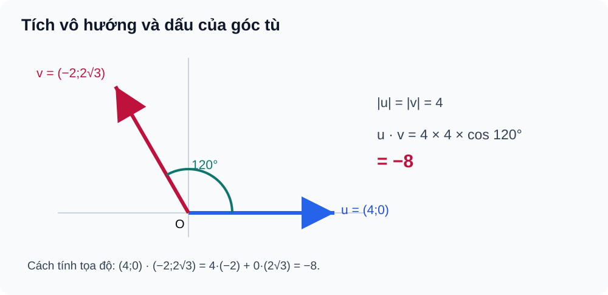

# Bài 11. Tích vô hướng của hai vectơ

TOÁN 10 · CHƯƠNG IV · KIẾN THỨC SGK KNTT

Học kiến thức và ví dụ, rồi luyện tập theo từng kĩ năng.
<nav class="thpt-r4-lesson-tabs"><a href="../">Chương IV</a><a href="../luyen-tap/">Core và Luyện tập</a><a href="../tu-kiem-tra-chuong/">Tự kiểm tra · chưa kích hoạt</a></nav>

## 1. Kiến thức SGK

**D1.1 Góc hai vectơ.** Với $\vec u,\vec v\ne\vec0$, góc $\theta$ giữa chúng thuộc $[0^\circ,180^\circ]$. Khi $\theta$ nhọn, cos dương; khi vuông, cos bằng 0; khi tù, cos âm. **Không định nghĩa góc thông thường giữa một vectơ-không và vectơ khác không.**

**D1.2 Tích vô hướng.** Với $\vec u,\vec v\ne\vec0$:

\[
\vec u\cdot\vec v=|\vec u|\,|\vec v|\cos\theta.
\]

Khi một vectơ bằng $\vec0$, tích vô hướng **bằng 0 theo quy ước**, không đòi xác định $\theta$. Tính chất: $\vec u\cdot\vec v=\vec v\cdot\vec u$, $(\vec u+\vec v)\cdot\vec w=\vec u\cdot\vec w+\vec v\cdot\vec w$, $(t\vec u)\cdot\vec v=t(\vec u\cdot\vec v)$; $\vec u\cdot\vec u=|\vec u|^2$. Hệ thức $|\vec u\pm\vec v|^2=|\vec u|^2+|\vec v|^2\pm2\vec u\cdot\vec v$ là hệ quả của phân phối.

**D1.3 Biểu thức tọa độ và vuông góc.** Với $\vec u=(a;b)$, $\vec v=(c;d)$, $\vec u\cdot\vec v=ac+bd$. Nếu **cả hai khác không**, $\vec u\perp\vec v\iff\vec u\cdot\vec v=0$. Khi tích khác 0, có thể tính $\cos\theta=(ac+bd)/(\sqrt{a^2+b^2}\sqrt{c^2+d^2})$; không áp dụng phép chia nếu một độ dài bằng 0.

**D1.4 Ứng dụng công của lực.** Nếu lực $\vec F$ (newton) không đổi tác dụng trên độ dời $\vec s$ (mét), công $W=\vec F\cdot\vec s=|\vec F||\vec s|\cos\theta$ (joule). Dấu của công phản ánh lực thuận/ngược độ dời; không nhầm công vô hướng với độ lớn của lực.

## 2. Ví dụ

### Ví dụ 1. Dấu tích vô hướng ở góc tù

**Đề:** Cho $|\vec u|=4$, $|\vec v|=3$ và góc giữa chúng là $120^\circ$. Tính $\vec u\cdot\vec v$.  
**Giải:** $\vec u\cdot\vec v=4\cdot3\cos120^\circ=12(-1/2)=-6$.  
**Tự kiểm:** Góc tù có cos âm.

### Ví dụ 2. Hai vectơ vuông góc trong tọa độ

**Đề:** Cho $\vec u=(2;-1)$, $\vec v=(1;2)$. Kiểm tra vuông góc.  
**Giải:** $\vec u\cdot\vec v=2\cdot1+(-1)\cdot2=0$. Hai vectơ đều khác $\vec0$, suy ra vuông góc.  
**Tự kiểm:** Phải kiểm hai vectơ khác không.

### Ví dụ 3. Tam giác vuông bằng tích vô hướng

**Đề:** Cho $A(1;1)$, $B(4;1)$, $C(1;5)$. Xác định góc A và diện tích tam giác.  
**Giải:** $\overrightarrow{AB}=(3;0)$, $\overrightarrow{AC}=(0;4)$, tích bằng 0, nên $\angle A=90^\circ$ và $S=\tfrac12\cdot3\cdot4=6$.  
**Tự kiểm:** Chọn hai vectơ cùng gốc A để xét góc A.

## 3. Hình minh họa

<figure class="thpt-r4-plot thpt-r4-probability-figure"><figcaption>Tích vô hướng khi góc giữa hai vectơ là 120 độ.</figcaption></figure>

## 4. Tự khắc phục lỗi thường gặp

Nhầm tích vô hướng với tích độ dài; bỏ điều kiện khác 0
<ul><li>Điểm nghẽn: Dùng công thức cos/điều kiện vuông góc khi một vectơ không.</li><li>Bản chất cần sửa: Dot là số; tọa độ dot = ac+bd; góc/cos chỉ định nghĩa khi hai độ dài dương.</li><li>Quy trình 5 bước: 1. Kiểm hai vectơ khác 0. 2. Tính dot. 3. Tính độ dài. 4. Chỉ chia khi mẫu &gt;0. 5. Luyện B11-P03.</li><li>Liên kết item có sẵn: B11-C02, B11-P02, B11-P03. Không clone câu hoặc giải vào HELP_ID.</li><li>Assessment safety: hỗ trợ chỉ tại Knowledge/Practice, không hiển thị trong phiên Tự kiểm tra trước Final Submit.</li></ul>
<a href="../luyen-tap/">Quay lại luyện tập</a>

Dấu cos góc tù hoặc sai công của lực
<ul><li>Điểm nghẽn: Quên cos/góc hoặc đơn vị W (J).</li><li>Bản chất cần sửa: Định nghĩa $W=\vec F\cdot\vec s$, đơn vị N·m; dấu W theo cos góc lực-độ dời.</li><li>Quy trình 5 bước: 1. Ghi rõ góc hai vectơ. 2. Đối chiếu dấu cos. 3. Tính dot. 4. Ghi đơn vị J. 5. Tự luyện B11-P05.</li><li>Liên kết item có sẵn: B11-P01, B11-P05, W11-ANCHOR. Không clone câu hoặc giải vào HELP_ID.</li><li>Assessment safety: hỗ trợ chỉ tại Knowledge/Practice, không hiển thị trong phiên Tự kiểm tra trước Final Submit.</li></ul>
<a href="../luyen-tap/">Quay lại luyện tập</a>

## 5. Tiếp tục

[Core và Luyện tập Bài 11](luyen-tap.md) · [Bài tự luận Chương IV](../../thu-vien/tu-luan-chuong-iv-b09-b11.md)
