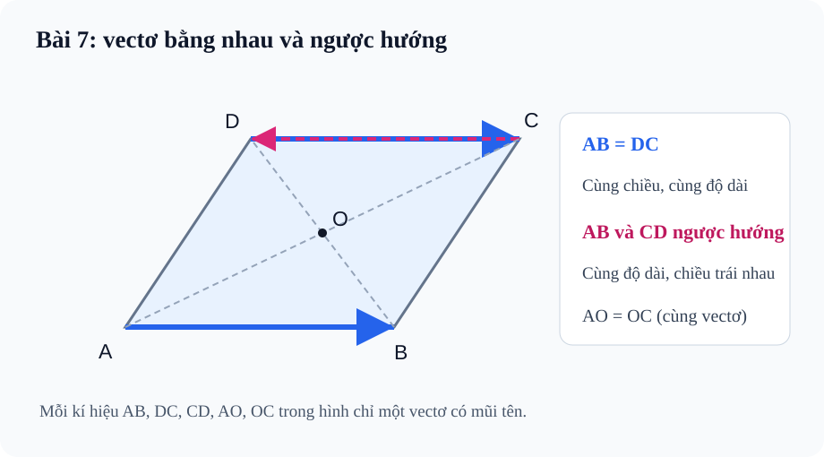

# Bài 7. Các khái niệm mở đầu về vectơ

TOÁN 10 · CHƯƠNG IV · KIẾN THỨC SGK KNTT

Học định nghĩa, công thức và ví dụ, rồi luyện tập theo từng kĩ năng.
<nav class="thpt-r4-lesson-tabs"><a href="../">Chương IV</a><a href="../luyen-tap/">Core và Luyện tập</a><a href="../tu-kiem-tra-chuong/">Tự kiểm tra</a></nav>

## 1. Kiến thức SGK

### 1. Vectơ và độ dài

**Khái niệm:** Vectơ là đoạn thẳng có hướng. Kí hiệu $\overrightarrow{AB}$ gồm điểm đầu **A**, điểm cuối **B**; độ dài $|\overrightarrow{AB}|=AB\ge0$.

**Nhận xét:** Hai vectơ đặt tại vị trí khác nhau có thể bằng nhau. Đường thẳng qua A,B là **giá** của vectơ khác không; vectơ có điểm đầu trùng điểm cuối là vectơ-không $\vec0$.

**Phân biệt:** Mũi tên biểu diễn hướng di chuyển từ A sang B, nhưng quãng đường đã đi không luôn bằng độ dài độ dời.

### 2. Phương và hướng

 Với hai vectơ khác không, chúng **cùng phương** nếu hai giá song song hoặc trùng nhau; cùng phương có thể **cùng hướng** hoặc **ngược hướng**.

**Lưu ý:** Cùng phương không suy ra cùng hướng; cùng hướng không suy ra cùng độ dài.

### 3. Bằng nhau và ngược hướng

 $\vec u=\vec v$ khi cùng hướng, cùng độ dài. Trong hình bình hành ABCD: $\overrightarrow{AB}=\overrightarrow{DC}$; còn $\overrightarrow{AB}$ và $\overrightarrow{CD}$ cùng độ dài nhưng **ngược hướng**.

**Liên hệ:** Tên gọi vectơ đối cùng kí hiệu âm của vectơ được giải thích ở Bài 8.

### 4. Vectơ-không theo SGK/SBT

 $\overrightarrow{AA}=\vec0$ với mọi điểm A và $|\vec0|=0$. **Theo quy ước SBT KNTT lớp 10 Bài 7**, vectơ-không được xem là cùng phương và cùng hướng với mọi vectơ.

**Lưu ý về quy ước:** Điều này là quy ước toán học cho trường hợp đặc biệt, không mô tả một đoạn có chiều vật lí khác 0.

### 5. Ứng dụng

 Lực, vận tốc, độ dời có thể dùng vectơ vì đồng thời chứa độ lớn và hướng; quãng đường đi theo hai chặng có thể lớn hơn độ dài vectơ độ dời từ đầu đến cuối. Luôn ghi đơn vị thích hợp.

## 2. Ví dụ

### Ví dụ 1. Bằng nhau và ngược hướng trong hình bình hành

**Đề:** Cho hình bình hành ABCD. Hãy so sánh AB với DC, và AB với CD theo nghĩa vectơ.
**Giải:** $\overrightarrow{AB}=\overrightarrow{DC}$ vì hai cạnh đối cùng hướng và cùng độ dài. Mặt khác, $\overrightarrow{CD}$ cùng độ dài nhưng ngược hướng $\overrightarrow{AB}$.
**Điểm cần tự kiểm:** Sai thường gặp: xem cả AB và CD là bằng nhau chỉ vì độ dài cạnh đối bằng nhau.

### Ví dụ 2. Trường hợp vectơ-không

**Đề:** Cho A bất kì và B khác A, hãy so sánh $\overrightarrow{AA}$ với $\overrightarrow{BB}$ và nêu độ dài.
**Giải:** $\overrightarrow{AA}=\overrightarrow{BB}=\vec0$ và đều có độ dài 0. Theo quy ước SBT Bài 7, vectơ-không được xem là cùng phương và cùng hướng với mọi vectơ.
**Điểm cần tự kiểm:** Không nên lấy sự không quan sát thấy chiều mũi tên làm lí do phủ nhận quy ước của sách.

### Ví dụ 3. Vectơ độ dời và quãng đường

**Đề:** Một tàu rời A đi Đông 6 km rồi Bắc 8 km tới B. Hỏi quãng đường đi và độ dài vectơ AB.
**Giải:** Quãng đường: $6+8=14$ km. Vì hai chặng vuông góc, $|\overrightarrow{AB}|=\sqrt{6^2+8^2}=10$ km.
**Điểm cần tự kiểm:** Không cộng 6 + 8 để tìm độ dài độ dời, cũng không dùng 10 km làm quãng đường hai chặng.

## 3. Hình minh họa

<figure class="thpt-r4-plot thpt-r4-probability-figure"><figcaption>Hình bình hành ABCD với các vectơ cạnh đối bằng nhau.</figcaption></figure>

## 4. Tự khắc phục lỗi thường gặp

Nhầm điểm đầu/cuối và chiều của vectơ
<ol><li><strong>Tín hiệu:</strong> Học sinh trả lời sai trong B07-C01, B07-P03.</li><li><strong>Nguyên nhân:</strong> Nhầm các định nghĩa hoặc quy tắc vectơ đã học, không phải thiếu thêm công thức mới.</li><li><strong>Nguyên lí:</strong> Vẽ mũi tên từ chữ đứng trước sang chữ đứng sau; thử đảo AB thành BA.</li><li><strong>Tự sửa:</strong> Học sinh phải tự vẽ một sơ đồ mũi tên nhỏ, xác định điểm đầu/cuối và nêu ít nhất một lí do toán học, rồi thử lại câu cũ.</li><li><strong>Điểm quay lại:</strong> Làm lại B07-P03 rồi đối chiếu B07-C02.</li></ol>
<a href="../luyen-tap/">Quay lại luyện tập</a>

Nhầm cùng phương, cùng hướng, bằng nhau; quên quy ước vectơ-không
<ol><li><strong>Tín hiệu:</strong> Học sinh trả lời sai trong B07-P04, B07-P05.</li><li><strong>Nguyên nhân:</strong> Nhầm các định nghĩa hoặc quy tắc vectơ đã học, không phải thiếu thêm công thức mới.</li><li><strong>Nguyên lí:</strong> So lần lượt phương, chiều, độ dài; dùng đúng quy ước KNTT về vectơ-không.</li><li><strong>Tự sửa:</strong> Học sinh phải tự vẽ một sơ đồ mũi tên nhỏ, xác định điểm đầu/cuối và nêu ít nhất một lí do toán học, rồi thử lại câu cũ.</li><li><strong>Điểm quay lại:</strong> Làm B07-P05 rồi B07-P04.</li></ol>
<a href="../luyen-tap/">Quay lại luyện tập</a>

## 5. Tiếp tục

[Core và Luyện tập Bài 7](luyen-tap.md) · [Bài tự luận Chương IV](../../thu-vien/tu-luan-chuong-iv-b07-b08.md)
