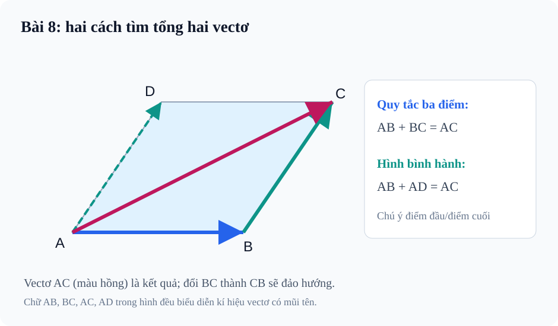

# Bài 8. Tổng và hiệu của hai vectơ

TOÁN 10 · CHƯƠNG IV · KIẾN THỨC SGK KNTT

Học định nghĩa, công thức và ví dụ, rồi luyện tập theo từng kĩ năng.
<nav class="thpt-r4-lesson-tabs"><a href="../">Chương IV</a><a href="../luyen-tap/">Core và Luyện tập</a><a href="../tu-kiem-tra-chuong/">Tự kiểm tra</a></nav>

## 1. Kiến thức SGK

**D1.1 Quy tắc ba điểm/ tam giác.** Với A,B,C tùy ý: $\overrightarrow{AB}+\overrightarrow{BC}=\overrightarrow{AC}$. Lưu ý điểm cuối của vectơ thứ nhất B là điểm đầu của vectơ thứ hai; đảo BC thành CB có thể làm đổi kết quả.

**D1.2 Quy tắc hình bình hành.** Với hình bình hành ABCD, $\overrightarrow{AB}+\overrightarrow{AD}=\overrightarrow{AC}$. Hai cạnh được chọn phải cùng xuất phát từ **A**, đường chéo kết quả từ A đến C. Phép cộng vectơ có giao hoán, kết hợp, phần tử không.

**D1.3 Vectơ đối và hiệu.** $-\overrightarrow{AB}=\overrightarrow{BA}$ và $\vec u-\vec v=\vec u+(-\vec v)$. Quy tắc ba điểm suy ra $\overrightarrow{AB}-\overrightarrow{AC}=\overrightarrow{CB}$; phép trừ vectơ nói chung **không giao hoán**. $\vec a+\vec0=\vec a$, $\vec a+(-\vec a)=\vec0$.

**D1.4 Trung điểm và trọng tâm.** M là trung điểm AB khi và chỉ khi $\overrightarrow{MA}+\overrightarrow{MB}=\vec0$. G là trọng tâm tam giác ABC thì $\overrightarrow{GA}+\overrightarrow{GB}+\overrightarrow{GC}=\vec0$. Đối với M trung điểm BC và E bất kì: $\overrightarrow{EB}+\overrightarrow{EC}=\overrightarrow{EM}+\overrightarrow{EM}$. Chú ý đây là quan hệ cộng vectơ đã có trong bài, không xây thêm phần Core riêng.

**D1.5 Ứng dụng hợp lực.** Nếu hai lực có cùng điểm đặt, hợp lực là đường chéo hình bình hành tạo bởi hai vectơ lực. Độ lớn hợp lực không bằng tổng các độ lớn nếu hai lực không cùng hướng. Bài toán hai lực vuông góc có thể dùng định lí Pitago.

## 2. Ví dụ

### Ví dụ 1. Rút gọn theo ba điểm

**Đề:** Rút gọn $\overrightarrow{AB}+\overrightarrow{BC}+\overrightarrow{CD}$.
**Giải:** Ghép $\overrightarrow{AB}+\overrightarrow{BC}=\overrightarrow{AC}$ rồi cộng $\overrightarrow{CD}$ được $\overrightarrow{AD}$.
**Điểm cần tự kiểm:** Điểm giữa phải nối đúng B rồi C; phép cộng không đổi khi thêm ngoặc hợp lí.

### Ví dụ 2. Quy tắc hình bình hành và hiệu

**Đề:** Trong hình bình hành ABCD, rút gọn $\overrightarrow{AB}+\overrightarrow{AD}$ và $\overrightarrow{AC}-\overrightarrow{AB}$.
**Giải:** Tổng là $\overrightarrow{AC}$. Vì $\overrightarrow{AC}=\overrightarrow{AB}+\overrightarrow{BC}$ nên hiệu $\overrightarrow{AC}-\overrightarrow{AB}=\overrightarrow{BC}=\overrightarrow{AD}$.
**Điểm cần tự kiểm:** Không nhầm kết quả với CA hoặc CB khi đổi hướng.

### Ví dụ 3. Trung điểm và trọng tâm

**Đề:** M là trung điểm BC của tam giác ABC, G là trọng tâm. Nêu hai hệ thức đặc trưng.
**Giải:** Vì M trung điểm BC: $\overrightarrow{MB}+\overrightarrow{MC}=\vec0$. Vì G trọng tâm tam giác ABC: $\overrightarrow{GA}+\overrightarrow{GB}+\overrightarrow{GC}=\vec0$.
**Điểm cần tự kiểm:** Tổng ba vectơ phải đều xuất phát từ G; không thay tùy ý thành AB + BC + CA khi viện dẫn tính chất trọng tâm.

## 3. Hình minh họa

<figure class="thpt-r4-plot thpt-r4-probability-figure"><figcaption>Vectơ và quy tắc ba điểm, hình bình hành.</figcaption></figure>

## 4. Tự khắc phục lỗi thường gặp

Nhầm hướng và thứ tự khi áp dụng quy tắc ba điểm/hiệu
<ol><li><strong>Tín hiệu:</strong> Học sinh trả lời sai trong B08-C01, B08-P02.</li><li><strong>Nguyên nhân:</strong> Nhầm các định nghĩa hoặc quy tắc vectơ đã học, không phải thiếu thêm công thức mới.</li><li><strong>Nguyên lí:</strong> Dùng đường gấp khúc đầu-cuối: AB + BC = AC; phép trừ đổi vectơ bị trừ thành vectơ đối.</li><li><strong>Tự sửa:</strong> Học sinh phải tự vẽ một sơ đồ mũi tên nhỏ, xác định điểm đầu/cuối và nêu ít nhất một lí do toán học, rồi thử lại câu cũ.</li><li><strong>Điểm quay lại:</strong> Làm B08-P02 và B08-P03.</li></ol>
<a href="../luyen-tap/">Quay lại luyện tập</a>

Quên giao điểm trung điểm/trọng tâm, suy luận sai phép cộng và hợp lực
<ol><li><strong>Tín hiệu:</strong> Học sinh trả lời sai trong B08-P04, B08-P05, B08-P06.</li><li><strong>Nguyên nhân:</strong> Nhầm các định nghĩa hoặc quy tắc vectơ đã học, không phải thiếu thêm công thức mới.</li><li><strong>Nguyên lí:</strong> Phân biệt tính chất M trung điểm với G trọng tâm; cộng lực theo hình bình hành, không cộng độ lớn nếu lệch hướng.</li><li><strong>Tự sửa:</strong> Học sinh phải tự vẽ một sơ đồ mũi tên nhỏ, xác định điểm đầu/cuối và nêu ít nhất một lí do toán học, rồi thử lại câu cũ.</li><li><strong>Điểm quay lại:</strong> Làm B08-P04, B08-P05 và B08-P06.</li></ol>
<a href="../luyen-tap/">Quay lại luyện tập</a>

## 5. Tiếp tục

[Core và Luyện tập Bài 8](luyen-tap.md) · [Bài tự luận Chương IV](../../thu-vien/tu-luan-chuong-iv-b07-b08.md)
