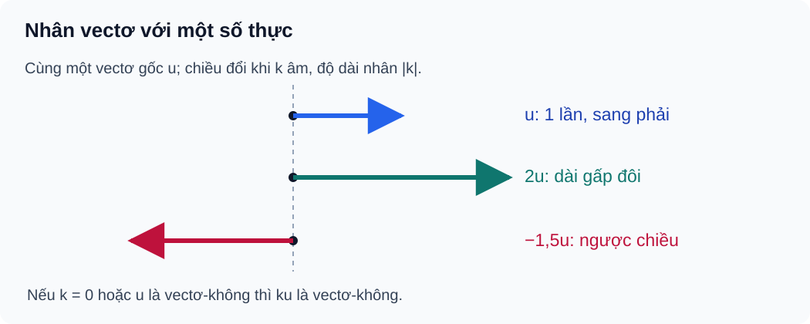

# Bài 9. Tích của một vectơ với một số

TOÁN 10 · CHƯƠNG IV · KIẾN THỨC SGK KNTT

Học kiến thức và ví dụ, rồi luyện tập theo từng kĩ năng.
<nav class="thpt-r4-lesson-tabs"><a href="../">Chương IV</a><a href="../luyen-tap/">Core và Luyện tập</a><a href="../tu-kiem-tra-chuong/">Tự kiểm tra · chưa kích hoạt</a></nav>

## 1. Kiến thức SGK

**D1.1 Định nghĩa và trường hợp đặc biệt.** Cho $k\in\mathbb R$ và vectơ $\vec u$. Vectơ $k\vec u$ có độ dài $|k\vec u|=|k|\,|\vec u|$. Nếu $\vec u\ne\vec0$, với $k>0$ thì $k\vec u$ cùng hướng $\vec u$; với $k<0$ thì ngược hướng. Nếu $k=0$ hoặc $\vec u=\vec0$ thì $k\vec u=\vec0$. Với vectơ-không, SGK/SBT KNTT có quy ước riêng về phương/hướng; không suy ra vectơ-không có một mũi tên vật lí khác 0.

**D1.2 Tính chất.** $k(\vec u+\vec v)=k\vec u+k\vec v$, $(k+m)\vec u=k\vec u+m\vec u$, $k(m\vec u)=(km)\vec u$, $1\vec u=\vec u$, $(-1)\vec u=-\vec u$. Nếu $\vec u$ và $\vec v$ **đều khác không**, chúng cùng phương khi và chỉ khi tồn tại $t\ne0$ sao cho $\vec v=t\vec u$. Trường hợp vectơ không phải kiểm riêng theo quy ước, không chia cho độ dài 0.

**D1.3 Trung điểm và trọng tâm.** Nếu $M$ là trung điểm $AB$ thì $\overrightarrow{AM}=\tfrac12\overrightarrow{AB}$; ngược lại, đẳng thức này xác định trung điểm. Nếu $G$ là trọng tâm tam giác $ABC$, $M$ là trung điểm $BC$ thì

\[
\overrightarrow{AG}=\tfrac23\overrightarrow{AM}=\tfrac13(\overrightarrow{AB}+\overrightarrow{AC}),
\quad \overrightarrow{GA}+\overrightarrow{GB}+\overrightarrow{GC}=\vec0.
\]

Đây là liên hệ vận dụng từ Bài 8 (cộng vectơ) sang nhân với một số, không tạo item trùng với Bài 8.

**D1.4 Ứng dụng.** Khi các vectơ biểu diễn dịch chuyển hay lực, $k$ thay đổi độ lớn và có thể đổi chiều. Không ghi độ dài âm hoặc cộng độ dài thay cho tổng vectơ khi các hướng khác nhau.

## 2. Ví dụ

### Ví dụ 1. Độ dài và hướng của tích với hệ số âm

**Đề:** Cho $|\vec u|=5$ cm, $\vec u\ne\vec0$, đặt $\vec v=-3\vec u$.  
**Giải:** Ta có $|\vec v|=|-3|\cdot5=15$ cm và $\vec v$ ngược hướng $\vec u$ vì hệ số âm.  
**Tự kiểm:** Không viết “độ dài = −15 cm”.

### Ví dụ 2. Trung điểm và vectơ đối

**Đề:** Cho $AB=12$ cm và $M$ là trung điểm $AB$. Biểu thị $\overrightarrow{AM},\overrightarrow{MB},\overrightarrow{MA}$ qua $\overrightarrow{AB}$.  
**Giải:** $\overrightarrow{AM}=\tfrac12\overrightarrow{AB}$, $\overrightarrow{MB}=\tfrac12\overrightarrow{AB}$, $\overrightarrow{MA}=-\tfrac12\overrightarrow{AB}$. Mỗi độ dài bằng 6 cm.  
**Tự kiểm:** Đừng đổi nhầm MA với AM.

### Ví dụ 3. Trọng tâm qua tổng vectơ

**Đề:** Gọi $G$ là trọng tâm $ABC$, $M$ là trung điểm $BC$. Hãy biểu thị $\overrightarrow{AG}$ theo $\overrightarrow{AB},\overrightarrow{AC}$.  
**Giải:** $\overrightarrow{AG}=\tfrac23\overrightarrow{AM}$ và $2\overrightarrow{AM}=\overrightarrow{AB}+\overrightarrow{AC}$, suy ra $\overrightarrow{AG}=\tfrac13(\overrightarrow{AB}+\overrightarrow{AC})$.  
**Tự kiểm:** AG:GM=2:1, nhưng AG:AM=2:3.

## 3. Hình minh họa

<figure class="thpt-r4-plot thpt-r4-probability-figure"><figcaption>Nhân một vectơ với số: cùng hướng, ngược hướng và vectơ không.</figcaption></figure>

## 4. Tự khắc phục lỗi thường gặp

Độ dài âm khi k âm hoặc nhầm quy tắc hướng
<ul><li>Điểm nghẽn: Nhầm $|k\vec u|$ với $k|\vec u|$.</li><li>Bản chất cần sửa: Phân biệt hệ số (có dấu) với độ dài (không âm).</li><li>Quy trình 5 bước: 1. Viết $|k|$. 2. Tính độ dài. 3. Xét dấu k khi $\vec u\ne\vec0$. 4. Kiểm k=0 riêng. 5. Làm lại B09-C01 rồi P05.</li><li>Liên kết item có sẵn: B09-C01, B09-P01, B09-P05. Không clone câu hoặc giải vào HELP_ID.</li><li>Assessment safety: hỗ trợ chỉ tại Knowledge/Practice, không hiển thị trong phiên Tự kiểm tra trước Final Submit.</li></ul>
<a href="../luyen-tap/">Quay lại luyện tập</a>

Nhầm tỉ số trung điểm/trọng tâm với tỉ số vectơ
<ul><li>Điểm nghẽn: Viết sai chiều MA/AM hoặc hệ số AG/AM.</li><li>Bản chất cần sửa: Đọc điểm đầu-cuối; lấy đúng 2/3 trung tuyến, 1/3 tổng AB+AC.</li><li>Quy trình 5 bước: 1. Vẽ ABC và M trung điểm BC. 2. Xác định chiều từng vectơ. 3. Dùng AM=(AB+AC)/2. 4. Suy AG=2AM/3. 5. Tự thử B09-P04.</li><li>Liên kết item có sẵn: B09-P03, B09-P04, W09. Không clone câu hoặc giải vào HELP_ID.</li><li>Assessment safety: hỗ trợ chỉ tại Knowledge/Practice, không hiển thị trong phiên Tự kiểm tra trước Final Submit.</li></ul>
<a href="../luyen-tap/">Quay lại luyện tập</a>

## 5. Tiếp tục

[Core và Luyện tập Bài 9](luyen-tap.md) · [Bài tự luận Chương IV](../../thu-vien/tu-luan-chuong-iv-b09-b11.md)
