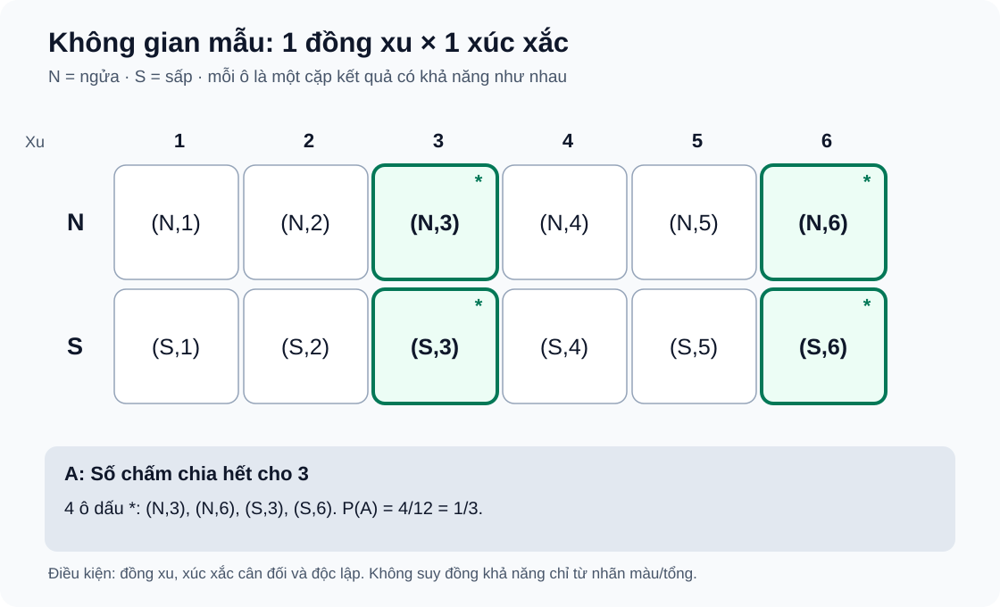

# Bài 26. Biến cố và định nghĩa cổ điển của xác suất

TOÁN 10 · CHƯƠNG IX · KIẾN THỨC SGK KNTT

Kiến thức, điều kiện đồng khả năng và ví dụ được trình bày theo SGK KNTT. Core/Luyện tập là hình thức tự đối chiếu, chưa chấm điểm hoặc ghi Mastery.

<nav class="thpt-r4-lesson-tabs" aria-label="Học và luyện Chương IX"><a href="../">Tổng quan Chương IX</a><a href="../luyen-tap/">Core và Luyện tập</a><a href="../tu-kiem-tra-chuong/">Tự kiểm tra chương · chưa kích hoạt</a></nav>

## 1. Kiến thức SGK — khái niệm và điều kiện

### 26.1. Phép thử ngẫu nhiên và không gian mẫu

Một **phép thử ngẫu nhiên** là hành động có thể biết trước các kết quả có thể xảy ra nhưng không chắc kết quả cụ thể của lần thử. Kí hiệu **Ω** là *không gian mẫu*: tập tất cả kết quả của phép thử. Khi gieo một con xúc xắc sáu mặt cân đối, Ω={1,2,3,4,5,6}. Nêu rõ một kết quả là một số chấm, không phải xác suất.

**Chốt điều kiện:** Khi gieo đồng thời hai xúc xắc phân biệt, mỗi kết quả của phép thử là một *cặp có thứ tự* (i,j), i,j∈{1,…,6}. Có 36 cặp có khả năng như nhau; nếu chỉ liệt kê các tổng từ 2 đến 12, những tổng đó **không** đồng khả năng.

### 26.2. Biến cố là tập con của Ω

Một **biến cố A** được biểu diễn bằng tập những kết quả làm A xảy ra, nên A⊆Ω. Ví dụ với Ω={1,2,3,4,5,6}, biến cố “xuất hiện số lớn hơn 4” là A={5,6}; biến cố không thể là ∅, biến cố chắc chắn là Ω. Học sinh phải phân biệt phát biểu bằng lời với tập kết quả thuận lợi và tránh đếm trùng.

### 26.3. Biến cố đối

Biến cố đối của A, kí hiệu Ā, là biến cố “A không xảy ra”; xét trong **cùng một không gian mẫu Ω**: Ā=Ω\A. Hai biến cố này không thể xảy ra đồng thời và phủ hết Ω. Do đó P(Ā)=1−P(A). Tránh nhầm “không xảy ra A” với một biến cố khác được viết thiếu trường hợp.

### 26.4. Định nghĩa cổ điển và tính chất cơ bản

**Chỉ khi Ω hữu hạn và mọi kết quả sơ cấp đồng khả năng**, xác suất theo định nghĩa cổ điển được tính bằng P(A)=n(A)/n(Ω), với n(Ω)>0. Vì 0≤n(A)≤n(Ω) nên 0≤P(A)≤1, P(∅)=0 và P(Ω)=1. Nếu các kết quả không đồng khả năng, không được lấy số phần tử chia cho tổng phần tử một cách máy móc. Nếu sử dụng hai kết quả không phân biệt về nhãn, phải kiểm tra chúng có cùng xác suất hay không.

### 26.5. Nguyên lí xác suất bé

Biến cố có xác suất rất nhỏ **khó xảy ra trong một phép thử**, nhưng **không phải không thể xảy ra**; ngược lại, xác suất gần 1 không bảo đảm chắc chắn. Trong tình huống thực tế, cần tách điều SGK trình bày với một quy tắc dự báo số lần xuất hiện (chỉ ước lượng, không bảo đảm số lần đúng bằng n·P(A)). 

## 2. Ví dụ

**Ví dụ 1 (EX-G10-B26-01) — Biểu diễn biến cố và công thức cổ điển.** Một vòng quay chia thành sáu ô bằng nhau mang kí hiệu A,A,B,C,C,C; giả sử mũi tên dừng đều nhau trên từng ô vật lí. Gọi các vị trí là A₁,A₂,B,C₁,C₂,C₃, tức n(Ω)=6. Biến cố “ra kí hiệu C” có 3 vị trí thuận lợi nên P(C)=3/6=1/2, trong khi P(A)=2/6=1/3. **Tại sao không dùng Ω={A,B,C} với 3 kết quả đồng khả năng?** Vì ba kí hiệu xuất hiện trên số ô khác nhau. Trình bày hai tầng “kết quả vật lí/nhãn đọc được” để chống nhầm.

**Ví dụ 2 (EX-G10-B26-02) — Biến cố đối và xác suất rất bé.** Một phiếu được chọn đều từ 500 phiếu khác nhau, có đúng một phiếu đặc biệt. Nếu A là “trúng phiếu đặc biệt”, P(A)=1/500; P(Ā)=499/500. Xác suất nhỏ không đồng nghĩa A không thể xảy ra, và không thể kết luận sau 500 lần thử chắc chắn sẽ trúng nếu không quy định chính xác cách chọn phiếu qua từng lần.

## 3. Hình minh họa và tự khắc phục lỗi

<figure class="thpt-r4-plot thpt-r4-probability-figure"><figcaption>Mô hình 12 kết quả đồng khả năng của phép thử đồng xu × xúc xắc.</figcaption></figure>

Đồng nhất nhãn kết quả với kết quả sơ cấp

<strong>Dấu hiệu sai:</strong> Liệt kê kết quả bằng tên màu hoặc tổng chấm nhưng giả định các tên/tổng có xác suất bằng nhau; cũng có thể quên thứ tự của hai lần tung.

<strong>Bản chất toán và điều kiện:</strong> Định nghĩa cổ điển P(A)=n(A)/n(Ω) chỉ áp dụng khi Ω hữu hạn, n(Ω)&gt;0 và mọi kết quả sơ cấp được chọn có khả năng như nhau. Nhãn gộp nhiều kết quả sơ cấp có thể không đồng khả năng.

<strong>Tự sửa theo bước:</strong> (1) Mô tả phép thử thật sự và một kết quả đầy đủ (ô vật lí, cặp có thứ tự nếu có hai bước). (2) Liệt kê/sơ đồ cây các kết quả sơ cấp. (3) Giải thích vì sao chúng đồng khả năng, không suy từ chữ “ngẫu nhiên”. (4) Xác định A⊆Ω rồi mới đếm. (5) Tự kiểm 0≤P(A)≤1.

<strong>Kiến thức cần ôn:</strong> B26 §26.1–26.2, 26.4; quy tắc nhân B23.

<strong>Luyện lại câu đã có:</strong> <a data-thpt-formative-id="THPT-G10-B26-C01" href="../luyen-tap/?item=THPT-G10-B26-C01">Luyện lại B26-C01</a> · <a data-thpt-formative-id="THPT-G10-B26-C02" href="../luyen-tap/?item=THPT-G10-B26-C02">Luyện lại B26-C02</a> · <a data-thpt-formative-id="THPT-G10-B26-P02" href="../luyen-tap/?item=THPT-G10-B26-P02">Luyện lại B26-P02</a> · <a data-thpt-formative-id="THPT-G10-B26-P05" href="../luyen-tap/?item=THPT-G10-B26-P05">Luyện lại B26-P05</a> · <a data-thpt-formative-id="THPT-G10-CHIX-W26-01" href="../../../thu-vien/tu-luan-chuong-ix/#thpt-g10-chix-w26-01">Tự luận liên quan</a>

Nhầm “hoặc”, biến cố đối và xác suất nhỏ

<strong>Dấu hiệu sai:</strong> Cộng hai số trường hợp có giao nhau mà không trừ phần giao; mô tả “A không xảy ra” bằng một tập thiếu kết quả; coi xác suất rất nhỏ là 0 hoặc số lần xuất hiện chắc chắn đúng bằng nP(A).

<strong>Bản chất toán và điều kiện:</strong> A và biến cố đối Ā phân hoạch Ω: Ā=Ω\A, P(A)+P(Ā)=1. Với các biến cố chồng lấn, n(A∪B)=n(A)+n(B)−n(A∩B) trong mô hình hữu hạn; P(A)&gt;0 dù nhỏ không đồng nghĩa A bất khả.

<strong>Tự sửa theo bước:</strong> (1) Viết rõ Ω và các tập A, B bằng kết quả sơ cấp. (2) Tô/vẽ phần giao nếu có chữ “hoặc”. (3) Viết Ā bằng câu chữ và Ω\A, kiểm A∩Ā=∅. (4) Đếm không lặp, tính xác suất khi có đồng khả năng. (5) Nếu phát biểu về xác suất bé, chỉ kết luận “khó xảy ra”, không kết luận “không thể” hay bảo đảm tần suất.

<strong>Kiến thức cần ôn:</strong> B26 §26.2–26.5; tập hợp và phép giao/hợp cơ bản.

<strong>Luyện lại câu đã có:</strong> <a data-thpt-formative-id="THPT-G10-B26-P01" href="../luyen-tap/?item=THPT-G10-B26-P01">Luyện lại B26-P01</a> · <a data-thpt-formative-id="THPT-G10-B26-P03" href="../luyen-tap/?item=THPT-G10-B26-P03">Luyện lại B26-P03</a> · <a data-thpt-formative-id="THPT-G10-B26-P04" href="../luyen-tap/?item=THPT-G10-B26-P04">Luyện lại B26-P04</a> · <a data-thpt-formative-id="THPT-G10-CHIX-W26-01" href="../../../thu-vien/tu-luan-chuong-ix/#thpt-g10-chix-w26-01">Tự luận liên quan</a>

## 4. Tiếp tục học

- [Core và Luyện tập/Vận dụng Chương IX](luyen-tap.md) · dùng chung câu hỏi luyện tập đã có.
- [Thư viện Written/Anchor Chương IX](../../thu-vien/tu-luan-chuong-ix.md) · giải trên giấy trước khi mở rubric.
- [Tổng quan Chương IX](../chuong-ix.md).

<small>Nguồn S1: SGK Toán 10 KNTT tập 2 tr.77–82, SBT Bài 26 phần bài tập tr.61–63. Hình minh họa và thẻ hướng dẫn giúp học sinh tự ôn tập; không phải bài đánh giá thành thạo.</small>
