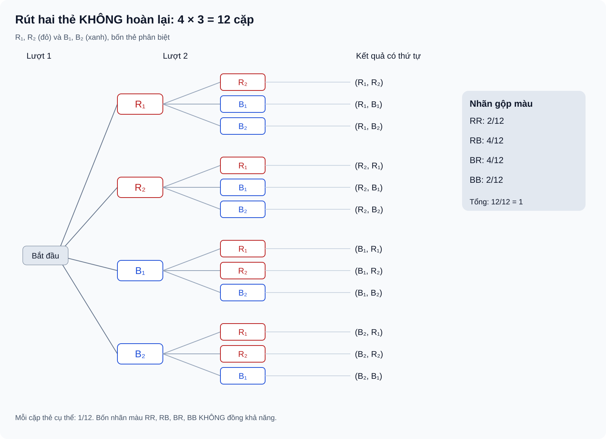

# Bài 27. Thực hành tính xác suất theo định nghĩa cổ điển

TOÁN 10 · CHƯƠNG IX · KIẾN THỨC SGK KNTT

Kiến thức, điều kiện đồng khả năng và ví dụ được trình bày theo SGK KNTT. Core/Luyện tập là hình thức tự đối chiếu, chưa chấm điểm hoặc ghi Mastery.

<nav class="thpt-r4-lesson-tabs" aria-label="Học và luyện Chương IX"><a href="../">Tổng quan Chương IX</a><a href="../luyen-tap/">Core và Luyện tập</a><a href="../tu-kiem-tra-chuong/">Tự kiểm tra chương · chưa kích hoạt</a></nav>

## 1. Kiến thức SGK — khái niệm và điều kiện

### 27.1. Dùng quy tắc đếm / tổ hợp

Khi chọn đều k vật trong n vật **khác nhau** và không quan tâm thứ tự, số kết quả sơ cấp là C(n,k). Với biến cố A, liệt kê các trường hợp thuận lợi rồi dùng P(A)=n(A)/C(n,k), *nếu mọi nhóm k phần tử có khả năng như nhau*. Nếu quan tâm thứ tự, dùng chỉnh hợp hoặc liệt kê theo bước; không trộn mẫu có thứ tự với mẫu không thứ tự khi lấy tỉ số.

### 27.2. Sơ đồ cây và xác suất theo nhiều bước

Với phép thử theo giai đoạn, sơ đồ cây giúp liệt kê mọi đường đi từ gốc đến lá, phân biệt “có hoàn lại” và “không hoàn lại”. Trong mô hình hữu hạn đồng khả năng, có thể đếm lá thuận lợi / tổng lá **chỉ khi các lá có cùng xác suất**. Nếu không đồng khả năng, cần tính xác suất cho từng nhánh theo điều kiện (nếu ngoài phạm vi SGK Core, reviewer yêu cầu phân tầng).

### 27.3. Xác suất của biến cố đối

Để tính “ít nhất một”, hãy xét biến cố đối “không có lần nào” khi đó thuận tiện hơn; P(A)=1−P(Ā). Cẩn thận nhận diện tập bổ sung theo **đúng không gian mẫu**. Không được lấy tổng xác suất các trường hợp giao nhau nếu chưa xử lí phần giao.

### 27.4. Lựa chọn mô hình & tự kiểm

Trước khi tính, học sinh tự hỏi: (1) Các kết quả sơ cấp là gì? (2) Có đồng khả năng không? (3) Có hoàn lại không? (4) Thứ tự có quan trọng không? (5) Biến cố thuận lợi là những trường hợp nào? (6) Kết quả cuối cùng có nằm trong [0,1] và có thể kiểm tra bằng cách khác không?

## 2. Ví dụ đã giải và tự kiểm tra lập luận

**Ví dụ đã giải 1 (EX-G10-B27-01) — Chọn nhóm không phân biệt thứ tự.** Có 3 phiếu đánh số 1,2,3 và 2 phiếu đánh số 4,5. Chọn đều 2 phiếu khác nhau cùng lúc. Tổng số nhóm C(5,2)=10. Biến cố “cả hai phiếu có số không vượt 3” có C(3,2)=3 nhóm, vậy xác suất 3/10. Không nhân thêm 2! vì nhóm không xét thứ tự.

**Ví dụ đã giải 2 (EX-G10-B27-02) — Sơ đồ cây ba phép thử.** Tung ba đồng xu cân đối độc lập, ghi kết quả từng lần (N = ngửa, S = sấp). Có 2³=8 bộ kết quả đồng khả năng: NNN, NNS, NSN, SNN, NSS, SNS, SSN, SSS. Biến cố đúng hai mặt ngửa là {NNS, NSN, SNN}, xác suất 3/8. Có thể minh họa bằng cây ba tầng; mỗi lá đúng một chuỗi.

**Ví dụ đã giải 3 (EX-G10-B27-03) — Tính biến cố đối.** Gieo một xúc xắc cân đối hai lần độc lập. A: “Có ít nhất một lần ra mặt 6”. Ā: “Cả hai lần đều khác 6” có 5·5=25 bộ, Ω có 36 bộ, nên P(A)=1−25/36=11/36. Không cộng 1/6+1/6=1/3 vì trường hợp cả hai lần cùng ra 6 sẽ bị tính hai lần.

## 3. Hình minh họa và tự khắc phục lỗi

<figure class="thpt-r4-plot thpt-r4-probability-figure"><figcaption>Sơ đồ cây lựa chọn không hoàn lại; chỉ dùng quy tắc đếm lá khi các kết quả sơ cấp đồng khả năng.</figcaption></figure>

Đếm lá sơ đồ cây không đồng khả năng

<strong>Dấu hiệu sai:</strong> Thấy sơ đồ cây có nhiều lá rồi chia số lá thuận lợi cho tổng lá mà không kiểm điều kiện chọn từng bước; hoặc quên rằng xác suất nhánh sau có thể thay đổi khi không hoàn lại.

<strong>Bản chất toán và điều kiện:</strong> Đếm lá theo định nghĩa cổ điển chỉ đúng khi mọi lá của Ω đã chọn là đồng khả năng. Rút không hoàn lại làm thay đổi số phần tử còn lại và các xác suất có điều kiện. Nếu mô hình không bảo đảm đồng khả năng, không dùng số lá thuần túy làm mẫu số; cần chuyển sang mô hình đủ chi tiết hoặc nêu thiếu dữ kiện.

<strong>Tự sửa theo bước:</strong> (1) Xác định thứ tự các bước và có hoàn lại hay không. (2) Tạo đúng một nhánh cho mỗi lựa chọn có thể xảy ra ở mỗi trạng thái. (3) Kiểm tính đồng khả năng của từng kết quả hoàn chỉnh/lá trước khi đếm. (4) Gom các lá thỏa biến cố, bảo đảm không đếm trùng. (5) Soát kết quả trong [0,1], đối chiếu bằng cách đếm cặp.

<strong>Kiến thức cần ôn:</strong> B23 quy tắc nhân; B26 §26.4; B27 §27.2.

<strong>Luyện lại câu đã có:</strong> <a data-thpt-formative-id="THPT-G10-B27-C01" href="../luyen-tap/?item=THPT-G10-B27-C01">Luyện lại B27-C01</a> · <a data-thpt-formative-id="THPT-G10-B27-C02" href="../luyen-tap/?item=THPT-G10-B27-C02">Luyện lại B27-C02</a> · <a data-thpt-formative-id="THPT-G10-B27-P03" href="../luyen-tap/?item=THPT-G10-B27-P03">Luyện lại B27-P03</a> · <a data-thpt-formative-id="THPT-G10-B27-P04" href="../luyen-tap/?item=THPT-G10-B27-P04">Luyện lại B27-P04</a> · <a data-thpt-formative-id="THPT-G10-B27-P05" href="../luyen-tap/?item=THPT-G10-B27-P05">Luyện lại B27-P05</a>

Lẫn mẫu có thứ tự, tổ hợp và biến cố ít nhất một

<strong>Dấu hiệu sai:</strong> Đếm mẫu bằng tổ hợp nhưng đếm trường hợp thuận lợi theo chuỗi có thứ tự; hoặc đếm “ít nhất một” bằng cộng các trường hợp giao nhau; cho rằng mọi cặp không thứ tự khi gieo hai xúc xắc phân biệt đều đồng khả năng.

<strong>Bản chất toán và điều kiện:</strong> Tử và mẫu phải đếm theo cùng loại kết quả sơ cấp và cùng giả thiết đồng khả năng. Với chọn đồng thời k đối tượng phân biệt thành một nhóm đồng khả năng, dùng C(n,k) nhất quán. “Ít nhất một” có thể chuyển sang biến cố đối “không có”, nhưng phải mô tả chính xác phần bù trong Ω.

<strong>Tự sửa theo bước:</strong> (1) Hỏi có xét thứ tự hay không và ghi vào định nghĩa Ω. (2) Với nhóm chọn đồng thời có khả năng như nhau, dùng tổ hợp cho cả tử và mẫu; với chuỗi nhiều bước, dùng kết quả có thứ tự nhất quán. (3) Kiểm các trường hợp thuận lợi rời nhau. (4) Thử biến cố đối để tránh đếm giao nhau. (5) Xác nhận 0≤P≤1; tự đối chiếu bằng cách khác.

<strong>Kiến thức cần ôn:</strong> B24 hoán vị/chỉnh hợp/tổ hợp; B26 biến cố đối; B27 §27.1, 27.3–27.4.

<strong>Luyện lại câu đã có:</strong> <a data-thpt-formative-id="THPT-G10-B27-P01" href="../luyen-tap/?item=THPT-G10-B27-P01">Luyện lại B27-P01</a> · <a data-thpt-formative-id="THPT-G10-B27-P02" href="../luyen-tap/?item=THPT-G10-B27-P02">Luyện lại B27-P02</a> · <a data-thpt-formative-id="THPT-G10-B27-P05" href="../luyen-tap/?item=THPT-G10-B27-P05">Luyện lại B27-P05</a> · <a data-thpt-formative-id="THPT-G10-CHIX-W27-ANCHOR-01" href="../../../thu-vien/tu-luan-chuong-ix/#thpt-g10-chix-w27-anchor-01">Tự luận liên quan</a>

## 4. Tiếp tục học

- [Core và Luyện tập/Vận dụng Chương IX](luyen-tap.md) · cùng ID canonical đã được review.
- [Thư viện Written/Anchor Chương IX](../../thu-vien/tu-luan-chuong-ix.md) · giải trên giấy trước khi mở rubric.
- [Tổng quan Chương IX](../chuong-ix.md).

<small>Nguồn S1 đã được reviewer xác nhận: SGK Toán 10 KNTT tập 2 tr.83–87, SBT Bài 27 phần bài tập tr.64–66. Hình minh họa và thẻ hướng dẫn giúp học sinh tự ôn tập; không phải bài đánh giá thành thạo.</small>
