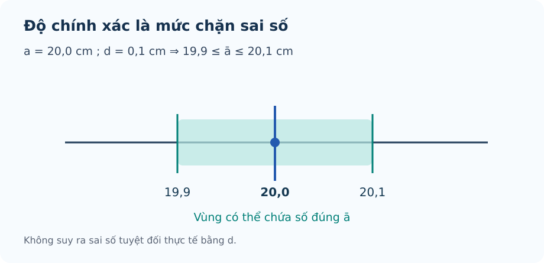

# Bài 12. Số gần đúng và sai số

TOÁN 10 · CHƯƠNG V · KIẾN THỨC SGK KNTT

Số gần đúng, sai số tuyệt đối/tương đối và quy tròn; sử dụng hình và hỗ trợ D6 R02 đã được NotebookLM duyệt.
<nav class="thpt-r4-lesson-tabs"><a href="../">Chương V</a><a href="../luyen-tap/">Core và Luyện tập</a><a href="../tu-kiem-tra-chuong/">Tự kiểm tra · chưa kích hoạt</a></nav>

## 1. Kiến thức SGK

### Đúng/gần đúng và số quy tròn
Theo kí hiệu SGK/SBT KNTT, **\(a\) là số gần đúng**, còn **\(\bar a\) là số đúng** (có thể chưa biết). Số gần đúng \(a\) thay cho số đúng \(\bar a\); viết \(a\approx\bar a\). Không phải mọi chữ số thập phân được hiển thị đều là chữ số đáng tin cậy; độ chính xác phụ thuộc phép đo/quy trình. Làm tròn một giá trị theo hàng yêu cầu để có số quy tròn. Quy tròn tới hàng phần mười, phần trăm, hàng chục… phải xác định rõ hàng làm tròn.

### Sai số tuyệt đối, độ chính xác
Sai số tuyệt đối của số gần đúng \(a\) là \(\Delta_a=|a-\bar a|\). Nếu **chưa biết** số đúng \(\bar a\), nhưng \(\Delta_a\le d\), thì \(d\) là **độ chính xác/giới hạn trên**; không được suy \(\Delta_a=d\). Số đúng nằm trong \(a-d\le\bar a\le a+d\). Sai số tuyệt đối cùng đơn vị với đại lượng.

### Sai số tương đối
Với số gần đúng **\(a\ne0\)** và số đúng \(\bar a\) đã biết, \(\delta_a=\Delta_a/|a|\) (thường viết theo %): **mẫu số là số gần đúng \(a\) theo KNTT**, không phải số đúng. Khi chỉ có \(a\ne0\) và \(\Delta_a\le d\), chỉ suy ra **cận trên** \(\delta_a\le d/|a|\), không được viết đẳng thức \(\delta_a=d/|a|\) nếu chưa biết sai số thực. Không chia cho 0, không nhầm tỷ lệ với %.

### Giới hạn độ chính xác và quy tròn
Khi làm tròn một số đúng tới đơn vị của hàng \(h>0\), sai số làm tròn thông thường không quá \(h/2\) nếu áp dụng quy tắc làm tròn gần nhất. Không tự khẳng định mọi phép đo tới hàng đó có cùng sai số tối đa: còn phụ thuộc độ chính xác đo ban đầu. Khi một số gần đúng \(a\) được cho với độ chính xác \(d\) nhưng không nêu hàng quy tròn, cần kiểm đúng quy tắc SGK/SBT về **hàng thấp nhất có một đơn vị lớn hơn d** trước khi chọn hàng.

## 2. Ví dụ

### Ví dụ 1. phân biệt sai số thực / ước lượng
Biết số đúng \(\bar a=12{,}347\), số gần đúng \(a=12{,}35\). \(\Delta_a=0{,}003\), \(\delta_a=0{,}003/12{,}35\approx0{,}0243\%\). Phải dùng **12,35 ở mẫu số** theo SGK KNTT. Nếu chỉ biết \(\Delta_a\le0{,}003\) thì chỉ có cận \(\delta_a\le0{,}003/12{,}35\).

### Ví dụ 2. giới hạn sai số
Ghi chiều dài gần đúng \(a=20{,}0\,\mathrm{cm}\) với độ chính xác \(d=0{,}1\,\mathrm{cm}\). Số đúng \(\bar a\in[19{,}9;20{,}1]\,\mathrm{cm}\). Không xác định được chính xác \(\Delta\) nếu không biết giá trị đúng.

### Ví dụ 3. quy tròn
Làm tròn \(3{,}14159\) tới hàng phần trăm được \(3{,}14\). Sai số tuyệt đối của phép làm tròn \(0{,}00159\le0{,}005\). Nói rõ hàng phần trăm là 2 chữ số thập phân.

## 3. Hình minh họa

<figure class="thpt-r4-plot thpt-r4-probability-figure" data-thpt-fig-id="FIG-G10-B12-01"><figcaption>Khoảng có thể chứa số đúng · Hình FIG-G10-B12-01 · Bản R02 đã được duyệt.</figcaption></figure>

## 4. Tự khắc phục lỗi thường gặp

Nhầm độ chính xác d với sai số tuyệt đối thực tế
<ol><li><strong>Nhận diện lỗi:</strong> Coi độ chính xác \(d\) là sai số tuyệt đối thực tế \(\Delta_a\), dù không biết số đúng.</li><li><strong>Dấu hiệu / tự chẩn đoán:</strong> Em đã viết \(\Delta_a=d\) chỉ vì đề cho độ chính xác \(d\)? Đề đã cho số đúng \(\bar a\), hay mới chỉ cho số gần đúng \(a\) và cận sai số \(d\)?</li><li><strong>Kiến thức gốc:</strong> \(a\) là số gần đúng, \(\bar a\) là số đúng; \(\Delta_a=|a-\bar a|\). Nếu chỉ biết \(\Delta_a\le d\) thì không thể kết luận \(\Delta_a=d\); ta chỉ biết \(a-d\le\bar a\le a+d\).</li><li><strong>Tự sửa:</strong> Với số gần đúng \(a\) và độ chính xác \(d\), hãy lập đúng khoảng \([a-d;a+d]\) chứa **số đúng** \(\bar a\), rồi phát biểu rõ “sai số tuyệt đối **không quá** \(d\)”, không ghi bằng \(d\) khi chưa biết sai số thực. Ví dụ liên hệ câu Core C02: \(a=12{,}3\,\mathrm{cm}\), \(d=0{,}2\,\mathrm{cm}\) thì \(\bar a\in[12{,}1;12{,}5]\,\mathrm{cm}\), chứ chưa biết \(\Delta_a=0{,}2\).</li><li><strong>Luyện lại bằng ID sẵn có:</strong> THPT-G10-B12-C02 (không sao chép câu, không đổi đáp án hay lời giải).</li></ol>
<a href="../luyen-tap/?item=THPT-G10-B12-C02">Luyện lại bằng câu hỏi đã có</a>

Sai mẫu số và nhầm cận sai số tương đối
<ol><li><strong>Nhận diện lỗi:</strong> Dùng số đúng (chưa biết) thay cho số gần đúng khi tính sai số tương đối, hoặc nhầm cận sai số với sai số thực.</li><li><strong>Dấu hiệu / tự chẩn đoán:</strong> Em lấy \(\frac{\Delta_a}{|\bar{a}|}\) thay cho \(\frac{\Delta_a}{|a|}\)? Khi chỉ biết độ chính xác \(d\), em đã nhầm \(\Delta_a=d\) chưa?</li><li><strong>Kiến thức gốc:</strong> Với số gần đúng \(a\ne0\), \(\delta_a=\frac{\Delta_a}{|a|}\). Nếu chỉ biết \(\Delta_a\le d\) thì chỉ suy \(\delta_a\le\frac{d}{|a|}\); không khẳng định \(\delta_a=\frac{d}{|a|}\) khi chưa biết sai số thực.</li><li><strong>Tự sửa:</strong> Xác định lại \(a,\bar{a},\Delta_a,d\); tính cận phần trăm đúng theo \(a\) và nói rõ dấu \(\le\).</li><li><strong>Luyện lại bằng ID sẵn có:</strong> THPT-G10-B12-P06.</li></ol>
<a href="../luyen-tap/?item=THPT-G10-B12-P06">Luyện lại bằng câu hỏi đã có</a>

## 5. Tiếp tục

[Core và Luyện tập Bài 12](luyen-tap.md) · [Bài tự luận Chương V](../../thu-vien/tu-luan-chuong-v-b13-b14.md)
