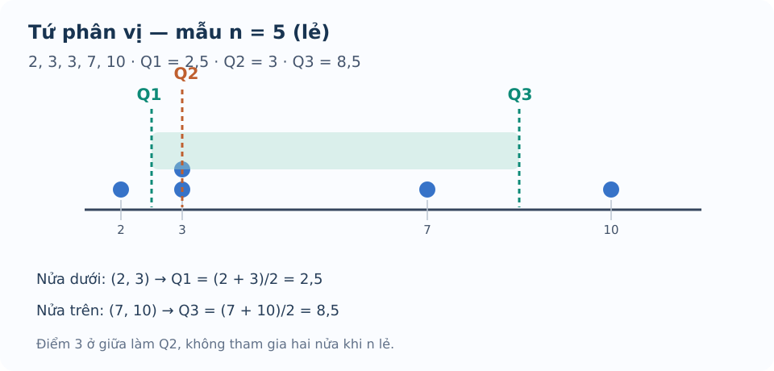

# Bài 13. Các số đặc trưng đo xu thế trung tâm

TOÁN 10 · CHƯƠNG V · KIẾN THỨC SGK KNTT

Học định nghĩa, điều kiện, ví dụ và hình minh họa; tự luyện trước khi mở gợi ý và lời giải.
<nav class="thpt-r4-lesson-tabs"><a href="../">Chương V</a><a href="../luyen-tap/">Core và Luyện tập</a><a href="../tu-kiem-tra-chuong/">Tự kiểm tra · chưa kích hoạt</a></nav>

## 1. Kiến thức SGK

### Số trung bình, trung vị
Mẫu \(x_1,\ldots,x_n\) có \(n>0\), số trung bình \(\bar x=(\sum_i x_i)/n\). Nếu \(x_i\) có tần số \(m_i\), \(\bar x=\sum_i m_ix_i/\sum_i m_i\). Phải sắp mẫu không giảm trước khi tìm trung vị \(Q_2\): với \(n\) lẻ lấy giá trị chính giữa; \(n\) chẵn lấy trung bình hai giá trị giữa.

### Tứ phân vị theo KNTT
Với mẫu tăng dần: \(Q_2\) là trung vị; \(Q_1\) là trung vị **nửa dưới** và \(Q_3\) là trung vị **nửa trên**. Khi \(n\) lẻ, **loại chính \(Q_2\)** khỏi cả hai nửa; khi \(n\) chẵn, chia dãy thành hai nửa bằng nhau. Mỗi trường hợp cần ghi thao tác, không dùng máy tính có quy ước percentile khác làm bằng chứng thay SGK.

### Mốt và diễn giải
Mốt là giá trị xuất hiện nhiều lần nhất (tần số cao nhất); có thể có nhiều giá trị đồng mốt. Theo ví dụ SGK khi tất cả giá trị có tần số 1, mẫu được coi **không có mốt**. Số trung bình có thể bị kéo về phía giá trị rất lớn/nhỏ, trong khi trung vị ít nhạy hơn, nên việc chọn số đặc trưng phải theo tình huống.

## 2. Ví dụ

### Ví dụ 1. một mẫu n lẻ
Mẫu đã sắp \(2,3,3,7,10\): \(\bar x=25/5=5\), \(Q_2=3\), mốt 3; nửa trái \(2,3\) cho \(Q_1=2{,}5\), nửa phải \(7,10\) cho \(Q_3=8{,}5\). Số trung bình cao hơn trung vị vì số 10.

### Ví dụ 2. mẫu n chẵn
Mẫu \(2,4,6,10,12,20\): \(Q_2=(6+10)/2=8\); \(Q_1=4\), \(Q_3=12\); \(\bar x=54/6=9\). Cần xếp số trước khi chia nửa.

### Ví dụ 3. bảng tần số
Giá trị 5 có tần số 2, 7 có tần số 3, 9 có tần số 1. \(n=6\), \(\bar x=(10+21+9)/6=20/3\), \(Q_2=7\), mốt 7, \(Q_1=5\), \(Q_3=7\). Không dùng \((5+7+9)/3\).

## 3. Hình minh họa

<figure class="thpt-r4-plot thpt-r4-probability-figure"><figcaption>Mẫu đã sắp và cách lấy tứ phân vị khi có năm giá trị.</figcaption></figure>

## 4. Tự khắc phục lỗi thường gặp

Quên sắp mẫu và loại Q2 ở n lẻ
<ol><li><strong>Nhận diện lỗi:</strong> Quên sắp mẫu và loại Q2 ở n lẻ.</li><li><strong>Dấu hiệu / tự chẩn đoán:</strong> Tính Q1/Q3 từ dãy chưa sắp hoặc đưa Q2 vào hai nửa. n chẵn hay lẻ? Em đã xếp tăng dần chưa?</li><li><strong>Kiến thức gốc:</strong> SGK KNTT: tìm Q2; n lẻ bỏ Q2 trước khi chia nửa.</li><li><strong>Tự sửa:</strong> Khoanh riêng nửa dưới, nửa trên rồi tính trung vị mỗi nửa.</li><li><strong>Luyện lại bằng ID sẵn có:</strong> THPT-G10-B13-P05.</li></ol>
<a href="../luyen-tap/?item=THPT-G10-B13-P05">Luyện lại bằng câu hỏi đã có</a>

Không nhân giá trị với tần số / nhầm mốt
<ol><li><strong>Nhận diện lỗi:</strong> Không nhân giá trị với tần số / nhầm mốt.</li><li><strong>Dấu hiệu / tự chẩn đoán:</strong> Lấy trung bình các giá trị phân biệt mà không tính tần số. Tổng số quan sát là tổng m_i hay số giá trị khác nhau?</li><li><strong>Kiến thức gốc:</strong> Trung bình bảng tần số = tổng x_i*m_i chia tổng m_i; mốt là x_i có tần số cao nhất.</li><li><strong>Tự sửa:</strong> Lập lại bảng cột giá trị × tần số, so đáp án.</li><li><strong>Luyện lại bằng ID sẵn có:</strong> THPT-G10-B13-P01.</li></ol>
<a href="../luyen-tap/?item=THPT-G10-B13-P01">Luyện lại bằng câu hỏi đã có</a>

## 5. Tiếp tục

[Core và Luyện tập Bài 13](luyen-tap.md) · [Bài tự luận Chương V](../../thu-vien/tu-luan-chuong-v-b13-b14.md)
