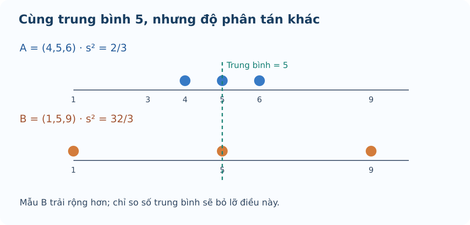

# Bài 14. Các số đặc trưng đo độ phân tán

TOÁN 10 · CHƯƠNG V · KIẾN THỨC SGK KNTT

Học định nghĩa, điều kiện, ví dụ và hình minh họa; tự luyện trước khi mở gợi ý và lời giải.
<nav class="thpt-r4-lesson-tabs"><a href="../">Chương V</a><a href="../luyen-tap/">Core và Luyện tập</a><a href="../tu-kiem-tra-chuong/">Tự kiểm tra · chưa kích hoạt</a></nav>

## 1. Kiến thức SGK

### Khoảng biến thiên và khoảng tứ phân vị
Khoảng biến thiên \(R=x_{\max}-x_{\min}\ge0\). Khoảng tứ phân vị \(\Delta_Q=Q_3-Q_1\ge0\), được xác định từ **cách lấy tứ phân vị của SGK**. R rất nhạy với giá trị quá lớn/quá nhỏ, \(\Delta_Q\) nhìn vào phần 50% số liệu giữa.

### Phương sai / độ lệch chuẩn theo dãy đang mô tả
\(s^2=\frac1n\sum_{i=1}^{n}(x_i-\bar x)^2\), **chia cho n** như SGK chứ không tự thay bằng \(n-1\). \(s=\sqrt{s^2}\). Nếu dữ liệu gốc tính bằng kg thì phương sai tính kg² và độ lệch chuẩn tính kg. Với bảng tần số, tính \(\sum m_i(x_i-\bar x)^2/n\).

### Giá trị bất thường
Theo quy tắc của SGK, giá trị \(x<Q_1-1{,}5\Delta_Q\) hoặc \(x>Q_3+1{,}5\Delta_Q\) được coi là giá trị bất thường. Dấu ở đây **nghiêm ngặt** (<, >); bằng ngưỡng không bị liệt kê. Không tự động loại những giá trị đó khỏi dữ liệu khi tính toán nếu đề bài không yêu cầu.

## 2. Ví dụ

### Ví dụ 1. R, IQR, phương sai
Mẫu \(2,4,6,8\): \(\bar x=5\), \(R=6\), \(Q_1=3,Q_3=7,\Delta_Q=4\); \(s^2=(9+1+1+9)/4=5\), \(s=\sqrt5\approx2{,}236\).

### Ví dụ 2. cùng trung bình, khác độ phân tán
\(A=(4,5,6)\), \(B=(1,5,9)\) đều có \(\bar x=5\), nhưng \(s_A^2=2/3\), \(s_B^2=32/3\); B biến động hơn, không thể dùng duy nhất trung bình.

### Ví dụ 3. nhận diện giá trị bất thường
Mẫu \(1,2,2,3,3,4,4,20\): \(Q_1=2\), \(Q_3=4\), \(\Delta_Q=2\), ngưỡng trên \(4+1{,}5(2)=7\), nên 20 là giá trị bất thường. Không gọi tất cả giá trị lớn hơn trung bình là ngoại lệ.

## 3. Hình minh họa

<figure class="thpt-r4-plot thpt-r4-probability-figure"><figcaption>Hai mẫu có cùng trung bình nhưng mức phân tán khác nhau.</figcaption></figure>

## 4. Tự khắc phục lỗi thường gặp

Sai mẫu số phương sai và đơn vị
<ol><li><strong>Nhận diện lỗi:</strong> Sai mẫu số phương sai và đơn vị.</li><li><strong>Dấu hiệu / tự chẩn đoán:</strong> Dùng n−1 và viết s có đơn vị bình phương. Đang mô tả dãy số liệu SGK hay ước lượng suy luận mẫu?</li><li><strong>Kiến thức gốc:</strong> SGK dùng s²=Σ(x−x̄)²/n; s căn của s², cùng đơn vị dữ liệu.</li><li><strong>Tự sửa:</strong> Tính lại các bình phương rồi chia n và ghi đơn vị.</li><li><strong>Luyện lại bằng ID sẵn có:</strong> THPT-G10-B14-P05.</li></ol>
<a href="../luyen-tap/?item=THPT-G10-B14-P05">Luyện lại bằng câu hỏi đã có</a>

Nhầm hàng rào ngoại lệ và phân tán
<ol><li><strong>Nhận diện lỗi:</strong> Nhầm hàng rào ngoại lệ và phân tán.</li><li><strong>Dấu hiệu / tự chẩn đoán:</strong> So giá trị với trung bình hoặc đánh dấu giá trị bằng ngưỡng là ngoại lệ. Em đã lấy Q1, Q3 đúng quy tắc chưa?</li><li><strong>Kiến thức gốc:</strong> Bất thường khi x&lt;Q1−1,5 IQR hoặc x&gt;Q3+1,5 IQR; dùng dấu nghiêm ngặt.</li><li><strong>Tự sửa:</strong> Tính Q1/Q3, viết ngưỡng và kiểm từng giá trị.</li><li><strong>Luyện lại bằng ID sẵn có:</strong> THPT-G10-B14-P03.</li></ol>
<a href="../luyen-tap/?item=THPT-G10-B14-P03">Luyện lại bằng câu hỏi đã có</a>

## 5. Tiếp tục

[Core và Luyện tập Bài 14](luyen-tap.md) · [Bài tự luận Chương V](../../thu-vien/tu-luan-chuong-v-b13-b14.md)
