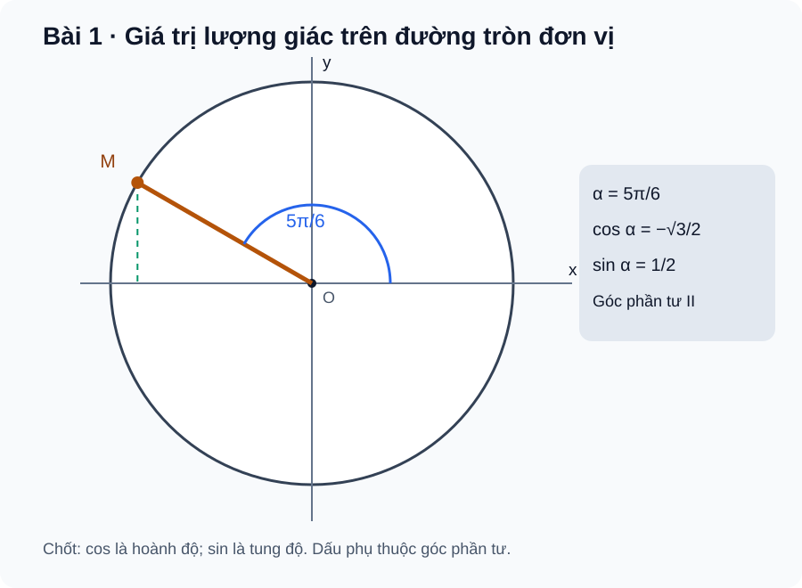

# Bài 1. Giá trị lượng giác của góc lượng giác

TOÁN 11 · CHƯƠNG I · SGK KẾT NỐI TRI THỨC

Học theo SGK từng bước: kiến thức, ví dụ, luyện tập và tự khắc phục lỗi. Phạm vi đang công bố chỉ gồm Bài 1–2.

<nav class="thpt-r4-lesson-tabs"><a href="../">Chương I</a><a href="../luyen-tap/">Core và Luyện tập</a><a href="../tu-kiem-tra-chuong/">Tự kiểm tra · chưa kích hoạt</a></nav>

## 1. Kiến thức SGK

### 1. Góc lượng giác và số đo

**Chiều quay.** Một góc lượng giác ghi lại cả tia đầu, tia cuối và chiều quay: ngược chiều kim đồng hồ lấy dương, cùng chiều lấy âm.

**Các góc cùng tia cuối.** Hai góc cùng tia đầu/tia cuối có thể chênh nhau một số nguyên lần \(360°\) hoặc \(2π\) rad.

**Đổi giữa độ và radian:**

- \(180° = π rad\)
- \(α rad = α·180°/π\)
- \(x° = xπ/180 rad\)

**Chú ý:** Khi chỉ xét vị trí cuối trên đường tròn lượng giác có thể quy về một đại diện trong \([0,2π)\), nhưng **không được xóa ý nghĩa số vòng quay** nếu bài toán hỏi quãng đường chuyển động.

### 2. Radian và độ dài cung

**Công thức độ dài cung.** Với bán kính \(R>0\), góc ở tâm có độ lớn \(|α|\) rad chắn cung có độ dài:

\[
s=R|α|
\]

**Lưu ý:** Cung đi theo số lần quay được mô tả.

Không dùng trực tiếp độ cho công thức này; góc 180° chắn cung nửa đường tròn dài \(πR\).

### 3. Đường tròn lượng giác

**Điểm cuối.** Gắn O với gốc tọa độ, bán kính đơn vị. Khi quay từ trục Ox dương, điểm cuối trên đường tròn là:

\[
M=(cos α,sin α)
\]

**Hệ thức cơ bản (đúng với mọi α):**

\[
sin²α+cos²α=1
\]

**Quy tắc dấu.** Dấu của sin/cos phụ thuộc góc phần tư, không phụ thuộc việc chỉ nhớ số dương của góc tham chiếu.

### 4. Tang, côtang và điều kiện xác định

**Tang:**

\[
tan α=sin α/cos α
\]

**Điều kiện:** cos α ≠ 0.

**Côtang:**

\[
cot α=cos α/sin α
\]

**Điều kiện:** sin α ≠ 0.

**Các hệ thức suy ra từ đẳng thức cơ bản:**

\[
1+tan²α=1/cos²α
\]

trên miền \(cos α ≠ 0\);

\[
1+cot²α=1/sin²α
\]

trên miền \(sin α ≠ 0\).

**Chu kì.** Sin/cos chu kì 2π; tan/cot chu kì π khi xác định.

### 5. Các góc liên quan đặc biệt

**Góc đối:**

- \(sin(−α)=−sinα\)
- \(cos(−α)=cosα\)

**Góc liên quan tới π:**

- \(sin(π−α)=sinα\)
- \(cos(π−α)=−cosα\)
- \(sin(π+α)=−sinα\)
- \(cos(π+α)=−cosα\)

**Góc phụ:**

- \(sin(π/2−α)=cosα\)
- \(cos(π/2−α)=sinα\)

**Điều kiện:** Mọi hệ thức tan/cot cần kiểm điều kiện mẫu khác 0.

**Cần tự tái dựng:** Bảng giá trị \(0,π/6,π/4,π/3,π/2\) là tiền đề cần học sinh tự tái dựng trên đường tròn, không chỉ học thuộc.

## 2. Ví dụ

### Ví dụ 1.

Đổi \(−150°\) sang radian: \(−150°×π/180°=−5π/6\); một đại diện đồng tia cuối trong \([0,2π)\) là \(7π/6\). Cần phân biệt “góc lượng giác −5π/6” (thể hiện chiều quay âm) với “vị trí cuối 7π/6” (chỉ xác định tia cuối).

### Ví dụ 2.

Tại \(α=5π/6\), sin dương, cos âm vì góc phần tư II; \(sin(5π/6)=sin(π−π/6)=1/2\), \(cos(5π/6)=−cos(π/6)=−√3/2\). Từ đây tan là tỉ số âm và xác định, không lấy dấu từ góc tham chiếu một cách máy móc. FIG01 diễn tả vị trí M trên đường tròn.

### Ví dụ 3.

Bánh xe bán kính \(30 cm\) quay góc \(−2π/3 rad\); độ dài cung quét trên vành là \(30×|−2π/3|=20π cm\). Dấu trừ chỉ chiều quay, không làm độ dài âm. Nếu xe quay qua hơn một vòng, tổng quãng đường phải dùng độ lớn góc quay **thực tế**, không chỉ góc quy về \([0,2π)\).

## 3. Hình minh họa

<figure class="thpt-r4-plot thpt-r4-probability-figure"><figcaption>Điểm M tại góc 5π/6 trên đường tròn lượng giác.</figcaption></figure>

## 4. Tự khắc phục lỗi thường gặp

Nhầm góc cùng tia cuối với cùng số vòng quay
<ul><li>**Dấu hiệu:** Rút <code>765°</code> thành <code>45°</code> rồi dùng góc 45° để tính quãng đường xe quay 765°.  </li>
<li>**Bản chất:** Hai góc chênh bội của 360° có cùng tia cuối / cùng sin cos, nhưng tổng độ dài cung di chuyển còn phụ thuộc số vòng quay thực tế.  </li>
<li>**Tự sửa:** ghi rõ đại lượng cần hỏi; với giá trị lượng giác quy góc modulo 2π, với quãng đường dùng độ lớn tổng góc quay ban đầu ở radian; kiểm đơn vị và dấu.  </li>
<li>**Ôn:** SGK Bài 1 góc lượng giác, radian, cung tròn.  </li>
<li>**Quay lại item:** <code>THPT-G11-B01-P02</code>, <code>THPT-G11-B01-P03</code>, <code>THPT-G11-CHI-W01</code>.</li></ul>
<a href="../luyen-tap/">Về Luyện tập</a>

Quên điều kiện tan/cot và dấu góc phần tư
<ul><li>**Dấu hiệu:** Kết luận tan(π/2) có giá trị hữu hạn hoặc chọn dấu cos dương trong góc phần tư II.  </li>
<li>**Bản chất:** tan α chỉ xác định nếu cos α≠0; cot α chỉ nếu sin α≠0. Hệ thức sin²+cos²=1 chỉ cho độ lớn; góc phần tư quyết định dấu.  </li>
<li>**Tự sửa:** khoanh miền xác định trước; xác định góc phần tư, lấy căn đúng dấu; thử ngược bằng tan=sin/cos và sin²+cos²=1.  </li>
<li>**Ôn:** SGK Bài 1 giá trị lượng giác, dấu và hệ thức cơ bản.  </li>
<li>**Quay lại item:** <code>THPT-G11-B01-C02</code>, <code>THPT-G11-B01-P01</code>, <code>THPT-G11-B01-P04</code>, <code>THPT-G11-B01-P05</code>.</li></ul>
<a href="../luyen-tap/">Về Luyện tập</a>

## 5. Tiếp tục

[Core và Luyện tập Bài 1](luyen-tap.md) · [Tự luận Chương I](../../../thu-vien/tu-luan-g11-chuong-i-b01-b02.md)
