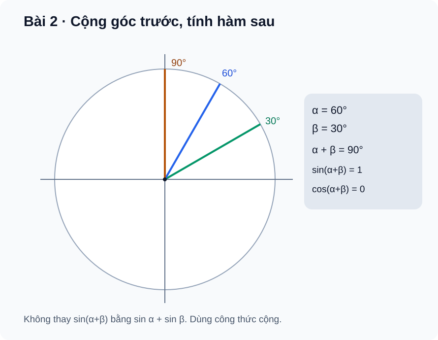

# Bài 2. Công thức lượng giác

TOÁN 11 · CHƯƠNG I · SGK KẾT NỐI TRI THỨC

Học theo SGK từng bước: kiến thức, ví dụ, luyện tập và tự khắc phục lỗi. Phạm vi đang công bố chỉ gồm Bài 1–2.

<nav class="thpt-r4-lesson-tabs"><a href="../">Chương I</a><a href="../luyen-tap/">Core và Luyện tập</a><a href="../tu-kiem-tra-chuong/">Tự kiểm tra · chưa kích hoạt</a></nav>

## 1. Kiến thức SGK

### 1. Công thức cộng và trừ.

\(cos(u±v)=cosu cosv ∓ sinu sinv\); \(sin(u±v)=sinu cosv ± cosu sinv\). Các biểu thức sin,cos luôn xác định với u,v thực. Không thay \(sin(u+v)\) bằng \(sin u+sin v\). Khi dùng \(tan(u±v)=(tan u±tan v)/(1∓tan u tan v)\), cần **tan u, tan v đều xác định** và mẫu số khác 0; nếu không, nên dùng sin/cos trực tiếp.

### 2. Công thức nhân đôi.

\(sin2u=2sin u cos u\); \(cos2u=cos²u−sin²u=2cos²u−1=1−2sin²u\); \(tan2u=2tan u/(1−tan²u)\) chỉ khi mọi giá trị tan trong biểu thức xác định và \(1−tan²u≠0\).

### 3. Tích thành tổng.

\(2sin u sin v=cos(u−v)−cos(u+v)\), \(2cosu cosv=cos(u−v)+cos(u+v)\), \(2sin u cos v=sin(u+v)+sin(u−v)\). Quy tắc dấu không tự hoán đổi giữa sin·sin và cos·cos.

### 4. Tổng thành tích.

\(sin u+sin v=2sin((u+v)/2)cos((u−v)/2)\); \(sin u−sin v=2cos((u+v)/2)sin((u−v)/2)\); \(cos u+cos v=2cos((u+v)/2)cos((u−v)/2)\); \(cos u−cos v=−2sin((u+v)/2)sin((u−v)/2)\). Phải dùng **nửa tổng / nửa hiệu**, không phải tổng / hiệu đơn thuần.

## 2. Ví dụ

### Ví dụ 1.

Tính \(sin(π/3+π/6)=sinπ/2=1\). Theo công thức cộng: \((√3/2)(√3/2)+(1/2)(1/2)=1\). Trong khi \(sinπ/3+sinπ/6=(√3+1)/2\), khác 1: đây là hai biểu thức khác nhau. FIG02 mô tả ba tia tại 30°, 60°, 90°.

### Ví dụ 2.

Nếu \(cos u=3/5\), \(sin u=4/5\), thì \(cos2u=9/25−16/25=−7/25\), \(sin2u=24/25\). Dấu phụ thuộc vị trí của 2u, không chỉ của u; tự kiểm \((−7/25)²+(24/25)²=1\).

### Ví dụ 3.

\(2cos75° cos15°=cos90°+cos60°=1/2\). Không được lấy sin75°·sin15° và cho cùng công thức cộng dấu “+”.

### Ví dụ 4.

\(cos75°+cos15°=2cos45°cos30°=√6/2\). Với các góc cho bằng độ, toàn bộ biểu thức phải dùng độ; tránh lẫn \(π\) rad với số đo độ trong cùng phép tính không đổi đơn vị.

## 3. Hình minh họa

<figure class="thpt-r4-plot thpt-r4-probability-figure"><figcaption>Các tia tạo góc 30°, 60° và 90° minh họa công thức cộng.</figcaption></figure>

## 4. Tự khắc phục lỗi thường gặp

Biến sin(u+v) thành sin u+sin v
<ul><li>**Dấu hiệu:** Nhầm tên hàm bên ngoài phép cộng với phép cộng hai giá trị lượng giác.  </li>
<li>**Bản chất:** <code>sin(u+v)=sin u cos v+cos u sin v</code> chứ không phải <code>sin u+sin v</code>; tương tự cos(u+v) có dấu trừ ở tích sin.  </li>
<li>**Tự sửa:** thử phản ví dụ u=60°, v=30°; lập bảng hai vế, viết công thức chuẩn, kiểm tính đúng bằng tính trực tiếp góc 90°.  </li>
<li>**Ôn:** SGK Bài 2 công thức cộng; bảng sin/cos của góc đặc biệt.  </li>
<li>**Quay lại item:** <code>THPT-G11-B02-C01</code>, <code>THPT-G11-B02-P01</code>, <code>THPT-G11-B02-P03</code>.</li></ul>
<a href="../luyen-tap/">Về Luyện tập</a>

Đảo dấu tích thành tổng, quên nửa tổng/nửa hiệu
<ul><li>**Dấu hiệu:** Viết <code>2sin u sin v=cos(u+v)-cos(u-v)</code> hoặc <code>sin u+sin v=2sin(u+v)cos(u-v)</code>.  </li>
<li>**Bản chất:** Với tích sin·sin, cos hiệu trừ cos tổng; với tổng thành tích phải lấy <code>(u±v)/2</code>.  </li>
<li>**Tự sửa:** nhận dạng đầu vào là tích hay tổng; ghi đúng công thức, thử u=75°,v=15°, so sánh kết quả số; dùng biểu thức đối xứng để tránh lẫn dấu.  </li>
<li>**Ôn:** SGK Bài 2 mục công thức biến đổi.  </li>
<li>**Quay lại item:** <code>THPT-G11-B02-P04</code>, <code>THPT-G11-B02-P05</code>, <code>THPT-G11-CHI-W02-ANCHOR</code>.</li></ul>
<a href="../luyen-tap/">Về Luyện tập</a>

## 5. Tiếp tục

[Core và Luyện tập Bài 2](luyen-tap.md) · [Tự luận Chương I](../../../thu-vien/tu-luan-g11-chuong-i-b01-b02.md)
