# W3A–W3C 40-source closure + academic depth D1–D6 audit (CT05–CT07)

**PACKET_ID:** `MATH-CT05-07-W3-CLOSURE-DEPTH-D1D6-R0-20261020`  
**Snapshot:** GitHub `TMA2015/roadmap-toan-thcs` branch `main`, 2026-10-20.  
**Status:** SOURCE_LOCKED_REVIEW_REQUEST / NOT_YET_D1D6_REVIEWED / NO_RELEASE_AUTHORIZATION.
**Scope:** CT05 Hằng đẳng thức, CT06 Phân tích đa thức, CT07 Phân thức đại số; exactly 40 historical paper exercises in W3A (12), W3B (14), W3C (14), 15 Core Cards, 360 existing MCQs and 12 currently published topic Written exercises out of 69 global Written items.

**NotebookLM sources:** Keep permanent current Master Plan v1.2.1, NotebookLM Math Review Rules v1.2, Golden Architecture, Academic Source & Depth Audit Rules and Shared Written Library Contract. Select THIS FILE as the only temporary batch packet; deselect W3A/B/C old packets. Use S1 authentic KNTT textbook if already present; no verified homogeneous S3 authentic-exam corpus is provided here. S1=official curriculum/textbook; S2=pedagogy; S3=provenance-verifiable assessments; S4=challenge. S2–S4 cannot redefine Core.

## A. Historic 40/40 closure ledger — reviewed source placement, not 40 newly added exercises

W3A source placement: 12/12 PASS as recorded in W3A authoring receipt; three W3A authoring proposals reviewed, **two newly published WX anchors** and `07-WR-11` Core-only explanation (not a standalone WX). W3B: placement `EXPECTED=14 REVIEWED=14 OVERALL|PASS_FOR_PLACEMENT_REVIEW`, authoring 2/2 PASS, **two new optional WX published**. W3C: placement 14/14 PASS, authoring 2/2 PASS, **two new optional WX published**. The original 40 paper-source Markdown IDs remain preserved; original ledger R1 said NOT_REVIEWED on 2026-10-16 and is a historical snapshot, not present status.

| Batch | Historical ID | Actual publication / lineage | Source blob |
|---|---|---|---|
| W3A | `05-WR-01` | placement reviewed, no new WX created; reuse/MCQ/hold subject to specific review | `ff4a8019b0f43e4eea0660bed0926abd89fa4c14` |
| W3A | `05-WR-02` | Existing WX source linkage: WX05-IDN-001 (lineage is not exact question equality) | `ff4a8019b0f43e4eea0660bed0926abd89fa4c14` |
| W3A | `05-WR-05` | placement reviewed, no new WX created; reuse/MCQ/hold subject to specific review | `ff4a8019b0f43e4eea0660bed0926abd89fa4c14` |
| W3A | `05-ENT-01` | NEW PUBLISHED optional `WX05-ENT-001` | `ff4a8019b0f43e4eea0660bed0926abd89fa4c14` |
| W3A | `06-WR-02` | Existing WX source linkage: WX06-FAC-001 (lineage is not exact question equality) | `00e983516ba2025b2bec54d506462553e4ca9647` |
| W3A | `06-WR-03` | placement reviewed, no new WX created; reuse/MCQ/hold subject to specific review | `00e983516ba2025b2bec54d506462553e4ca9647` |
| W3A | `06-ENT-02` | placement reviewed, no new WX created; reuse/MCQ/hold subject to specific review | `00e983516ba2025b2bec54d506462553e4ca9647` |
| W3A | `06-CH-01` | NEW PUBLISHED optional `WX06-CH-001` | `00e983516ba2025b2bec54d506462553e4ca9647` |
| W3A | `07-WR-01` | placement reviewed, no new WX created; reuse/MCQ/hold subject to specific review | `80b8620ada44de09ddf34e8c60c57a42adf44b6d` |
| W3A | `07-WR-07` | Existing WX source linkage: WX07-RAT-001 (lineage is not exact question equality) | `80b8620ada44de09ddf34e8c60c57a42adf44b6d` |
| W3A | `07-WR-10` | Existing WX source linkage: WX07-RAT-002 (lineage is not exact question equality) | `80b8620ada44de09ddf34e8c60c57a42adf44b6d` |
| W3A | `07-WR-11` | W3A `PLACE_CORE_ONLY`; do not add duplicate WX | `80b8620ada44de09ddf34e8c60c57a42adf44b6d` |
| W3B | `05-WR-03` | Existing WX source linkage: WX05-IDN-001 (lineage is not exact question equality) | `ff4a8019b0f43e4eea0660bed0926abd89fa4c14` |
| W3B | `05-WR-04` | Existing WX source linkage: WX05-IDN-002 (lineage is not exact question equality) | `ff4a8019b0f43e4eea0660bed0926abd89fa4c14` |
| W3B | `05-WR-06` | placement reviewed, no new WX created; reuse/MCQ/hold subject to specific review | `ff4a8019b0f43e4eea0660bed0926abd89fa4c14` |
| W3B | `05-WR-07` | placement reviewed, no new WX created; reuse/MCQ/hold subject to specific review | `ff4a8019b0f43e4eea0660bed0926abd89fa4c14` |
| W3B | `05-WR-08` | placement reviewed, no new WX created; reuse/MCQ/hold subject to specific review | `ff4a8019b0f43e4eea0660bed0926abd89fa4c14` |
| W3B | `05-WR-09` | placement reviewed, no new WX created; reuse/MCQ/hold subject to specific review | `ff4a8019b0f43e4eea0660bed0926abd89fa4c14` |
| W3B | `05-WR-10` | Existing WX source linkage: WX05-IDN-002 (lineage is not exact question equality) | `ff4a8019b0f43e4eea0660bed0926abd89fa4c14` |
| W3B | `05-ENT-02` | NEW PUBLISHED optional `WX05-ENT-002` | `ff4a8019b0f43e4eea0660bed0926abd89fa4c14` |
| W3B | `05-CH-01` | NEW PUBLISHED optional `WX05-CH-001` | `ff4a8019b0f43e4eea0660bed0926abd89fa4c14` |
| W3B | `06-WR-01` | Existing WX source linkage: WX06-FAC-001 (lineage is not exact question equality) | `00e983516ba2025b2bec54d506462553e4ca9647` |
| W3B | `06-WR-04` | placement reviewed, no new WX created; reuse/MCQ/hold subject to specific review | `00e983516ba2025b2bec54d506462553e4ca9647` |
| W3B | `06-WR-05` | placement reviewed, no new WX created; reuse/MCQ/hold subject to specific review | `00e983516ba2025b2bec54d506462553e4ca9647` |
| W3B | `06-WR-06` | Existing WX source linkage: WX06-FAC-002 (lineage is not exact question equality) | `00e983516ba2025b2bec54d506462553e4ca9647` |
| W3B | `06-WR-07` | placement reviewed, no new WX created; reuse/MCQ/hold subject to specific review | `00e983516ba2025b2bec54d506462553e4ca9647` |
| W3C | `06-WR-08` | Existing WX source linkage: WX06-FAC-002 (lineage is not exact question equality) | `00e983516ba2025b2bec54d506462553e4ca9647` |
| W3C | `06-WR-09` | placement reviewed, no new WX created; reuse/MCQ/hold subject to specific review | `00e983516ba2025b2bec54d506462553e4ca9647` |
| W3C | `06-WR-10` | Existing WX source linkage: WX06-FAC-002 (lineage is not exact question equality) | `00e983516ba2025b2bec54d506462553e4ca9647` |
| W3C | `06-ENT-01` | placement reviewed, no new WX created; reuse/MCQ/hold subject to specific review | `00e983516ba2025b2bec54d506462553e4ca9647` |
| W3C | `07-WR-02` | placement reviewed, no new WX created; reuse/MCQ/hold subject to specific review | `80b8620ada44de09ddf34e8c60c57a42adf44b6d` |
| W3C | `07-WR-03` | placement reviewed, no new WX created; reuse/MCQ/hold subject to specific review | `80b8620ada44de09ddf34e8c60c57a42adf44b6d` |
| W3C | `07-WR-04` | placement reviewed, no new WX created; reuse/MCQ/hold subject to specific review | `80b8620ada44de09ddf34e8c60c57a42adf44b6d` |
| W3C | `07-WR-05` | placement reviewed, no new WX created; reuse/MCQ/hold subject to specific review | `80b8620ada44de09ddf34e8c60c57a42adf44b6d` |
| W3C | `07-WR-06` | placement reviewed, no new WX created; reuse/MCQ/hold subject to specific review | `80b8620ada44de09ddf34e8c60c57a42adf44b6d` |
| W3C | `07-WR-08` | placement reviewed, no new WX created; reuse/MCQ/hold subject to specific review | `80b8620ada44de09ddf34e8c60c57a42adf44b6d` |
| W3C | `07-WR-09` | placement reviewed, no new WX created; reuse/MCQ/hold subject to specific review | `80b8620ada44de09ddf34e8c60c57a42adf44b6d` |
| W3C | `07-ENT-01` | NEW PUBLISHED optional `WX07-ENT-001` | `80b8620ada44de09ddf34e8c60c57a42adf44b6d` |
| W3C | `07-ENT-02` | placement reviewed, no new WX created; reuse/MCQ/hold subject to specific review | `80b8620ada44de09ddf34e8c60c57a42adf44b6d` |
| W3C | `07-CH-01` | NEW PUBLISHED optional `WX07-CH-001` | `80b8620ada44de09ddf34e8c60c57a42adf44b6d` |

**Six newly published IDs:** `WX05-ENT-001`, `WX06-CH-001` (W3A); `WX05-ENT-002`, `WX05-CH-001` (W3B); `WX07-ENT-001`, `WX07-CH-001` (W3C). The **other 34 reviewed historical sources are not 34 new MCQs**. Some share active stems/structures, some feed Core, some are left for a later minimal-delta decision. Reviewer should not infer every `CONVERT_INTERACTIVE` recommendation was deployed.

**Verdict evidence files in GitHub `main`:**  
`review-packets/math-content-cleanup/MATH-CT05-07-W3A-WR-R1-20261016_NOTEBOOKLM_VERDICT_RECEIPT.md`  
`review-packets/math-content-cleanup/MATH-CT05-07-W3B-20261019_NOTEBOOKLM_VERDICT_RECEIPT.md`  
`review-packets/math-content-cleanup/MATH-CT05-07-W3B-WR-AUTHORING-R1_NOTEBOOKLM_VERDICT_RECEIPT.md`  
`review-packets/math-content-cleanup/MATH-CT05-07-W3C-20261020_NOTEBOOKLM_VERDICT_RECEIPT.md`  
`review-packets/math-content-cleanup/MATH-CT05-07-W3C-WR-AUTHORING-R1_NOTEBOOKLM_VERDICT_RECEIPT.md`.

## B. Depth matrix: currently observed evidence, not a new PASS

| Dimension | Observed source fact | Research question |
|---|---|---|
| **D1 Theory Depth** | All three theory pages and five Core Cards/topic include concept explanations. | Are reasons, domain, methods, restrictions and prerequisite bridges sufficient for each distinct Core family? |
| **D2 Worked Examples** | All 15 Core Cards contain worked examples. | Are examples genuinely different reasoning pathways or just reparameterized clones? |
| **D3 Interactive Practice** | 120 original MCQs/topic, 360 total; complete prompts/options/tags/answers included in Part E. | Normalize true problem structures; audit options and constraints, not just question counts. |
| **D4 Written Reasoning** | Published CT05 5, CT06 3, CT07 4, of which exactly 2 per topic KNTT-Core and six others optional. | Which essential Core reasoning structures lack full-process written practice, if any? |
| **D5 Authentic Assessment** | Theory includes entrance-exam themed sections and optional Entrance10. This packet has no homogeneous verified S3 exam sample or denominator. | Mark numerical exam-frequency claims `INSUFFICIENT_SOURCE` unless separate verified S3 is supplied. |
| **D6 Help/Remediation** | Core Cards have misconception explanations; WX anchors have worked steps and remediation. | Do hints and remediation let learners recover from specific mistakes without AI, and are they accessible in UI? |

**Candidate triage, not declared defects:** CT05 inverse formula recognition versus parameter clones; CT06 choosing between factoring methods and continuing to irreducible factors; CT07 original-domain restrictions including *nonzero divisor*, sign changes and open plan-first reasoning; D3 structural-clone density; D4 Core-written family gaps; D5 evidence gap (no authentic S3 corpus in packet). Do not label a P0 mathematical error without a verifiable counterexample.

## C. Current topic theory pages (D1/D2/D5/D6)

Full existing Markdown theory content follows, taken from `docs/kien-thuc/...`. Do not treat this site-authored text as independent S1 or S3 evidence.


### CT05 full current theory (`docs/kien-thuc/05-7-hang-dang-thuc/index.md`, blob `6e34411e59ebf8589ba8ee14f2464edd5c0e822f`)

# Chuyên đề 05 – 7 Hằng đẳng thức đáng nhớ


> **Trạng thái:** Đã kiểm định nội dung học thuật; cấu trúc Roadmap chuẩn 11 mục.
>
> **Lớp trọng tâm:** 8
> **Mạch kiến thức:** Đại số
> **Mức ưu tiên:** ⭐⭐⭐⭐⭐

> **Vai trò trong Roadmap:** cầu nối trực tiếp từ phép nhân đa thức sang phân tích đa thức thành nhân tử, rút gọn biểu thức và giải phương trình.
>

---

## 🧭 1. Bản đồ kiến thức

### Infographic 1 – Tổng quan chuyên đề

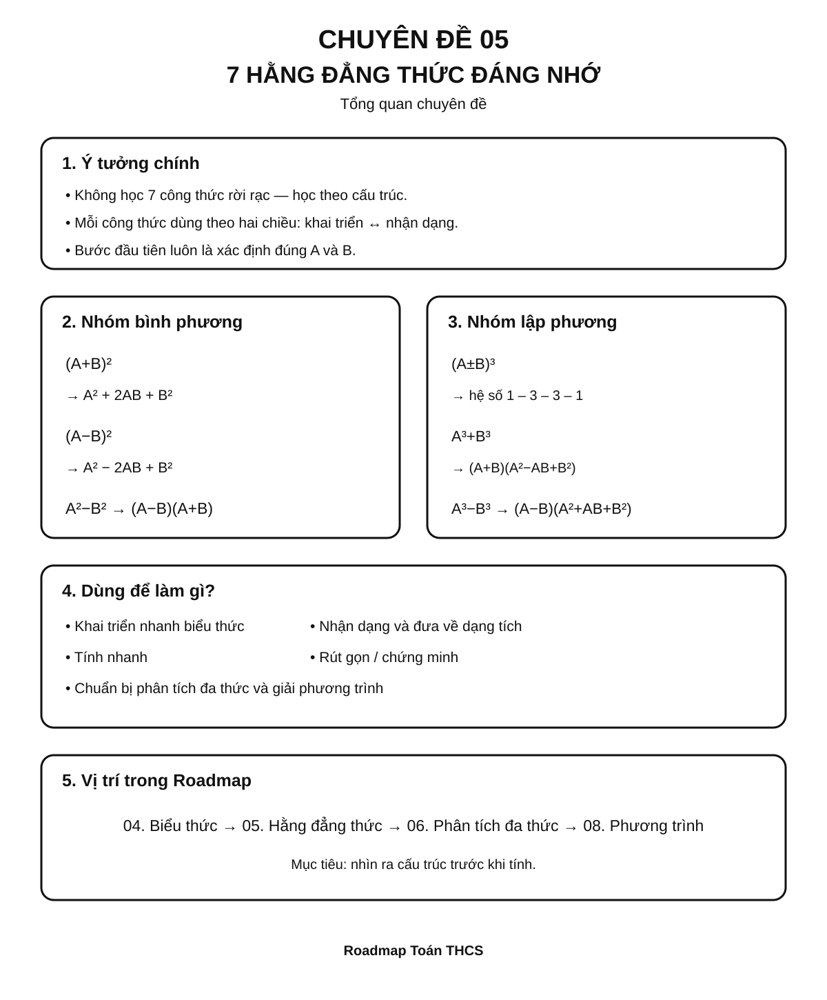

```text
7 HẰNG ĐẲNG THỨC ĐÁNG NHỚ
│
├── Nhóm bình phương
│   ├── (A + B)²
│   ├── (A - B)²
│   └── A² - B²
│
├── Nhóm lập phương
│   ├── (A + B)³
│   ├── (A - B)³
│   ├── A³ + B³
│   └── A³ - B³
│
├── Hai chiều sử dụng
│   ├── Khai triển: dạng tích → dạng tổng
│   └── Nhận dạng: dạng tổng → dạng tích
│
└── Ứng dụng
    ├── Tính nhanh
    ├── Rút gọn biểu thức
    ├── Phân tích đa thức
    ├── Chứng minh đẳng thức
    └── Chuẩn bị giải phương trình
```

Điều quan trọng nhất của chuyên đề không phải là học thuộc bảy dòng công thức rời rạc, mà là **nhìn ra cấu trúc** của biểu thức.

---

## 🎯 2. Mục tiêu cần đạt

Sau khi hoàn thành chuyên đề, học sinh cần có thể:

- [ ] Viết đúng cả 7 hằng đẳng thức theo hai chiều.
- [ ] Phân biệt được bình phương của một tổng và tổng các bình phương.
- [ ] Nhận dạng được `A`, `B` ngay cả khi chúng là đơn thức hoặc biểu thức phức tạp.
- [ ] Khai triển biểu thức bằng hằng đẳng thức thay vì nhân dài dòng khi phù hợp.
- [ ] Nhận dạng biểu thức để đưa từ dạng tổng về dạng tích.
- [ ] Vận dụng hằng đẳng thức để tính nhanh, rút gọn và chứng minh.
- [ ] Biết kiểm tra dấu ở các công thức có phép trừ.
- [ ] Phân biệt được tổng hai lập phương với hiệu hai lập phương.
- [ ] Kết nối kiến thức này với phân tích đa thức thành nhân tử và phương trình.

---

## 📖 3. Kiến thức cốt lõi

> **Ghi nhớ:** hằng đẳng thức là đẳng thức đúng với mọi giá trị của các biến làm cho hai vế có nghĩa. Trong các công thức dưới đây, `A` và `B` có thể là số, đơn thức hoặc biểu thức đại số.

### Infographic 2 – Nhóm bình phương

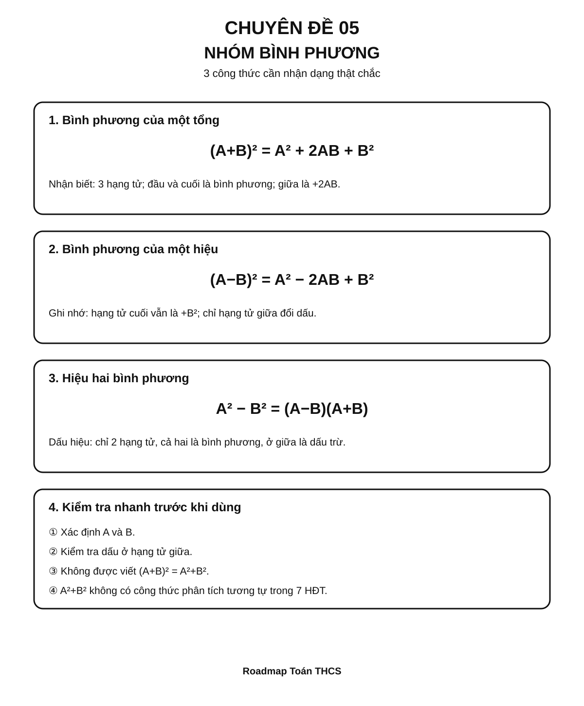

### 3.1. Bình phương của một tổng

$$
(A+B)^2=A^2+2AB+B^2
$$

**Cách đọc:** bình phương biểu thức thứ nhất + hai lần tích hai biểu thức + bình phương biểu thức thứ hai.

Ví dụ:

$$
(x+3)^2=x^2+6x+9
$$

Vì:

- `A = x`
- `B = 3`
- `2AB = 2·x·3 = 6x`

---

### 3.2. Bình phương của một hiệu

$$
(A-B)^2=A^2-2AB+B^2
$$

Ví dụ:

$$
(2x-5)^2=4x^2-20x+25
$$

> ⚠️ Hạng tử cuối vẫn là `+B²`, không phải `-B²`.

---

### 3.3. Hiệu hai bình phương

$$
A^2-B^2=(A-B)(A+B)
$$

Ví dụ:

$$
x^2-16=(x-4)(x+4)
$$

Đây là một trong những công thức quan trọng nhất khi học **phân tích đa thức thành nhân tử**.

---

### Infographic 3 – Nhóm lập phương

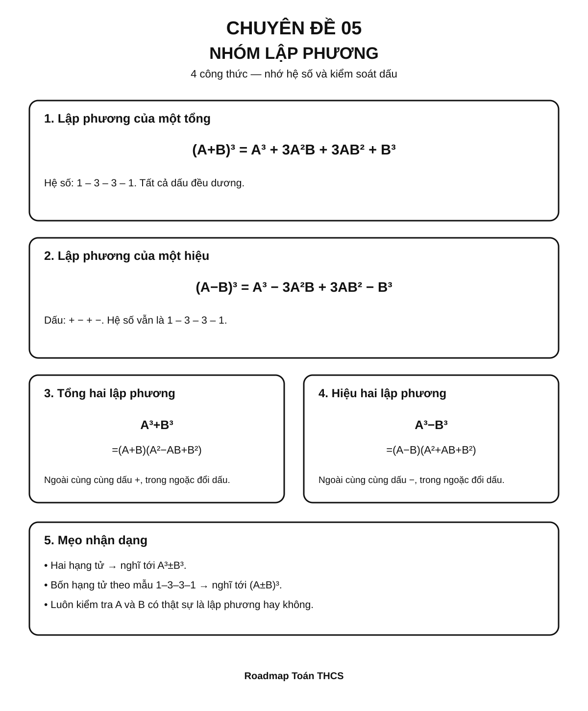

### 3.4. Lập phương của một tổng

$$
(A+B)^3=A^3+3A^2B+3AB^2+B^3
$$

Ví dụ:

$$
(x+2)^3=x^3+6x^2+12x+8
$$

Một cách nhớ theo hệ số:

```text
1 – 3 – 3 – 1
```

---

### 3.5. Lập phương của một hiệu

$$
(A-B)^3=A^3-3A^2B+3AB^2-B^3
$$

Ví dụ:

$$
(x-2)^3=x^3-6x^2+12x-8
$$

Dấu của bốn hạng tử lần lượt là:

```text
+   −   +   −
```

---

### 3.6. Tổng hai lập phương

$$
A^3+B^3=(A+B)(A^2-AB+B^2)
$$

Ví dụ:

$$
x^3+8=x^3+2^3=(x+2)(x^2-2x+4)
$$

---

### 3.7. Hiệu hai lập phương

$$
A^3-B^3=(A-B)(A^2+AB+B^2)
$$

Ví dụ:

$$
8x^3-27=(2x)^3-3^3=(2x-3)(4x^2+6x+9)
$$

---

### 3.8. Bảng tổng hợp 7 công thức

| # | Hằng đẳng thức |
|---:|---|
| 1 | `(A + B)² = A² + 2AB + B²` |
| 2 | `(A − B)² = A² − 2AB + B²` |
| 3 | `A² − B² = (A − B)(A + B)` |
| 4 | `(A + B)³ = A³ + 3A²B + 3AB² + B³` |
| 5 | `(A − B)³ = A³ − 3A²B + 3AB² − B³` |
| 6 | `A³ + B³ = (A + B)(A² − AB + B²)` |
| 7 | `A³ − B³ = (A − B)(A² + AB + B²)` |

---

## 🔗 4. Kiến thức liên quan

### 4.1. Vì sao `(A+B)²` có hạng tử `2AB`?

Từ phép nhân đa thức:

$$
(A+B)^2=(A+B)(A+B)
$$

Khai triển:

$$
=A^2+AB+AB+B^2
$$

Do đó:

$$
=A^2+2AB+B^2
$$

Vì vậy:

> **Bình phương của một tổng không bằng tổng các bình phương.**

Sai:

$$
(A+B)^2=A^2+B^2
$$

Đúng:

$$
(A+B)^2=A^2+2AB+B^2
$$

### 4.2. Hằng đẳng thức dùng theo hai chiều

**Chiều khai triển:**

```text
(A + B)² → A² + 2AB + B²
```

**Chiều nhận dạng / phân tích:**

```text
A² + 2AB + B² → (A + B)²
```

Học sinh cần thành thạo cả hai chiều. Chỉ biết khai triển là chưa đủ.

### 4.3. Kiến thức cần biết trước

- Phép nhân đơn thức và đa thức.
- Thu gọn hạng tử đồng dạng.
- Lũy thừa.
- Quy tắc dấu.

Xem lại [Chuyên đề 04 – Biểu thức và biến đổi đại số](../04-bieu-thuc-dai-so/index.md).

### 4.4. Kiến thức sẽ dùng tiếp

Hằng đẳng thức là công cụ trực tiếp cho:

- [Chuyên đề 06 – Phân tích đa thức thành nhân tử](../06-phan-tich-da-thuc/index.md)
- [Chuyên đề 07 – Phân thức đại số](../07-phan-thuc-dai-so/index.md)
- [Chuyên đề 08 – Phương trình và bất phương trình](../08-phuong-trinh-bat-phuong-trinh/index.md)

---

## 🧩 5. Các dạng bài cần nắm vững

### Infographic 4 – Dạng bài trọng tâm & lỗi sai

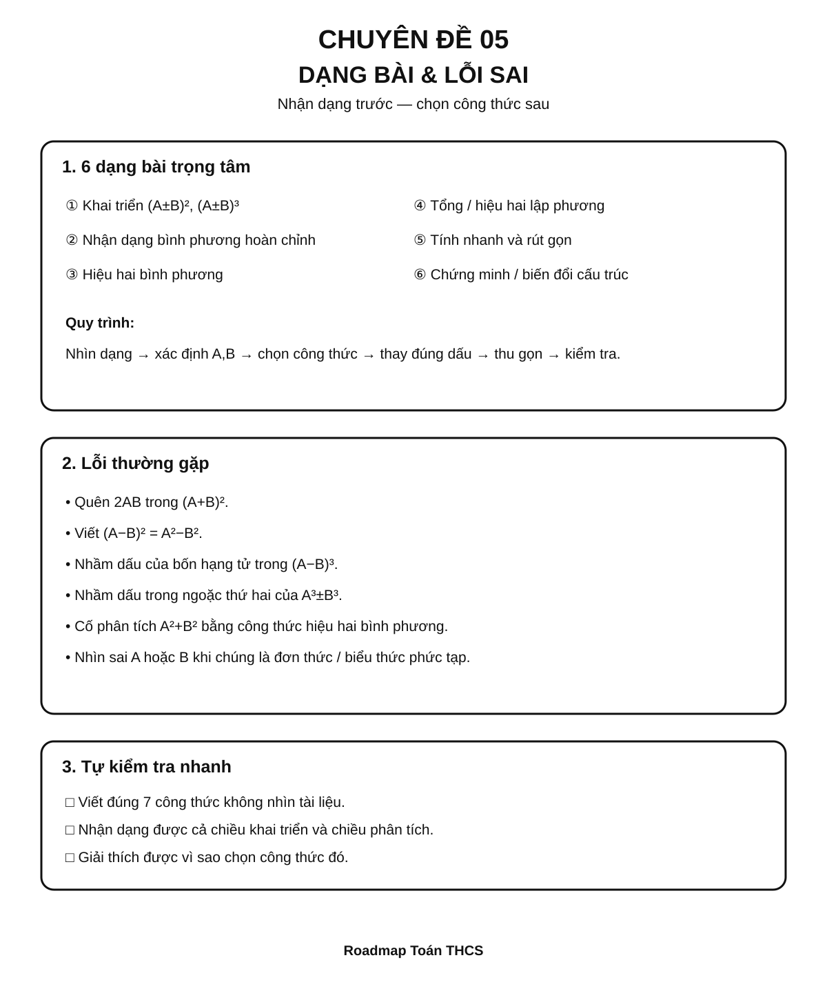

### Dạng 1 – Khai triển bằng hằng đẳng thức

**Dấu hiệu nhận biết:** biểu thức có dạng bình phương hoặc lập phương của một tổng/hiệu.

**Phương pháp:**

1. Xác định `A`, `B`.
2. Chọn đúng công thức.
3. Thay vào từng thành phần.
4. Thu gọn nếu cần.

Ví dụ:

$$
(3x+2)^2
$$

Ta có `A = 3x`, `B = 2`:

$$
(3x+2)^2=9x^2+12x+4
$$

---

### Dạng 2 – Nhận dạng bình phương hoàn chỉnh

**Dấu hiệu:** biểu thức có ba hạng tử, trong đó:

- hạng tử đầu là một bình phương;
- hạng tử cuối là một bình phương;
- hạng tử giữa bằng `±2AB`.

Ví dụ:

$$
x^2+10x+25
$$

Ta có:

- `x² = A²`
- `25 = 5² = B²`
- `10x = 2·x·5`

Do đó:

$$
x^2+10x+25=(x+5)^2
$$

---

### Dạng 2A – Nhận diện hằng đẳng thức khi có hệ số phân số (mở rộng)

Khi \(A\) hoặc \(B\) là một phân số chứa biến, **cách nhận diện không đổi**: trước hết xác định hai bình phương ở hai đầu, sau đó kiểm tra hạng tử giữa có bằng \(\pm2AB\) không.

**Ví dụ theo hai chiều:** Khai triển và phân tích trở lại \(\left(\frac{x}{2}-1\right)^2\).

1. Chọn \(A=x/2\), \(B=1\).
2. Khai triển: \((A-B)^2=A^2-2AB+B^2\).
3. Suy ra \(\left(\frac{x}{2}-1\right)^2=\frac{x^2}{4}-x+1\).
4. Đọc ngược: \(\frac{x^2}{4}=(\frac{x}{2})^2\), \(1=1^2\), hạng tử giữa \(-x=-2\cdot\frac{x}{2}\cdot1\). Vậy \(\frac{x^2}{4}-x+1=(\frac{x}{2}-1)^2\).

**Thử giá trị:** Với \(x=2\), cả hai vế đều bằng 0. Đây là cách phát hiện nhanh lỗi quên nhân 2 trong hạng tử giữa, nhưng phép thử **không thay thế chứng minh bằng hằng đẳng thức**.

> Đừng bỏ ngoặc quanh \(x/2\) khi bình phương: \((x/2)^2=x^2/4\), không phải \(x^2/2\). Ví dụ này dùng để **hiểu cấu trúc và tự kiểm tra**, không phải thêm một hằng đẳng thức thứ tám.

### Dạng 3 – Phân tích hiệu hai bình phương

**Dấu hiệu:** hai hạng tử đều là bình phương và ở giữa là dấu trừ.

Ví dụ:

$$
9x^2-25=(3x)^2-5^2=(3x-5)(3x+5)
$$

> `A² + B²` không có công thức phân tích tương tự trong 7 hằng đẳng thức.

---

### Dạng 4 – Tổng hoặc hiệu hai lập phương

**Dấu hiệu:** hai hạng tử đều viết được dưới dạng lập phương.

Ví dụ:

$$
27x^3+8=(3x)^3+2^3
$$

Suy ra:

$$
27x^3+8=(3x+2)(9x^2-6x+4)
$$

---

### Dạng 5 – Tính nhanh

**Dấu hiệu:** các số gần số tròn chục, tròn trăm hoặc tạo được cấu trúc hằng đẳng thức.

Ví dụ:

$$
99^2=(100-1)^2
$$

$$
=10000-200+1=9801
$$

Ví dụ khác:

$$
103·97=(100+3)(100-3)=100^2-3^2=9991
$$

---

### Dạng 6 – Rút gọn biểu thức

Ví dụ:

$$
A=(x+2)^2-(x-2)^2
$$

Khai triển:

$$
A=(x^2+4x+4)-(x^2-4x+4)=8x
$$

Có thể nhìn nhanh hơn bằng hiệu hai bình phương:

$$
A=[(x+2)-(x-2)][(x+2)+(x-2)]=4·2x=8x
$$

---

### Dạng 7 – Chứng minh đẳng thức

**Nguyên tắc:** biến đổi một vế về vế còn lại, hoặc biến đổi cả hai vế về cùng một biểu thức bằng các phép biến đổi tương đương.

> Cần phân biệt **hằng đẳng thức** với **phương trình**: hằng đẳng thức đúng với mọi giá trị thích hợp của biến, còn phương trình chỉ đúng với những giá trị thỏa mãn nó.

Ví dụ, chứng minh:

$$
(a+b)^2+(a-b)^2=2a^2+2b^2
$$

Ta có:

$$
(a+b)^2+(a-b)^2
$$

$$
=a^2+2ab+b^2+a^2-2ab+b^2
$$

$$
=2a^2+2b^2
$$

---

### Dạng 8 – Tìm giá trị chưa biết nhờ cấu trúc

Ví dụ:

Cho `x + y = 10`, `xy = 21`. Tính `x² + y²`.

Từ:

$$
(x+y)^2=x^2+2xy+y^2
$$

Suy ra:

$$
x^2+y^2=(x+y)^2-2xy=100-42=58
$$

---

## 🚀 6. Dạng bài thi vào lớp 10

| Dạng | Mức ưu tiên Roadmap | Vai trò |
|---|:---:|---|
| Khai triển và thu gọn | ⭐⭐⭐⭐ | Kỹ năng nền |
| Phân tích bằng hiệu hai bình phương | ⭐⭐⭐⭐⭐ | Rất quan trọng cho biến đổi đại số |
| Nhận dạng bình phương hoàn chỉnh | ⭐⭐⭐⭐⭐ | Dùng trong rút gọn, phương trình, bất đẳng thức |
| Tổng/hiệu hai lập phương | ⭐⭐⭐⭐ | Công cụ quan trọng khi phân tích đa thức |
| Rút gọn biểu thức nhiều bước | ⭐⭐⭐⭐⭐ | Kết nối với phân thức và căn thức |
| Tính nhanh / biến đổi thông minh | ⭐⭐⭐ | Rèn nhận dạng cấu trúc |
| Chứng minh đẳng thức | ⭐⭐⭐⭐ | Kiểm tra năng lực biến đổi |

> Mức sao thể hiện **mức ưu tiên ôn tập trong Roadmap**, không phải cam kết dạng bài xuất hiện trong mọi đề thi.

---

## ⚠️ 7. Lỗi sai thường gặp

### ❌ Lỗi 1 – Bình phương của tổng thành tổng bình phương

Sai:

$$
(a+b)^2=a^2+b^2
$$

Đúng:

$$
(a+b)^2=a^2+2ab+b^2
$$

**Cách tự kiểm tra:** thử `a = b = 1`. Vế trái bằng `4`, còn biểu thức sai chỉ bằng `2`.

---

### ❌ Lỗi 2 – Sai dấu ở `(A-B)²`

Sai:

$$
(A-B)^2=A^2-2AB-B^2
$$

Đúng:

$$
(A-B)^2=A^2-2AB+B^2
$$

Vì `(-B)² = B²`.

---

### ❌ Lỗi 3 – Nhầm công thức tổng hai lập phương

Sai:

$$
A^3+B^3=(A+B)(A^2+AB+B^2)
$$

Đúng:

$$
A^3+B^3=(A+B)(A^2-AB+B^2)
$$

Mẹo kiểm tra: nhân ngược lại để xem hai hạng tử giữa có triệt tiêu hay không.

---

### ❌ Lỗi 4 – Nhìn thấy hai số chính phương là áp dụng hiệu hai bình phương

Công thức:

$$
A^2-B^2=(A-B)(A+B)
$$

chỉ dùng cho **hiệu**, không dùng trực tiếp cho `A² + B²`.

---

### ❌ Lỗi 5 – Không đặt ngoặc khi `A` hoặc `B` là biểu thức

Nếu `A = 2x`, thì:

$$
A^2=(2x)^2=4x^2
$$

không phải `2x²`.

---

### ❌ Lỗi 6 – Học thuộc công thức nhưng không nhận dạng được

Ví dụ:

$$
4x^2+12xy+9y^2
$$

Phải nhìn ra:

- `4x² = (2x)²`
- `9y² = (3y)²`
- `12xy = 2·2x·3y`

nên:

$$
4x^2+12xy+9y^2=(2x+3y)^2
$$

---

## 📝 8. Luyện tập tiếp theo

Micro-practice trong các Learning Cards dùng để kiểm tra nhanh ngay sau khi học. Khi muốn luyện sâu hơn, luyện từng skill hoặc làm bài tự luận, hãy chuyển sang **Practice Room**.

[🎯 Mở Practice Room – Chuyên đề 05](bai-tap.md){ .md-button .md-button--primary }

Trong Practice Room:

- **Luyện nhanh tương tác:** Practice Engine chọn câu từ ngân hàng lớn, có feedback, gợi ý và Tutor.
- **Luyện tự luận & trình bày:** tự giải trên giấy/vở rồi mở gợi ý hoặc lời giải để tự đối chiếu.
- Core / Entrance10 / Challenge được tách rõ.

!!! info "Phân biệt mục đích"
    Micro-practice kiểm tra hiểu ngay; Practice Room dùng để **rèn kỹ năng**. Kết quả luyện tập là formative evidence, không phải điểm kiểm tra cuối chuyên đề.

---

## ✅ 9. Tự kiểm tra mức độ sẵn sàng

Khi đã luyện tương đối chắc, hãy làm **Core Readiness Check**.

[✅ Bắt đầu Core Readiness Check](tu-kiem-tra.md){ .md-button .md-button--primary }

Trong Readiness Check:

- không hint và không Tutor khi đang làm;
- không báo đúng/sai từng câu;
- chỉ chấm sau khi bấm **Nộp bài**;
- kết quả phân tích theo assessed skill;
- là **Soft Mastery**: không khóa chuyên đề tiếp theo;
- Entrance10 / Challenge không tính vào Core readiness.

---

## 🔄 10. Liên kết Roadmap

```text
04. Biểu thức và biến đổi đại số
                 │
                 ↓
       05. 7 HẰNG ĐẲNG THỨC
                 │
          ┌──────┴──────┐
          ↓             ↓
06. Phân tích       07. Phân thức
    đa thức             đại số
          └──────┬──────┘
                 ↓
08. Phương trình và bất phương trình
```

- **← Trước:** [04. Biểu thức và biến đổi đại số](../04-bieu-thuc-dai-so/index.md)
- **→ Tiếp theo:** [06. Phân tích đa thức thành nhân tử](../06-phan-tich-da-thuc/index.md)
- **Liên hệ:** [07. Phân thức đại số](../07-phan-thuc-dai-so/index.md)
- **Ứng dụng tiếp:** [08. Phương trình và bất phương trình](../08-phuong-trinh-bat-phuong-trinh/index.md)

Xem toàn bộ hệ thống tại [Blueprint 25 chuyên đề](../../roadmap/blueprint-25-chuyen-de.md).

---

## 🏁 11. Điều kiện hoàn thành

Chuyên đề được xem là **đủ sẵn sàng để học tiếp** khi học sinh có phần lớn các bằng chứng sau:

- [ ] Hiểu và giải thích được các quy tắc Core của chuyên đề.
- [ ] Làm tương đối ổn định các skill Core trong Practice Room.
- [ ] Không lặp lại ổn định cùng một lỗi nền tảng sau khi đã được chữa.
- [ ] Core Readiness Check đạt khoảng **80%** hoặc học sinh đã hiểu và chữa được các lỗi còn lại.
- [ ] Có thể trình bày ít nhất một số bài tự luận Core mà không mở lời giải trước.

!!! note "Soft Mastery"
    Không cần đạt 100% mới được học tiếp. Nếu Readiness Check cho thấy một vài kỹ năng còn yếu, hệ thống khuyến nghị luyện lại đúng kỹ năng đó; học sinh vẫn có thể chuyển sang chuyên đề tiếp theo.

!!! warning "Core độc lập Extension"
    Entrance10 và Specialized-Challenge không phải điều kiện để hoàn thành KNTT Core.

---

## ➡️ Tiếp tục học

<div class="topic-workspace-actions" markdown>

[🎯 Sang Phòng Luyện Tập](bai-tap.md){ .md-button .md-button--primary }

[✅ Kiểm Tra Độ Sẵn Sàng](tu-kiem-tra.md){ .md-button }

[→ 06 – Phân tích đa thức thành nhân tử](../06-phan-tich-da-thuc/index.md){ .md-button }

</div>


### CT06 full current theory (`docs/kien-thuc/06-phan-tich-da-thuc/index.md`, blob `866420ac8cda089354b3d0ef7b673828ae34313c`)

# Chuyên đề 06 – Phân tích đa thức thành nhân tử


> **Trạng thái:** Đã kiểm định nội dung học thuật; cấu trúc Roadmap chuẩn 11 mục.
>
> **Lớp trọng tâm:** 8
> **Mạch kiến thức:** Đại số
> **Mức ưu tiên:** ⭐⭐⭐⭐⭐

> **Vai trò trong Roadmap:** cầu nối trực tiếp từ biến đổi đại số và hằng đẳng thức sang phân thức, phương trình và nhiều bài toán tổng hợp.
>

---

## 🧭 1. Bản đồ kiến thức

### Infographic 1 – Tổng quan chuyên đề

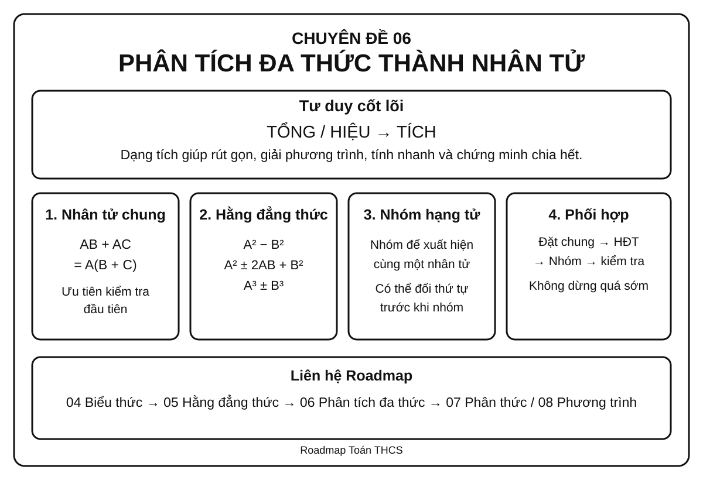

```text
PHÂN TÍCH ĐA THỨC THÀNH NHÂN TỬ
│
├── 1. Đặt nhân tử chung
│   ├── Nhân tử số
│   ├── Nhân tử chứa biến
│   └── Đổi dấu để xuất hiện nhân tử chung
│
├── 2. Dùng hằng đẳng thức
│   ├── Hiệu hai bình phương
│   ├── Bình phương một tổng / hiệu
│   └── Tổng / hiệu hai lập phương
│
├── 3. Nhóm hạng tử
│   ├── Nhóm để xuất hiện nhân tử chung
│   ├── Nhóm để xuất hiện hằng đẳng thức
│   └── Đổi thứ tự hạng tử trước khi nhóm
│
├── 4. Phối hợp nhiều phương pháp
│   ├── Đặt nhân tử chung trước
│   ├── Sau đó dùng HĐT hoặc nhóm
│   └── Kiểm tra xem có thể phân tích tiếp không
│
└── 5. Vận dụng
    ├── Rút gọn biểu thức
    ├── Tính nhanh
    ├── Chứng minh chia hết
    ├── Tìm x
    └── Chuẩn bị cho phân thức và phương trình
```

### Tư duy cốt lõi

Phân tích đa thức thành nhân tử nghĩa là biến một **tổng hoặc hiệu** thành một **tích**.

Ví dụ:

`6x² - 9x = 3x(2x - 3)`

Hai biểu thức ở hai vế bằng nhau, nhưng dạng tích thường hữu ích hơn vì có thể:

- rút gọn phân thức;
- giải phương trình tích;
- nhận ra cấu trúc hằng đẳng thức;
- chứng minh chia hết;
- tính nhanh.

---

## 🎯 2. Mục tiêu cần đạt

Sau khi hoàn thành chuyên đề, học sinh cần có thể:

- [ ] Hiểu đúng ý nghĩa của việc phân tích đa thức thành nhân tử.
- [ ] Nhận ra và đặt được nhân tử chung lớn nhất hợp lý.
- [ ] Nhận dạng được các hằng đẳng thức thường dùng khi phân tích.
- [ ] Biết nhóm hạng tử để tạo nhân tử chung hoặc hằng đẳng thức; ở mức vận dụng, biết tách một hạng tử phù hợp để tạo nhóm.
- [ ] Phối hợp nhiều phương pháp trong một bài.
- [ ] Kiểm tra được kết quả bằng cách nhân trở lại.
- [ ] Dùng dạng tích để rút gọn và tính nhanh; nhận biết **giải phương trình bằng nhân tử** là ứng dụng kết nối sang Entrance10 / Chuyên đề 08.
- [ ] Nhận biết khi nào đa thức còn có thể tiếp tục phân tích bằng các phương pháp đã học trong phạm vi THCS.

---

## 📖 3. Kiến thức cốt lõi

### Infographic 2 – Sơ đồ chọn phương pháp

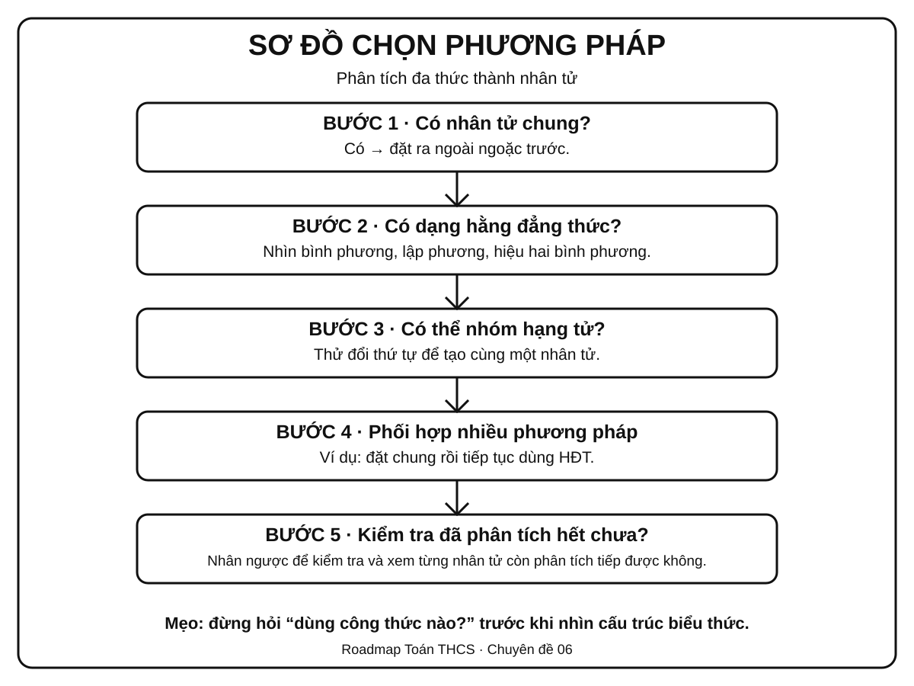

### 3.1. Phân tích đa thức thành nhân tử là gì?

Phân tích đa thức thành nhân tử là biến đổi đa thức thành một tích của các nhân tử đa thức có giá trị bằng đa thức ban đầu.

Ví dụ:

`x² - 5x = x(x - 5)`

`x² - 9 = (x - 3)(x + 3)`

### 3.2. Vì sao cần dạng tích?

Một đa thức ở dạng tổng có thể khó xử lý, còn dạng tích giúp nhìn thấy các nhân tử rõ ràng.

Ví dụ:

`x² - 5x = 0`

Phân tích:

`x(x - 5) = 0`

Từ đó:

`x = 0` hoặc `x = 5`.

> **Nguyên tắc:** khi mục tiêu bài toán liên quan đến nghiệm, chia hết hoặc rút gọn, hãy nghĩ đến việc đưa biểu thức về dạng tích.

---

### 3.3. Phương pháp 1 – Đặt nhân tử chung

Nếu mọi hạng tử đều chứa một nhân tử giống nhau, đưa nhân tử đó ra ngoài ngoặc.

Dạng tổng quát:

`AB + AC = A(B + C)`

Ví dụ:

`6x² + 9x = 3x(2x + 3)`

#### Cách tìm nhân tử chung hợp lý

1. Tìm ước chung lớn nhất của các hệ số.
2. Với mỗi biến, lấy số mũ nhỏ nhất xuất hiện ở tất cả các hạng tử.

Ví dụ:

`12x³y² - 18x²y³`

- ƯCLN của `12` và `18` là `6`.
- Với `x`: số mũ nhỏ nhất là `2`.
- Với `y`: số mũ nhỏ nhất là `2`.

Do đó:

`12x³y² - 18x²y³ = 6x²y²(2x - 3y)`

#### Đổi dấu để tạo nhân tử chung

Nhớ rằng:

`a - b = -(b - a)`

Ví dụ:

`x(a - b) + y(b - a)`

Vì `b - a = -(a - b)` nên:

`= x(a - b) - y(a - b)`

`= (a - b)(x - y)`

---

### 3.4. Phương pháp 2 – Dùng hằng đẳng thức

Các hằng đẳng thức thường gặp nhất khi phân tích đa thức:

#### Hiệu hai bình phương

`A² - B² = (A - B)(A + B)`

Ví dụ:

`x² - 25 = (x - 5)(x + 5)`

`9x² - 4y² = (3x - 2y)(3x + 2y)`

#### Bình phương một tổng

`A² + 2AB + B² = (A + B)²`

Ví dụ:

`x² + 6x + 9 = (x + 3)²`

#### Bình phương một hiệu

`A² - 2AB + B² = (A - B)²`

Ví dụ:

`4x² - 12x + 9 = (2x - 3)²`

#### Tổng hai lập phương

`A³ + B³ = (A + B)(A² - AB + B²)`

Ví dụ:

`x³ + 8 = (x + 2)(x² - 2x + 4)`

#### Hiệu hai lập phương

`A³ - B³ = (A - B)(A² + AB + B²)`

Ví dụ:

`8x³ - 27 = (2x - 3)(4x² + 6x + 9)`

> Khi dùng hằng đẳng thức, việc khó nhất không phải nhớ công thức mà là **nhìn ra A và B**.

---

### 3.5. Phương pháp 3 – Nhóm hạng tử

Dùng khi toàn bộ đa thức chưa có nhân tử chung, nhưng có thể chia thành các nhóm để tạo nhân tử chung.

Ví dụ:

`ax + ay + bx + by`

Nhóm:

`= a(x + y) + b(x + y)`

`= (x + y)(a + b)`

#### Có thể cần đổi thứ tự trước khi nhóm

Ví dụ:

`x² + 3x + 2x + 6`

`= (x² + 3x) + (2x + 6)`

`= x(x + 3) + 2(x + 3)`

`= (x + 3)(x + 2)`

> Không có một cách nhóm duy nhất. Mục tiêu là tạo được **cùng một nhân tử** ở các nhóm.

---

### 3.6. Mở rộng – Tách hạng tử để tạo nhóm

Đây là kỹ thuật **vận dụng**, hữu ích với một số tam thức bậc hai chưa xuất hiện nhân tử chung hay hằng đẳng thức ngay lập tức.

Với biểu thức dạng:

```text
x^2 + bx + c
```

nếu tìm được hai số `p`, `q` sao cho:

```text
p + q = b
pq = c
```

thì có thể tách:

```text
bx = px + qx
```

rồi nhóm hạng tử.

Ví dụ:

```text
x^2 - 5x + 6
= x^2 - 2x - 3x + 6
= x(x - 2) - 3(x - 2)
= (x - 2)(x - 3)
```

vì `-2 + (-3) = -5` và `(-2)(-3) = 6`.

> Không nên thử cặp số một cách máy móc trong mọi bài. Kỹ thuật này chỉ nên dùng khi cặp `p, q` dễ nhận ra; sau khi phân tích phải nhân trở lại để kiểm tra.

### 3.6A. Tách hạng tử khi hệ số của \(x^2\) khác 1 (mở rộng)

Mục 3.6 đã hướng dẫn dạng \(x^2+bx+c\). Với tam thức \(ax^2+bx+c\), \(a\ne0\), nếu tìm được hai số \(p,q\) sao cho:

\[
p+q=b,\qquad pq=ac,
\]

thì có thể tách \(bx=px+qx\) rồi **nhóm để xuất hiện một nhân tử chung**. Hãy hiểu đây là cách tìm phép nhóm phù hợp, **không phải công thức tự động phân tích được mọi tam thức**.

**Ví dụ từng bước:** Phân tích \(6x^2+11x+3\) thành nhân tử.

1. Xác định \(a=6,\ b=11,\ c=3\) và \(ac=18\).
2. Tìm hai số có **tổng 11, tích 18**: chọn \(p=9,\ q=2\).
3. Tách hạng tử giữa: \(6x^2+11x+3=6x^2+9x+2x+3\).
4. Nhóm: \(3x(2x+3)+(2x+3)\).
5. Đặt nhân tử chung: **\((3x+1)(2x+3)\)**.

**Kiểm tra bằng nhân ngược:** \((3x+1)(2x+3)=6x^2+9x+2x+3=6x^2+11x+3\), đúng biểu thức ban đầu.

**Vì sao quy tắc \(pq=ac\) có ích?** Ta đang tìm cách viết \(ax^2+px+qx+c\) thành hai nhóm có **cùng nhị thức**. Nếu không tìm được \(p,q\) phù hợp, đừng thử số mãi: hãy xem có nhân tử chung hoặc hằng đẳng thức hay không và chọn phương pháp khác.

> Đây là kỹ thuật **bổ trợ/vận dụng**, không phải yêu cầu rằng mọi tam thức đều phải phân tích được thành nhân tử với hệ số nguyên.

### 3.7. Phương pháp 4 – Phối hợp nhiều phương pháp

Nhiều bài không thể giải chỉ bằng một bước.

Quy trình nên thử:

```text
Bước 1: Có nhân tử chung không?
        ↓
Bước 2: Có hằng đẳng thức không?
        ↓
Bước 3: Có thể nhóm hạng tử không?
        ↓
Bước 4: Sau khi phân tích, còn phân tích tiếp được không?
```

Ví dụ:

`2x³ - 18x`

Đặt nhân tử chung:

`= 2x(x² - 9)`

Dùng hiệu hai bình phương:

`= 2x(x - 3)(x + 3)`

Không nên dừng ở `2x(x² - 9)` nếu đề yêu cầu tiếp tục phân tích bằng các phương pháp đã học.

---

## 🔗 4. Kiến thức liên quan

### Cần biết trước

- [04. Biểu thức và biến đổi đại số](../04-bieu-thuc-dai-so/index.md)
- [05. 7 Hằng đẳng thức đáng nhớ](../05-7-hang-dang-thuc/index.md)

### Sẽ dùng tiếp

- [07. Phân thức đại số](../07-phan-thuc-dai-so/index.md)
- [08. Phương trình và bất phương trình](../08-phuong-trinh-bat-phuong-trinh/index.md)

### Mạch tư duy

```text
04. Biến đổi đại số
        ↓
05. Hằng đẳng thức
        ↓
06. PHÂN TÍCH ĐA THỨC THÀNH NHÂN TỬ
        ↓
   ┌────┴────┐
   ↓         ↓
07. Phân thức   08. Phương trình
```

---

## 🧩 5. Các dạng bài cần nắm vững

### Infographic 3 – Dạng bài trọng tâm & lỗi sai

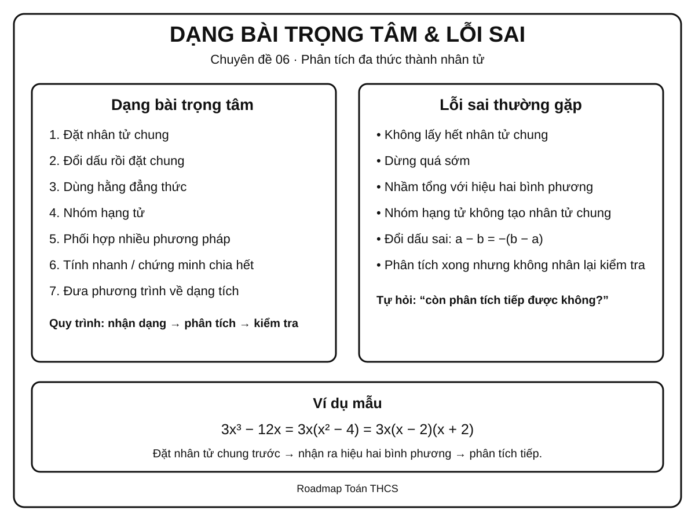

### Dạng 1 – Đặt nhân tử chung trực tiếp

**Dấu hiệu:** mọi hạng tử đều có một phần giống nhau.

Ví dụ:

`15x³y - 10x²y²`

Ta có:

`= 5x²y(3x - 2y)`

**Tự kiểm tra:** nhân `5x²y` trở lại hai hạng tử trong ngoặc.

---

### Dạng 2 – Đổi dấu rồi đặt nhân tử chung

Ví dụ:

`3x(x - 2) + 5(2 - x)`

Vì:

`2 - x = -(x - 2)`

nên:

`= 3x(x - 2) - 5(x - 2)`

`= (x - 2)(3x - 5)`

---

### Dạng 3 – Nhận dạng hiệu hai bình phương

Ví dụ:

`25x² - 16`

`= (5x)² - 4²`

`= (5x - 4)(5x + 4)`

**Dấu hiệu:** hai số hạng, có dấu trừ, cả hai đều là bình phương.

---

### Dạng 4 – Nhận dạng bình phương hoàn chỉnh

Ví dụ:

`x² - 10x + 25`

Ta có:

- `x² = x²`
- `25 = 5²`
- `-10x = -2·x·5`

Do đó:

`x² - 10x + 25 = (x - 5)²`

---

### Dạng 5 – Nhóm hạng tử

Ví dụ:

`x² - 3x + 2x - 6`

`= x(x - 3) + 2(x - 3)`

`= (x - 3)(x + 2)`

---

### Dạng 6 – Đặt nhân tử chung rồi dùng hằng đẳng thức

Ví dụ:

`3x³ - 12x`

`= 3x(x² - 4)`

`= 3x(x - 2)(x + 2)`

Đây là dạng rất quan trọng vì học sinh thường dừng quá sớm.

---

### Dạng 7 – Nhóm rồi tiếp tục phân tích

Ví dụ:

`x³ + x² - 4x - 4`

Nhóm:

`= x²(x + 1) - 4(x + 1)`

`= (x + 1)(x² - 4)`

Tiếp tục:

`= (x + 1)(x - 2)(x + 2)`

---

### Dạng 8 – Dùng dạng tích để tính nhanh

Ví dụ:

`99² - 1`

`= (99 - 1)(99 + 1)`

`= 98·100 = 9800`

---

### Dạng 9 – Dùng dạng tích để chứng minh chia hết

Ví dụ: chứng minh `n² - n` chia hết cho `2` với mọi số nguyên `n`.

Ta có:

`n² - n = n(n - 1)`

Hai số nguyên liên tiếp `n` và `n - 1` luôn có một số chẵn, nên tích của chúng chia hết cho `2`.

---

### Dạng 10 – Kết nối Entrance10: Dùng phân tích nhân tử để tìm x

> **Không tính vào KNTT Core readiness của CĐ06.** Đây là phần kết nối sang Chuyên đề 08. Sau khi đưa phương trình về dạng tích bằng 0, dùng tính chất: nếu `A·B = 0` thì `A = 0` hoặc `B = 0`.

Ví dụ:

`x² - 7x = 0`

`x(x - 7) = 0`

Suy ra:

`x = 0` hoặc `x = 7`.

> Dạng này là tiền đề trực tiếp cho phương trình tích ở Chuyên đề 08.

---

## 🚀 6. Dạng bài thi vào lớp 10

Mức sao dưới đây thể hiện **mức ưu tiên ôn tập của Roadmap**.

| Dạng | Mức ưu tiên |
|---|:---:|
| Đặt nhân tử chung | ⭐⭐⭐⭐ |
| Dùng hằng đẳng thức | ⭐⭐⭐⭐⭐ |
| Nhóm hạng tử | ⭐⭐⭐⭐ |
| Phối hợp nhiều phương pháp | ⭐⭐⭐⭐⭐ |
| Rút gọn biểu thức bằng phân tích nhân tử | ⭐⭐⭐⭐⭐ |
| Giải phương trình bằng đưa về tích | ⭐⭐⭐⭐⭐ |
| Chứng minh chia hết / tính nhanh | ⭐⭐⭐⭐ |

### Kỹ năng cần ưu tiên

Trong bài thi tổng hợp, phân tích nhân tử có thể xuất hiện như **một bước trung gian** trong quá trình biến đổi biểu thức hoặc giải phương trình.

Ví dụ mạch bài:

```text
Biểu thức
   ↓
Phân tích tử / mẫu
   ↓
Rút gọn
   ↓
Thay giá trị hoặc giải phương trình
```

Do đó, học sinh cần đạt mức **nhận dạng nhanh phương pháp**, không chỉ làm được khi đề ghi rõ “phân tích đa thức thành nhân tử”.

---

## ⚠️ 7. Lỗi sai thường gặp

### ❌ Lỗi 1 – Không lấy hết nhân tử chung

Ví dụ:

`12x² - 18x`

Viết:

`= 2x(6x - 9)`

là đúng, nhưng còn có thể tiếp tục đặt nhân tử chung.

Dạng gọn hơn:

`= 6x(2x - 3)`

---

### ❌ Lỗi 2 – Dừng quá sớm

`x³ - 9x = x(x² - 9)`

Nếu yêu cầu phân tích hoàn toàn thì phải tiếp tục:

`= x(x - 3)(x + 3)`

---

### ❌ Lỗi 3 – Nhầm hiệu hai bình phương với tổng hai bình phương

`x² - 9 = (x - 3)(x + 3)`

nhưng:

`x² + 9`

không thể áp dụng công thức hiệu hai bình phương trong phạm vi số thực THCS.

---

### ❌ Lỗi 4 – Nhận sai bình phương hoàn chỉnh

`x² + 6x + 8`

không phải `(x + 3)²` vì `(x + 3)² = x² + 6x + 9`.

Cần kiểm tra đủ cả ba hạng tử.

---

### ❌ Lỗi 5 – Nhóm hạng tử nhưng không tạo được cùng nhân tử

Nhóm chỉ có ý nghĩa nếu sau khi đặt nhân tử chung ở từng nhóm, xuất hiện cùng một biểu thức.

---

### ❌ Lỗi 6 – Sai dấu khi đổi thứ tự

Nhớ:

`a - b = -(b - a)`

Một dấu âm bị quên có thể làm sai toàn bộ kết quả.

---

### ❌ Lỗi 7 – Không kiểm tra bằng phép nhân ngược

Sau khi có kết quả dạng tích, hãy nhân nhanh trở lại để kiểm tra, đặc biệt khi có nhiều dấu âm.

---

## 📝 8. Luyện tập tiếp theo

Micro-practice trong các Learning Cards dùng để kiểm tra nhanh ngay sau khi học. Khi muốn luyện sâu hơn, luyện từng skill hoặc làm bài tự luận, hãy chuyển sang **Practice Room**.

[🎯 Mở Practice Room – Chuyên đề 06](bai-tap.md){ .md-button .md-button--primary }

Trong Practice Room:

- **Luyện nhanh tương tác:** Practice Engine chọn câu từ ngân hàng lớn, có feedback, gợi ý và Tutor.
- **Luyện tự luận & trình bày:** tự giải trên giấy/vở rồi mở gợi ý hoặc lời giải để tự đối chiếu.
- Core / Entrance10 / Challenge được tách rõ.

!!! info "Phân biệt mục đích"
    Micro-practice kiểm tra hiểu ngay; Practice Room dùng để **rèn kỹ năng**. Kết quả luyện tập là formative evidence, không phải điểm kiểm tra cuối chuyên đề.

---

## ✅ 9. Tự kiểm tra mức độ sẵn sàng

Khi đã luyện tương đối chắc, hãy làm **Core Readiness Check**.

[✅ Bắt đầu Core Readiness Check](tu-kiem-tra.md){ .md-button .md-button--primary }

Trong Readiness Check:

- không hint và không Tutor khi đang làm;
- không báo đúng/sai từng câu;
- chỉ chấm sau khi bấm **Nộp bài**;
- kết quả phân tích theo assessed skill;
- là **Soft Mastery**: không khóa chuyên đề tiếp theo;
- Entrance10 / Challenge không tính vào Core readiness.

---

## 🔄 10. Liên kết Roadmap

- **← Trước:** [04. Biểu thức và biến đổi đại số](../04-bieu-thuc-dai-so/index.md)
- **← Trực tiếp:** [05. 7 Hằng đẳng thức đáng nhớ](../05-7-hang-dang-thuc/index.md)
- **→ Tiếp theo:** [07. Phân thức đại số](../07-phan-thuc-dai-so/index.md)
- **→ Ứng dụng quan trọng:** [08. Phương trình và bất phương trình](../08-phuong-trinh-bat-phuong-trinh/index.md)

Xem toàn bộ hệ thống tại [Blueprint 25 chuyên đề](../../roadmap/blueprint-25-chuyen-de.md).

---

## 🏁 11. Điều kiện hoàn thành

Chuyên đề được xem là **đủ sẵn sàng để học tiếp** khi học sinh có phần lớn các bằng chứng sau:

- [ ] Hiểu và giải thích được các quy tắc Core của chuyên đề.
- [ ] Làm tương đối ổn định các skill Core trong Practice Room.
- [ ] Không lặp lại ổn định cùng một lỗi nền tảng sau khi đã được chữa.
- [ ] Core Readiness Check đạt khoảng **80%** hoặc học sinh đã hiểu và chữa được các lỗi còn lại.
- [ ] Có thể trình bày ít nhất một số bài tự luận Core mà không mở lời giải trước.

!!! note "Soft Mastery"
    Không cần đạt 100% mới được học tiếp. Nếu Readiness Check cho thấy một vài kỹ năng còn yếu, hệ thống khuyến nghị luyện lại đúng kỹ năng đó; học sinh vẫn có thể chuyển sang chuyên đề tiếp theo.

!!! warning "Core độc lập Extension"
    Entrance10 và Specialized-Challenge không phải điều kiện để hoàn thành KNTT Core.

---

## ➡️ Tiếp tục học

<div class="topic-workspace-actions" markdown>

[🎯 Sang Phòng Luyện Tập](bai-tap.md){ .md-button .md-button--primary }

[✅ Kiểm Tra Độ Sẵn Sàng](tu-kiem-tra.md){ .md-button }

[→ 07 – Phân thức đại số](../07-phan-thuc-dai-so/index.md){ .md-button }

</div>


### CT07 full current theory (`docs/kien-thuc/07-phan-thuc-dai-so/index.md`, blob `9479a2528dc28f00d90caf3050b667404ae4dfbf`)

# Chuyên đề 07 – Phân thức đại số


> **Trạng thái:** Đã kiểm định nội dung học thuật; cấu trúc Roadmap chuẩn 11 mục.
>
> **Lớp trọng tâm:** 8
> **Mạch kiến thức:** Đại số
> **Mức ưu tiên:** ⭐⭐⭐⭐⭐

> **Vai trò trong Roadmap:** cầu nối trực tiếp từ phân tích đa thức thành nhân tử sang phương trình chứa ẩn ở mẫu và các phép biến đổi đại số phức tạp.
>

---

## 🧭 1. Bản đồ kiến thức

### Infographic 1 – Tổng quan chuyên đề

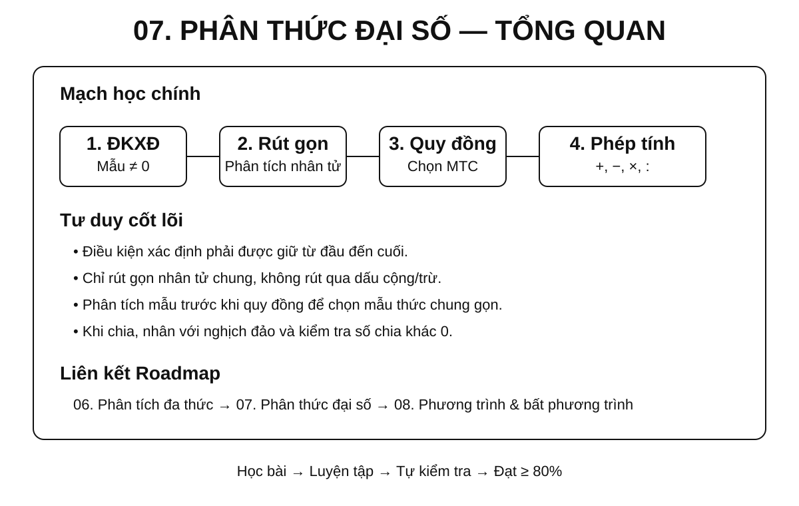

```text
PHÂN THỨC ĐẠI SỐ
│
├── 1. Khái niệm và điều kiện xác định
│   ├── Tử thức – mẫu thức
│   ├── Mẫu khác 0
│   └── Hai phân thức bằng nhau
│
├── 2. Tính chất cơ bản
│   ├── Nhân cả tử và mẫu với cùng một đa thức khác 0
│   ├── Chia cả tử và mẫu cho nhân tử chung
│   └── Đổi dấu
│
├── 3. Rút gọn phân thức
│   ├── Phân tích tử, mẫu thành nhân tử
│   ├── Tìm nhân tử chung
│   └── Rút gọn nhưng không làm mất điều kiện xác định
│
├── 4. Quy đồng mẫu thức
│   ├── Phân tích mẫu
│   ├── Chọn mẫu thức chung
│   └── Tìm nhân tử phụ
│
├── 5. Phép tính
│   ├── Cộng – trừ
│   ├── Nhân
│   ├── Chia
│   └── Biểu thức nhiều phép tính
│
└── 6. Ứng dụng
    ├── Tính giá trị biểu thức
    ├── Chứng minh đẳng thức
    ├── Tìm giá trị nguyên
    └── Chuẩn bị phương trình chứa ẩn ở mẫu
```

---

## 🎯 2. Mục tiêu cần đạt

Sau khi hoàn thành chuyên đề, học sinh cần có thể:

- [ ] Nhận biết đúng phân thức đại số và xác định tử thức, mẫu thức.
- [ ] Tìm điều kiện xác định trước khi thực hiện các phép biến đổi.
- [ ] Hiểu và sử dụng đúng tính chất cơ bản của phân thức.
- [ ] Rút gọn phân thức bằng cách phân tích đa thức thành nhân tử.
- [ ] Quy đồng mẫu thức của hai hoặc nhiều phân thức.
- [ ] Thực hiện đúng cộng, trừ, nhân, chia phân thức.
- [ ] Biến đổi biểu thức hữu tỉ nhiều bước theo thứ tự hợp lý.
- [ ] Tính giá trị biểu thức sau khi rút gọn và kiểm tra điều kiện.
- [ ] Nhận diện các lỗi sai do rút gọn sai, đổi dấu sai hoặc quên điều kiện xác định.
- [ ] Chuẩn bị tốt cho Chuyên đề 08 – Phương trình và bất phương trình.

---

## 📖 3. Kiến thức cốt lõi

### Infographic 2 – Điều kiện xác định và rút gọn

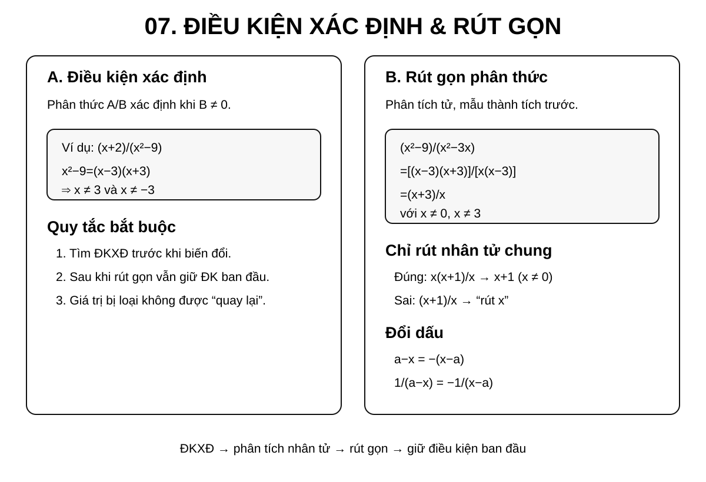

### Infographic 3 – Quy đồng và các phép tính

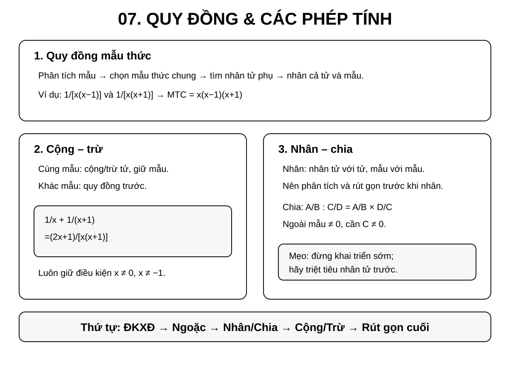

### 3.1. Phân thức đại số là gì?

Phân thức đại số có dạng:

`A/B`

trong đó `A`, `B` là các đa thức và `B` là **đa thức khác đa thức 0**.

- `A` gọi là **tử thức**.
- `B` gọi là **mẫu thức**.

Khi thay biến bằng một giá trị cụ thể, còn phải bảo đảm **giá trị của mẫu thức khác 0**.

Ví dụ:

- `(x + 1)/(x - 2)`
- `(2x² - 3x + 1)/(x² - 9)`
- `5/(x + 4)`

Một đa thức cũng có thể xem là một phân thức có mẫu bằng `1`.

---

### 3.2. Điều kiện xác định

Với một giá trị cụ thể của biến, phân thức xác định khi giá trị của mẫu thức khác `0`.

Ví dụ:

`A = (x + 1)/(x - 3)`

Điều kiện xác định:

`x - 3 ≠ 0 ⇒ x ≠ 3`

Với:

`B = (x + 2)/(x² - 9)`

Ta có:

`x² - 9 = (x - 3)(x + 3)`

nên:

`x ≠ 3` và `x ≠ -3`.

!!! warning "Quy tắc bắt buộc"
    Với bài có phân thức chứa biến ở mẫu, hãy tìm **điều kiện xác định trước khi rút gọn hoặc biến đổi**.

---

### 3.3. Hai phân thức bằng nhau

Với `B`, `D` là các đa thức khác đa thức `0`, hai phân thức

`A/B` và `C/D`

bằng nhau khi:

`A·D = B·C`

như một đẳng thức đa thức. Khi thay biến bằng giá trị cụ thể, chỉ được so sánh trên **miền xác định chung**, tức là các giá trị làm cả `B` và `D` khác `0`.

Ví dụ:

`(x + 1)/(x - 2) = (2x + 2)/(2x - 4)`

trên miền xác định `x ≠ 2`.

---

### 3.4. Tính chất cơ bản của phân thức

Với `M` là một đa thức khác đa thức `0`:

`A/B = (A·M)/(B·M)`

Khi xét giá trị của biểu thức, cần giữ các điều kiện để cả hai mẫu thức đều khác `0`.

Nếu `N` là nhân tử chung khác đa thức `0` của cả tử và mẫu thì có thể rút gọn:

`(A·N)/(B·N) = A/B`

trên các giá trị của biến mà phân thức ban đầu xác định.

Đây là cơ sở của hai thao tác quan trọng:

- **quy đồng**: nhân thêm nhân tử;
- **rút gọn**: chia đi nhân tử chung.

---

!!! warning "Miền xác định không tự mở rộng"
    Khi nhân cả tử và mẫu với một đa thức `M`, biểu thức mới có thể thêm các giá trị bị loại tại nghiệm của `M`. Ngược lại, khi rút gọn một nhân tử chung, không được lấy lại các giá trị đã bị loại ở phân thức ban đầu. Vì vậy mọi đẳng thức biến đổi phân thức phải được hiểu trên **miền xác định chung** của các biểu thức đang so sánh.

### 3.5. Quy tắc đổi dấu

Ta có:

`A/B = (-A)/(-B)`

và:

`A/(-B) = (-A)/B = -(A/B)`.

Đặc biệt:

`x - a = -(a - x)`.

Ví dụ:

`1/(x - 2) = -1/(2 - x)`.

Đây là kỹ năng rất quan trọng khi quy đồng mẫu thức.

---

## 🔗 4. Kiến thức liên quan

### Kiến thức cần nắm trước

- [Chuyên đề 04 – Biểu thức và biến đổi đại số](../04-bieu-thuc-dai-so/index.md)
- [Chuyên đề 05 – 7 Hằng đẳng thức đáng nhớ](../05-7-hang-dang-thuc/index.md)
- [Chuyên đề 06 – Phân tích đa thức thành nhân tử](../06-phan-tich-da-thuc/index.md)

### Kiến thức sẽ sử dụng tiếp

- [Chuyên đề 08 – Phương trình và bất phương trình](../08-phuong-trinh-bat-phuong-trinh/index.md)

Chuỗi kiến thức chính:

```text
04. Biểu thức đại số
        ↓
05. Hằng đẳng thức
        ↓
06. Phân tích đa thức thành nhân tử
        ↓
07. PHÂN THỨC ĐẠI SỐ
        ↓
08. Phương trình và bất phương trình
```

---

## 🧩 5. Các dạng bài cần nắm vững

### Infographic 4 – Dạng bài trọng tâm và lỗi sai

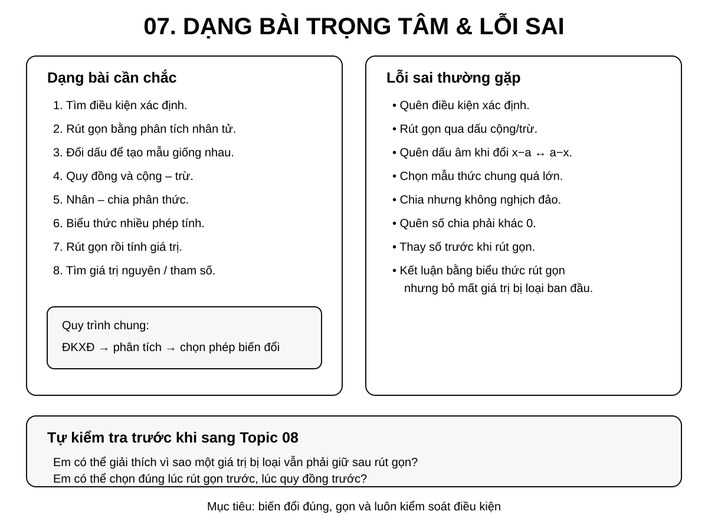

### Dạng 1 – Tìm điều kiện xác định

**Dấu hiệu:** mẫu thức có chứa biến.

**Cách làm:**

1. Cho từng mẫu thức khác `0`.
2. Phân tích mẫu thành nhân tử nếu cần.
3. Loại các giá trị làm mẫu bằng `0`.

**Ví dụ:**

Tìm điều kiện xác định của:

`A = (x + 2)/(x² - 5x + 6)`

Ta có:

`x² - 5x + 6 = (x - 2)(x - 3)`

Vậy:

`x ≠ 2`, `x ≠ 3`.

---

### Dạng 2 – Rút gọn phân thức

**Dấu hiệu:** tử và mẫu có thể phân tích thành nhân tử chung.

**Quy trình:**

`phân tích tử, mẫu → nhận nhân tử chung → rút gọn → giữ nguyên điều kiện xác định ban đầu`

**Ví dụ:**

`A = (x² - 9)/(x² - 3x)`

Điều kiện:

`x ≠ 0`, `x ≠ 3`.

Phân tích:

`x² - 9 = (x - 3)(x + 3)`

`x² - 3x = x(x - 3)`

Suy ra:

`A = [(x - 3)(x + 3)]/[x(x - 3)] = (x + 3)/x`

với **điều kiện ban đầu**:

`x ≠ 0`, `x ≠ 3`.

!!! danger "Không được làm mất điều kiện"
    Sau khi rút gọn, mẫu mới chỉ còn `x`, nhưng giá trị `x = 3` vẫn phải loại vì phân thức ban đầu không xác định tại đó.

---

### Dạng 3 – Đổi dấu để tạo mẫu giống nhau

Ví dụ:

`A = 1/(x - 2) + 1/(2 - x)`

Vì:

`2 - x = -(x - 2)`

nên:

`1/(2 - x) = -1/(x - 2)`

Do đó:

`A = 0`

với `x ≠ 2`.

---

### Dạng 4 – Quy đồng mẫu thức

**Quy trình chuẩn:**

1. Phân tích các mẫu thành nhân tử.
2. Chọn mẫu thức chung.
3. Xác định nhân tử phụ của từng mẫu.
4. Nhân cả tử và mẫu với nhân tử phụ tương ứng.

**Ví dụ:**

Quy đồng:

`1/[x(x - 1)]` và `1/[x(x + 1)]`.

Mẫu thức chung:

`x(x - 1)(x + 1)`.

Ta được:

`1/[x(x - 1)] = (x + 1)/[x(x - 1)(x + 1)]`

`1/[x(x + 1)] = (x - 1)/[x(x - 1)(x + 1)]`.

---

### Dạng 5 – Cộng, trừ phân thức

#### Cùng mẫu

`A/M + B/M = (A + B)/M`

`A/M - B/M = (A - B)/M`

#### Khác mẫu

Phải quy đồng trước.

**Ví dụ:**

`A = 1/x + 1/(x + 1)`

Điều kiện:

`x ≠ 0`, `x ≠ -1`.

Quy đồng:

`A = (x + 1)/[x(x + 1)] + x/[x(x + 1)]`

`= (2x + 1)/[x(x + 1)]`.

---

### Dạng 6 – Nhân phân thức

Quy tắc:

`A/B · C/D = (A·C)/(B·D)`.

Nên **phân tích thành nhân tử và rút gọn trước khi nhân khai triển**.

**Ví dụ:**

`A = (x² - 4)/(x² - x - 2) · (x - 2)/(x + 2)`

Điều kiện xác định:

`x ≠ 2`, `x ≠ -1`, `x ≠ -2`.

Phân tích:

`x² - 4 = (x - 2)(x + 2)`

`x² - x - 2 = (x - 2)(x + 1)`

Do đó:

`A = [(x - 2)(x + 2)]/[(x - 2)(x + 1)] · (x - 2)/(x + 2)`

`= (x - 2)/(x + 1)`

với điều kiện ban đầu `x ≠ 2`, `x ≠ -1`, `x ≠ -2`.

Ví dụ này cho thấy nên phân tích và rút gọn nhân tử trước khi nghĩ đến khai triển.

---

### Dạng 7 – Chia phân thức

Quy tắc:

`A/B : C/D = A/B · D/C`

Ngoài điều kiện các mẫu thức `B`, `D` khác `0`, **phân thức chia `C/D` cũng phải khác `0`** (nghĩa là `C ≠ 0`).

Ví dụ:

`A/B : C/D`

cần:

- `B ≠ 0`
- `D ≠ 0`
- `C ≠ 0`

vì `C/D` không được bằng `0`.

---

### Dạng 8 – Biểu thức nhiều phép tính

**Thứ tự ưu tiên:**

1. Điều kiện xác định.
2. Ngoặc.
3. Nhân – chia.
4. Cộng – trừ.
5. Rút gọn cuối cùng.

Không nên quy đồng toàn bộ biểu thức quá sớm nếu có thể rút gọn từng cụm trước.

**Chiến lược tốt:**

`phân tích → rút gọn cục bộ → thực hiện phép tính → rút gọn toàn biểu thức`

---

### Dạng 9 – Tính giá trị biểu thức sau khi rút gọn

**Quy trình:**

1. Tìm điều kiện xác định.
2. Rút gọn biểu thức.
3. Kiểm tra giá trị cần thay có thỏa điều kiện không.
4. Thay số vào biểu thức đã rút gọn.

Ví dụ:

`A = (x² - 4)/(x - 2)` với `x ≠ 2`.

Rút gọn:

`A = x + 2` với `x ≠ 2`.

Tại `x = 5`:

`A = 7`.

Không được tính tại `x = 2`, dù biểu thức rút gọn `x + 2` có nghĩa tại `2`.

---

### Dạng 10 – Tìm giá trị nguyên của biểu thức

> **Mức vận dụng:** dạng này dùng để kết nối phân thức với tính chia hết và không phải là yêu cầu cơ bản của mọi bài về phân thức.

Một hướng xử lý là biến đổi biểu thức về dạng:

`A = k + m/(x - a)`

Muốn `A` nguyên, cần phân tích điều kiện để `x - a` là ước của `m`.

Ví dụ dạng:

`A = 2 + 3/(x - 1)`.

Nếu `x` nguyên và `A` nguyên thì `x - 1` phải là ước nguyên của `3`.

Đây là dạng vận dụng tốt để kết nối đại số với tính chia hết.

---

## 🚀 6. Dạng bài thi vào lớp 10

Trong bài toán tổng hợp, kiến thức phân thức đại số có thể được dùng trong **rút gọn biểu thức**, **tính giá trị**, **tìm điều kiện xác định** hoặc làm nền cho **phương trình chứa ẩn ở mẫu**.

| Nhóm kỹ năng | Mức ưu tiên Roadmap |
|---|:---:|
| Tìm điều kiện xác định | ⭐⭐⭐⭐⭐ |
| Phân tích mẫu thành nhân tử | ⭐⭐⭐⭐⭐ |
| Rút gọn biểu thức hữu tỉ | ⭐⭐⭐⭐⭐ |
| Quy đồng và cộng – trừ | ⭐⭐⭐⭐⭐ |
| Nhân – chia phân thức | ⭐⭐⭐⭐ |
| Tính giá trị sau rút gọn | ⭐⭐⭐⭐⭐ |
| Biểu thức nhiều bước | ⭐⭐⭐⭐⭐ |
| Tìm giá trị nguyên / tham số | ⭐⭐⭐⭐ |
| Chuẩn bị phương trình chứa ẩn ở mẫu | ⭐⭐⭐⭐⭐ |

### Mẫu tư duy cần hình thành

Khi gặp biểu thức hữu tỉ phức tạp, không nên bắt đầu tính ngay. Hãy hỏi:

1. **Điều kiện xác định là gì?**
2. **Có thể phân tích tử hoặc mẫu thành nhân tử không?**
3. **Có nhân tử nào triệt tiêu được không?**
4. **Có cần đổi dấu để tạo cùng mẫu không?**
5. **Nên rút gọn trước hay quy đồng trước?**

---

## ⚠️ 7. Lỗi sai thường gặp

### ❌ Lỗi 1 – Quên điều kiện xác định

Sai khi chỉ rút gọn mà không ghi giá trị bị loại.

**Cách tránh:** viết điều kiện ngay ở dòng đầu tiên.

---

### ❌ Lỗi 2 – Rút gọn các hạng tử thay vì nhân tử

Sai:

`(x + 2)/x` → “rút `x` với `x`”.

Không thể rút gọn vì `x` không phải nhân tử chung của toàn bộ tử `x + 2`.

Chỉ được rút gọn khi tử và mẫu ở dạng tích có nhân tử chung.

---

### ❌ Lỗi 3 – Rút gọn qua dấu cộng hoặc trừ

Sai:

`(x² + x)/x = x² + 1`.

Đúng:

`(x² + x)/x = x(x + 1)/x = x + 1`, với `x ≠ 0`.

---

### ❌ Lỗi 4 – Quên đổi dấu

`x - a` và `a - x` không giống nhau mà đối nhau:

`a - x = -(x - a)`.

---

### ❌ Lỗi 5 – Quy đồng sai mẫu thức chung

Mẫu thức chung không phải lúc nào cũng là tích nguyên xi của mọi mẫu. Hãy phân tích các mẫu trước để tránh lặp thừa nhân tử.

---

### ❌ Lỗi 6 – Chia nhưng quên nghịch đảo

Sai:

`A/B : C/D = AC/BD`.

Đúng:

`A/B : C/D = A/B · D/C`.

---

### ❌ Lỗi 7 – Bỏ quên điều kiện của số chia

Trong phép chia phân thức, phân thức đứng sau dấu `:` phải khác `0`.

---

### ❌ Lỗi 8 – Thay số trước khi rút gọn

Với biểu thức dài, thay số quá sớm thường làm phép tính nặng và tăng nguy cơ sai. Nếu đề cho phép, hãy rút gọn đại số trước.

---

## 📝 8. Luyện tập tiếp theo

Phần **micro-practice** trong 5 Learning Cards dùng để kiểm tra nhanh ngay sau khi học. Khi muốn luyện sâu hơn và lặp lại theo kỹ năng, hãy chuyển sang **Practice Room**.

[🎯 Mở Practice Room – Chuyên đề 07](bai-tap.md){ .md-button .md-button--primary }

Trong Practice Room có hai chế độ:

- **Luyện nhanh tương tác:** Practice Engine chọn câu từ ngân hàng lớn, có feedback, gợi ý, Tutor và luyện điểm yếu.
- **Luyện tự luận & trình bày:** tự giải trên giấy/vở rồi mở gợi ý hoặc lời giải để tự đối chiếu từng bước.

!!! info "Phân biệt mục đích"
    Micro-practice dùng để kiểm tra hiểu ngay khi học; Practice Room dùng để **rèn kỹ năng**. Kết quả luyện tập là learner evidence dạng formative, không phải một bài thi cuối chuyên đề.

---

## ✅ 9. Tự kiểm tra mức độ sẵn sàng

Khi đã luyện tương đối chắc, hãy làm **Core Readiness Check** để xem mình có thể giải độc lập đến đâu.

[✅ Bắt đầu Core Readiness Check](tu-kiem-tra.md){ .md-button .md-button--primary }

Trong Readiness Check:

- không có gợi ý và không có Tutor khi đang làm;
- không báo đúng/sai từng câu;
- chỉ chấm sau khi bấm **Nộp bài**;
- kết quả được phân tích theo kỹ năng;
- đây là **soft mastery**: kết quả thấp sẽ gợi ý ôn đúng phần yếu, nhưng không khóa chuyên đề tiếp theo.

Phần **Entrance10 / Challenge** không tính vào kết quả hoàn thành KNTT Core.

---

## 🔄 10. Liên kết Roadmap

**← Kiến thức nền:**

- [04. Biểu thức và biến đổi đại số](../04-bieu-thuc-dai-so/index.md)
- [05. 7 Hằng đẳng thức đáng nhớ](../05-7-hang-dang-thuc/index.md)
- [06. Phân tích đa thức thành nhân tử](../06-phan-tich-da-thuc/index.md)

**→ Tiếp theo:**

- [08. Phương trình và bất phương trình](../08-phuong-trinh-bat-phuong-trinh/index.md)

Xem toàn bộ hệ thống tại [Blueprint 25 chuyên đề](../../roadmap/blueprint-25-chuyen-de.md).

---

## 🏁 11. Điều kiện hoàn thành

Chuyên đề được xem là **đủ sẵn sàng để học tiếp** khi học sinh có phần lớn các bằng chứng sau:

- [ ] Hiểu và giải thích được các quy tắc Core của phân thức đại số.
- [ ] Tìm đúng điều kiện xác định trong các bài Core.
- [ ] Rút gọn, quy đồng và thực hiện được cộng – trừ – nhân – chia phân thức cơ bản.
- [ ] Không lặp lại ổn định cùng một lỗi sai nền tảng sau khi đã được chữa.
- [ ] Practice evidence cho thấy các kỹ năng Core đang tương đối ổn định.
- [ ] Core Readiness Check đạt khoảng **80%** hoặc học sinh đã hiểu và chữa được các lỗi còn lại.

!!! note "Soft Mastery"
    Không cần đạt 100% mới được học tiếp. Nếu Readiness Check cho thấy một vài kỹ năng còn yếu, hệ thống sẽ khuyến nghị luyện lại đúng kỹ năng đó; học sinh vẫn có thể chuyển sang chuyên đề tiếp theo.

!!! warning "Core độc lập Extension"
    Bài Entrance10 hoặc Specialized-Challenge không phải điều kiện để hoàn thành KNTT Core của chuyên đề.

---

## ➡️ Tiếp tục học

<div class="topic-workspace-actions" markdown>

[🎯 Sang Phòng Luyện Tập](bai-tap.md){ .md-button .md-button--primary }

[✅ Kiểm Tra Độ Sẵn Sàng](tu-kiem-tra.md){ .md-button }

</div>


## D. 15 exact Core Cards (D1/D2/D6)

Literal teaching copy including actual worked examples, misconception explanation, prerequisite and review-status (many SELF_AUDITED, not new independent PASS).

### CT05 workspace · blob `110af8f55549a46b6d696d710eb412a176ef9bd1`

```jsonl
{"id":"id05-core-1","title":"Bình phương tổng & hiệu","layer":"KNTT-Core","kntt_lessons":["Core"],"skills":["binh-phuong-tong","binh-phuong-hieu","binh-phuong-hoan-chinh"],"prerequisites":["nhan-bieu-thuc"],"micro_practice":["ID05MICRO_001","ID05MICRO_002","ID05MICRO_003"],"key_idea":"Bình phương một tổng: \\((A+B)^2=A^2+2AB+B^2\\); bình phương một hiệu: \\((A-B)^2=A^2-2AB+B^2\\). Khi nhận dạng ngược, kiểm tra đủ hai bình phương và hạng tử giữa \\(\\pm2AB\\); không chỉ nhìn hạng tử đầu/cuối.","worked_example":{"problem":"Khai triển và thu gọn \\((2x+3)^2+(x-2)^2\\).","solution":"Bước 1: \\((2x+3)^2=4x^2+12x+9\\).\nBước 2: \\((x-2)^2=x^2-4x+4\\).\nBước 3: Cộng hai kết quả: \\(5x^2+8x+13\\)."},"misconception":"Quên (2AB) hoặc viết bình phương của một hiệu với hạng tử cuối mang dấu âm.","summary":"Bình phương tổng/hiệu có ba hạng tử; hạng tử cuối luôn là (+B^2).","source_ref":"docs/kien-thuc/05-7-hang-dang-thuc/index.md","review_status":"SELF_AUDITED","review_method":"SOURCE_LOCKED_BOUNDED_SELF_AUDIT"}
{"id":"id05-core-2","title":"Hiệu hai bình phương","layer":"KNTT-Core","kntt_lessons":["Core"],"skills":["hieu-hai-binh-phuong"],"prerequisites":["binh-phuong-tong","binh-phuong-hieu"],"micro_practice":["ID05MICRO_004","ID05MICRO_005","ID05MICRO_006"],"key_idea":"Hiệu hai bình phương: \\(A^2-B^2=(A-B)(A+B)\\). Xác định chính xác \\(A\\), \\(B\\), kể cả khi chúng là đơn thức hoặc biểu thức; không áp dụng công thức này cho tổng \\(A^2+B^2\\).","worked_example":{"problem":"Phân tích \\(9x^2-16y^2\\) thành nhân tử.","solution":"Bước 1: \\(9x^2=(3x)^2\\), \\(16y^2=(4y)^2\\).\nBước 2: Dùng hiệu hai bình phương: \\(9x^2-16y^2=(3x-4y)(3x+4y)\\).\nBước 3: Nhân hai ngoặc trở lại để kiểm tra hai hạng tử chéo triệt tiêu."},"misconception":"Viết ((3x-4y)^2) hoặc cố phân tích tổng hai bình phương bằng cùng công thức.","summary":"Hai bình phương và dấu trừ ở giữa → tích của tổng và hiệu.","source_ref":"docs/kien-thuc/05-7-hang-dang-thuc/index.md","review_status":"SELF_AUDITED","review_method":"SOURCE_LOCKED_BOUNDED_SELF_AUDIT"}
{"id":"id05-core-3","title":"Lập phương tổng & hiệu","layer":"KNTT-Core","kntt_lessons":["Core"],"skills":["lap-phuong-tong","lap-phuong-hieu","nhan-dang-lap-phuong"],"prerequisites":["nhan-bieu-thuc"],"micro_practice":["ID05MICRO_007","ID05MICRO_008","ID05MICRO_009"],"key_idea":"Lập phương tổng: \\((A+B)^3=A^3+3A^2B+3AB^2+B^3\\). Lập phương hiệu: \\((A-B)^3=A^3-3A^2B+3AB^2-B^3\\). Nhận dạng ngược cần đủ bốn hạng tử theo hệ số \\(1,3,3,1\\); chú ý dấu \\(+,-,+,-\\) với lập phương hiệu.","worked_example":{"problem":"Khai triển \\((2x-1)^3\\).","solution":"Bước 1: Chọn \\(A=2x\\), \\(B=1\\).\nBước 2: \\(A^3=8x^3,\\;-3A^2B=-12x^2,\\;3AB^2=6x,\\;-B^3=-1\\).\nBước 3: Kết quả \\(8x^3-12x^2+6x-1\\)."},"misconception":"Quên hệ số (3), sai dấu của hạng tử (3AB^2), hoặc tính ((2x)^3) thành (2x^3).","summary":"Nhận đúng A, B; giữ đủ bốn hạng tử và thứ tự dấu.","source_ref":"docs/kien-thuc/05-7-hang-dang-thuc/index.md","review_status":"SELF_AUDITED","review_method":"SOURCE_LOCKED_BOUNDED_SELF_AUDIT"}
{"id":"id05-core-4","title":"Tổng & hiệu hai lập phương","layer":"KNTT-Core","kntt_lessons":["Core"],"skills":["tong-hai-lap-phuong","hieu-hai-lap-phuong"],"prerequisites":["nhan-dang-lap-phuong"],"micro_practice":["ID05MICRO_010","ID05MICRO_011","ID05MICRO_012"],"key_idea":"Tổng hai lập phương: \\(A^3+B^3=(A+B)(A^2-AB+B^2)\\). Hiệu hai lập phương: \\(A^3-B^3=(A-B)(A^2+AB+B^2)\\). Ngoặc thứ nhất giữ dấu của đề; dấu của tích \\(AB\\) trong ngoặc thứ hai là dấu ngược lại.","worked_example":{"problem":"Phân tích \\(8x^3+125\\) thành nhân tử.","solution":"Bước 1: Nhận \\(8x^3=(2x)^3\\) và \\(125=5^3\\).\nBước 2: Áp dụng tổng hai lập phương: \\((2x+5)((2x)^2-(2x)\\cdot5+5^2)\\).\nBước 3: Thu gọn: \\((2x+5)(4x^2-10x+25)\\)."},"misconception":"Viết sai dấu hạng tử giữa hoặc nhận ((A+B)^3) thay cho (A^3+B^3).","summary":"Tổng/hiệu lập phương: ngoặc 1 giữ dấu, ngoặc 2 đổi dấu hạng tử tích.","source_ref":"docs/kien-thuc/05-7-hang-dang-thuc/index.md","review_status":"SELF_AUDITED","review_method":"SOURCE_LOCKED_BOUNDED_SELF_AUDIT"}
{"id":"id05-core-5","title":"Nhận dạng & vận dụng","layer":"KNTT-Core","kntt_lessons":["Core"],"skills":["nhan-dang-hdt","tinh-nhanh-hdt","rut-gon-hdt"],"prerequisites":["thu-gon-da-thuc"],"micro_practice":["ID05MICRO_013","ID05MICRO_014","ID05MICRO_015"],"key_idea":"Chọn hằng đẳng thức từ cấu trúc của biểu thức, không chỉ từ số lượng hạng tử. Có thể dùng công thức xuôi để khai triển, ngược để nhận dạng hoặc hiệu hai bình phương để tính nhanh. Sau biến đổi, thử nhân trở lại để kiểm tra.","worked_example":{"problem":"Rút gọn \\(S=(x+3)^2-(x-3)^2\\).","solution":"Bước 1: Đặt \\(A=x+3\\), \\(B=x-3\\); \\(S=A^2-B^2=(A-B)(A+B)\\).\nBước 2: \\(A-B=6\\), \\(A+B=2x\\).\nBước 3: \\(S=12x\\); kiểm tra bằng khai triển hai bình phương cũng được \\(12x\\)."},"misconception":"Bỏ ngoặc sai dấu trong ((x-3)^2) hoặc cố khai triển quá dài khi nhận ra hiệu hai bình phương.","summary":"Nhận cấu trúc trước khi tính; sau đó chọn công thức ngắn, kiểm tra bằng cách khác.","source_ref":"docs/kien-thuc/05-7-hang-dang-thuc/index.md","review_status":"SELF_AUDITED","review_method":"SOURCE_LOCKED_BOUNDED_SELF_AUDIT"}
```
Non-gating extensions: [{"id":"id05-ent10-1","layer":"Entrance10","title":"Chứng minh & biến đổi tổng hợp"},{"id":"id05-ent10-2","layer":"Entrance10","title":"Giải phương trình bằng HĐT"},{"id":"id05-challenge-1","layer":"Specialized-Challenge","title":"Đẳng thức nâng cao"}].

### CT06 workspace · blob `44930e004048e7b9bd89652f49f2be8209fe8209`

```jsonl
{"id":"fac06-core-1","title":"Đặt nhân tử chung","layer":"KNTT-Core","kntt_lessons":["Core"],"skills":["nhan-tu-chung","doi-dau-nhan-tu-chung"],"prerequisites":["thu-gon-da-thuc"],"micro_practice":["FAC06MICRO_001","FAC06MICRO_002","FAC06MICRO_003"],"key_idea":"Đặt nhân tử chung bằng cách tìm ước chung của hệ số và phần biến với số mũ nhỏ nhất. Nếu có hai ngoặc đối nhau, nhớ \\(a-b=-(b-a)\\) để đổi dấu rồi mới nhóm thành nhân tử chung.","worked_example":{"problem":"Phân tích \\(6x(x-3)+9(3-x)\\) thành nhân tử.","solution":"Bước 1: \\(3-x=-(x-3)\\), nên biểu thức bằng \\(6x(x-3)-9(x-3)\\).\nBước 2: Đặt \\((x-3)\\) chung: \\((x-3)(6x-9)\\).\nBước 3: Rút tiếp nhân tử số \\(3\\): \\(3(x-3)(2x-3)\\)."},"misconception":"Xem (3-x) là (x-3) mà quên dấu âm; dừng lại khi các hệ số còn nhân tử chung.","summary":"Tìm chung cả hệ số, biến và ngoặc; đổi dấu ngoặc trước khi đặt nhân tử.","source_ref":"docs/kien-thuc/06-phan-tich-da-thuc/index.md","review_status":"SELF_AUDITED","review_method":"SOURCE_LOCKED_BOUNDED_SELF_AUDIT"}
{"id":"fac06-core-2","title":"Dùng hằng đẳng thức","layer":"KNTT-Core","kntt_lessons":["Core"],"skills":["hieu-hai-binh-phuong","binh-phuong-hoan-chinh","tong-hieu-lap-phuong"],"prerequisites":["hieu-hai-binh-phuong"],"micro_practice":["FAC06MICRO_004","FAC06MICRO_005","FAC06MICRO_006"],"key_idea":"Muốn dùng hằng đẳng thức để phân tích, nhận diện \\(A,B\\) trước. Các mẫu thường dùng: \\(A^2-B^2=(A-B)(A+B)\\); \\(A^2\\pm2AB+B^2=(A\\pm B)^2\\); \\(A^3\\pm B^3=(A\\pm B)(A^2\\mp AB+B^2)\\) với dấu được chọn nhất quán.","worked_example":{"problem":"Phân tích \\(x^3+27\\) thành nhân tử.","solution":"Bước 1: Viết \\(x^3+27=x^3+3^3\\).\nBước 2: Dùng tổng hai lập phương \\(A^3+B^3=(A+B)(A^2-AB+B^2)\\).\nBước 3: \\(x^3+27=(x+3)(x^2-3x+9)\\)."},"misconception":"Nhầm tổng hai lập phương với lập phương của một tổng; đổi sai dấu hạng tử giữa.","summary":"Nhận A, B, chọn đúng công thức; tổng lập phương có hạng tử giữa mang dấu trừ.","source_ref":"docs/kien-thuc/06-phan-tich-da-thuc/index.md","review_status":"SELF_AUDITED","review_method":"SOURCE_LOCKED_BOUNDED_SELF_AUDIT"}
{"id":"fac06-core-3","title":"Nhóm hạng tử","layer":"KNTT-Core","kntt_lessons":["Core"],"skills":["nhom-hang-tu"],"prerequisites":["nhan-tu-chung"],"micro_practice":["FAC06MICRO_007","FAC06MICRO_008","FAC06MICRO_009"],"key_idea":"Khi không có nhân tử chung cho toàn bộ đa thức, thử nhóm các hạng tử sao cho sau khi đặt nhân tử chung từng nhóm, các nhóm còn lại có cùng một ngoặc. Có thể đổi thứ tự hạng tử nhưng không được tự đổi dấu.","worked_example":{"problem":"Phân tích \\(2ax+2ay+3bx+3by\\) thành nhân tử.","solution":"Bước 1: Nhóm \\((2ax+2ay)+(3bx+3by)\\).\nBước 2: Đặt nhân tử mỗi nhóm: \\(2a(x+y)+3b(x+y)\\).\nBước 3: Đặt \\(x+y\\) chung: \\((2a+3b)(x+y)\\)."},"misconception":"Nhóm sai làm hai ngoặc không giống nhau nhưng vẫn đặt nhân tử; quên một hạng tử.","summary":"Nhóm có mục đích: sau bước đặt nhân tử, hai nhóm phải xuất hiện cùng ngoặc.","source_ref":"docs/kien-thuc/06-phan-tich-da-thuc/index.md","review_status":"SELF_AUDITED","review_method":"SOURCE_LOCKED_BOUNDED_SELF_AUDIT"}
{"id":"fac06-core-4","title":"Phối hợp nhiều phương pháp","layer":"KNTT-Core","kntt_lessons":["Core"],"skills":["phoi-hop-phuong-phap"],"prerequisites":["nhan-tu-chung","hieu-hai-binh-phuong","nhom-hang-tu"],"micro_practice":["FAC06MICRO_010","FAC06MICRO_011","FAC06MICRO_012"],"key_idea":"Một biểu thức có thể cần nhiều phương pháp. Ưu tiên tìm nhân tử chung trước; sau đó quan sát hằng đẳng thức hoặc nhóm, rồi kiểm tra có phân tích tiếp được không. Không dùng kỹ thuật tách hạng tử giữa hoặc giải phương trình tích để tính là KNTT Core của chặng này.","worked_example":{"problem":"Phân tích hoàn toàn \\(x^3+2x^2-9x-18\\).","solution":"Bước 1: Nhóm \\(x^2(x+2)-9(x+2)\\).\nBước 2: Đặt \\(x+2\\) chung: \\((x+2)(x^2-9)\\).\nBước 3: Dùng hiệu hai bình phương: \\((x+2)(x-3)(x+3)\\).\nBước 4: Kiểm tra bằng nhân ngược để xác nhận tích trở lại đa thức ban đầu."},"misconception":"Dừng ở ((x+2)(x^2-9)) dù vẫn còn hiệu hai bình phương.","summary":"Có nhân tử chung? Có hằng đẳng thức? Có thể nhóm? Đã phân tích hết chưa?","source_ref":"docs/kien-thuc/06-phan-tich-da-thuc/index.md","review_status":"SELF_AUDITED","review_method":"SOURCE_LOCKED_BOUNDED_SELF_AUDIT"}
{"id":"fac06-core-5","title":"Kiểm tra & chọn phương pháp","layer":"KNTT-Core","kntt_lessons":["Core"],"skills":["kiem-tra-phan-tich","phoi-hop-phuong-phap"],"prerequisites":["phoi-hop-phuong-phap"],"micro_practice":["FAC06MICRO_013","FAC06MICRO_014","FAC06MICRO_015"],"key_idea":"Để chọn cách phân tích, xét nhân tử chung trước rồi nhận dạng hằng đẳng thức hoặc nhóm; kết quả phải là tích và phải đúng khi nhân ngược. Nếu đề yêu cầu phân tích hoàn toàn theo các phương pháp đã học, không được dừng khi còn nhân tử có thể phân tích tiếp.","worked_example":{"problem":"Kiểm tra đẳng thức \\((x-4)(x+1)=x^2-3x-4\\) bằng phép nhân ngược.","solution":"Bước 1: Nhân \\(x(x+1)-4(x+1)\\).\nBước 2: \\(=x^2+x-4x-4=x^2-3x-4\\).\nBước 3: Hai vế giống nhau với mọi \\(x\\), nên cách phân tích được kiểm tra là đúng."},"misconception":"Chỉ nhìn hai ngoặc có vẻ hợp lý mà không nhân trở lại; dấu của hằng số bị viết sai.","summary":"Nhân ngược là cách kiểm tra trực tiếp; kết quả đúng còn phải xem có phân tích tiếp được không.","source_ref":"docs/kien-thuc/06-phan-tich-da-thuc/index.md","review_status":"SELF_AUDITED","review_method":"SOURCE_LOCKED_BOUNDED_SELF_AUDIT"}
```
Non-gating extensions: [{"id":"fac06-ent10-1","layer":"Entrance10","title":"Tách hạng tử giữa"},{"id":"fac06-ent10-2","layer":"Entrance10","title":"Giải phương trình bằng nhân tử"},{"id":"fac06-challenge-1","layer":"Specialized-Challenge","title":"Phân tích bằng thêm bớt / cấu trúc nâng cao"}].

### CT07 workspace · blob `20f72fec0f284e4aad8c39c94b0cc53b45ba2f4c`

```jsonl
{"id":"pt07-core-1","title":"Khái niệm & điều kiện xác định","layer":"KNTT-Core","kntt_lessons":["Bài 21"],"skills":["nhan-biet-phan-thuc","dieu-kien-xac-dinh","hai-phan-thuc-bang-nhau","tinh-gia-tri-phan-thuc"],"prerequisites":[],"micro_practice":["RAT07MICRO_001","RAT07MICRO_002","RAT07MICRO_003","RAT07MICRO_016"],"key_idea":"Phân thức đại số có dạng \\(\\frac{A}{B}\\), trong đó \\(A,B\\) là đa thức và \\(B\\) không phải đa thức \\(0\\); \\(A\\) là tử thức, \\(B\\) là mẫu thức. Mỗi đa thức cũng được coi là phân thức có mẫu bằng \\(1\\). Điều kiện xác định là \\(B\\ne0\\): phải tìm trước khi thay số hoặc biến đổi. Tại các giá trị biến thỏa \\(B\\ne0\\) và \\(D\\ne0\\), hai phân thức \\(\\frac{A}{B}\\) và \\(\\frac{C}{D}\\) bằng nhau khi và chỉ khi \\(A\\cdot D=B\\cdot C\\).","worked_example":{"problem":"Cho \\(P=\\frac{x+2}{(x-1)(x+3)}\\). Tìm điều kiện xác định và tính \\(P\\) tại \\(x=0\\).","solution":"Bước 1: \\((x-1)(x+3)\\ne0\\) nên \\(x\\ne1\\), \\(x\\ne-3\\).\nBước 2: \\(x=0\\) thỏa điều kiện. Khi đó \\(P(0)=\\frac2{(-1)\\cdot3}=-\\frac23\\).\nBước 3: Kiểm tra lại cả hai giá trị bị loại ở mẫu ban đầu."},"misconception":"Tìm điều kiện từ tử thức, hoặc thay một giá trị khiến mẫu bằng 0 rồi vẫn tính kết quả.","summary":"Luôn tìm điều kiện mẫu khác 0 trước khi thay số; không được tự lấy lại giá trị đã bị loại.","source_ref":"docs/kien-thuc/07-phan-thuc-dai-so/index.md","review_status":"APPROVED"}
{"id":"pt07-core-2","title":"Tính chất cơ bản & rút gọn","layer":"KNTT-Core","kntt_lessons":["Bài 22"],"skills":["doi-dau-phan-thuc","phan-tich-tu-mau","rut-gon-phan-thuc","giu-dieu-kien-ban-dau"],"prerequisites":["nhan-tu-chung","hieu-hai-binh-phuong"],"micro_practice":["RAT07MICRO_004","RAT07MICRO_005","RAT07MICRO_006","RAT07MICRO_017","RAT07MICRO_018"],"key_idea":"Rút gọn phân thức bằng cách phân tích tử, mẫu thành nhân tử rồi chia nhân tử chung khác \\(0\\). Đẳng thức sau rút gọn chỉ đúng trên miền xác định ban đầu. Quy tắc đổi dấu: \\(\\frac{A}{B}=\\frac{-A}{-B}\\) và \\(\\frac{A}{-B}=\\frac{-A}{B}=-\\frac{A}{B}\\), với các mẫu khác \\(0\\).","worked_example":{"problem":"Rút gọn \\(Q=\\frac{x^2-16}{x^2-4x}\\) và nêu điều kiện xác định.","solution":"Bước 1: \\(x^2-4x=x(x-4)\\ne0\\), nên \\(x\\ne0\\), \\(x\\ne4\\).\nBước 2: \\(x^2-16=(x-4)(x+4)\\).\nBước 3: Với điều kiện trên, \\(Q=\\frac{(x-4)(x+4)}{x(x-4)}=\\frac{x+4}{x}\\).\nBước 4: Giữ nguyên cả \\(x\\ne0\\), \\(x\\ne4\\), dù mẫu sau rút gọn chỉ còn \\(x\\)."},"misconception":"Gạch bỏ các hạng tử qua dấu cộng/trừ; chỉ rút gọn nhân tử. Hoặc quên giữ điều kiện của mẫu ban đầu. Vì sao vẫn giữ điều kiện? Với $\\\\frac{x^2-4}{x-2}$, tại $x=2$ mẫu ban đầu bằng $0$ nên phân thức không xác định. Chỉ khi $x\\\\ne2$ mới có $\\\\frac{(x-2)(x+2)}{x-2}=x+2$. Biểu thức $x+2$ có nghĩa tại $2$, nhưng phép rút gọn không thể bổ sung giá trị đó vào miền xác định của phân thức gốc.","summary":"Phân tích → rút gọn nhân tử → ghi lại điều kiện gốc.","source_ref":"docs/kien-thuc/07-phan-thuc-dai-so/index.md","review_status":"APPROVED"}
{"id":"pt07-core-3","title":"Quy đồng mẫu thức","layer":"KNTT-Core","kntt_lessons":["Bài 22"],"skills":["quy-dong-mau-thuc"],"prerequisites":["phan-tich-tu-mau"],"micro_practice":["RAT07MICRO_007","RAT07MICRO_008","RAT07MICRO_009"],"key_idea":"Muốn quy đồng: (1) Phân tích các mẫu thành nhân tử, chọn mẫu thức chung (MTC) chia hết cho tất cả mẫu cũ; mỗi nhân tử được lấy với số mũ lớn nhất cần thiết. (2) Tìm nhân tử phụ của từng phân thức: \\(\\text{nhân tử phụ}=\\text{MTC}:\\text{mẫu thức cũ}\\). (3) Nhân cả tử và mẫu của từng phân thức với nhân tử phụ tương ứng. Trong suốt quá trình, giữ điều kiện xác định chung của các phân thức ban đầu.","worked_example":{"problem":"Quy đồng \\(\\frac1{x(x-2)}\\) và \\(\\frac2{x+2}\\).","solution":"Bước 1: Điều kiện chung \\(x\\ne0,\\,x\\ne2,\\,x\\ne-2\\).\nBước 2: Chọn mẫu thức chung \\(M=x(x-2)(x+2)\\).\nBước 3: Nhân tử phụ của phân thức thứ nhất là \\(x+2\\):\n\\(\\frac{1}{x(x-2)}=\\frac{1\\cdot(x+2)}{x(x-2)(x+2)}=\\frac{x+2}{M}\\).\nNhân tử phụ của phân thức thứ hai là \\(x(x-2)\\):\n\\(\\frac{2}{x+2}=\\frac{2\\cdot x(x-2)}{(x+2)\\cdot x(x-2)}=\\frac{2x(x-2)}{M}\\).\nBước 4: Hai phân thức mới được hiểu trên miền xác định chung đã ghi."},"misconception":"Chọn thiếu một nhân tử hoặc quên nhân tử phụ ở tử thức; chỉ nhân mẫu mà không nhân tử.","summary":"Phân tích mẫu → chọn mẫu chung → tìm nhân tử phụ → nhân cả tử và mẫu.","source_ref":"docs/kien-thuc/07-phan-thuc-dai-so/index.md","review_status":"APPROVED"}
{"id":"pt07-core-4","title":"Phép cộng & phép trừ","layer":"KNTT-Core","kntt_lessons":["Bài 23"],"skills":["cong-tru-phan-thuc"],"prerequisites":["quy-dong-mau-thuc","bo-ngoac-dau","cong-tru-da-thuc"],"micro_practice":["RAT07MICRO_010","RAT07MICRO_011","RAT07MICRO_012"],"key_idea":"Cùng mẫu: \\(\\frac AM\\pm\\frac BM=\\frac{A\\pm B}{M}\\) với \\(M\\ne0\\). Khác mẫu: quy đồng trước rồi cộng/trừ tử thức. Dấu trừ trước một tử thức nhiều hạng tử phải đổi dấu toàn bộ tử thức trong ngoặc.","worked_example":{"problem":"Tính \\(R=\\frac1{x-1}-\\frac2{x+1}\\).","solution":"Bước 1: \\(x\\ne1\\) và \\(x\\ne-1\\).\nBước 2: Mẫu chung \\((x-1)(x+1)\\).\nBước 3: \\(R=\\frac{x+1-2(x-1)}{(x-1)(x+1)}=\\frac{3-x}{x^2-1}\\), với \\(x\\ne\\pm1\\).\nBước 4: Kiểm tra: \\(-2(x-1)=-2x+2\\), không phải \\(-2x-2\\)."},"misconception":"Quên ngoặc khi trừ một phân thức hoặc cộng/trừ trực tiếp các mẫu thức.","summary":"Điều kiện → quy đồng → xử lý dấu ngoặc của toàn bộ tử → rút gọn nếu có thể.","source_ref":"docs/kien-thuc/07-phan-thuc-dai-so/index.md","review_status":"APPROVED"}
{"id":"pt07-core-5","title":"Phép nhân & phép chia","layer":"KNTT-Core","kntt_lessons":["Bài 24"],"skills":["nhan-phan-thuc","chia-phan-thuc"],"prerequisites":["phan-tich-tu-mau","rut-gon-phan-thuc"],"micro_practice":["RAT07MICRO_013","RAT07MICRO_014","RAT07MICRO_015"],"key_idea":"Phép nhân: \\(\\frac{A}{B}\\cdot\\frac{C}{D}=\\frac{AC}{BD}\\). Phép chia: \\(\\frac{A}{B}:\\frac{C}{D}=\\frac{A}{B}\\cdot\\frac{D}{C}\\). Mẫu của tất cả phân thức ban đầu phải khác \\(0\\). Riêng phép chia, phân thức chia (số chia) \\(\\frac{C}{D}\\) cũng phải khác \\(0\\), nghĩa là \\(C\\ne0\\) và \\(D\\ne0\\). Nên phân tích các tử và mẫu thành nhân tử để rút gọn trước khi khai triển.","worked_example":{"problem":"Rút gọn \\(T=\\frac{x^2-1}{2x}:\\frac{x+1}{3x}\\).","solution":"Bước 1: Mẫu thức của hai phân thức ban đầu phải khác \\(0\\): \\(2x\\ne0\\) và \\(3x\\ne0\\), tức \\(x\\ne0\\). Đồng thời, phân thức chia \\(\\frac{x+1}{3x}\\) phải khác \\(0\\), nên \\(x+1\\ne0\\), hay \\(x\\ne-1\\). Vậy điều kiện xác định: \\(x\\ne0\\) và \\(x\\ne-1\\).\nBước 2: \\(x^2-1=(x-1)(x+1)\\).\nBước 3: \\(T=\\frac{(x-1)(x+1)}{2x}\\cdot\\frac{3x}{x+1}=\\frac{3(x-1)}{2}\\).\nBước 4: Kết quả chỉ có nghĩa với \\(x\\ne0,-1\\)."},"misconception":"Chia nhưng không nhân nghịch đảo, hoặc chỉ xét mẫu của hai phân thức mà quên số chia phải khác 0.","summary":"Ghi điều kiện của biểu thức ban đầu; đổi chia thành nhân nghịch đảo; rút nhân tử chung.","source_ref":"docs/kien-thuc/07-phan-thuc-dai-so/index.md","review_status":"APPROVED"}
```
Non-gating extensions: [{"id":"pt07-ent10-1","layer":"Entrance10","title":"Biểu thức hữu tỉ nhiều bước"},{"id":"pt07-ent10-2","layer":"Entrance10","title":"Tính giá trị sau rút gọn & bài toán tổng hợp"},{"id":"pt07-challenge-1","layer":"Specialized-Challenge","title":"Giá trị nguyên / chia có dư"},{"id":"pt07-challenge-2","layer":"Specialized-Challenge","title":"GTLN / GTNN phân thức khi phù hợp"}].

## E. Exact 360 authored Practice MCQs (D3)

Source-snapshot JSONL of `id`, stem, four options, correct answer index, tags, difficulty and explanation. Review structural family *independently*; no number of items is evidence of authentic exam frequency, coverage or reasoning diversity. File SHAs are pinned per shard.


### CT05 Practice 120

**`docs/assets/data/practice/05-7-hang-dang-thuc-v1-01.json` blob `6bb054851b281e495b02a55bf65008a08ad82218`**

```jsonl
{"id":"ID05V1_001","question":"Khai triển \\((x+2)^2\\).","options":["\\(x^{2} + 4 x + 4\\)","\\(x^{2} + 4\\)","\\(x^{2} + 4 x - 4\\)","\\(x^{2} + 2 x + 4\\)"],"answer":0,"tags":{"topic":"7-hang-dang-thuc","skill":["binh-phuong-tong"],"type":"khai-trien-binh-phuong-tong"},"difficulty":"basic","explanation":"Dùng \\((A+B)^2=A^2+2AB+B^2\\) với \\(A=x,\\ B=2\\)."}
{"id":"ID05V1_002","question":"Khai triển \\((x+3)^2\\).","options":["\\(x^{2} + 6 x + 9\\)","\\(x^{2} + 9\\)","\\(x^{2} + 6 x - 9\\)","\\(x^{2} + 3 x + 9\\)"],"answer":0,"tags":{"topic":"7-hang-dang-thuc","skill":["binh-phuong-tong"],"type":"khai-trien-binh-phuong-tong"},"difficulty":"basic","explanation":"Dùng \\((A+B)^2=A^2+2AB+B^2\\) với \\(A=x,\\ B=3\\)."}
{"id":"ID05V1_003","question":"Khai triển \\((2x+1)^2\\).","options":["\\(4 x^{2} + 4 x + 1\\)","\\(4 x^{2} + 1\\)","\\(4 x^{2} + 4 x - 1\\)","\\(4 x^{2} + 2 x + 1\\)"],"answer":0,"tags":{"topic":"7-hang-dang-thuc","skill":["binh-phuong-tong"],"type":"khai-trien-binh-phuong-tong"},"difficulty":"basic","explanation":"Dùng \\((A+B)^2=A^2+2AB+B^2\\) với \\(A=2x,\\ B=1\\)."}
{"id":"ID05V1_004","question":"Khai triển \\((2x+3)^2\\).","options":["\\(4 x^{2} + 12 x + 9\\)","\\(4 x^{2} + 9\\)","\\(4 x^{2} + 12 x - 9\\)","\\(4 x^{2} + 6 x + 9\\)"],"answer":0,"tags":{"topic":"7-hang-dang-thuc","skill":["binh-phuong-tong"],"type":"khai-trien-binh-phuong-tong"},"difficulty":"basic","explanation":"Dùng \\((A+B)^2=A^2+2AB+B^2\\) với \\(A=2x,\\ B=3\\)."}
{"id":"ID05V1_005","question":"Khai triển \\((3x+2)^2\\).","options":["\\(9 x^{2} + 12 x + 4\\)","\\(9 x^{2} + 4\\)","\\(9 x^{2} + 12 x - 4\\)","\\(9 x^{2} + 6 x + 4\\)"],"answer":0,"tags":{"topic":"7-hang-dang-thuc","skill":["binh-phuong-tong"],"type":"khai-trien-binh-phuong-tong"},"difficulty":"basic","explanation":"Dùng \\((A+B)^2=A^2+2AB+B^2\\) với \\(A=3x,\\ B=2\\)."}
{"id":"ID05V1_006","question":"Khai triển \\((4x+1)^2\\).","options":["\\(16 x^{2} + 8 x + 1\\)","\\(16 x^{2} + 1\\)","\\(16 x^{2} + 8 x - 1\\)","\\(16 x^{2} + 4 x + 1\\)"],"answer":0,"tags":{"topic":"7-hang-dang-thuc","skill":["binh-phuong-tong"],"type":"khai-trien-binh-phuong-tong"},"difficulty":"basic","explanation":"Dùng \\((A+B)^2=A^2+2AB+B^2\\) với \\(A=4x,\\ B=1\\)."}
{"id":"ID05V1_007","question":"Khai triển \\((x+5)^2\\).","options":["\\(x^{2} + 10 x + 25\\)","\\(x^{2} + 25\\)","\\(x^{2} + 10 x - 25\\)","\\(x^{2} + 5 x + 25\\)"],"answer":0,"tags":{"topic":"7-hang-dang-thuc","skill":["binh-phuong-tong"],"type":"khai-trien-binh-phuong-tong"},"difficulty":"intermediate","explanation":"Dùng \\((A+B)^2=A^2+2AB+B^2\\) với \\(A=x,\\ B=5\\)."}
{"id":"ID05V1_008","question":"Khai triển \\((3x+4)^2\\).","options":["\\(9 x^{2} + 24 x + 16\\)","\\(9 x^{2} + 16\\)","\\(9 x^{2} + 24 x - 16\\)","\\(9 x^{2} + 12 x + 16\\)"],"answer":0,"tags":{"topic":"7-hang-dang-thuc","skill":["binh-phuong-tong"],"type":"khai-trien-binh-phuong-tong"},"difficulty":"intermediate","explanation":"Dùng \\((A+B)^2=A^2+2AB+B^2\\) với \\(A=3x,\\ B=4\\)."}
{"id":"ID05V1_009","question":"Khai triển \\((5x+2)^2\\).","options":["\\(25 x^{2} + 20 x + 4\\)","\\(25 x^{2} + 4\\)","\\(25 x^{2} + 20 x - 4\\)","\\(25 x^{2} + 10 x + 4\\)"],"answer":0,"tags":{"topic":"7-hang-dang-thuc","skill":["binh-phuong-tong"],"type":"khai-trien-binh-phuong-tong"},"difficulty":"intermediate","explanation":"Dùng \\((A+B)^2=A^2+2AB+B^2\\) với \\(A=5x,\\ B=2\\)."}
{"id":"ID05V1_010","question":"Khai triển \\((2x+5)^2\\).","options":["\\(4 x^{2} + 20 x + 25\\)","\\(4 x^{2} + 25\\)","\\(4 x^{2} + 20 x - 25\\)","\\(4 x^{2} + 10 x + 25\\)"],"answer":0,"tags":{"topic":"7-hang-dang-thuc","skill":["binh-phuong-tong"],"type":"khai-trien-binh-phuong-tong"},"difficulty":"intermediate","explanation":"Dùng \\((A+B)^2=A^2+2AB+B^2\\) với \\(A=2x,\\ B=5\\)."}
{"id":"ID05V1_011","question":"Khai triển \\((x-2)^2\\).","options":["\\(x^{2} - 4 x + 4\\)","\\(x^{2} - 4\\)","\\(x^{2} + 4 x + 4\\)","\\(x^{2} - 4 x - 4\\)"],"answer":0,"tags":{"topic":"7-hang-dang-thuc","skill":["binh-phuong-hieu"],"type":"khai-trien-binh-phuong-hieu"},"difficulty":"basic","explanation":"Dùng \\((A-B)^2=A^2-2AB+B^2\\). Hạng tử cuối luôn là \\(+B^2\\)."}
{"id":"ID05V1_012","question":"Khai triển \\((x-4)^2\\).","options":["\\(x^{2} - 8 x + 16\\)","\\(x^{2} - 16\\)","\\(x^{2} + 8 x + 16\\)","\\(x^{2} - 8 x - 16\\)"],"answer":0,"tags":{"topic":"7-hang-dang-thuc","skill":["binh-phuong-hieu"],"type":"khai-trien-binh-phuong-hieu"},"difficulty":"basic","explanation":"Dùng \\((A-B)^2=A^2-2AB+B^2\\). Hạng tử cuối luôn là \\(+B^2\\)."}
{"id":"ID05V1_013","question":"Khai triển \\((2x-1)^2\\).","options":["\\(4 x^{2} - 4 x + 1\\)","\\(4 x^{2} - 1\\)","\\(4 x^{2} + 4 x + 1\\)","\\(4 x^{2} - 4 x - 1\\)"],"answer":0,"tags":{"topic":"7-hang-dang-thuc","skill":["binh-phuong-hieu"],"type":"khai-trien-binh-phuong-hieu"},"difficulty":"basic","explanation":"Dùng \\((A-B)^2=A^2-2AB+B^2\\). Hạng tử cuối luôn là \\(+B^2\\)."}
{"id":"ID05V1_014","question":"Khai triển \\((2x-3)^2\\).","options":["\\(4 x^{2} - 12 x + 9\\)","\\(4 x^{2} - 9\\)","\\(4 x^{2} + 12 x + 9\\)","\\(4 x^{2} - 12 x - 9\\)"],"answer":0,"tags":{"topic":"7-hang-dang-thuc","skill":["binh-phuong-hieu"],"type":"khai-trien-binh-phuong-hieu"},"difficulty":"basic","explanation":"Dùng \\((A-B)^2=A^2-2AB+B^2\\). Hạng tử cuối luôn là \\(+B^2\\)."}
{"id":"ID05V1_015","question":"Khai triển \\((3x-1)^2\\).","options":["\\(9 x^{2} - 6 x + 1\\)","\\(9 x^{2} - 1\\)","\\(9 x^{2} + 6 x + 1\\)","\\(9 x^{2} - 6 x - 1\\)"],"answer":0,"tags":{"topic":"7-hang-dang-thuc","skill":["binh-phuong-hieu"],"type":"khai-trien-binh-phuong-hieu"},"difficulty":"basic","explanation":"Dùng \\((A-B)^2=A^2-2AB+B^2\\). Hạng tử cuối luôn là \\(+B^2\\)."}
{"id":"ID05V1_016","question":"Khai triển \\((3x-5)^2\\).","options":["\\(9 x^{2} - 30 x + 25\\)","\\(9 x^{2} - 25\\)","\\(9 x^{2} + 30 x + 25\\)","\\(9 x^{2} - 30 x - 25\\)"],"answer":0,"tags":{"topic":"7-hang-dang-thuc","skill":["binh-phuong-hieu"],"type":"khai-trien-binh-phuong-hieu"},"difficulty":"basic","explanation":"Dùng \\((A-B)^2=A^2-2AB+B^2\\). Hạng tử cuối luôn là \\(+B^2\\)."}
{"id":"ID05V1_017","question":"Khai triển \\((4x-2)^2\\).","options":["\\(16 x^{2} - 16 x + 4\\)","\\(16 x^{2} - 4\\)","\\(16 x^{2} + 16 x + 4\\)","\\(16 x^{2} - 16 x - 4\\)"],"answer":0,"tags":{"topic":"7-hang-dang-thuc","skill":["binh-phuong-hieu"],"type":"khai-trien-binh-phuong-hieu"},"difficulty":"intermediate","explanation":"Dùng \\((A-B)^2=A^2-2AB+B^2\\). Hạng tử cuối luôn là \\(+B^2\\)."}
{"id":"ID05V1_018","question":"Khai triển \\((5x-1)^2\\).","options":["\\(25 x^{2} - 10 x + 1\\)","\\(25 x^{2} - 1\\)","\\(25 x^{2} + 10 x + 1\\)","\\(25 x^{2} - 10 x - 1\\)"],"answer":0,"tags":{"topic":"7-hang-dang-thuc","skill":["binh-phuong-hieu"],"type":"khai-trien-binh-phuong-hieu"},"difficulty":"intermediate","explanation":"Dùng \\((A-B)^2=A^2-2AB+B^2\\). Hạng tử cuối luôn là \\(+B^2\\)."}
{"id":"ID05V1_019","question":"Khai triển \\((2x-5)^2\\).","options":["\\(4 x^{2} - 20 x + 25\\)","\\(4 x^{2} - 25\\)","\\(4 x^{2} + 20 x + 25\\)","\\(4 x^{2} - 20 x - 25\\)"],"answer":0,"tags":{"topic":"7-hang-dang-thuc","skill":["binh-phuong-hieu"],"type":"khai-trien-binh-phuong-hieu"},"difficulty":"intermediate","explanation":"Dùng \\((A-B)^2=A^2-2AB+B^2\\). Hạng tử cuối luôn là \\(+B^2\\)."}
{"id":"ID05V1_020","question":"Khai triển \\((4x-3)^2\\).","options":["\\(16 x^{2} - 24 x + 9\\)","\\(16 x^{2} - 9\\)","\\(16 x^{2} + 24 x + 9\\)","\\(16 x^{2} - 24 x - 9\\)"],"answer":0,"tags":{"topic":"7-hang-dang-thuc","skill":["binh-phuong-hieu"],"type":"khai-trien-binh-phuong-hieu"},"difficulty":"intermediate","explanation":"Dùng \\((A-B)^2=A^2-2AB+B^2\\). Hạng tử cuối luôn là \\(+B^2\\)."}
{"id":"ID05V1_021","question":"Phân tích \\(x^{2} - 16\\) thành nhân tử.","options":["\\((x - 4)(x + 4)\\)","\\((x - 4)^2\\)","\\((x + 4)^2\\)","\\((x - 4)(x - 4)\\)"],"answer":0,"tags":{"topic":"7-hang-dang-thuc","skill":["hieu-hai-binh-phuong","phan-tich-hdt"],"type":"phan-tich-hieu-hai-binh-phuong"},"difficulty":"basic","explanation":"Nhận dạng \\(A^2-B^2=(A-B)(A+B)\\) với \\(A=x,\\ B=4\\)."}
{"id":"ID05V1_022","question":"Phân tích \\(x^{2} - 81\\) thành nhân tử.","options":["\\((x - 9)(x + 9)\\)","\\((x - 9)^2\\)","\\((x + 9)^2\\)","\\((x - 9)(x - 9)\\)"],"answer":0,"tags":{"topic":"7-hang-dang-thuc","skill":["hieu-hai-binh-phuong","phan-tich-hdt"],"type":"phan-tich-hieu-hai-binh-phuong"},"difficulty":"basic","explanation":"Nhận dạng \\(A^2-B^2=(A-B)(A+B)\\) với \\(A=x,\\ B=9\\)."}
{"id":"ID05V1_023","question":"Phân tích \\(4 x^{2} - 9\\) thành nhân tử.","options":["\\((2 x - 3)(2 x + 3)\\)","\\((2 x - 3)^2\\)","\\((2 x + 3)^2\\)","\\((2 x - 3)(2 x - 3)\\)"],"answer":0,"tags":{"topic":"7-hang-dang-thuc","skill":["hieu-hai-binh-phuong","phan-tich-hdt"],"type":"phan-tich-hieu-hai-binh-phuong"},"difficulty":"basic","explanation":"Nhận dạng \\(A^2-B^2=(A-B)(A+B)\\) với \\(A=2 x,\\ B=3\\)."}
{"id":"ID05V1_024","question":"Phân tích \\(9 x^{2} - 4\\) thành nhân tử.","options":["\\((3 x - 2)(3 x + 2)\\)","\\((3 x - 2)^2\\)","\\((3 x + 2)^2\\)","\\((3 x - 2)(3 x - 2)\\)"],"answer":0,"tags":{"topic":"7-hang-dang-thuc","skill":["hieu-hai-binh-phuong","phan-tich-hdt"],"type":"phan-tich-hieu-hai-binh-phuong"},"difficulty":"basic","explanation":"Nhận dạng \\(A^2-B^2=(A-B)(A+B)\\) với \\(A=3 x,\\ B=2\\)."}
{"id":"ID05V1_025","question":"Phân tích \\(16 x^{2} - 25\\) thành nhân tử.","options":["\\((4 x - 5)(4 x + 5)\\)","\\((4 x - 5)^2\\)","\\((4 x + 5)^2\\)","\\((4 x - 5)(4 x - 5)\\)"],"answer":0,"tags":{"topic":"7-hang-dang-thuc","skill":["hieu-hai-binh-phuong","phan-tich-hdt"],"type":"phan-tich-hieu-hai-binh-phuong"},"difficulty":"basic","explanation":"Nhận dạng \\(A^2-B^2=(A-B)(A+B)\\) với \\(A=4 x,\\ B=5\\)."}
{"id":"ID05V1_026","question":"Phân tích \\(25 x^{2} - 9\\) thành nhân tử.","options":["\\((5 x - 3)(5 x + 3)\\)","\\((5 x - 3)^2\\)","\\((5 x + 3)^2\\)","\\((5 x - 3)(5 x - 3)\\)"],"answer":0,"tags":{"topic":"7-hang-dang-thuc","skill":["hieu-hai-binh-phuong","phan-tich-hdt"],"type":"phan-tich-hieu-hai-binh-phuong"},"difficulty":"intermediate","explanation":"Nhận dạng \\(A^2-B^2=(A-B)(A+B)\\) với \\(A=5 x,\\ B=3\\)."}
{"id":"ID05V1_027","question":"Phân tích \\(4 x^{2} - 49\\) thành nhân tử.","options":["\\((2 x - 7)(2 x + 7)\\)","\\((2 x - 7)^2\\)","\\((2 x + 7)^2\\)","\\((2 x - 7)(2 x - 7)\\)"],"answer":0,"tags":{"topic":"7-hang-dang-thuc","skill":["hieu-hai-binh-phuong","phan-tich-hdt"],"type":"phan-tich-hieu-hai-binh-phuong"},"difficulty":"intermediate","explanation":"Nhận dạng \\(A^2-B^2=(A-B)(A+B)\\) với \\(A=2 x,\\ B=7\\)."}
{"id":"ID05V1_028","question":"Phân tích \\(36 x^{2} - 1\\) thành nhân tử.","options":["\\((6 x - 1)(6 x + 1)\\)","\\((6 x - 1)^2\\)","\\((6 x + 1)^2\\)","\\((6 x - 1)(6 x - 1)\\)"],"answer":0,"tags":{"topic":"7-hang-dang-thuc","skill":["hieu-hai-binh-phuong","phan-tich-hdt"],"type":"phan-tich-hieu-hai-binh-phuong"},"difficulty":"intermediate","explanation":"Nhận dạng \\(A^2-B^2=(A-B)(A+B)\\) với \\(A=6 x,\\ B=1\\)."}
{"id":"ID05V1_029","question":"Phân tích \\(9 x^{2} - 25\\) thành nhân tử.","options":["\\((3 x - 5)(3 x + 5)\\)","\\((3 x - 5)^2\\)","\\((3 x + 5)^2\\)","\\((3 x - 5)(3 x - 5)\\)"],"answer":0,"tags":{"topic":"7-hang-dang-thuc","skill":["hieu-hai-binh-phuong","phan-tich-hdt"],"type":"phan-tich-hieu-hai-binh-phuong"},"difficulty":"intermediate","explanation":"Nhận dạng \\(A^2-B^2=(A-B)(A+B)\\) với \\(A=3 x,\\ B=5\\)."}
{"id":"ID05V1_030","question":"Phân tích \\(49 x^{2} - 4\\) thành nhân tử.","options":["\\((7 x - 2)(7 x + 2)\\)","\\((7 x - 2)^2\\)","\\((7 x + 2)^2\\)","\\((7 x - 2)(7 x - 2)\\)"],"answer":0,"tags":{"topic":"7-hang-dang-thuc","skill":["hieu-hai-binh-phuong","phan-tich-hdt"],"type":"phan-tich-hieu-hai-binh-phuong"},"difficulty":"intermediate","explanation":"Nhận dạng \\(A^2-B^2=(A-B)(A+B)\\) với \\(A=7 x,\\ B=2\\)."}
```

**`docs/assets/data/practice/05-7-hang-dang-thuc-v1-02.json` blob `68c2d51a80b2eb9bdfe57cf62d2a790e88b4a05d`**

```jsonl
{"id":"ID05V1_031","question":"Khai triển \\((x+1)^3\\).","options":["\\(x^{3} + 3 x^{2} + 3 x + 1\\)","\\(x^{3} + 1\\)","\\(x^{3} + 3 x^{2} + 3 x - 1\\)","\\(x^{3} + 3 x^{2} + x + 1\\)"],"answer":0,"tags":{"topic":"7-hang-dang-thuc","skill":["lap-phuong-tong"],"type":"khai-trien-lap-phuong-tong"},"difficulty":"basic","explanation":"Dùng \\((A+B)^3=A^3+3A^2B+3AB^2+B^3\\), hệ số theo thứ tự \\(1-3-3-1\\)."}
{"id":"ID05V1_032","question":"Khai triển \\((x+2)^3\\).","options":["\\(x^{3} + 6 x^{2} + 12 x + 8\\)","\\(x^{3} + 8\\)","\\(x^{3} + 6 x^{2} + 12 x - 8\\)","\\(x^{3} + 6 x^{2} + 4 x + 8\\)"],"answer":0,"tags":{"topic":"7-hang-dang-thuc","skill":["lap-phuong-tong"],"type":"khai-trien-lap-phuong-tong"},"difficulty":"basic","explanation":"Dùng \\((A+B)^3=A^3+3A^2B+3AB^2+B^3\\), hệ số theo thứ tự \\(1-3-3-1\\)."}
{"id":"ID05V1_033","question":"Khai triển \\((x+3)^3\\).","options":["\\(x^{3} + 9 x^{2} + 27 x + 27\\)","\\(x^{3} + 27\\)","\\(x^{3} + 9 x^{2} + 27 x - 27\\)","\\(x^{3} + 9 x^{2} + 9 x + 27\\)"],"answer":0,"tags":{"topic":"7-hang-dang-thuc","skill":["lap-phuong-tong"],"type":"khai-trien-lap-phuong-tong"},"difficulty":"basic","explanation":"Dùng \\((A+B)^3=A^3+3A^2B+3AB^2+B^3\\), hệ số theo thứ tự \\(1-3-3-1\\)."}
{"id":"ID05V1_034","question":"Khai triển \\((2x+1)^3\\).","options":["\\(8 x^{3} + 12 x^{2} + 6 x + 1\\)","\\(8 x^{3} + 1\\)","\\(8 x^{3} + 12 x^{2} + 6 x - 1\\)","\\(8 x^{3} + 12 x^{2} + 2 x + 1\\)"],"answer":0,"tags":{"topic":"7-hang-dang-thuc","skill":["lap-phuong-tong"],"type":"khai-trien-lap-phuong-tong"},"difficulty":"basic","explanation":"Dùng \\((A+B)^3=A^3+3A^2B+3AB^2+B^3\\), hệ số theo thứ tự \\(1-3-3-1\\)."}
{"id":"ID05V1_035","question":"Khai triển \\((2x+2)^3\\).","options":["\\(8 x^{3} + 24 x^{2} + 24 x + 8\\)","\\(8 x^{3} + 8\\)","\\(8 x^{3} + 24 x^{2} + 24 x - 8\\)","\\(8 x^{3} + 24 x^{2} + 8 x + 8\\)"],"answer":0,"tags":{"topic":"7-hang-dang-thuc","skill":["lap-phuong-tong"],"type":"khai-trien-lap-phuong-tong"},"difficulty":"intermediate","explanation":"Dùng \\((A+B)^3=A^3+3A^2B+3AB^2+B^3\\), hệ số theo thứ tự \\(1-3-3-1\\)."}
{"id":"ID05V1_036","question":"Khai triển \\((2x+3)^3\\).","options":["\\(8 x^{3} + 36 x^{2} + 54 x + 27\\)","\\(8 x^{3} + 27\\)","\\(8 x^{3} + 36 x^{2} + 54 x - 27\\)","\\(8 x^{3} + 36 x^{2} + 18 x + 27\\)"],"answer":0,"tags":{"topic":"7-hang-dang-thuc","skill":["lap-phuong-tong"],"type":"khai-trien-lap-phuong-tong"},"difficulty":"intermediate","explanation":"Dùng \\((A+B)^3=A^3+3A^2B+3AB^2+B^3\\), hệ số theo thứ tự \\(1-3-3-1\\)."}
{"id":"ID05V1_037","question":"Khai triển \\((3x+1)^3\\).","options":["\\(27 x^{3} + 27 x^{2} + 9 x + 1\\)","\\(27 x^{3} + 1\\)","\\(27 x^{3} + 27 x^{2} + 9 x - 1\\)","\\(27 x^{3} + 27 x^{2} + 3 x + 1\\)"],"answer":0,"tags":{"topic":"7-hang-dang-thuc","skill":["lap-phuong-tong"],"type":"khai-trien-lap-phuong-tong"},"difficulty":"intermediate","explanation":"Dùng \\((A+B)^3=A^3+3A^2B+3AB^2+B^3\\), hệ số theo thứ tự \\(1-3-3-1\\)."}
{"id":"ID05V1_038","question":"Khai triển \\((3x+2)^3\\).","options":["\\(27 x^{3} + 54 x^{2} + 36 x + 8\\)","\\(27 x^{3} + 8\\)","\\(27 x^{3} + 54 x^{2} + 36 x - 8\\)","\\(27 x^{3} + 54 x^{2} + 12 x + 8\\)"],"answer":0,"tags":{"topic":"7-hang-dang-thuc","skill":["lap-phuong-tong"],"type":"khai-trien-lap-phuong-tong"},"difficulty":"intermediate","explanation":"Dùng \\((A+B)^3=A^3+3A^2B+3AB^2+B^3\\), hệ số theo thứ tự \\(1-3-3-1\\)."}
{"id":"ID05V1_039","question":"Khai triển \\((x-1)^3\\).","options":["\\(x^{3} - 3 x^{2} + 3 x - 1\\)","\\(x^{3} - 1\\)","\\(x^{3} - 3 x^{2} - 3 x - 1\\)","\\(x^{3} + 3 x^{2} + 3 x - 1\\)"],"answer":0,"tags":{"topic":"7-hang-dang-thuc","skill":["lap-phuong-hieu"],"type":"khai-trien-lap-phuong-hieu"},"difficulty":"basic","explanation":"Dùng \\((A-B)^3=A^3-3A^2B+3AB^2-B^3\\); dấu lần lượt là \\(+,-,+,-\\)."}
{"id":"ID05V1_040","question":"Khai triển \\((x-2)^3\\).","options":["\\(x^{3} - 6 x^{2} + 12 x - 8\\)","\\(x^{3} - 8\\)","\\(x^{3} - 6 x^{2} - 12 x - 8\\)","\\(x^{3} + 6 x^{2} + 12 x - 8\\)"],"answer":0,"tags":{"topic":"7-hang-dang-thuc","skill":["lap-phuong-hieu"],"type":"khai-trien-lap-phuong-hieu"},"difficulty":"basic","explanation":"Dùng \\((A-B)^3=A^3-3A^2B+3AB^2-B^3\\); dấu lần lượt là \\(+,-,+,-\\)."}
{"id":"ID05V1_041","question":"Khai triển \\((x-3)^3\\).","options":["\\(x^{3} - 9 x^{2} + 27 x - 27\\)","\\(x^{3} - 27\\)","\\(x^{3} - 9 x^{2} - 27 x - 27\\)","\\(x^{3} + 9 x^{2} + 27 x - 27\\)"],"answer":0,"tags":{"topic":"7-hang-dang-thuc","skill":["lap-phuong-hieu"],"type":"khai-trien-lap-phuong-hieu"},"difficulty":"basic","explanation":"Dùng \\((A-B)^3=A^3-3A^2B+3AB^2-B^3\\); dấu lần lượt là \\(+,-,+,-\\)."}
{"id":"ID05V1_042","question":"Khai triển \\((2x-1)^3\\).","options":["\\(8 x^{3} - 12 x^{2} + 6 x - 1\\)","\\(8 x^{3} - 1\\)","\\(8 x^{3} - 12 x^{2} - 6 x - 1\\)","\\(8 x^{3} + 12 x^{2} + 6 x - 1\\)"],"answer":0,"tags":{"topic":"7-hang-dang-thuc","skill":["lap-phuong-hieu"],"type":"khai-trien-lap-phuong-hieu"},"difficulty":"basic","explanation":"Dùng \\((A-B)^3=A^3-3A^2B+3AB^2-B^3\\); dấu lần lượt là \\(+,-,+,-\\)."}
{"id":"ID05V1_043","question":"Khai triển \\((2x-2)^3\\).","options":["\\(8 x^{3} - 24 x^{2} + 24 x - 8\\)","\\(8 x^{3} - 8\\)","\\(8 x^{3} - 24 x^{2} - 24 x - 8\\)","\\(8 x^{3} + 24 x^{2} + 24 x - 8\\)"],"answer":0,"tags":{"topic":"7-hang-dang-thuc","skill":["lap-phuong-hieu"],"type":"khai-trien-lap-phuong-hieu"},"difficulty":"intermediate","explanation":"Dùng \\((A-B)^3=A^3-3A^2B+3AB^2-B^3\\); dấu lần lượt là \\(+,-,+,-\\)."}
{"id":"ID05V1_044","question":"Khai triển \\((2x-3)^3\\).","options":["\\(8 x^{3} - 36 x^{2} + 54 x - 27\\)","\\(8 x^{3} - 27\\)","\\(8 x^{3} - 36 x^{2} - 54 x - 27\\)","\\(8 x^{3} + 36 x^{2} + 54 x - 27\\)"],"answer":0,"tags":{"topic":"7-hang-dang-thuc","skill":["lap-phuong-hieu"],"type":"khai-trien-lap-phuong-hieu"},"difficulty":"intermediate","explanation":"Dùng \\((A-B)^3=A^3-3A^2B+3AB^2-B^3\\); dấu lần lượt là \\(+,-,+,-\\)."}
{"id":"ID05V1_045","question":"Khai triển \\((3x-1)^3\\).","options":["\\(27 x^{3} - 27 x^{2} + 9 x - 1\\)","\\(27 x^{3} - 1\\)","\\(27 x^{3} - 27 x^{2} - 9 x - 1\\)","\\(27 x^{3} + 27 x^{2} + 9 x - 1\\)"],"answer":0,"tags":{"topic":"7-hang-dang-thuc","skill":["lap-phuong-hieu"],"type":"khai-trien-lap-phuong-hieu"},"difficulty":"intermediate","explanation":"Dùng \\((A-B)^3=A^3-3A^2B+3AB^2-B^3\\); dấu lần lượt là \\(+,-,+,-\\)."}
{"id":"ID05V1_046","question":"Khai triển \\((3x-2)^3\\).","options":["\\(27 x^{3} - 54 x^{2} + 36 x - 8\\)","\\(27 x^{3} - 8\\)","\\(27 x^{3} - 54 x^{2} - 36 x - 8\\)","\\(27 x^{3} + 54 x^{2} + 36 x - 8\\)"],"answer":0,"tags":{"topic":"7-hang-dang-thuc","skill":["lap-phuong-hieu"],"type":"khai-trien-lap-phuong-hieu"},"difficulty":"intermediate","explanation":"Dùng \\((A-B)^3=A^3-3A^2B+3AB^2-B^3\\); dấu lần lượt là \\(+,-,+,-\\)."}
{"id":"ID05V1_047","question":"Phân tích \\(x^{3} + 1\\) thành nhân tử.","options":["\\((x + 1)(x^{2} - x + 1)\\)","\\((x + 1)(x^{2} + x + 1)\\)","\\((x - 1)(x^{2} + x + 1)\\)","\\((x - 1)(x^{2} - x + 1)\\)"],"answer":0,"tags":{"topic":"7-hang-dang-thuc","skill":["tong-hai-lap-phuong","phan-tich-hdt"],"type":"phan-tich-tong-hai-lap-phuong"},"difficulty":"intermediate","explanation":"Dùng \\(A^3+B^3=(A+B)(A^2-AB+B^2)\\) với \\(A=x,\\ B=1\\)."}
{"id":"ID05V1_048","question":"Phân tích \\(x^{3} + 8\\) thành nhân tử.","options":["\\((x + 2)(x^{2} - 2 x + 4)\\)","\\((x + 2)(x^{2} + 2 x + 4)\\)","\\((x - 2)(x^{2} + 2 x + 4)\\)","\\((x - 2)(x^{2} - 2 x + 4)\\)"],"answer":0,"tags":{"topic":"7-hang-dang-thuc","skill":["tong-hai-lap-phuong","phan-tich-hdt"],"type":"phan-tich-tong-hai-lap-phuong"},"difficulty":"intermediate","explanation":"Dùng \\(A^3+B^3=(A+B)(A^2-AB+B^2)\\) với \\(A=x,\\ B=2\\)."}
{"id":"ID05V1_049","question":"Phân tích \\(x^{3} + 27\\) thành nhân tử.","options":["\\((x + 3)(x^{2} - 3 x + 9)\\)","\\((x + 3)(x^{2} + 3 x + 9)\\)","\\((x - 3)(x^{2} + 3 x + 9)\\)","\\((x - 3)(x^{2} - 3 x + 9)\\)"],"answer":0,"tags":{"topic":"7-hang-dang-thuc","skill":["tong-hai-lap-phuong","phan-tich-hdt"],"type":"phan-tich-tong-hai-lap-phuong"},"difficulty":"intermediate","explanation":"Dùng \\(A^3+B^3=(A+B)(A^2-AB+B^2)\\) với \\(A=x,\\ B=3\\)."}
{"id":"ID05V1_050","question":"Phân tích \\(8 x^{3} + 1\\) thành nhân tử.","options":["\\((2 x + 1)(4 x^{2} - 2 x + 1)\\)","\\((2 x + 1)(4 x^{2} + 2 x + 1)\\)","\\((2 x - 1)(4 x^{2} + 2 x + 1)\\)","\\((2 x - 1)(4 x^{2} - 2 x + 1)\\)"],"answer":0,"tags":{"topic":"7-hang-dang-thuc","skill":["tong-hai-lap-phuong","phan-tich-hdt"],"type":"phan-tich-tong-hai-lap-phuong"},"difficulty":"intermediate","explanation":"Dùng \\(A^3+B^3=(A+B)(A^2-AB+B^2)\\) với \\(A=2 x,\\ B=1\\)."}
{"id":"ID05V1_051","question":"Phân tích \\(8 x^{3} + 27\\) thành nhân tử.","options":["\\((2 x + 3)(4 x^{2} - 6 x + 9)\\)","\\((2 x + 3)(4 x^{2} + 6 x + 9)\\)","\\((2 x - 3)(4 x^{2} + 6 x + 9)\\)","\\((2 x - 3)(4 x^{2} - 6 x + 9)\\)"],"answer":0,"tags":{"topic":"7-hang-dang-thuc","skill":["tong-hai-lap-phuong","phan-tich-hdt"],"type":"phan-tich-tong-hai-lap-phuong"},"difficulty":"intermediate","explanation":"Dùng \\(A^3+B^3=(A+B)(A^2-AB+B^2)\\) với \\(A=2 x,\\ B=3\\)."}
{"id":"ID05V1_052","question":"Phân tích \\(27 x^{3} + 1\\) thành nhân tử.","options":["\\((3 x + 1)(9 x^{2} - 3 x + 1)\\)","\\((3 x + 1)(9 x^{2} + 3 x + 1)\\)","\\((3 x - 1)(9 x^{2} + 3 x + 1)\\)","\\((3 x - 1)(9 x^{2} - 3 x + 1)\\)"],"answer":0,"tags":{"topic":"7-hang-dang-thuc","skill":["tong-hai-lap-phuong","phan-tich-hdt"],"type":"phan-tich-tong-hai-lap-phuong"},"difficulty":"intermediate","explanation":"Dùng \\(A^3+B^3=(A+B)(A^2-AB+B^2)\\) với \\(A=3 x,\\ B=1\\)."}
{"id":"ID05V1_053","question":"Phân tích \\(27 x^{3} + 8\\) thành nhân tử.","options":["\\((3 x + 2)(9 x^{2} - 6 x + 4)\\)","\\((3 x + 2)(9 x^{2} + 6 x + 4)\\)","\\((3 x - 2)(9 x^{2} + 6 x + 4)\\)","\\((3 x - 2)(9 x^{2} - 6 x + 4)\\)"],"answer":0,"tags":{"topic":"7-hang-dang-thuc","skill":["tong-hai-lap-phuong","phan-tich-hdt"],"type":"phan-tich-tong-hai-lap-phuong"},"difficulty":"intermediate","explanation":"Dùng \\(A^3+B^3=(A+B)(A^2-AB+B^2)\\) với \\(A=3 x,\\ B=2\\)."}
{"id":"ID05V1_054","question":"Phân tích \\(x^{3} - 1\\) thành nhân tử.","options":["\\((x - 1)(x^{2} + x + 1)\\)","\\((x - 1)(x^{2} - x + 1)\\)","\\((x + 1)(x^{2} - x + 1)\\)","\\((x + 1)(x^{2} + x + 1)\\)"],"answer":0,"tags":{"topic":"7-hang-dang-thuc","skill":["hieu-hai-lap-phuong","phan-tich-hdt"],"type":"phan-tich-hieu-hai-lap-phuong"},"difficulty":"intermediate","explanation":"Dùng \\(A^3-B^3=(A-B)(A^2+AB+B^2)\\) với \\(A=x,\\ B=1\\)."}
{"id":"ID05V1_055","question":"Phân tích \\(x^{3} - 8\\) thành nhân tử.","options":["\\((x - 2)(x^{2} + 2 x + 4)\\)","\\((x - 2)(x^{2} - 2 x + 4)\\)","\\((x + 2)(x^{2} - 2 x + 4)\\)","\\((x + 2)(x^{2} + 2 x + 4)\\)"],"answer":0,"tags":{"topic":"7-hang-dang-thuc","skill":["hieu-hai-lap-phuong","phan-tich-hdt"],"type":"phan-tich-hieu-hai-lap-phuong"},"difficulty":"intermediate","explanation":"Dùng \\(A^3-B^3=(A-B)(A^2+AB+B^2)\\) với \\(A=x,\\ B=2\\)."}
{"id":"ID05V1_056","question":"Phân tích \\(x^{3} - 27\\) thành nhân tử.","options":["\\((x - 3)(x^{2} + 3 x + 9)\\)","\\((x - 3)(x^{2} - 3 x + 9)\\)","\\((x + 3)(x^{2} - 3 x + 9)\\)","\\((x + 3)(x^{2} + 3 x + 9)\\)"],"answer":0,"tags":{"topic":"7-hang-dang-thuc","skill":["hieu-hai-lap-phuong","phan-tich-hdt"],"type":"phan-tich-hieu-hai-lap-phuong"},"difficulty":"intermediate","explanation":"Dùng \\(A^3-B^3=(A-B)(A^2+AB+B^2)\\) với \\(A=x,\\ B=3\\)."}
{"id":"ID05V1_057","question":"Phân tích \\(8 x^{3} - 1\\) thành nhân tử.","options":["\\((2 x - 1)(4 x^{2} + 2 x + 1)\\)","\\((2 x - 1)(4 x^{2} - 2 x + 1)\\)","\\((2 x + 1)(4 x^{2} - 2 x + 1)\\)","\\((2 x + 1)(4 x^{2} + 2 x + 1)\\)"],"answer":0,"tags":{"topic":"7-hang-dang-thuc","skill":["hieu-hai-lap-phuong","phan-tich-hdt"],"type":"phan-tich-hieu-hai-lap-phuong"},"difficulty":"intermediate","explanation":"Dùng \\(A^3-B^3=(A-B)(A^2+AB+B^2)\\) với \\(A=2 x,\\ B=1\\)."}
{"id":"ID05V1_058","question":"Phân tích \\(8 x^{3} - 27\\) thành nhân tử.","options":["\\((2 x - 3)(4 x^{2} + 6 x + 9)\\)","\\((2 x - 3)(4 x^{2} - 6 x + 9)\\)","\\((2 x + 3)(4 x^{2} - 6 x + 9)\\)","\\((2 x + 3)(4 x^{2} + 6 x + 9)\\)"],"answer":0,"tags":{"topic":"7-hang-dang-thuc","skill":["hieu-hai-lap-phuong","phan-tich-hdt"],"type":"phan-tich-hieu-hai-lap-phuong"},"difficulty":"intermediate","explanation":"Dùng \\(A^3-B^3=(A-B)(A^2+AB+B^2)\\) với \\(A=2 x,\\ B=3\\)."}
{"id":"ID05V1_059","question":"Phân tích \\(27 x^{3} - 1\\) thành nhân tử.","options":["\\((3 x - 1)(9 x^{2} + 3 x + 1)\\)","\\((3 x - 1)(9 x^{2} - 3 x + 1)\\)","\\((3 x + 1)(9 x^{2} - 3 x + 1)\\)","\\((3 x + 1)(9 x^{2} + 3 x + 1)\\)"],"answer":0,"tags":{"topic":"7-hang-dang-thuc","skill":["hieu-hai-lap-phuong","phan-tich-hdt"],"type":"phan-tich-hieu-hai-lap-phuong"},"difficulty":"intermediate","explanation":"Dùng \\(A^3-B^3=(A-B)(A^2+AB+B^2)\\) với \\(A=3 x,\\ B=1\\)."}
{"id":"ID05V1_060","question":"Phân tích \\(27 x^{3} - 8\\) thành nhân tử.","options":["\\((3 x - 2)(9 x^{2} + 6 x + 4)\\)","\\((3 x - 2)(9 x^{2} - 6 x + 4)\\)","\\((3 x + 2)(9 x^{2} - 6 x + 4)\\)","\\((3 x + 2)(9 x^{2} + 6 x + 4)\\)"],"answer":0,"tags":{"topic":"7-hang-dang-thuc","skill":["hieu-hai-lap-phuong","phan-tich-hdt"],"type":"phan-tich-hieu-hai-lap-phuong"},"difficulty":"intermediate","explanation":"Dùng \\(A^3-B^3=(A-B)(A^2+AB+B^2)\\) với \\(A=3 x,\\ B=2\\)."}
```

**`docs/assets/data/practice/05-7-hang-dang-thuc-v1-03.json` blob `fa18b11a46d5aad8e47813d3cc83549cd5769ac4`**

```jsonl
{"id":"ID05V1_061","question":"Viết \\(x^{2} + 4 x + 4\\) dưới dạng bình phương của một tổng hoặc hiệu.","options":["\\((x + 2)^2\\)","\\((x - 2)^2\\)","\\((x + 3)^2\\)","\\(x^{2} + 4\\)"],"answer":0,"tags":{"topic":"7-hang-dang-thuc","skill":["binh-phuong-hoan-chinh","nhan-dang-hdt"],"type":"nhan-dang-binh-phuong-hoan-chinh"},"difficulty":"basic","explanation":"Nhận \\(A^2\\), \\(B^2\\) và kiểm tra hạng tử giữa bằng \\(\\pm2AB\\)."}
{"id":"ID05V1_062","question":"Viết \\(x^{2} + 6 x + 9\\) dưới dạng bình phương của một tổng hoặc hiệu.","options":["\\((x + 3)^2\\)","\\((x - 3)^2\\)","\\((x + 4)^2\\)","\\(x^{2} + 9\\)"],"answer":0,"tags":{"topic":"7-hang-dang-thuc","skill":["binh-phuong-hoan-chinh","nhan-dang-hdt"],"type":"nhan-dang-binh-phuong-hoan-chinh"},"difficulty":"basic","explanation":"Nhận \\(A^2\\), \\(B^2\\) và kiểm tra hạng tử giữa bằng \\(\\pm2AB\\)."}
{"id":"ID05V1_063","question":"Viết \\(4 x^{2} + 4 x + 1\\) dưới dạng bình phương của một tổng hoặc hiệu.","options":["\\((2 x + 1)^2\\)","\\((2 x - 1)^2\\)","\\((2 x + 2)^2\\)","\\(4 x^{2} + 1\\)"],"answer":0,"tags":{"topic":"7-hang-dang-thuc","skill":["binh-phuong-hoan-chinh","nhan-dang-hdt"],"type":"nhan-dang-binh-phuong-hoan-chinh"},"difficulty":"basic","explanation":"Nhận \\(A^2\\), \\(B^2\\) và kiểm tra hạng tử giữa bằng \\(\\pm2AB\\)."}
{"id":"ID05V1_064","question":"Viết \\(4 x^{2} + 12 x + 9\\) dưới dạng bình phương của một tổng hoặc hiệu.","options":["\\((2 x + 3)^2\\)","\\((2 x - 3)^2\\)","\\((2 x + 4)^2\\)","\\(4 x^{2} + 9\\)"],"answer":0,"tags":{"topic":"7-hang-dang-thuc","skill":["binh-phuong-hoan-chinh","nhan-dang-hdt"],"type":"nhan-dang-binh-phuong-hoan-chinh"},"difficulty":"basic","explanation":"Nhận \\(A^2\\), \\(B^2\\) và kiểm tra hạng tử giữa bằng \\(\\pm2AB\\)."}
{"id":"ID05V1_065","question":"Viết \\(9 x^{2} + 12 x + 4\\) dưới dạng bình phương của một tổng hoặc hiệu.","options":["\\((3 x + 2)^2\\)","\\((3 x - 2)^2\\)","\\((3 x + 3)^2\\)","\\(9 x^{2} + 4\\)"],"answer":0,"tags":{"topic":"7-hang-dang-thuc","skill":["binh-phuong-hoan-chinh","nhan-dang-hdt"],"type":"nhan-dang-binh-phuong-hoan-chinh"},"difficulty":"basic","explanation":"Nhận \\(A^2\\), \\(B^2\\) và kiểm tra hạng tử giữa bằng \\(\\pm2AB\\)."}
{"id":"ID05V1_066","question":"Viết \\(x^{2} - 8 x + 16\\) dưới dạng bình phương của một tổng hoặc hiệu.","options":["\\((x - 4)^2\\)","\\((x + 4)^2\\)","\\((x - 5)^2\\)","\\(x^{2} + 16\\)"],"answer":0,"tags":{"topic":"7-hang-dang-thuc","skill":["binh-phuong-hoan-chinh","nhan-dang-hdt"],"type":"nhan-dang-binh-phuong-hoan-chinh"},"difficulty":"basic","explanation":"Nhận \\(A^2\\), \\(B^2\\) và kiểm tra hạng tử giữa bằng \\(\\pm2AB\\)."}
{"id":"ID05V1_067","question":"Viết \\(4 x^{2} - 4 x + 1\\) dưới dạng bình phương của một tổng hoặc hiệu.","options":["\\((2 x - 1)^2\\)","\\((2 x + 1)^2\\)","\\((2 x - 2)^2\\)","\\(4 x^{2} + 1\\)"],"answer":0,"tags":{"topic":"7-hang-dang-thuc","skill":["binh-phuong-hoan-chinh","nhan-dang-hdt"],"type":"nhan-dang-binh-phuong-hoan-chinh"},"difficulty":"basic","explanation":"Nhận \\(A^2\\), \\(B^2\\) và kiểm tra hạng tử giữa bằng \\(\\pm2AB\\)."}
{"id":"ID05V1_068","question":"Viết \\(9 x^{2} - 12 x + 4\\) dưới dạng bình phương của một tổng hoặc hiệu.","options":["\\((3 x - 2)^2\\)","\\((3 x + 2)^2\\)","\\((3 x - 3)^2\\)","\\(9 x^{2} + 4\\)"],"answer":0,"tags":{"topic":"7-hang-dang-thuc","skill":["binh-phuong-hoan-chinh","nhan-dang-hdt"],"type":"nhan-dang-binh-phuong-hoan-chinh"},"difficulty":"basic","explanation":"Nhận \\(A^2\\), \\(B^2\\) và kiểm tra hạng tử giữa bằng \\(\\pm2AB\\)."}
{"id":"ID05V1_069","question":"Tìm \\(k\\) để \\(x^2+kx+4\\) là bình phương hoàn chỉnh \\((x+2)^2\\).","options":["\\(4\\)","\\(2\\)","\\(-4\\)","\\(6\\)"],"answer":0,"tags":{"topic":"7-hang-dang-thuc","skill":["binh-phuong-hoan-chinh","nhan-dang-hdt"],"type":"tim-he-so-binh-phuong"},"difficulty":"intermediate","explanation":"Hạng tử giữa phải bằng \\(2\\cdot(x)\\cdot(2)=4x\\), nên \\(k=4\\)."}
{"id":"ID05V1_070","question":"Tìm \\(k\\) để \\(x^2+kx+25\\) là bình phương hoàn chỉnh \\((x+5)^2\\).","options":["\\(10\\)","\\(5\\)","\\(-10\\)","\\(12\\)"],"answer":0,"tags":{"topic":"7-hang-dang-thuc","skill":["binh-phuong-hoan-chinh","nhan-dang-hdt"],"type":"tim-he-so-binh-phuong"},"difficulty":"intermediate","explanation":"Hạng tử giữa phải bằng \\(2\\cdot(x)\\cdot(5)=10x\\), nên \\(k=10\\)."}
{"id":"ID05V1_071","question":"Tìm \\(k\\) để \\(4x^2+kx+9\\) là bình phương hoàn chỉnh \\((2x+3)^2\\).","options":["\\(12\\)","\\(6\\)","\\(-12\\)","\\(14\\)"],"answer":0,"tags":{"topic":"7-hang-dang-thuc","skill":["binh-phuong-hoan-chinh","nhan-dang-hdt"],"type":"tim-he-so-binh-phuong"},"difficulty":"intermediate","explanation":"Hạng tử giữa phải bằng \\(2\\cdot(2x)\\cdot(3)=12x\\), nên \\(k=12\\)."}
{"id":"ID05V1_072","question":"Tìm \\(k\\) để \\(9x^2+kx+4\\) là bình phương hoàn chỉnh \\((3x+2)^2\\).","options":["\\(12\\)","\\(6\\)","\\(-12\\)","\\(14\\)"],"answer":0,"tags":{"topic":"7-hang-dang-thuc","skill":["binh-phuong-hoan-chinh","nhan-dang-hdt"],"type":"tim-he-so-binh-phuong"},"difficulty":"intermediate","explanation":"Hạng tử giữa phải bằng \\(2\\cdot(3x)\\cdot(2)=12x\\), nên \\(k=12\\)."}
{"id":"ID05V1_073","question":"Tìm \\(k\\) để \\(x^2+kx+16\\) là bình phương hoàn chỉnh \\((x-4)^2\\).","options":["\\(-8\\)","\\(-4\\)","\\(8\\)","\\(-6\\)"],"answer":0,"tags":{"topic":"7-hang-dang-thuc","skill":["binh-phuong-hoan-chinh","nhan-dang-hdt"],"type":"tim-he-so-binh-phuong"},"difficulty":"intermediate","explanation":"Hạng tử giữa phải bằng \\(2\\cdot(x)\\cdot(-4)=-8x\\), nên \\(k=-8\\)."}
{"id":"ID05V1_074","question":"Tìm \\(k\\) để \\(4x^2+kx+25\\) là bình phương hoàn chỉnh \\((2x-5)^2\\).","options":["\\(-20\\)","\\(-10\\)","\\(20\\)","\\(-18\\)"],"answer":0,"tags":{"topic":"7-hang-dang-thuc","skill":["binh-phuong-hoan-chinh","nhan-dang-hdt"],"type":"tim-he-so-binh-phuong"},"difficulty":"intermediate","explanation":"Hạng tử giữa phải bằng \\(2\\cdot(2x)\\cdot(-5)=-20x\\), nên \\(k=-20\\)."}
{"id":"ID05V1_075","question":"Biểu thức nào bằng \\((A+B)^2\\)?","options":["\\(A^2+2AB+B^2\\)","\\(A^2+B^2\\)","\\(A^2-2AB+B^2\\)","\\(A^2-B^2\\)"],"answer":0,"tags":{"topic":"7-hang-dang-thuc","skill":["binh-phuong-tong","nhan-dang-hdt"],"type":"nhan-dang-cong-thuc"},"difficulty":"basic","explanation":"Đối chiếu đúng cấu trúc và dấu của hằng đẳng thức."}
{"id":"ID05V1_076","question":"Biểu thức nào bằng \\((A-B)^2\\)?","options":["\\(A^2-2AB+B^2\\)","\\(A^2-2AB-B^2\\)","\\(A^2+2AB+B^2\\)","\\(A^2-B^2\\)"],"answer":0,"tags":{"topic":"7-hang-dang-thuc","skill":["binh-phuong-hieu","nhan-dang-hdt"],"type":"nhan-dang-cong-thuc"},"difficulty":"basic","explanation":"Đối chiếu đúng cấu trúc và dấu của hằng đẳng thức."}
{"id":"ID05V1_077","question":"Biểu thức nào bằng \\(A^3+B^3\\)?","options":["\\((A+B)(A^2-AB+B^2)\\)","\\((A+B)(A^2+AB+B^2)\\)","\\((A-B)(A^2+AB+B^2)\\)","\\((A-B)(A^2-AB+B^2)\\)"],"answer":0,"tags":{"topic":"7-hang-dang-thuc","skill":["tong-hai-lap-phuong","nhan-dang-hdt"],"type":"nhan-dang-cong-thuc"},"difficulty":"basic","explanation":"Đối chiếu đúng cấu trúc và dấu của hằng đẳng thức."}
{"id":"ID05V1_078","question":"Biểu thức nào bằng \\(A^3-B^3\\)?","options":["\\((A-B)(A^2+AB+B^2)\\)","\\((A-B)(A^2-AB+B^2)\\)","\\((A+B)(A^2-AB+B^2)\\)","\\((A+B)(A^2+AB+B^2)\\)"],"answer":0,"tags":{"topic":"7-hang-dang-thuc","skill":["hieu-hai-lap-phuong","nhan-dang-hdt"],"type":"nhan-dang-cong-thuc"},"difficulty":"basic","explanation":"Đối chiếu đúng cấu trúc và dấu của hằng đẳng thức."}
{"id":"ID05V1_079","question":"Khi áp dụng hằng đẳng thức cho \\((2x+3y)^2\\), chọn đúng \\(A,B\\).","options":["\\(A=2x,\\ B=3y\\)","\\(A=2,\\ B=3\\)","\\(A=x,\\ B=y\\)","\\(A=2x,\\ B=3\\)"],"answer":0,"tags":{"topic":"7-hang-dang-thuc","skill":["nhan-dang-hdt"],"type":"xac-dinh-A-B"},"difficulty":"basic","explanation":"Xác định toàn bộ biểu thức đóng vai trò \\(A\\) và \\(B\\), không chỉ lấy hệ số hay biến riêng lẻ."}
{"id":"ID05V1_080","question":"Khi áp dụng hằng đẳng thức dạng \\((A-B)^2\\) cho \\((3x-5)^2\\), chọn đúng \\(A,B\\).","options":["\\(A=3x,\\ B=5\\)","\\(A=x,\\ B=5\\)","\\(A=3,\\ B=5\\)","\\(A=3x,\\ B=-5\\)"],"answer":0,"tags":{"topic":"7-hang-dang-thuc","skill":["nhan-dang-hdt"],"type":"xac-dinh-A-B"},"difficulty":"basic","explanation":"Theo dạng \\((A-B)^2\\), lấy \\(A=3x\\), \\(B=5\\). Nếu dùng dạng \\((A+B)^2\\) thì có thể lấy \\(B=-5\\), nhưng đó không phải dạng được yêu cầu ở câu này."}
{"id":"ID05V1_081","question":"Khi áp dụng hằng đẳng thức cho \\(4x^2-25\\), chọn đúng \\(A,B\\).","options":["\\(A=2x,\\ B=5\\)","\\(A=4x,\\ B=25\\)","\\(A=2x,\\ B=25\\)","\\(A=4x,\\ B=5\\)"],"answer":0,"tags":{"topic":"7-hang-dang-thuc","skill":["hieu-hai-binh-phuong","nhan-dang-hdt"],"type":"xac-dinh-A-B"},"difficulty":"basic","explanation":"Xác định toàn bộ biểu thức đóng vai trò \\(A\\) và \\(B\\), không chỉ lấy hệ số hay biến riêng lẻ."}
{"id":"ID05V1_082","question":"Khi áp dụng hằng đẳng thức cho \\(8x^3+27\\), chọn đúng \\(A,B\\).","options":["\\(A=2x,\\ B=3\\)","\\(A=8x,\\ B=27\\)","\\(A=2x,\\ B=27\\)","\\(A=8x,\\ B=3\\)"],"answer":0,"tags":{"topic":"7-hang-dang-thuc","skill":["tong-hai-lap-phuong","nhan-dang-lap-phuong"],"type":"xac-dinh-A-B"},"difficulty":"basic","explanation":"Xác định toàn bộ biểu thức đóng vai trò \\(A\\) và \\(B\\), không chỉ lấy hệ số hay biến riêng lẻ."}
{"id":"ID05V1_083","question":"Khi áp dụng hằng đẳng thức cho \\(27x^3-64\\), chọn đúng \\(A,B\\).","options":["\\(A=3x,\\ B=4\\)","\\(A=27x,\\ B=64\\)","\\(A=3x,\\ B=64\\)","\\(A=27x,\\ B=4\\)"],"answer":0,"tags":{"topic":"7-hang-dang-thuc","skill":["hieu-hai-lap-phuong","nhan-dang-lap-phuong"],"type":"xac-dinh-A-B"},"difficulty":"basic","explanation":"Xác định toàn bộ biểu thức đóng vai trò \\(A\\) và \\(B\\), không chỉ lấy hệ số hay biến riêng lẻ."}
{"id":"ID05V1_084","question":"Khi áp dụng hằng đẳng thức cho \\((x+2y)^3\\), chọn đúng \\(A,B\\).","options":["\\(A=x,\\ B=2y\\)","\\(A=x,\\ B=y\\)","\\(A=2x,\\ B=y\\)","\\(A=x,\\ B=2\\)"],"answer":0,"tags":{"topic":"7-hang-dang-thuc","skill":["lap-phuong-tong","nhan-dang-lap-phuong"],"type":"xac-dinh-A-B"},"difficulty":"basic","explanation":"Xác định toàn bộ biểu thức đóng vai trò \\(A\\) và \\(B\\), không chỉ lấy hệ số hay biến riêng lẻ."}
{"id":"ID05V1_085","question":"Nhận dạng và viết \\(x^2+12x+36\\) dưới dạng gọn nhất bằng hằng đẳng thức.","options":["\\((x+6)^2\\)","\\((x-6)^2\\)","\\((x+3)^2\\)","\\((x+12)^2\\)"],"answer":0,"tags":{"topic":"7-hang-dang-thuc","skill":["binh-phuong-hoan-chinh","phan-tich-hdt"],"type":"nhan-dang-phan-tich"},"difficulty":"intermediate","explanation":"So sánh biểu thức với đúng mẫu hằng đẳng thức và kiểm tra hệ số/dấu."}
{"id":"ID05V1_086","question":"Nhận dạng và viết \\(9x^2-30x+25\\) dưới dạng gọn nhất bằng hằng đẳng thức.","options":["\\((3x-5)^2\\)","\\((3x+5)^2\\)","\\((9x-5)^2\\)","\\((3x-25)^2\\)"],"answer":0,"tags":{"topic":"7-hang-dang-thuc","skill":["binh-phuong-hoan-chinh","phan-tich-hdt"],"type":"nhan-dang-phan-tich"},"difficulty":"intermediate","explanation":"So sánh biểu thức với đúng mẫu hằng đẳng thức và kiểm tra hệ số/dấu."}
{"id":"ID05V1_087","question":"Nhận dạng và viết \\(25x^2-49\\) dưới dạng gọn nhất bằng hằng đẳng thức.","options":["\\((5x-7)(5x+7)\\)","\\((5x-7)^2\\)","\\((25x-49)(25x+49)\\)","\\((5x+7)^2\\)"],"answer":0,"tags":{"topic":"7-hang-dang-thuc","skill":["hieu-hai-binh-phuong","phan-tich-hdt"],"type":"nhan-dang-phan-tich"},"difficulty":"intermediate","explanation":"So sánh biểu thức với đúng mẫu hằng đẳng thức và kiểm tra hệ số/dấu."}
{"id":"ID05V1_088","question":"Nhận dạng và viết \\(x^3+27\\) dưới dạng gọn nhất bằng hằng đẳng thức.","options":["\\((x+3)(x^2-3x+9)\\)","\\((x+3)(x^2+3x+9)\\)","\\((x-3)(x^2+3x+9)\\)","\\((x-3)(x^2-3x+9)\\)"],"answer":0,"tags":{"topic":"7-hang-dang-thuc","skill":["tong-hai-lap-phuong","phan-tich-hdt"],"type":"nhan-dang-phan-tich"},"difficulty":"intermediate","explanation":"So sánh biểu thức với đúng mẫu hằng đẳng thức và kiểm tra hệ số/dấu."}
{"id":"ID05V1_089","question":"Nhận dạng và viết \\(8x^3-1\\) dưới dạng gọn nhất bằng hằng đẳng thức.","options":["\\((2x-1)(4x^2+2x+1)\\)","\\((2x-1)(4x^2-2x+1)\\)","\\((2x+1)(4x^2-2x+1)\\)","\\((2x+1)(4x^2+2x+1)\\)"],"answer":0,"tags":{"topic":"7-hang-dang-thuc","skill":["hieu-hai-lap-phuong","phan-tich-hdt"],"type":"nhan-dang-phan-tich"},"difficulty":"intermediate","explanation":"So sánh biểu thức với đúng mẫu hằng đẳng thức và kiểm tra hệ số/dấu."}
{"id":"ID05V1_090","question":"Nhận dạng và viết \\(x^3-6x^2+12x-8\\) dưới dạng gọn nhất bằng hằng đẳng thức.","options":["\\((x-2)^3\\)","\\((x+2)^3\\)","\\((x-4)^3\\)","\\((x-1)^3\\)"],"answer":0,"tags":{"topic":"7-hang-dang-thuc","skill":["lap-phuong-hieu","nhan-dang-lap-phuong"],"type":"nhan-dang-phan-tich"},"difficulty":"intermediate","explanation":"So sánh biểu thức với đúng mẫu hằng đẳng thức và kiểm tra hệ số/dấu."}
```

**`docs/assets/data/practice/05-7-hang-dang-thuc-v1-04.json` blob `c1edbbe7eba0d144a32d54cb384eb1ec09f156c8`**

```jsonl
{"id":"ID05V1_091","question":"Tính nhanh \\(101^2\\).","options":["\\(10201\\)","\\(10001\\)","\\(10101\\)","\\(10200\\)"],"answer":0,"tags":{"topic":"7-hang-dang-thuc","skill":["tinh-nhanh-hdt","binh-phuong-tong"],"type":"tinh-nhanh"},"difficulty":"basic","explanation":"Chọn số tròn làm mốc và áp dụng hằng đẳng thức phù hợp để tránh nhân dài."}
{"id":"ID05V1_092","question":"Tính nhanh \\(99^2\\).","options":["\\(9801\\)","\\(9901\\)","\\(9701\\)","\\(9999\\)"],"answer":0,"tags":{"topic":"7-hang-dang-thuc","skill":["tinh-nhanh-hdt","binh-phuong-hieu"],"type":"tinh-nhanh"},"difficulty":"basic","explanation":"Chọn số tròn làm mốc và áp dụng hằng đẳng thức phù hợp để tránh nhân dài."}
{"id":"ID05V1_093","question":"Tính nhanh \\(103\\cdot97\\).","options":["\\(9991\\)","\\(10009\\)","\\(9999\\)","\\(10091\\)"],"answer":0,"tags":{"topic":"7-hang-dang-thuc","skill":["tinh-nhanh-hdt","hieu-hai-binh-phuong"],"type":"tinh-nhanh"},"difficulty":"basic","explanation":"Chọn số tròn làm mốc và áp dụng hằng đẳng thức phù hợp để tránh nhân dài."}
{"id":"ID05V1_094","question":"Tính nhanh \\(52\\cdot48\\).","options":["\\(2496\\)","\\(2504\\)","\\(2498\\)","\\(2400\\)"],"answer":0,"tags":{"topic":"7-hang-dang-thuc","skill":["tinh-nhanh-hdt","hieu-hai-binh-phuong"],"type":"tinh-nhanh"},"difficulty":"basic","explanation":"Chọn số tròn làm mốc và áp dụng hằng đẳng thức phù hợp để tránh nhân dài."}
{"id":"ID05V1_095","question":"Tính nhanh \\(1002^2\\).","options":["\\(1004004\\)","\\(1000404\\)","\\(1004000\\)","\\(1002004\\)"],"answer":0,"tags":{"topic":"7-hang-dang-thuc","skill":["tinh-nhanh-hdt","binh-phuong-tong"],"type":"tinh-nhanh"},"difficulty":"basic","explanation":"Chọn số tròn làm mốc và áp dụng hằng đẳng thức phù hợp để tránh nhân dài."}
{"id":"ID05V1_096","question":"Tính nhanh \\(998^2\\).","options":["\\(996004\\)","\\(998004\\)","\\(994004\\)","\\(996000\\)"],"answer":0,"tags":{"topic":"7-hang-dang-thuc","skill":["tinh-nhanh-hdt","binh-phuong-hieu"],"type":"tinh-nhanh"},"difficulty":"basic","explanation":"Chọn số tròn làm mốc và áp dụng hằng đẳng thức phù hợp để tránh nhân dài."}
{"id":"ID05V1_097","question":"Tính nhanh \\(49^2\\).","options":["\\(2401\\)","\\(2501\\)","\\(2301\\)","\\(2499\\)"],"answer":0,"tags":{"topic":"7-hang-dang-thuc","skill":["tinh-nhanh-hdt","binh-phuong-hieu"],"type":"tinh-nhanh"},"difficulty":"basic","explanation":"Chọn số tròn làm mốc và áp dụng hằng đẳng thức phù hợp để tránh nhân dài."}
{"id":"ID05V1_098","question":"Tính nhanh \\(51^2\\).","options":["\\(2601\\)","\\(2501\\)","\\(2610\\)","\\(2551\\)"],"answer":0,"tags":{"topic":"7-hang-dang-thuc","skill":["tinh-nhanh-hdt","binh-phuong-tong"],"type":"tinh-nhanh"},"difficulty":"basic","explanation":"Chọn số tròn làm mốc và áp dụng hằng đẳng thức phù hợp để tránh nhân dài."}
{"id":"ID05V1_099","question":"Tính nhanh \\(205\\cdot195\\).","options":["\\(39975\\)","\\(40025\\)","\\(39995\\)","\\(40000\\)"],"answer":0,"tags":{"topic":"7-hang-dang-thuc","skill":["tinh-nhanh-hdt","hieu-hai-binh-phuong"],"type":"tinh-nhanh"},"difficulty":"basic","explanation":"Chọn số tròn làm mốc và áp dụng hằng đẳng thức phù hợp để tránh nhân dài."}
{"id":"ID05V1_100","question":"Tính nhanh \\(1001^2\\).","options":["\\(1002001\\)","\\(1000201\\)","\\(1002000\\)","\\(1001001\\)"],"answer":0,"tags":{"topic":"7-hang-dang-thuc","skill":["tinh-nhanh-hdt","binh-phuong-tong"],"type":"tinh-nhanh"},"difficulty":"basic","explanation":"Chọn số tròn làm mốc và áp dụng hằng đẳng thức phù hợp để tránh nhân dài."}
{"id":"ID05V1_101","question":"Rút gọn \\((x+2)^2-(x-2)^2\\).","options":["\\(8 x\\)","\\(4 x\\)","\\(8 x + 8\\)","\\(4 x + 8\\)"],"answer":0,"tags":{"topic":"7-hang-dang-thuc","skill":["rut-gon-hdt","binh-phuong-tong","binh-phuong-hieu"],"type":"rut-gon"},"difficulty":"intermediate","explanation":"Nhận dạng hằng đẳng thức trước, sau đó khai triển hoặc phân tích và thu gọn."}
{"id":"ID05V1_102","question":"Rút gọn \\((2x+1)^2-(4x^2+1)\\).","options":["\\(4 x\\)","\\(4 x + 1\\)","\\(2 x\\)","\\(4 x^{2}\\)"],"answer":0,"tags":{"topic":"7-hang-dang-thuc","skill":["rut-gon-hdt","binh-phuong-tong"],"type":"rut-gon"},"difficulty":"intermediate","explanation":"Nhận dạng hằng đẳng thức trước, sau đó khai triển hoặc phân tích và thu gọn."}
{"id":"ID05V1_103","question":"Rút gọn \\((x+3)^2-x^2\\).","options":["\\(6 x + 9\\)","\\(3 x + 9\\)","\\(6 x + 3\\)","\\(9\\)"],"answer":0,"tags":{"topic":"7-hang-dang-thuc","skill":["rut-gon-hdt","binh-phuong-tong"],"type":"rut-gon"},"difficulty":"intermediate","explanation":"Nhận dạng hằng đẳng thức trước, sau đó khai triển hoặc phân tích và thu gọn."}
{"id":"ID05V1_104","question":"Rút gọn \\((x-4)^2-x^2\\).","options":["\\(16 - 8 x\\)","\\(- 8 x - 16\\)","\\(8 x + 16\\)","\\(16 - 4 x\\)"],"answer":0,"tags":{"topic":"7-hang-dang-thuc","skill":["rut-gon-hdt","binh-phuong-hieu"],"type":"rut-gon"},"difficulty":"intermediate","explanation":"Nhận dạng hằng đẳng thức trước, sau đó khai triển hoặc phân tích và thu gọn."}
{"id":"ID05V1_105","question":"Rút gọn \\((x+1)^3-(x-1)^3\\).","options":["\\(6 x^{2} + 2\\)","\\(6 x^{2}\\)","\\(2 x^{3} + 2\\)","\\(6 x + 2\\)"],"answer":0,"tags":{"topic":"7-hang-dang-thuc","skill":["rut-gon-hdt","lap-phuong-tong","lap-phuong-hieu"],"type":"rut-gon"},"difficulty":"intermediate","explanation":"Nhận dạng hằng đẳng thức trước, sau đó khai triển hoặc phân tích và thu gọn."}
{"id":"ID05V1_106","question":"Rút gọn \\((x+2)^3+(x-2)^3\\).","options":["\\(2 x^{3} + 24 x\\)","\\(2 x^{3} + 16\\)","\\(2 x^{3} + 12 x\\)","\\(6 x^{2} + 16\\)"],"answer":0,"tags":{"topic":"7-hang-dang-thuc","skill":["rut-gon-hdt","lap-phuong-tong","lap-phuong-hieu"],"type":"rut-gon"},"difficulty":"intermediate","explanation":"Nhận dạng hằng đẳng thức trước, sau đó khai triển hoặc phân tích và thu gọn."}
{"id":"ID05V1_107","question":"Rút gọn \\((x+5)(x-5)+25\\).","options":["\\(x^{2}\\)","\\(x^{2} + 25\\)","\\(x^{2} - 25\\)","\\(x^{2} + 5\\)"],"answer":0,"tags":{"topic":"7-hang-dang-thuc","skill":["rut-gon-hdt","hieu-hai-binh-phuong"],"type":"rut-gon"},"difficulty":"intermediate","explanation":"Nhận dạng hằng đẳng thức trước, sau đó khai triển hoặc phân tích và thu gọn."}
{"id":"ID05V1_108","question":"Rút gọn \\((3x+2)(3x-2)\\).","options":["\\(9 x^{2} - 4\\)","\\(9 x^{2} + 4\\)","\\(6 x^{2} - 4\\)","\\(9 x - 4\\)"],"answer":0,"tags":{"topic":"7-hang-dang-thuc","skill":["rut-gon-hdt","hieu-hai-binh-phuong"],"type":"rut-gon"},"difficulty":"intermediate","explanation":"Nhận dạng hằng đẳng thức trước, sau đó khai triển hoặc phân tích và thu gọn."}
{"id":"ID05V1_109","question":"Với \\(x\\ne-2\\), rút gọn \\(\\dfrac{x^3+8}{x+2}\\).","options":["\\(x^{2} - 2 x + 4\\)","\\(x^{2} + 2 x + 4\\)","\\(x^{2} - 4\\)","\\(x^{2} + 4\\)"],"answer":0,"tags":{"topic":"7-hang-dang-thuc","skill":["rut-gon-hdt","tong-hai-lap-phuong"],"type":"rut-gon"},"difficulty":"intermediate","explanation":"Nhận dạng hằng đẳng thức trước, sau đó khai triển hoặc phân tích và thu gọn."}
{"id":"ID05V1_110","question":"Với \\(x\\ne3\\), rút gọn \\(\\dfrac{x^3-27}{x-3}\\).","options":["\\(x^{2} + 3 x + 9\\)","\\(x^{2} - 3 x + 9\\)","\\(x^{2} - 9\\)","\\(x^{2} + 9\\)"],"answer":0,"tags":{"topic":"7-hang-dang-thuc","skill":["rut-gon-hdt","hieu-hai-lap-phuong"],"type":"rut-gon"},"difficulty":"intermediate","explanation":"Nhận dạng hằng đẳng thức trước, sau đó khai triển hoặc phân tích và thu gọn."}
{"id":"ID05V1_111","question":"Giải phương trình \\((x+1)^2-(x-1)^2=20\\).","options":["\\(x=5\\)","\\(x=6\\)","\\(x=-5\\)","\\(x=10\\)"],"answer":0,"tags":{"topic":"7-hang-dang-thuc","skill":["giai-phuong-trinh-hdt","rut-gon-hdt"],"type":"giai-phuong-trinh"},"difficulty":"intermediate","explanation":"Dùng hằng đẳng thức để rút gọn hoặc phân tích vế trái rồi giải phương trình đơn giản."}
{"id":"ID05V1_112","question":"Giải phương trình \\((x+2)^2-(x-2)^2=24\\).","options":["\\(x=3\\)","\\(x=4\\)","\\(x=-3\\)","\\(x=6\\)"],"answer":0,"tags":{"topic":"7-hang-dang-thuc","skill":["giai-phuong-trinh-hdt","rut-gon-hdt"],"type":"giai-phuong-trinh"},"difficulty":"intermediate","explanation":"Dùng hằng đẳng thức để rút gọn hoặc phân tích vế trái rồi giải phương trình đơn giản."}
{"id":"ID05V1_113","question":"Nghiệm của phương trình \\(x^2-25=0\\) là:","options":["\\(x=\\pm5\\)","\\(x=5\\)","\\(x=-5\\)","\\(x=25\\)"],"answer":0,"tags":{"topic":"7-hang-dang-thuc","skill":["giai-phuong-trinh-hdt","hieu-hai-binh-phuong"],"type":"giai-phuong-trinh"},"difficulty":"advanced","explanation":"Phân tích \\(x^2-25=(x-5)(x+5)=0\\), nên \\(x=5\\) hoặc \\(x=-5\\)."}
{"id":"ID05V1_114","question":"Nghiệm của phương trình \\(x^3-8=0\\) là:","options":["\\(x=2\\)","\\(x=3\\)","\\(x=-2\\)","\\(x=4\\)"],"answer":0,"tags":{"topic":"7-hang-dang-thuc","skill":["giai-phuong-trinh-hdt","hieu-hai-lap-phuong"],"type":"giai-phuong-trinh"},"difficulty":"advanced","explanation":"Dùng hằng đẳng thức để rút gọn hoặc phân tích vế trái rồi giải phương trình đơn giản."}
{"id":"ID05V1_115","question":"Nghiệm của phương trình \\(x^3+27=0\\) là:","options":["\\(x=-3\\)","\\(x=-2\\)","\\(x=3\\)","\\(x=-6\\)"],"answer":0,"tags":{"topic":"7-hang-dang-thuc","skill":["giai-phuong-trinh-hdt","tong-hai-lap-phuong"],"type":"giai-phuong-trinh"},"difficulty":"advanced","explanation":"Dùng hằng đẳng thức để rút gọn hoặc phân tích vế trái rồi giải phương trình đơn giản."}
{"id":"ID05V1_116","question":"Sau khi khai triển, đẳng thức nào đúng với mọi \\(a,b\\)?","options":["\\((a+b)^2+(a-b)^2=2(a^2+b^2)\\)","\\((a+b)^2+(a-b)^2=2(a^2-b^2)\\)","\\((a+b)^2+(a-b)^2=a^2+b^2\\)","\\((a+b)^2+(a-b)^2=4ab\\)"],"answer":0,"tags":{"topic":"7-hang-dang-thuc","skill":["chung-minh-hdt"],"type":"chung-minh-phan-tich"},"difficulty":"advanced","explanation":"Khai triển: \\((a+b)^2+(a-b)^2=a^2+2ab+b^2+a^2-2ab+b^2=2a^2+2b^2=2(a^2+b^2)\\). Chọn đẳng thức đúng là bước nhận biết; để đánh giá kỹ năng trình bày chứng minh cần bài yêu cầu viết các bước."}
{"id":"ID05V1_117","question":"Sau khi khai triển, đẳng thức nào đúng với mọi \\(x,y\\)?","options":["\\((x+y)^2-(x-y)^2=4xy\\)","\\((x+y)^2-(x-y)^2=2xy\\)","\\((x+y)^2-(x-y)^2=2x^2+2y^2\\)","\\((x+y)^2-(x-y)^2=x^2-y^2\\)"],"answer":0,"tags":{"topic":"7-hang-dang-thuc","skill":["chung-minh-hdt"],"type":"chung-minh-phan-tich"},"difficulty":"advanced","explanation":"\\((x+y)^2-(x-y)^2=(x^2+2xy+y^2)-(x^2-2xy+y^2)=4xy\\). Chỉ chọn đáp án đúng chưa chứng tỏ học sinh tự viết được toàn bộ phép chứng minh."}
{"id":"ID05V1_118","question":"Sau khi khai triển, đẳng thức nào đúng với mọi \\(x,y\\)?","options":["\\((x+y)^3+(x-y)^3=2x(x^2+3y^2)\\)","\\((x+y)^3+(x-y)^3=2x(x^2+y^2)\\)","\\((x+y)^3+(x-y)^3=2x^3+2y^3\\)","\\((x+y)^3+(x-y)^3=2y(3x^2+y^2)\\)"],"answer":0,"tags":{"topic":"7-hang-dang-thuc","skill":["chung-minh-hdt"],"type":"chung-minh-phan-tich"},"difficulty":"advanced","explanation":"\\((x+y)^3+(x-y)^3=(x^3+3x^2y+3xy^2+y^3)+(x^3-3x^2y+3xy^2-y^3)=2x^3+6xy^2=2x(x^2+3y^2)\\)."}
{"id":"ID05V1_119","question":"Để chứng minh \\((a+b)^2-(a-b)^2=4ab\\), bước phù hợp nhất là:","options":["Khai triển hai bình phương rồi thu gọn","Chia cả hai vế cho \\(a-b\\)","Cho \\(a=b=1\\) rồi kết luận","Lấy căn hai vế"],"answer":0,"tags":{"topic":"7-hang-dang-thuc","skill":["chung-minh-hdt"],"type":"chung-minh-phan-tich"},"difficulty":"intermediate","explanation":"Khai triển: \\((a+b)^2-(a-b)^2=(a^2+2ab+b^2)-(a^2-2ab+b^2)=4ab\\). Thử một cặp số không chứng minh đúng với mọi số; chia cho \\(a-b\\) không hợp lệ khi \\(a=b\\). Câu này kiểm tra chọn phương pháp, chưa đo khả năng tự trình bày chứng minh."}
{"id":"ID05V1_120","question":"Bước ĐẦU TIÊN thích hợp khi phân tích \\(x^4-16\\) thành nhân tử là:","options":["Hiệu hai bình phương: \\((x^2-4)(x^2+4)\\)","Tổng hai bình phương","Bình phương của một tổng","Lập phương của một hiệu"],"answer":0,"tags":{"topic":"7-hang-dang-thuc","skill":["phan-tich-hdt","hieu-hai-binh-phuong"],"type":"chung-minh-phan-tich"},"difficulty":"intermediate","explanation":"Trước hết nhận dạng \\(x^4-16=(x^2)^2-4^2=(x^2-4)(x^2+4)\\) (hiệu hai bình phương). Nếu yêu cầu phân tích hoàn toàn thì còn \\(x^2-4=(x-2)(x+2)\\), nên kết quả cuối là \\((x-2)(x+2)(x^2+4)\\). Câu trắc nghiệm hiện chỉ đo bước đầu."}
```

### CT06 Practice 120

**`docs/assets/data/practice/06-phan-tich-da-thuc-v1-01.json` blob `1c2dd47977aa016cd24ce07d64215c213641f27f`**

```jsonl
{"id":"FAC06V1_001","question":"Phân tích đa thức \\(20 x^{4} - 5 x^{2}\\) thành nhân tử bằng cách đặt nhân tử chung lớn nhất.","options":["\\(5x^2(4x^2-1)\\)","\\(5x^2(4x^2+1)\\)","\\(4x^2(4x^2-1)\\)","\\(5x^3(4x^2-1)\\)"],"answer":0,"tags":{"topic":"phan-tich-da-thuc","skill":["nhan-tu-chung"],"type":"dat-nhan-tu-chung"},"difficulty":"basic","explanation":"Nhân tử chung lớn nhất là \\(5x^2\\). Đưa nhân tử đó ra ngoài ngoặc rồi chia từng hạng tử cho nó."}
{"id":"FAC06V1_002","question":"Phân tích đa thức \\(24 x^{3} + 6 x\\) thành nhân tử bằng cách đặt nhân tử chung lớn nhất.","options":["\\(6x(4x^2+1)\\)","\\(6x(4x^2-1)\\)","\\(5x(4x^2+1)\\)","\\(6x^2(4x^2+1)\\)"],"answer":0,"tags":{"topic":"phan-tich-da-thuc","skill":["nhan-tu-chung"],"type":"dat-nhan-tu-chung"},"difficulty":"basic","explanation":"Nhân tử chung lớn nhất là \\(6x\\). Đưa nhân tử đó ra ngoài ngoặc rồi chia từng hạng tử cho nó."}
{"id":"FAC06V1_003","question":"Phân tích đa thức \\(8 x^{3} - 4 x\\) thành nhân tử bằng cách đặt nhân tử chung lớn nhất.","options":["\\(4x(2x^2-1)\\)","\\(4x(2x^2+1)\\)","\\(3x(2x^2-1)\\)","\\(4x^2(2x^2-1)\\)"],"answer":0,"tags":{"topic":"phan-tich-da-thuc","skill":["nhan-tu-chung"],"type":"dat-nhan-tu-chung"},"difficulty":"basic","explanation":"Nhân tử chung lớn nhất là \\(4x\\). Đưa nhân tử đó ra ngoài ngoặc rồi chia từng hạng tử cho nó."}
{"id":"FAC06V1_004","question":"Phân tích đa thức \\(10 x^{3} + 20 x^{2}\\) thành nhân tử bằng cách đặt nhân tử chung lớn nhất.","options":["\\(10x^2(x+2)\\)","\\(5x^2(2x-4)\\)","\\(4x^2(2x+4)\\)","\\(5x^3(2x+4)\\)"],"answer":0,"tags":{"topic":"phan-tich-da-thuc","skill":["nhan-tu-chung"],"type":"dat-nhan-tu-chung"},"difficulty":"basic","explanation":"\\(10x^3+20x^2=10x^2(x+2)\\). Hệ số chung lớn nhất của 10 và 20 là 10; lũy thừa biến chung thấp nhất là \\(x^2\\)."}
{"id":"FAC06V1_005","question":"Phân tích đa thức \\(18 x^{3} + 24 x^{2}\\) thành nhân tử bằng cách đặt nhân tử chung lớn nhất.","options":["\\(6x^2(3x+4)\\)","\\(6x^2(3x-4)\\)","\\(5x^2(3x+4)\\)","\\(6x^3(3x+4)\\)"],"answer":0,"tags":{"topic":"phan-tich-da-thuc","skill":["nhan-tu-chung"],"type":"dat-nhan-tu-chung"},"difficulty":"basic","explanation":"Nhân tử chung lớn nhất là \\(6x^2\\). Đưa nhân tử đó ra ngoài ngoặc rồi chia từng hạng tử cho nó."}
{"id":"FAC06V1_006","question":"Phân tích đa thức \\(20 x^{3} - 8 x\\) thành nhân tử bằng cách đặt nhân tử chung lớn nhất.","options":["\\(4x(5x^2-2)\\)","\\(4x(5x^2+2)\\)","\\(3x(5x^2-2)\\)","\\(4x^2(5x^2-2)\\)"],"answer":0,"tags":{"topic":"phan-tich-da-thuc","skill":["nhan-tu-chung"],"type":"dat-nhan-tu-chung"},"difficulty":"basic","explanation":"Nhân tử chung lớn nhất là \\(4x\\). Đưa nhân tử đó ra ngoài ngoặc rồi chia từng hạng tử cho nó."}
{"id":"FAC06V1_007","question":"Phân tích đa thức \\(12 x^{3} - 24 x\\) thành nhân tử bằng cách đặt nhân tử chung lớn nhất.","options":["\\(12x(x^2-2)\\)","\\(6x(2x^2+4)\\)","\\(5x(2x^2-4)\\)","\\(6x^2(2x^2-4)\\)"],"answer":0,"tags":{"topic":"phan-tich-da-thuc","skill":["nhan-tu-chung"],"type":"dat-nhan-tu-chung"},"difficulty":"basic","explanation":"\\(12x^3-24x=12x(x^2-2)\\). Hệ số chung lớn nhất của 12 và 24 là 12; biến chung là \\(x\\)."}
{"id":"FAC06V1_008","question":"Phân tích đa thức \\(8 x^{4} + 12 x^{2}\\) thành nhân tử bằng cách đặt nhân tử chung lớn nhất.","options":["\\(4x^2(2x^2+3)\\)","\\(4x^2(2x^2-3)\\)","\\(3x^2(2x^2+3)\\)","\\(4x^3(2x^2+3)\\)"],"answer":0,"tags":{"topic":"phan-tich-da-thuc","skill":["nhan-tu-chung"],"type":"dat-nhan-tu-chung"},"difficulty":"basic","explanation":"Nhân tử chung lớn nhất là \\(4x^2\\). Đưa nhân tử đó ra ngoài ngoặc rồi chia từng hạng tử cho nó."}
{"id":"FAC06V1_009","question":"Phân tích đa thức \\(10 x^{2} - 2 x\\) thành nhân tử bằng cách đặt nhân tử chung lớn nhất.","options":["\\(2x(5x-1)\\)","\\(2x(5x+1)\\)","\\(1x(5x-1)\\)","\\(2x^2(5x-1)\\)"],"answer":0,"tags":{"topic":"phan-tich-da-thuc","skill":["nhan-tu-chung"],"type":"dat-nhan-tu-chung"},"difficulty":"intermediate","explanation":"Nhân tử chung lớn nhất là \\(2x\\). Đưa nhân tử đó ra ngoài ngoặc rồi chia từng hạng tử cho nó."}
{"id":"FAC06V1_010","question":"Phân tích đa thức \\(20 x^{3} - 15 x^{2}\\) thành nhân tử bằng cách đặt nhân tử chung lớn nhất.","options":["\\(5x^2(4x-3)\\)","\\(5x^2(4x+3)\\)","\\(4x^2(4x-3)\\)","\\(5x^3(4x-3)\\)"],"answer":0,"tags":{"topic":"phan-tich-da-thuc","skill":["nhan-tu-chung"],"type":"dat-nhan-tu-chung"},"difficulty":"intermediate","explanation":"Nhân tử chung lớn nhất là \\(5x^2\\). Đưa nhân tử đó ra ngoài ngoặc rồi chia từng hạng tử cho nó."}
{"id":"FAC06V1_011","question":"Phân tích đa thức \\(12 x^{3} - 6 x\\) thành nhân tử bằng cách đặt nhân tử chung lớn nhất.","options":["\\(6x(2x^2-1)\\)","\\(3x(4x^2+2)\\)","\\(2x(4x^2-2)\\)","\\(3x^2(4x^2-2)\\)"],"answer":0,"tags":{"topic":"phan-tich-da-thuc","skill":["nhan-tu-chung"],"type":"dat-nhan-tu-chung"},"difficulty":"intermediate","explanation":"\\(12x^3-6x=6x(2x^2-1)\\). Hệ số chung lớn nhất là 6, biến chung là \\(x\\)."}
{"id":"FAC06V1_012","question":"Phân tích đa thức \\(20 x^{4} - 20 x^{2}\\) thành nhân tử bằng cách đặt nhân tử chung lớn nhất.","options":["\\(20x^2(x^2-1)\\)","\\(5x^2(4x^2+4)\\)","\\(4x^2(4x^2-4)\\)","\\(5x^3(4x^2-4)\\)"],"answer":0,"tags":{"topic":"phan-tich-da-thuc","skill":["nhan-tu-chung"],"type":"dat-nhan-tu-chung"},"difficulty":"intermediate","explanation":"\\(20x^4-20x^2=20x^2(x^2-1)\\). Bài này hỏi bước đặt nhân tử chung lớn nhất; nếu phân tích hoàn toàn thì tiếp tục được \\(20x^2(x-1)(x+1)\\)."}
{"id":"FAC06V1_013","question":"Phân tích \\(4x(x-2)+5(2-x)\\) thành nhân tử.","options":["\\((x-2)(4x-5)\\)","\\((x-2)(4x+5)\\)","\\((x+2)(4x-5)\\)","\\((x-2)(4+5x)\\)"],"answer":0,"tags":{"topic":"phan-tich-da-thuc","skill":["doi-dau-nhan-tu-chung","nhan-tu-chung"],"type":"doi-dau-nhan-tu-chung"},"difficulty":"intermediate","explanation":"Vì \\(2-x=-(x-2)\\), biểu thức trở thành \\((x-2)(4x-5)\\)."}
{"id":"FAC06V1_014","question":"Phân tích \\(2x(x-4)+1(4-x)\\) thành nhân tử.","options":["\\((x-4)(2x-1)\\)","\\((x-4)(2x+1)\\)","\\((x+4)(2x-1)\\)","\\((x-4)(2+1x)\\)"],"answer":0,"tags":{"topic":"phan-tich-da-thuc","skill":["doi-dau-nhan-tu-chung","nhan-tu-chung"],"type":"doi-dau-nhan-tu-chung"},"difficulty":"intermediate","explanation":"Vì \\(4-x=-(x-4)\\), biểu thức trở thành \\((x-4)(2x-1)\\)."}
{"id":"FAC06V1_015","question":"Phân tích \\(4x(x-1)+3(1-x)\\) thành nhân tử.","options":["\\((x-1)(4x-3)\\)","\\((x-1)(4x+3)\\)","\\((x+1)(4x-3)\\)","\\((x-1)(4+3x)\\)"],"answer":0,"tags":{"topic":"phan-tich-da-thuc","skill":["doi-dau-nhan-tu-chung","nhan-tu-chung"],"type":"doi-dau-nhan-tu-chung"},"difficulty":"intermediate","explanation":"Vì \\(1-x=-(x-1)\\), biểu thức trở thành \\((x-1)(4x-3)\\)."}
{"id":"FAC06V1_016","question":"Phân tích \\(5x(x-2)+4(2-x)\\) thành nhân tử.","options":["\\((x-2)(5x-4)\\)","\\((x-2)(5x+4)\\)","\\((x+2)(5x-4)\\)","\\((x-2)(5-4x)\\)"],"answer":0,"tags":{"topic":"phan-tich-da-thuc","skill":["doi-dau-nhan-tu-chung","nhan-tu-chung"],"type":"doi-dau-nhan-tu-chung"},"difficulty":"intermediate","explanation":"Vì \\(2-x=-(x-2)\\), ta có \\(5x(x-2)-4(x-2)=(x-2)(5x-4)\\)."}
{"id":"FAC06V1_017","question":"Phân tích \\(4x(x-1)+1(1-x)\\) thành nhân tử.","options":["\\((x-1)(4x-1)\\)","\\((x-1)(4x+1)\\)","\\((x+1)(4x-1)\\)","\\((x-1)(4+1x)\\)"],"answer":0,"tags":{"topic":"phan-tich-da-thuc","skill":["doi-dau-nhan-tu-chung","nhan-tu-chung"],"type":"doi-dau-nhan-tu-chung"},"difficulty":"intermediate","explanation":"Vì \\(1-x=-(x-1)\\), biểu thức trở thành \\((x-1)(4x-1)\\)."}
{"id":"FAC06V1_018","question":"Phân tích \\(4x(x-4)+5(4-x)\\) thành nhân tử.","options":["\\((x-4)(4x-5)\\)","\\((x-4)(4x+5)\\)","\\((x+4)(4x-5)\\)","\\((x-4)(4+5x)\\)"],"answer":0,"tags":{"topic":"phan-tich-da-thuc","skill":["doi-dau-nhan-tu-chung","nhan-tu-chung"],"type":"doi-dau-nhan-tu-chung"},"difficulty":"intermediate","explanation":"Vì \\(4-x=-(x-4)\\), biểu thức trở thành \\((x-4)(4x-5)\\)."}
{"id":"FAC06V1_019","question":"Phân tích \\(2x(x-5)+5(5-x)\\) thành nhân tử.","options":["\\((x-5)(2x-5)\\)","\\((x-5)(2x+5)\\)","\\((x+5)(2x-5)\\)","\\((x-5)(2+5x)\\)"],"answer":0,"tags":{"topic":"phan-tich-da-thuc","skill":["doi-dau-nhan-tu-chung","nhan-tu-chung"],"type":"doi-dau-nhan-tu-chung"},"difficulty":"intermediate","explanation":"Vì \\(5-x=-(x-5)\\), biểu thức trở thành \\((x-5)(2x-5)\\)."}
{"id":"FAC06V1_020","question":"Phân tích \\(4x(x-5)+2(5-x)\\) thành nhân tử.","options":["\\((x-5)(4x-2)\\)","\\((x-5)(4x+2)\\)","\\((x+5)(4x-2)\\)","\\((x-5)(4+2x)\\)"],"answer":0,"tags":{"topic":"phan-tich-da-thuc","skill":["doi-dau-nhan-tu-chung","nhan-tu-chung"],"type":"doi-dau-nhan-tu-chung"},"difficulty":"intermediate","explanation":"Vì \\(5-x=-(x-5)\\), biểu thức trở thành \\((x-5)(4x-2)\\)."}
{"id":"FAC06V1_021","question":"Phân tích \\(4 x^{2} - 25\\) thành nhân tử.","options":["\\((2x-5)(2x+5)\\)","\\((2x-5)^2\\)","\\((2x+5)^2\\)","\\((2x-5)(2x-5)\\)"],"answer":0,"tags":{"topic":"phan-tich-da-thuc","skill":["hieu-hai-binh-phuong"],"type":"hang-dang-thuc"},"difficulty":"basic","explanation":"Đây là hiệu hai bình phương: \\((2x)^2-5^2=(2x-5)(2x+5)\\)."}
{"id":"FAC06V1_022","question":"Phân tích \\(16 x^{2} - 9\\) thành nhân tử.","options":["\\((4x-3)(4x+3)\\)","\\((4x-3)^2\\)","\\((4x+3)^2\\)","\\((4x-3)(4x-3)\\)"],"answer":0,"tags":{"topic":"phan-tich-da-thuc","skill":["hieu-hai-binh-phuong"],"type":"hang-dang-thuc"},"difficulty":"basic","explanation":"Đây là hiệu hai bình phương: \\((4x)^2-3^2=(4x-3)(4x+3)\\)."}
{"id":"FAC06V1_023","question":"Phân tích \\(x^{2} - 25\\) thành nhân tử.","options":["\\((x-5)(x+5)\\)","\\((x-5)^2\\)","\\((x+5)^2\\)","\\((x-5)(x-5)\\)"],"answer":0,"tags":{"topic":"phan-tich-da-thuc","skill":["hieu-hai-binh-phuong"],"type":"hang-dang-thuc"},"difficulty":"basic","explanation":"Đây là hiệu hai bình phương: \\((x)^2-5^2=(x-5)(x+5)\\)."}
{"id":"FAC06V1_024","question":"Phân tích \\(9x^2-16\\) thành nhân tử.","options":["\\((3x-4)(3x+4)\\)","\\((3x-4)^2\\)","\\((9x-4)(x+4)\\)","\\((3x+4)^2\\)"],"answer":0,"tags":{"topic":"phan-tich-da-thuc","skill":["hieu-hai-binh-phuong"],"type":"hang-dang-thuc"},"difficulty":"basic","explanation":"\\(9x^2-16=(3x)^2-4^2=(3x-4)(3x+4)\\)."}
{"id":"FAC06V1_025","question":"Phân tích \\(x^2-36\\) thành nhân tử.","options":["\\((x-6)(x+6)\\)","\\((x-6)^2\\)","\\((x-18)(x+2)\\)","\\((x+6)^2\\)"],"answer":0,"tags":{"topic":"phan-tich-da-thuc","skill":["hieu-hai-binh-phuong"],"type":"hang-dang-thuc"},"difficulty":"basic","explanation":"\\(x^2-36=x^2-6^2=(x-6)(x+6)\\)."}
{"id":"FAC06V1_026","question":"Phân tích \\(9 x^{2} - 25\\) thành nhân tử.","options":["\\((3x-5)(3x+5)\\)","\\((3x-5)^2\\)","\\((3x+5)^2\\)","\\((3x-5)(3x-5)\\)"],"answer":0,"tags":{"topic":"phan-tich-da-thuc","skill":["hieu-hai-binh-phuong"],"type":"hang-dang-thuc"},"difficulty":"basic","explanation":"Đây là hiệu hai bình phương: \\((3x)^2-5^2=(3x-5)(3x+5)\\)."}
{"id":"FAC06V1_027","question":"Phân tích \\(16 x^{2} - 1\\) thành nhân tử.","options":["\\((4x-1)(4x+1)\\)","\\((4x-1)^2\\)","\\((4x+1)^2\\)","\\((4x-1)(4x-1)\\)"],"answer":0,"tags":{"topic":"phan-tich-da-thuc","skill":["hieu-hai-binh-phuong"],"type":"hang-dang-thuc"},"difficulty":"basic","explanation":"Đây là hiệu hai bình phương: \\((4x)^2-1^2=(4x-1)(4x+1)\\)."}
{"id":"FAC06V1_028","question":"Phân tích \\(9 x^{2} - 4\\) thành nhân tử.","options":["\\((3x-2)(3x+2)\\)","\\((3x-2)^2\\)","\\((3x+2)^2\\)","\\((3x-2)(3x-2)\\)"],"answer":0,"tags":{"topic":"phan-tich-da-thuc","skill":["hieu-hai-binh-phuong"],"type":"hang-dang-thuc"},"difficulty":"basic","explanation":"Đây là hiệu hai bình phương: \\((3x)^2-2^2=(3x-2)(3x+2)\\)."}
{"id":"FAC06V1_029","question":"Phân tích \\(25x^2-4\\) thành nhân tử.","options":["\\((5x-2)(5x+2)\\)","\\((5x-2)^2\\)","\\((25x-2)(x+2)\\)","\\((5x+2)^2\\)"],"answer":0,"tags":{"topic":"phan-tich-da-thuc","skill":["hieu-hai-binh-phuong"],"type":"hang-dang-thuc"},"difficulty":"intermediate","explanation":"\\(25x^2-4=(5x)^2-2^2=(5x-2)(5x+2)\\)."}
{"id":"FAC06V1_030","question":"Phân tích \\(x^{2} - 4\\) thành nhân tử.","options":["\\((x-2)(x+2)\\)","\\((x-2)^2\\)","\\((x+2)^2\\)","\\((x-2)(x-2)\\)"],"answer":0,"tags":{"topic":"phan-tich-da-thuc","skill":["hieu-hai-binh-phuong"],"type":"hang-dang-thuc"},"difficulty":"intermediate","explanation":"Đây là hiệu hai bình phương: \\((x)^2-2^2=(x-2)(x+2)\\)."}
```

**`docs/assets/data/practice/06-phan-tich-da-thuc-v1-02.json` blob `fb9459c3728f2679a3f5eb74f14a6df35be9f63d`**

```jsonl
{"id":"FAC06V1_031","question":"Phân tích \\(25 x^{2} - 25\\) thành nhân tử.","options":["\\((5x-5)(5x+5)\\)","\\((5x-5)^2\\)","\\((5x+5)^2\\)","\\((5x-5)(5x-5)\\)"],"answer":0,"tags":{"topic":"phan-tich-da-thuc","skill":["hieu-hai-binh-phuong"],"type":"hang-dang-thuc"},"difficulty":"intermediate","explanation":"Đây là hiệu hai bình phương: \\((5x)^2-5^2=(5x-5)(5x+5)\\)."}
{"id":"FAC06V1_032","question":"Phân tích \\(25 x^{2} - 9\\) thành nhân tử.","options":["\\((5x-3)(5x+3)\\)","\\((5x-3)^2\\)","\\((5x+3)^2\\)","\\((5x-3)(5x-3)\\)"],"answer":0,"tags":{"topic":"phan-tich-da-thuc","skill":["hieu-hai-binh-phuong"],"type":"hang-dang-thuc"},"difficulty":"intermediate","explanation":"Đây là hiệu hai bình phương: \\((5x)^2-3^2=(5x-3)(5x+3)\\)."}
{"id":"FAC06V1_033","question":"Phân tích \\(4 x^{2} - 20 x + 25\\) thành nhân tử.","options":["\\((2x-5)^2\\)","\\((2x+5)^2\\)","\\((2x-5)(2x+5)\\)","\\((2x)^2+5^2\\)"],"answer":0,"tags":{"topic":"phan-tich-da-thuc","skill":["binh-phuong-hoan-chinh"],"type":"binh-phuong-hoan-chinh"},"difficulty":"basic","explanation":"Hạng giữa bằng \\(-20x\\), đúng dạng \\(A^2 - 2AB+B^2\\)."}
{"id":"FAC06V1_034","question":"Phân tích \\(x^{2} + 4 x + 4\\) thành nhân tử.","options":["\\((x+2)^2\\)","\\((x-2)^2\\)","\\((x+2)(x-2)\\)","\\((x)^2+2^2\\)"],"answer":0,"tags":{"topic":"phan-tich-da-thuc","skill":["binh-phuong-hoan-chinh"],"type":"binh-phuong-hoan-chinh"},"difficulty":"basic","explanation":"Hạng giữa bằng \\(4x\\), đúng dạng \\(A^2 + 2AB+B^2\\)."}
{"id":"FAC06V1_035","question":"Phân tích \\(4 x^{2} + 16 x + 16\\) thành nhân tử.","options":["\\((2x+4)^2\\)","\\((2x-4)^2\\)","\\((2x+4)(2x-4)\\)","\\((2x)^2+4^2\\)"],"answer":0,"tags":{"topic":"phan-tich-da-thuc","skill":["binh-phuong-hoan-chinh"],"type":"binh-phuong-hoan-chinh"},"difficulty":"basic","explanation":"Hạng giữa bằng \\(16x\\), đúng dạng \\(A^2 + 2AB+B^2\\)."}
{"id":"FAC06V1_036","question":"Phân tích \\(x^{2} - 6 x + 9\\) thành nhân tử.","options":["\\((x-3)^2\\)","\\((x+3)^2\\)","\\((x-3)(x+3)\\)","\\((x)^2+3^2\\)"],"answer":0,"tags":{"topic":"phan-tich-da-thuc","skill":["binh-phuong-hoan-chinh"],"type":"binh-phuong-hoan-chinh"},"difficulty":"basic","explanation":"Hạng giữa bằng \\(-6x\\), đúng dạng \\(A^2 - 2AB+B^2\\)."}
{"id":"FAC06V1_037","question":"Phân tích \\(x^2+14x+49\\) thành nhân tử.","options":["\\((x+7)^2\\)","\\((x-7)^2\\)","\\((x-7)(x+7)\\)","\\(x(x+14)+49\\)"],"answer":0,"tags":{"topic":"phan-tich-da-thuc","skill":["binh-phuong-hoan-chinh"],"type":"binh-phuong-hoan-chinh"},"difficulty":"basic","explanation":"\\(x^2+14x+49=x^2+2\\cdot x\\cdot7+7^2=(x+7)^2\\). Biểu thức \\(x(x+14)+49\\) dù tương đương vẫn là tổng, chưa được viết dưới dạng tích các nhân tử."}
{"id":"FAC06V1_038","question":"Phân tích \\(9 x^{2} + 30 x + 25\\) thành nhân tử.","options":["\\((3x+5)^2\\)","\\((3x-5)^2\\)","\\((3x+5)(3x-5)\\)","\\((3x)^2+5^2\\)"],"answer":0,"tags":{"topic":"phan-tich-da-thuc","skill":["binh-phuong-hoan-chinh"],"type":"binh-phuong-hoan-chinh"},"difficulty":"basic","explanation":"Hạng giữa bằng \\(30x\\), đúng dạng \\(A^2 + 2AB+B^2\\)."}
{"id":"FAC06V1_039","question":"Phân tích \\(9x^2-24x+16\\) thành nhân tử.","options":["\\((3x-4)^2\\)","\\((3x+4)^2\\)","\\((3x-4)(3x+4)\\)","\\((9x-4)(x-4)\\)"],"answer":0,"tags":{"topic":"phan-tich-da-thuc","skill":["binh-phuong-hoan-chinh"],"type":"binh-phuong-hoan-chinh"},"difficulty":"intermediate","explanation":"\\(9x^2-24x+16=(3x)^2-2\\cdot3x\\cdot4+4^2=(3x-4)^2\\)."}
{"id":"FAC06V1_040","question":"Phân tích \\(x^{2} - 2 x + 1\\) thành nhân tử.","options":["\\((x-1)^2\\)","\\((x+1)^2\\)","\\((x-1)(x+1)\\)","\\((x)^2+1^2\\)"],"answer":0,"tags":{"topic":"phan-tich-da-thuc","skill":["binh-phuong-hoan-chinh"],"type":"binh-phuong-hoan-chinh"},"difficulty":"intermediate","explanation":"Hạng giữa bằng \\(-2x\\), đúng dạng \\(A^2 - 2AB+B^2\\)."}
{"id":"FAC06V1_041","question":"Phân tích \\(9 x^{2} + 24 x + 16\\) thành nhân tử.","options":["\\((3x+4)^2\\)","\\((3x-4)^2\\)","\\((3x+4)(3x-4)\\)","\\((3x)^2+4^2\\)"],"answer":0,"tags":{"topic":"phan-tich-da-thuc","skill":["binh-phuong-hoan-chinh"],"type":"binh-phuong-hoan-chinh"},"difficulty":"intermediate","explanation":"Hạng giữa bằng \\(24x\\), đúng dạng \\(A^2 + 2AB+B^2\\)."}
{"id":"FAC06V1_042","question":"Phân tích \\(9 x^{2} + 12 x + 4\\) thành nhân tử.","options":["\\((3x+2)^2\\)","\\((3x-2)^2\\)","\\((3x+2)(3x-2)\\)","\\((3x)^2+2^2\\)"],"answer":0,"tags":{"topic":"phan-tich-da-thuc","skill":["binh-phuong-hoan-chinh"],"type":"binh-phuong-hoan-chinh"},"difficulty":"intermediate","explanation":"Hạng giữa bằng \\(12x\\), đúng dạng \\(A^2 + 2AB+B^2\\)."}
{"id":"FAC06V1_043","question":"Phân tích \\(8 x^{3} + 8\\) thành nhân tử.","options":["\\((2x+2)(4x^2-4x+4)\\)","\\((2x+2)(4x^2+4x+4)\\)","\\((2x-2)(4x^2+4x+4)\\)","\\((2x+2)^3\\)"],"answer":0,"tags":{"topic":"phan-tich-da-thuc","skill":["tong-hieu-lap-phuong"],"type":"tong-hieu-lap-phuong"},"difficulty":"intermediate","explanation":"Dùng \\(A^3+B^3=(A+B)(A^2-AB+B^2)\\) với \\(A=2x, B=2\\)."}
{"id":"FAC06V1_044","question":"Phân tích \\(8 x^{3} - 1\\) thành nhân tử.","options":["\\((2x-1)(4x^2+2x+1)\\)","\\((2x-1)(4x^2-2x+1)\\)","\\((2x+1)(4x^2-2x+1)\\)","\\((2x-1)^3\\)"],"answer":0,"tags":{"topic":"phan-tich-da-thuc","skill":["tong-hieu-lap-phuong"],"type":"tong-hieu-lap-phuong"},"difficulty":"intermediate","explanation":"Dùng \\(A^3-B^3=(A-B)(A^2+AB+B^2)\\) với \\(A=2x, B=1\\)."}
{"id":"FAC06V1_045","question":"Phân tích \\(x^3-27\\) thành nhân tử.","options":["\\((x-3)(x^2+3x+9)\\)","\\((x-3)(x^2-3x+9)\\)","\\((x+3)(x^2-3x+9)\\)","\\((x-3)^3\\)"],"answer":0,"tags":{"topic":"phan-tich-da-thuc","skill":["tong-hieu-lap-phuong"],"type":"tong-hieu-lap-phuong"},"difficulty":"intermediate","explanation":"Dùng \\(A^3-B^3=(A-B)(A^2+AB+B^2)\\) với \\(A=x, B=3\\)."}
{"id":"FAC06V1_046","question":"Phân tích \\(x^{3} - 64\\) thành nhân tử.","options":["\\((x-4)(1x^2+4x+16)\\)","\\((x-4)(1x^2-4x+16)\\)","\\((x+4)(1x^2-4x+16)\\)","\\((x-4)^3\\)"],"answer":0,"tags":{"topic":"phan-tich-da-thuc","skill":["tong-hieu-lap-phuong"],"type":"tong-hieu-lap-phuong"},"difficulty":"intermediate","explanation":"Dùng \\(A^3-B^3=(A-B)(A^2+AB+B^2)\\) với \\(A=x, B=4\\)."}
{"id":"FAC06V1_047","question":"Phân tích \\(27 x^{3} - 64\\) thành nhân tử.","options":["\\((3x-4)(9x^2+12x+16)\\)","\\((3x-4)(9x^2-12x+16)\\)","\\((3x+4)(9x^2-12x+16)\\)","\\((3x-4)^3\\)"],"answer":0,"tags":{"topic":"phan-tich-da-thuc","skill":["tong-hieu-lap-phuong"],"type":"tong-hieu-lap-phuong"},"difficulty":"intermediate","explanation":"Dùng \\(A^3-B^3=(A-B)(A^2+AB+B^2)\\) với \\(A=3x, B=4\\)."}
{"id":"FAC06V1_048","question":"Phân tích \\(27 x^{3} - 8\\) thành nhân tử.","options":["\\((3x-2)(9x^2+6x+4)\\)","\\((3x-2)(9x^2-6x+4)\\)","\\((3x+2)(9x^2-6x+4)\\)","\\((3x-2)^3\\)"],"answer":0,"tags":{"topic":"phan-tich-da-thuc","skill":["tong-hieu-lap-phuong"],"type":"tong-hieu-lap-phuong"},"difficulty":"intermediate","explanation":"Dùng \\(A^3-B^3=(A-B)(A^2+AB+B^2)\\) với \\(A=3x, B=2\\)."}
{"id":"FAC06V1_049","question":"Phân tích \\(8x^3+27\\) thành nhân tử.","options":["\\((2x+3)(4x^2-6x+9)\\)","\\((2x+3)(4x^2+6x+9)\\)","\\((2x-3)(4x^2+6x+9)\\)","\\((2x+3)^3\\)"],"answer":0,"tags":{"topic":"phan-tich-da-thuc","skill":["tong-hieu-lap-phuong"],"type":"tong-hieu-lap-phuong"},"difficulty":"intermediate","explanation":"\\(8x^3+27=(2x)^3+3^3=(2x+3)(4x^2-6x+9)\\)."}
{"id":"FAC06V1_050","question":"Phân tích \\(64x^3-125\\) thành nhân tử.","options":["\\((4x-5)(16x^2+20x+25)\\)","\\((4x-5)(16x^2-20x+25)\\)","\\((4x+5)(16x^2-20x+25)\\)","\\((4x-5)^3\\)"],"answer":0,"tags":{"topic":"phan-tich-da-thuc","skill":["tong-hieu-lap-phuong"],"type":"tong-hieu-lap-phuong"},"difficulty":"intermediate","explanation":"\\(64x^3-125=(4x)^3-5^3=(4x-5)(16x^2+20x+25)\\)."}
{"id":"FAC06V1_051","question":"Phân tích \\(x^{3} + 8\\) thành nhân tử.","options":["\\((x+2)(1x^2-2x+4)\\)","\\((x+2)(1x^2+2x+4)\\)","\\((x-2)(1x^2+2x+4)\\)","\\((x+2)^3\\)"],"answer":0,"tags":{"topic":"phan-tich-da-thuc","skill":["tong-hieu-lap-phuong"],"type":"tong-hieu-lap-phuong"},"difficulty":"intermediate","explanation":"Dùng \\(A^3+B^3=(A+B)(A^2-AB+B^2)\\) với \\(A=x, B=2\\)."}
{"id":"FAC06V1_052","question":"Phân tích \\(8 x^{3} + 1\\) thành nhân tử.","options":["\\((2x+1)(4x^2-2x+1)\\)","\\((2x+1)(4x^2+2x+1)\\)","\\((2x-1)(4x^2+2x+1)\\)","\\((2x+1)^3\\)"],"answer":0,"tags":{"topic":"phan-tich-da-thuc","skill":["tong-hieu-lap-phuong"],"type":"tong-hieu-lap-phuong"},"difficulty":"intermediate","explanation":"Dùng \\(A^3+B^3=(A+B)(A^2-AB+B^2)\\) với \\(A=2x, B=1\\)."}
{"id":"FAC06V1_053","question":"Phân tích \\(4x^2-16x+1x-4\\) bằng phương pháp nhóm hạng tử.","options":["\\((4x+1)(x-4)\\)","\\((4x-1)(x-4)\\)","\\((4x+1)(x+4)\\)","\\(x(4x-15)-4\\)"],"answer":0,"tags":{"topic":"phan-tich-da-thuc","skill":["nhom-hang-tu"],"type":"nhom-hang-tu"},"difficulty":"intermediate","explanation":"Nhóm hai cặp: \\(4x(x-4)+1(x-4)\\), rồi đặt \\((x-4)\\) làm nhân tử chung. Lưu ý: viết lại thành một tổng tương đương vẫn chưa phải phân tích thành tích các nhân tử."}
{"id":"FAC06V1_054","question":"Phân tích \\(4x^2-16x+3x-12\\) bằng phương pháp nhóm hạng tử.","options":["\\((4x+3)(x-4)\\)","\\((4x-3)(x-4)\\)","\\((4x+3)(x+4)\\)","\\(x(4x-13)-12\\)"],"answer":0,"tags":{"topic":"phan-tich-da-thuc","skill":["nhom-hang-tu"],"type":"nhom-hang-tu"},"difficulty":"intermediate","explanation":"Nhóm hai cặp: \\(4x(x-4)+3(x-4)\\), rồi đặt \\((x-4)\\) làm nhân tử chung. Lưu ý: viết lại thành một tổng tương đương vẫn chưa phải phân tích thành tích các nhân tử."}
{"id":"FAC06V1_055","question":"Phân tích \\(3x^2+9x+2x+6\\) bằng phương pháp nhóm hạng tử.","options":["\\((3x+2)(x+3)\\)","\\((3x-2)(x+3)\\)","\\((3x+2)(x-3)\\)","\\(x(3x+11)+6\\)"],"answer":0,"tags":{"topic":"phan-tich-da-thuc","skill":["nhom-hang-tu"],"type":"nhom-hang-tu"},"difficulty":"intermediate","explanation":"Nhóm hai cặp: \\(3x(x+3)+2(x+3)\\), rồi đặt \\((x+3)\\) làm nhân tử chung. Lưu ý: viết lại thành một tổng tương đương vẫn chưa phải phân tích thành tích các nhân tử."}
{"id":"FAC06V1_056","question":"Phân tích \\(3x^2-3x+5x-5\\) bằng phương pháp nhóm hạng tử.","options":["\\((3x+5)(x-1)\\)","\\((3x-5)(x-1)\\)","\\((3x+5)(x+1)\\)","\\(x(3x+2)-5\\)"],"answer":0,"tags":{"topic":"phan-tich-da-thuc","skill":["nhom-hang-tu"],"type":"nhom-hang-tu"},"difficulty":"intermediate","explanation":"Nhóm hai cặp: \\(3x(x-1)+5(x-1)\\), rồi đặt \\((x-1)\\) làm nhân tử chung. Lưu ý: viết lại thành một tổng tương đương vẫn chưa phải phân tích thành tích các nhân tử."}
{"id":"FAC06V1_057","question":"Phân tích \\(3x^2+6x+3x+6\\) bằng phương pháp nhóm hạng tử.","options":["\\((3x+3)(x+2)\\)","\\((3x-3)(x+2)\\)","\\((3x+3)(x-2)\\)","\\(x(3x+9)+6\\)"],"answer":0,"tags":{"topic":"phan-tich-da-thuc","skill":["nhom-hang-tu"],"type":"nhom-hang-tu"},"difficulty":"intermediate","explanation":"Nhóm hai cặp: \\(3x(x+2)+3(x+2)\\), rồi đặt \\((x+2)\\) làm nhân tử chung. Lưu ý: viết lại thành một tổng tương đương vẫn chưa phải phân tích thành tích các nhân tử."}
{"id":"FAC06V1_058","question":"Phân tích \\(2x^2-6x+5x-15\\) bằng phương pháp nhóm hạng tử.","options":["\\((2x+5)(x-3)\\)","\\((2x-5)(x-3)\\)","\\((2x+5)(x+3)\\)","\\(x(2x-1)-15\\)"],"answer":0,"tags":{"topic":"phan-tich-da-thuc","skill":["nhom-hang-tu"],"type":"nhom-hang-tu"},"difficulty":"intermediate","explanation":"Nhóm hai cặp: \\(2x(x-3)+5(x-3)\\), rồi đặt \\((x-3)\\) làm nhân tử chung. Lưu ý: viết lại thành một tổng tương đương vẫn chưa phải phân tích thành tích các nhân tử."}
{"id":"FAC06V1_059","question":"Phân tích \\(4x^2-12x+2x-6\\) bằng phương pháp nhóm hạng tử.","options":["\\((4x+2)(x-3)\\)","\\((4x-2)(x-3)\\)","\\((4x+2)(x+3)\\)","\\(x(4x-10)-6\\)"],"answer":0,"tags":{"topic":"phan-tich-da-thuc","skill":["nhom-hang-tu"],"type":"nhom-hang-tu"},"difficulty":"intermediate","explanation":"Nhóm hai cặp: \\(4x(x-3)+2(x-3)\\), rồi đặt \\((x-3)\\) làm nhân tử chung. Lưu ý: viết lại thành một tổng tương đương vẫn chưa phải phân tích thành tích các nhân tử."}
{"id":"FAC06V1_060","question":"Phân tích \\(3x^2+9x+3x+9\\) bằng phương pháp nhóm hạng tử.","options":["\\((3x+3)(x+3)\\)","\\((3x-3)(x+3)\\)","\\((3x+3)(x-3)\\)","\\(x(3x+12)+9\\)"],"answer":0,"tags":{"topic":"phan-tich-da-thuc","skill":["nhom-hang-tu"],"type":"nhom-hang-tu"},"difficulty":"intermediate","explanation":"Nhóm hai cặp: \\(3x(x+3)+3(x+3)\\), rồi đặt \\((x+3)\\) làm nhân tử chung. Lưu ý: viết lại thành một tổng tương đương vẫn chưa phải phân tích thành tích các nhân tử."}
```

**`docs/assets/data/practice/06-phan-tich-da-thuc-v1-03.json` blob `ce11cc3aa3e9e7511cbe3ccd06af703ec0bef457`**

```jsonl
{"id":"FAC06V1_061","question":"Phân tích \\(2x^2+6x+5x+15\\) bằng phương pháp nhóm hạng tử.","options":["\\((2x+5)(x+3)\\)","\\((2x-5)(x+3)\\)","\\((2x+5)(x-3)\\)","\\(x(2x+11)+15\\)"],"answer":0,"tags":{"topic":"phan-tich-da-thuc","skill":["nhom-hang-tu"],"type":"nhom-hang-tu"},"difficulty":"intermediate","explanation":"Nhóm hai cặp: \\(2x(x+3)+5(x+3)\\), rồi đặt \\((x+3)\\) làm nhân tử chung. Lưu ý: viết lại thành một tổng tương đương vẫn chưa phải phân tích thành tích các nhân tử."}
{"id":"FAC06V1_062","question":"Phân tích \\(2x^2-4x+1x-2\\) bằng phương pháp nhóm hạng tử.","options":["\\((2x+1)(x-2)\\)","\\((2x-1)(x-2)\\)","\\((2x+1)(x+2)\\)","\\(x(2x-3)-2\\)"],"answer":0,"tags":{"topic":"phan-tich-da-thuc","skill":["nhom-hang-tu"],"type":"nhom-hang-tu"},"difficulty":"intermediate","explanation":"Nhóm hai cặp: \\(2x(x-2)+1(x-2)\\), rồi đặt \\((x-2)\\) làm nhân tử chung. Lưu ý: viết lại thành một tổng tương đương vẫn chưa phải phân tích thành tích các nhân tử."}
{"id":"FAC06V1_063","question":"Phân tích \\(3x^2+6x+2x+4\\) bằng phương pháp nhóm hạng tử.","options":["\\((3x+2)(x+2)\\)","\\((3x-2)(x+2)\\)","\\((3x+2)(x-2)\\)","\\(x(3x+8)+4\\)"],"answer":0,"tags":{"topic":"phan-tich-da-thuc","skill":["nhom-hang-tu"],"type":"nhom-hang-tu"},"difficulty":"intermediate","explanation":"Nhóm \\((3x^2+6x)+(2x+4)=3x(x+2)+2(x+2)=(3x+2)(x+2)\\). Lưu ý: viết lại thành một tổng tương đương vẫn chưa phải phân tích thành tích các nhân tử."}
{"id":"FAC06V1_064","question":"Phân tích \\(3x^2-12x+2x-8\\) bằng phương pháp nhóm hạng tử.","options":["\\((3x+2)(x-4)\\)","\\((3x-2)(x-4)\\)","\\((3x+2)(x+4)\\)","\\(x(3x-10)-8\\)"],"answer":0,"tags":{"topic":"phan-tich-da-thuc","skill":["nhom-hang-tu"],"type":"nhom-hang-tu"},"difficulty":"intermediate","explanation":"Nhóm hai cặp: \\(3x(x-4)+2(x-4)\\), rồi đặt \\((x-4)\\) làm nhân tử chung. Lưu ý: viết lại thành một tổng tương đương vẫn chưa phải phân tích thành tích các nhân tử."}
{"id":"FAC06V1_065","question":"Phân tích \\(x^{2} + 5 x + 6\\) thành nhân tử bằng cách tách hạng tử giữa.","options":["\\((x+2)(x+3)\\)","\\((x-2)(x+3)\\)","\\((x+2)(x-3)\\)","\\((x+5)(x+6)\\)"],"answer":0,"tags":{"topic":"phan-tich-da-thuc","skill":["tach-hang-tu-giua"],"type":"tach-hang-tu-giua"},"difficulty":"intermediate","explanation":"Tìm hai số có tổng \\(5\\) và tích \\(6\\): đó là \\(2\\) và \\(3\\), rồi tách hạng tử giữa và nhóm."}
{"id":"FAC06V1_066","question":"Phân tích \\(x^{2} + 7 x + 10\\) thành nhân tử bằng cách tách hạng tử giữa.","options":["\\((x+2)(x+5)\\)","\\((x-2)(x+5)\\)","\\((x+2)(x-5)\\)","\\((x+7)(x+10)\\)"],"answer":0,"tags":{"topic":"phan-tich-da-thuc","skill":["tach-hang-tu-giua"],"type":"tach-hang-tu-giua"},"difficulty":"intermediate","explanation":"Tìm hai số có tổng \\(7\\) và tích \\(10\\): đó là \\(2\\) và \\(5\\), rồi tách hạng tử giữa và nhóm."}
{"id":"FAC06V1_067","question":"Phân tích \\(x^{2} + 7 x + 12\\) thành nhân tử bằng cách tách hạng tử giữa.","options":["\\((x+3)(x+4)\\)","\\((x-3)(x+4)\\)","\\((x+3)(x-4)\\)","\\((x+7)(x+12)\\)"],"answer":0,"tags":{"topic":"phan-tich-da-thuc","skill":["tach-hang-tu-giua"],"type":"tach-hang-tu-giua"},"difficulty":"intermediate","explanation":"Tìm hai số có tổng \\(7\\) và tích \\(12\\): đó là \\(3\\) và \\(4\\), rồi tách hạng tử giữa và nhóm."}
{"id":"FAC06V1_068","question":"Phân tích \\(x^{2} + 7 x + 6\\) thành nhân tử bằng cách tách hạng tử giữa.","options":["\\((x+1)(x+6)\\)","\\((x-1)(x+6)\\)","\\((x+1)(x-6)\\)","\\((x+7)(x+6)\\)"],"answer":0,"tags":{"topic":"phan-tich-da-thuc","skill":["tach-hang-tu-giua"],"type":"tach-hang-tu-giua"},"difficulty":"intermediate","explanation":"Tìm hai số có tổng \\(7\\) và tích \\(6\\): đó là \\(1\\) và \\(6\\), rồi tách hạng tử giữa và nhóm."}
{"id":"FAC06V1_069","question":"Phân tích \\(x^{2} + x - 6\\) thành nhân tử bằng cách tách hạng tử giữa.","options":["\\((x-2)(x+3)\\)","\\((x+2)(x+3)\\)","\\((x-2)(x-3)\\)","\\((x+1)(x-6)\\)"],"answer":0,"tags":{"topic":"phan-tich-da-thuc","skill":["tach-hang-tu-giua"],"type":"tach-hang-tu-giua"},"difficulty":"intermediate","explanation":"Tìm hai số có tổng \\(1\\) và tích \\(-6\\): đó là \\(-2\\) và \\(3\\), rồi tách hạng tử giữa và nhóm."}
{"id":"FAC06V1_070","question":"Phân tích \\(x^{2} + 2 x - 15\\) thành nhân tử bằng cách tách hạng tử giữa.","options":["\\((x-3)(x+5)\\)","\\((x+3)(x+5)\\)","\\((x-3)(x-5)\\)","\\((x+2)(x-15)\\)"],"answer":0,"tags":{"topic":"phan-tich-da-thuc","skill":["tach-hang-tu-giua"],"type":"tach-hang-tu-giua"},"difficulty":"intermediate","explanation":"Tìm hai số có tổng \\(2\\) và tích \\(-15\\): đó là \\(-3\\) và \\(5\\), rồi tách hạng tử giữa và nhóm."}
{"id":"FAC06V1_071","question":"Phân tích \\(x^{2} - 6 x + 8\\) thành nhân tử bằng cách tách hạng tử giữa.","options":["\\((x-2)(x-4)\\)","\\((x+2)(x-4)\\)","\\((x-2)(x+4)\\)","\\((x-6)(x+8)\\)"],"answer":0,"tags":{"topic":"phan-tich-da-thuc","skill":["tach-hang-tu-giua"],"type":"tach-hang-tu-giua"},"difficulty":"intermediate","explanation":"Tìm hai số có tổng \\(-6\\) và tích \\(8\\): đó là \\(-2\\) và \\(-4\\), rồi tách hạng tử giữa và nhóm."}
{"id":"FAC06V1_072","question":"Phân tích \\(x^{2} + 4 x - 5\\) thành nhân tử bằng cách tách hạng tử giữa.","options":["\\((x-1)(x+5)\\)","\\((x+1)(x+5)\\)","\\((x-1)(x-5)\\)","\\((x+4)(x-5)\\)"],"answer":0,"tags":{"topic":"phan-tich-da-thuc","skill":["tach-hang-tu-giua"],"type":"tach-hang-tu-giua"},"difficulty":"intermediate","explanation":"Tìm hai số có tổng \\(4\\) và tích \\(-5\\): đó là \\(-1\\) và \\(5\\), rồi tách hạng tử giữa và nhóm."}
{"id":"FAC06V1_073","question":"Phân tích \\(x^{2} + 9 x + 20\\) thành nhân tử bằng cách tách hạng tử giữa.","options":["\\((x+4)(x+5)\\)","\\((x-4)(x+5)\\)","\\((x+4)(x-5)\\)","\\((x+9)(x+20)\\)"],"answer":0,"tags":{"topic":"phan-tich-da-thuc","skill":["tach-hang-tu-giua"],"type":"tach-hang-tu-giua"},"difficulty":"intermediate","explanation":"Tìm hai số có tổng \\(9\\) và tích \\(20\\): đó là \\(4\\) và \\(5\\), rồi tách hạng tử giữa và nhóm."}
{"id":"FAC06V1_074","question":"Phân tích \\(x^{2} + 9 x + 14\\) thành nhân tử bằng cách tách hạng tử giữa.","options":["\\((x+2)(x+7)\\)","\\((x-2)(x+7)\\)","\\((x+2)(x-7)\\)","\\((x+9)(x+14)\\)"],"answer":0,"tags":{"topic":"phan-tich-da-thuc","skill":["tach-hang-tu-giua"],"type":"tach-hang-tu-giua"},"difficulty":"intermediate","explanation":"Tìm hai số có tổng \\(9\\) và tích \\(14\\): đó là \\(2\\) và \\(7\\), rồi tách hạng tử giữa và nhóm."}
{"id":"FAC06V1_075","question":"Phân tích \\(x^{2} - 2 x - 8\\) thành nhân tử bằng cách tách hạng tử giữa.","options":["\\((x-4)(x+2)\\)","\\((x+4)(x+2)\\)","\\((x-4)(x-2)\\)","\\((x-2)(x-8)\\)"],"answer":0,"tags":{"topic":"phan-tich-da-thuc","skill":["tach-hang-tu-giua"],"type":"tach-hang-tu-giua"},"difficulty":"intermediate","explanation":"Tìm hai số có tổng \\(-2\\) và tích \\(-8\\): đó là \\(-4\\) và \\(2\\), rồi tách hạng tử giữa và nhóm."}
{"id":"FAC06V1_076","question":"Phân tích \\(x^{2} - 7 x + 10\\) thành nhân tử bằng cách tách hạng tử giữa.","options":["\\((x-5)(x-2)\\)","\\((x+5)(x-2)\\)","\\((x-5)(x+2)\\)","\\((x-7)(x+10)\\)"],"answer":0,"tags":{"topic":"phan-tich-da-thuc","skill":["tach-hang-tu-giua"],"type":"tach-hang-tu-giua"},"difficulty":"intermediate","explanation":"Tìm hai số có tổng \\(-7\\) và tích \\(10\\): đó là \\(-5\\) và \\(-2\\), rồi tách hạng tử giữa và nhóm."}
{"id":"FAC06V1_077","question":"Phân tích hoàn toàn \\(3 x^{3} - 48 x\\) thành nhân tử.","options":["\\(3x(x-4)(x+4)\\)","\\(3x(x^2-16)\\)","\\(3x(x-4)^2\\)","\\(3(x-4)(x+4)\\)"],"answer":0,"tags":{"topic":"phan-tich-da-thuc","skill":["phoi-hop-phuong-phap"],"type":"phoi-hop"},"difficulty":"intermediate","explanation":"\\(3x^3-48x=3x(x^2-16)=3x(x-4)(x+4)\\). Đặt nhân tử chung trước, sau đó dùng hiệu hai bình phương. \\(3x(x^2-16)\\) mới là bước trung gian, chưa phân tích hoàn toàn."}
{"id":"FAC06V1_078","question":"Phân tích hoàn toàn \\(2 x^{3} + 12 x^{2} + 18 x\\) thành nhân tử.","options":["\\(2x(x+3)^2\\)","\\(2x(x^2+9)\\)","\\(2(x+3)^2\\)","\\(2x(x-3)^2\\)"],"answer":0,"tags":{"topic":"phan-tich-da-thuc","skill":["phoi-hop-phuong-phap"],"type":"phoi-hop"},"difficulty":"intermediate","explanation":"\\(2x^3+12x^2+18x=2x(x^2+6x+9)=2x(x+3)^2\\). Sau khi đặt \\(2x\\), nhận dạng bình phương hoàn chỉnh."}
{"id":"FAC06V1_079","question":"Phân tích hoàn toàn \\(x^{3} + 3 x^{2} - 4 x - 12\\) thành nhân tử.","options":["\\((x+3)(x-2)(x+2)\\)","\\((x+3)(x^2-4)\\)","\\((x-3)(x-2)(x+2)\\)","\\((x+3)(x-2)^2\\)"],"answer":0,"tags":{"topic":"phan-tich-da-thuc","skill":["phoi-hop-phuong-phap"],"type":"phoi-hop"},"difficulty":"intermediate","explanation":"Nhóm \\(x^3+3x^2-4x-12=(x+3)(x^2-4)=(x+3)(x-2)(x+2)\\). Dừng ở \\((x+3)(x^2-4)\\) là chưa phân tích hoàn toàn."}
{"id":"FAC06V1_080","question":"Phân tích hoàn toàn \\(x^{3} + 8 x^{2} + 12 x\\) thành nhân tử.","options":["\\(x(x+2)(x+6)\\)","\\(x(x-2)(x+6)\\)","\\((x+2)(x+6)\\)","\\(x(x+8)\\)"],"answer":0,"tags":{"topic":"phan-tich-da-thuc","skill":["phoi-hop-phuong-phap"],"type":"phoi-hop"},"difficulty":"intermediate","explanation":"\\(x^3+8x^2+12x=x(x^2+8x+12)=x(x+2)(x+6)\\). Đặt \\(x\\) trước; tìm hai số có tổng 8, tích 12."}
{"id":"FAC06V1_081","question":"Phân tích hoàn toàn \\(2 x^{3} - 18 x\\) thành nhân tử.","options":["\\(2x(x-3)(x+3)\\)","\\(2x(x^2-9)\\)","\\(2x(x-3)^2\\)","\\(2(x-3)(x+3)\\)"],"answer":0,"tags":{"topic":"phan-tich-da-thuc","skill":["phoi-hop-phuong-phap"],"type":"phoi-hop"},"difficulty":"intermediate","explanation":"\\(2x^3-18x=2x(x^2-9)=2x(x-3)(x+3)\\). Đặt \\(2x\\) rồi tiếp tục tách hiệu hai bình phương. Bước \\(2x(x^2-9)\\) vẫn chưa là kết quả phân tích hoàn toàn."}
{"id":"FAC06V1_082","question":"Phân tích hoàn toàn \\(3 x^{3} + 18 x^{2} + 27 x\\) thành nhân tử.","options":["\\(3x(x+3)^2\\)","\\(3x(x^2+9)\\)","\\(3(x+3)^2\\)","\\(3x(x-3)^2\\)"],"answer":0,"tags":{"topic":"phan-tich-da-thuc","skill":["phoi-hop-phuong-phap"],"type":"phoi-hop"},"difficulty":"intermediate","explanation":"\\(3x^3+18x^2+27x=3x(x^2+6x+9)=3x(x+3)^2\\). Nhân tử chung \\(3x\\), phần còn lại là bình phương hoàn chỉnh."}
{"id":"FAC06V1_083","question":"Phân tích hoàn toàn \\(x^{3} + 3 x^{2} - x - 3\\) thành nhân tử.","options":["\\((x+3)(x-1)(x+1)\\)","\\((x+3)(x^2-1)\\)","\\((x-3)(x-1)(x+1)\\)","\\((x+3)(x-1)^2\\)"],"answer":0,"tags":{"topic":"phan-tich-da-thuc","skill":["phoi-hop-phuong-phap"],"type":"phoi-hop"},"difficulty":"intermediate","explanation":"\\(x^3+3x^2-x-3=(x+3)(x^2-1)=(x+3)(x-1)(x+1)\\). Nhóm hạng tử rồi phân tích tiếp hiệu hai bình phương."}
{"id":"FAC06V1_084","question":"Phân tích hoàn toàn \\(x^{3} + 6 x^{2} + 5 x\\) thành nhân tử.","options":["\\(x(x+1)(x+5)\\)","\\(x(x-1)(x+5)\\)","\\((x+1)(x+5)\\)","\\(x(x+6)\\)"],"answer":0,"tags":{"topic":"phan-tich-da-thuc","skill":["phoi-hop-phuong-phap"],"type":"phoi-hop"},"difficulty":"intermediate","explanation":"\\(x^3+6x^2+5x=x(x^2+6x+5)=x(x+1)(x+5)\\). Đặt \\(x\\), sau đó tách hạng tử giữa."}
{"id":"FAC06V1_085","question":"Phân tích hoàn toàn \\(4 x^{3} - 36 x\\) thành nhân tử.","options":["\\(4x(x-3)(x+3)\\)","\\(4x(x^2-9)\\)","\\(4x(x-3)^2\\)","\\(4(x-3)(x+3)\\)"],"answer":0,"tags":{"topic":"phan-tich-da-thuc","skill":["phoi-hop-phuong-phap"],"type":"phoi-hop"},"difficulty":"intermediate","explanation":"\\(4x^3-36x=4x(x^2-9)=4x(x-3)(x+3)\\). Cần tiếp tục phân tích \\(x^2-9\\), không dừng ở bước đặt nhân tử chung."}
{"id":"FAC06V1_086","question":"Phân tích hoàn toàn \\(3 x^{3} + 6 x^{2} + 3 x\\) thành nhân tử.","options":["\\(3x(x+1)^2\\)","\\(3x(x^2+1)\\)","\\(3(x+1)^2\\)","\\(3x(x-1)^2\\)"],"answer":0,"tags":{"topic":"phan-tich-da-thuc","skill":["phoi-hop-phuong-phap"],"type":"phoi-hop"},"difficulty":"intermediate","explanation":"\\(3x^3+6x^2+3x=3x(x^2+2x+1)=3x(x+1)^2\\). Nhận ra bình phương hoàn chỉnh sau khi đặt \\(3x\\)."}
{"id":"FAC06V1_087","question":"Phân tích hoàn toàn \\(x^3+2x^2-9x-18\\) thành nhân tử.","options":["\\((x+2)(x-3)(x+3)\\)","\\((x-2)(x-3)(x+3)\\)","\\((x+2)(x-3)^2\\)","\\((x+2)(x^2+9)\\)"],"answer":0,"tags":{"topic":"phan-tich-da-thuc","skill":["phoi-hop-phuong-phap"],"type":"phoi-hop"},"difficulty":"intermediate","explanation":"\\(x^3+2x^2-9x-18=(x+2)(x^2-9)=(x+2)(x-3)(x+3)\\). Nhóm hạng tử và dùng hiệu hai bình phương cho bước cuối."}
{"id":"FAC06V1_088","question":"Phân tích hoàn toàn \\(x^{3} + 9 x^{2} + 18 x\\) thành nhân tử.","options":["\\(x(x+3)(x+6)\\)","\\(x(x-3)(x+6)\\)","\\((x+3)(x+6)\\)","\\(x(x+9)\\)"],"answer":0,"tags":{"topic":"phan-tich-da-thuc","skill":["phoi-hop-phuong-phap"],"type":"phoi-hop"},"difficulty":"intermediate","explanation":"\\(x^3+9x^2+18x=x(x^2+9x+18)=x(x+3)(x+6)\\). Đặt nhân tử chung rồi phân tích tam thức."}
{"id":"FAC06V1_089","question":"Phân tích hoàn toàn \\(3 x^{3} - 3 x\\) thành nhân tử.","options":["\\(3x(x-1)(x+1)\\)","\\(3x(x^2-1)\\)","\\(3x(x-1)^2\\)","\\(3(x-1)(x+1)\\)"],"answer":0,"tags":{"topic":"phan-tich-da-thuc","skill":["phoi-hop-phuong-phap"],"type":"phoi-hop"},"difficulty":"advanced","explanation":"\\(3x^3-3x=3x(x^2-1)=3x(x-1)(x+1)\\). Sau khi đặt \\(3x\\), tiếp tục phân tích hiệu hai bình phương."}
{"id":"FAC06V1_090","question":"Phân tích hoàn toàn \\(2 x^{3} + 8 x^{2} + 8 x\\) thành nhân tử.","options":["\\(2x(x+2)^2\\)","\\(2x(x^2+4)\\)","\\(2(x+2)^2\\)","\\(2x(x-2)^2\\)"],"answer":0,"tags":{"topic":"phan-tich-da-thuc","skill":["phoi-hop-phuong-phap"],"type":"phoi-hop"},"difficulty":"advanced","explanation":"\\(2x^3+8x^2+8x=2x(x^2+4x+4)=2x(x+2)^2\\). Đặt \\(2x\\), nhận dạng bình phương hoàn chỉnh."}
```

**`docs/assets/data/practice/06-phan-tich-da-thuc-v1-04.json` blob `281e90b8c791d3047c4c0413a2fea58958bd2323`**

```jsonl
{"id":"FAC06V1_091","question":"Phân tích hoàn toàn \\(x^{3} + x^{2} - 4 x - 4\\) thành nhân tử.","options":["\\((x+1)(x-2)(x+2)\\)","\\((x+1)(x^2-4)\\)","\\((x-1)(x-2)(x+2)\\)","\\((x+1)(x-2)^2\\)"],"answer":0,"tags":{"topic":"phan-tich-da-thuc","skill":["phoi-hop-phuong-phap"],"type":"phoi-hop"},"difficulty":"advanced","explanation":"\\(x^3+x^2-4x-4=(x+1)(x^2-4)=(x+1)(x-2)(x+2)\\). Bước tách hiệu hai bình phương cuối là bắt buộc khi đề yêu cầu phân tích hoàn toàn."}
{"id":"FAC06V1_092","question":"Phân tích hoàn toàn \\(x^3+4x^2+3x\\) thành nhân tử.","options":["\\(x(x+1)(x+3)\\)","\\(x(x-1)(x+3)\\)","\\((x+1)(x+3)\\)","\\(x(x+4)\\)"],"answer":0,"tags":{"topic":"phan-tich-da-thuc","skill":["phoi-hop-phuong-phap"],"type":"phoi-hop"},"difficulty":"advanced","explanation":"\\(x^3+4x^2+3x=x(x^2+4x+3)=x(x+1)(x+3)\\). Đặt nhân tử chung và tách hạng tử giữa."}
{"id":"FAC06V1_093","question":"Đẳng thức phân tích nào dưới đây đúng?","options":["\\(x^{2} - 9=\\left(x - 3\\right) \\left(x + 3\\right)\\)","\\(x^{2} - 9=x^{2} - 8\\)","\\(x^{2} - 9=- \\left(x - 3\\right) \\left(x + 3\\right)\\)","\\(x^{2} - 9=x + \\left(x - 3\\right) \\left(x + 3\\right)\\)"],"answer":0,"tags":{"topic":"phan-tich-da-thuc","skill":["kiem-tra-phan-tich"],"type":"kiem-tra"},"difficulty":"basic","explanation":"Nhân các nhân tử ở vế phải trở lại và thu gọn; kết quả phải đúng bằng đa thức ban đầu."}
{"id":"FAC06V1_094","question":"Đẳng thức phân tích nào dưới đây đúng?","options":["\\(2 x^{2} + 6 x=2 x \\left(x + 3\\right)\\)","\\(2 x^{2} + 6 x=2 x^{2} + 6 x + 1\\)","\\(2 x^{2} + 6 x=- 2 x \\left(x + 3\\right)\\)","\\(2 x^{2} + 6 x=2 x \\left(x + 3\\right) + x\\)"],"answer":0,"tags":{"topic":"phan-tich-da-thuc","skill":["kiem-tra-phan-tich"],"type":"kiem-tra"},"difficulty":"basic","explanation":"Nhân các nhân tử ở vế phải trở lại và thu gọn; kết quả phải đúng bằng đa thức ban đầu."}
{"id":"FAC06V1_095","question":"Đẳng thức phân tích nào dưới đây đúng?","options":["\\(x^{2} + 6 x + 9=\\left(x + 3\\right)^{2}\\)","\\(x^{2} + 6 x + 9=x^{2} + 6 x + 10\\)","\\(x^{2} + 6 x + 9=- \\left(x + 3\\right)^{2}\\)","\\(x^{2} + 6 x + 9=x + \\left(x + 3\\right)^{2}\\)"],"answer":0,"tags":{"topic":"phan-tich-da-thuc","skill":["kiem-tra-phan-tich"],"type":"kiem-tra"},"difficulty":"basic","explanation":"Nhân các nhân tử ở vế phải trở lại và thu gọn; kết quả phải đúng bằng đa thức ban đầu."}
{"id":"FAC06V1_096","question":"Đẳng thức phân tích nào dưới đây đúng?","options":["\\(x^{3} - 4 x=x \\left(x - 2\\right) \\left(x + 2\\right)\\)","\\(x^{3} - 4 x=x^{3} - 4 x + 1\\)","\\(x^{3} - 4 x=- x \\left(x - 2\\right) \\left(x + 2\\right)\\)","\\(x^{3} - 4 x=x \\left(x - 2\\right) \\left(x + 2\\right) + x\\)"],"answer":0,"tags":{"topic":"phan-tich-da-thuc","skill":["kiem-tra-phan-tich"],"type":"kiem-tra"},"difficulty":"basic","explanation":"Nhân các nhân tử ở vế phải trở lại và thu gọn; kết quả phải đúng bằng đa thức ban đầu."}
{"id":"FAC06V1_097","question":"Đẳng thức phân tích nào dưới đây đúng?","options":["\\(x^{2} - 5 x + 6=\\left(x - 3\\right) \\left(x - 2\\right)\\)","\\(x^{2} - 5 x + 6=x^{2} - 5 x + 7\\)","\\(x^{2} - 5 x + 6=- \\left(x - 3\\right) \\left(x - 2\\right)\\)","\\(x^{2} - 5 x + 6=x + \\left(x - 3\\right) \\left(x - 2\\right)\\)"],"answer":0,"tags":{"topic":"phan-tich-da-thuc","skill":["kiem-tra-phan-tich"],"type":"kiem-tra"},"difficulty":"intermediate","explanation":"Nhân các nhân tử ở vế phải trở lại và thu gọn; kết quả phải đúng bằng đa thức ban đầu."}
{"id":"FAC06V1_098","question":"Đẳng thức phân tích nào dưới đây đúng?","options":["\\(4 x^{2} - 25=\\left(2 x - 5\\right) \\left(2 x + 5\\right)\\)","\\(4 x^{2} - 25=4 x^{2} - 24\\)","\\(4 x^{2} - 25=- \\left(2 x - 5\\right) \\left(2 x + 5\\right)\\)","\\(4 x^{2} - 25=x + \\left(2 x - 5\\right) \\left(2 x + 5\\right)\\)"],"answer":0,"tags":{"topic":"phan-tich-da-thuc","skill":["kiem-tra-phan-tich"],"type":"kiem-tra"},"difficulty":"intermediate","explanation":"Nhân các nhân tử ở vế phải trở lại và thu gọn; kết quả phải đúng bằng đa thức ban đầu."}
{"id":"FAC06V1_099","question":"Đẳng thức phân tích nào dưới đây đúng?","options":["\\(x^{3} + 8=\\left(x + 2\\right) \\left(x^{2} - 2 x + 4\\right)\\)","\\(x^{3} + 8=x^{3} + 9\\)","\\(x^{3} + 8=- \\left(x + 2\\right) \\left(x^{2} - 2 x + 4\\right)\\)","\\(x^{3} + 8=x + \\left(x + 2\\right) \\left(x^{2} - 2 x + 4\\right)\\)"],"answer":0,"tags":{"topic":"phan-tich-da-thuc","skill":["kiem-tra-phan-tich"],"type":"kiem-tra"},"difficulty":"intermediate","explanation":"Nhân các nhân tử ở vế phải trở lại và thu gọn; kết quả phải đúng bằng đa thức ban đầu."}
{"id":"FAC06V1_100","question":"Đẳng thức phân tích nào dưới đây đúng?","options":["\\(3 x^{2} + 9 x=3 x \\left(x + 3\\right)\\)","\\(3 x^{2} + 9 x=3 x^{2} + 9 x + 1\\)","\\(3 x^{2} + 9 x=- 3 x \\left(x + 3\\right)\\)","\\(3 x^{2} + 9 x=3 x \\left(x + 3\\right) + x\\)"],"answer":0,"tags":{"topic":"phan-tich-da-thuc","skill":["kiem-tra-phan-tich"],"type":"kiem-tra"},"difficulty":"intermediate","explanation":"Nhân các nhân tử ở vế phải trở lại và thu gọn; kết quả phải đúng bằng đa thức ban đầu."}
{"id":"FAC06V1_101","question":"Giải phương trình \\(x^{2} - 4 x\\) \\(=0\\) bằng phân tích nhân tử.","options":["\\(x=0\\;\\text{hoặc}\\;x=4\\)","\\(x=0\\;\\text{hoặc}\\;x=-4\\)","\\(x=4\\)","\\(x=0\\)"],"answer":0,"tags":{"topic":"phan-tich-da-thuc","skill":["giai-pt-bang-nhan-tu"],"type":"giai-phuong-trinh"},"difficulty":"intermediate","explanation":"Phân tích vế trái thành \\(x(x-4)=0\\). Theo tính chất tích bằng 0, suy ra \\(x=0\\) hoặc \\(x=4\\). Đối chiếu vào phương trình ban đầu, cả hai nghiệm đều thỏa mãn."}
{"id":"FAC06V1_102","question":"Giải phương trình \\(x^{2} - 7 x + 10\\) \\(=0\\) bằng phân tích nhân tử.","options":["\\(x=2\\;\\text{hoặc}\\;x=5\\)","\\(x=-2\\;\\text{hoặc}\\;x=-5\\)","\\(x=7\\)","\\(x=10\\)"],"answer":0,"tags":{"topic":"phan-tich-da-thuc","skill":["giai-pt-bang-nhan-tu"],"type":"giai-phuong-trinh"},"difficulty":"intermediate","explanation":"Phân tích vế trái thành \\((x-2)(x-5)=0\\). Theo tính chất tích bằng 0, suy ra \\(x=2\\) hoặc \\(x=5\\). Đối chiếu vào phương trình ban đầu, cả hai nghiệm đều thỏa mãn."}
{"id":"FAC06V1_103","question":"Giải phương trình \\(x^{2} + x - 6\\) \\(=0\\) bằng phân tích nhân tử.","options":["\\(x=-3\\;\\text{hoặc}\\;x=2\\)","\\(x=3\\;\\text{hoặc}\\;x=-2\\)","\\(x=-1\\)","\\(x=-6\\)"],"answer":0,"tags":{"topic":"phan-tich-da-thuc","skill":["giai-pt-bang-nhan-tu"],"type":"giai-phuong-trinh"},"difficulty":"intermediate","explanation":"Phân tích vế trái thành \\((x+3)(x-2)=0\\). Theo tính chất tích bằng 0, suy ra \\(x=-3\\) hoặc \\(x=2\\). Đối chiếu vào phương trình ban đầu, cả hai nghiệm đều thỏa mãn."}
{"id":"FAC06V1_104","question":"Giải phương trình \\(x^{2} - 7 x + 6\\) \\(=0\\) bằng phân tích nhân tử.","options":["\\(x=1\\;\\text{hoặc}\\;x=6\\)","\\(x=-1\\;\\text{hoặc}\\;x=-6\\)","\\(x=7\\)","\\(x=6\\)"],"answer":0,"tags":{"topic":"phan-tich-da-thuc","skill":["giai-pt-bang-nhan-tu"],"type":"giai-phuong-trinh"},"difficulty":"intermediate","explanation":"Phân tích vế trái thành \\((x-1)(x-6)=0\\). Theo tính chất tích bằng 0, suy ra \\(x=1\\) hoặc \\(x=6\\). Đối chiếu vào phương trình ban đầu, cả hai nghiệm đều thỏa mãn."}
{"id":"FAC06V1_105","question":"Giải phương trình \\(x^{2} + 7 x + 10\\) \\(=0\\) bằng phân tích nhân tử.","options":["\\(x=-2\\;\\text{hoặc}\\;x=-5\\)","\\(x=2\\;\\text{hoặc}\\;x=5\\)","\\(x=-7\\)","\\(x=10\\)"],"answer":0,"tags":{"topic":"phan-tich-da-thuc","skill":["giai-pt-bang-nhan-tu"],"type":"giai-phuong-trinh"},"difficulty":"intermediate","explanation":"Phân tích vế trái thành \\((x+2)(x+5)=0\\). Theo tính chất tích bằng 0, suy ra \\(x=-2\\) hoặc \\(x=-5\\). Đối chiếu vào phương trình ban đầu, cả hai nghiệm đều thỏa mãn."}
{"id":"FAC06V1_106","question":"Giải phương trình \\(x^{2} - 10 x + 21\\) \\(=0\\) bằng phân tích nhân tử.","options":["\\(x=3\\;\\text{hoặc}\\;x=7\\)","\\(x=-3\\;\\text{hoặc}\\;x=-7\\)","\\(x=10\\)","\\(x=21\\)"],"answer":0,"tags":{"topic":"phan-tich-da-thuc","skill":["giai-pt-bang-nhan-tu"],"type":"giai-phuong-trinh"},"difficulty":"intermediate","explanation":"Phân tích vế trái thành \\((x-3)(x-7)=0\\). Theo tính chất tích bằng 0, suy ra \\(x=3\\) hoặc \\(x=7\\). Đối chiếu vào phương trình ban đầu, cả hai nghiệm đều thỏa mãn."}
{"id":"FAC06V1_107","question":"Giải phương trình \\(x^{2} + 4 x\\) \\(=0\\) bằng phân tích nhân tử.","options":["\\(x=0\\;\\text{hoặc}\\;x=-4\\)","\\(x=0\\;\\text{hoặc}\\;x=4\\)","\\(x=-4\\)","\\(x=0\\)"],"answer":0,"tags":{"topic":"phan-tich-da-thuc","skill":["giai-pt-bang-nhan-tu"],"type":"giai-phuong-trinh"},"difficulty":"intermediate","explanation":"Phân tích vế trái thành \\(x(x+4)=0\\). Theo tính chất tích bằng 0, suy ra \\(x=0\\) hoặc \\(x=-4\\). Đối chiếu vào phương trình ban đầu, cả hai nghiệm đều thỏa mãn."}
{"id":"FAC06V1_108","question":"Giải phương trình \\(x^{2} - 3 x - 4\\) \\(=0\\) bằng phân tích nhân tử.","options":["\\(x=-1\\;\\text{hoặc}\\;x=4\\)","\\(x=1\\;\\text{hoặc}\\;x=-4\\)","\\(x=3\\)","\\(x=-4\\)"],"answer":0,"tags":{"topic":"phan-tich-da-thuc","skill":["giai-pt-bang-nhan-tu"],"type":"giai-phuong-trinh"},"difficulty":"intermediate","explanation":"Phân tích vế trái thành \\((x+1)(x-4)=0\\). Theo tính chất tích bằng 0, suy ra \\(x=-1\\) hoặc \\(x=4\\). Đối chiếu vào phương trình ban đầu, cả hai nghiệm đều thỏa mãn."}
{"id":"FAC06V1_109","question":"Giải phương trình \\(x^{2} + x - 6\\) \\(=0\\) bằng phân tích nhân tử.","options":["\\(x=2\\;\\text{hoặc}\\;x=-3\\)","\\(x=-2\\;\\text{hoặc}\\;x=3\\)","\\(x=-1\\)","\\(x=-6\\)"],"answer":0,"tags":{"topic":"phan-tich-da-thuc","skill":["giai-pt-bang-nhan-tu"],"type":"giai-phuong-trinh"},"difficulty":"advanced","explanation":"Phân tích vế trái thành \\((x-2)(x+3)=0\\). Theo tính chất tích bằng 0, suy ra \\(x=2\\) hoặc \\(x=-3\\). Đối chiếu vào phương trình ban đầu, cả hai nghiệm đều thỏa mãn."}
{"id":"FAC06V1_110","question":"Giải phương trình \\(x^{2} - 4 x - 5\\) \\(=0\\) bằng phân tích nhân tử.","options":["\\(x=5\\;\\text{hoặc}\\;x=-1\\)","\\(x=-5\\;\\text{hoặc}\\;x=1\\)","\\(x=4\\)","\\(x=-5\\)"],"answer":0,"tags":{"topic":"phan-tich-da-thuc","skill":["giai-pt-bang-nhan-tu"],"type":"giai-phuong-trinh"},"difficulty":"advanced","explanation":"Phân tích vế trái thành \\((x-5)(x+1)=0\\). Theo tính chất tích bằng 0, suy ra \\(x=5\\) hoặc \\(x=-1\\). Đối chiếu vào phương trình ban đầu, cả hai nghiệm đều thỏa mãn."}
{"id":"FAC06V1_111","question":"Giải phương trình \\(x^{2} - 6 x\\) \\(=0\\) bằng phân tích nhân tử.","options":["\\(x=0\\;\\text{hoặc}\\;x=6\\)","\\(x=0\\;\\text{hoặc}\\;x=-6\\)","\\(x=6\\)","\\(x=0\\)"],"answer":0,"tags":{"topic":"phan-tich-da-thuc","skill":["giai-pt-bang-nhan-tu"],"type":"giai-phuong-trinh"},"difficulty":"advanced","explanation":"Phân tích vế trái thành \\(x(x-6)=0\\). Theo tính chất tích bằng 0, suy ra \\(x=0\\) hoặc \\(x=6\\). Đối chiếu vào phương trình ban đầu, cả hai nghiệm đều thỏa mãn."}
{"id":"FAC06V1_112","question":"Giải phương trình \\(x^{2} + x - 12\\) \\(=0\\) bằng phân tích nhân tử.","options":["\\(x=-4\\;\\text{hoặc}\\;x=3\\)","\\(x=4\\;\\text{hoặc}\\;x=-3\\)","\\(x=-1\\)","\\(x=-12\\)"],"answer":0,"tags":{"topic":"phan-tich-da-thuc","skill":["giai-pt-bang-nhan-tu"],"type":"giai-phuong-trinh"},"difficulty":"advanced","explanation":"Phân tích vế trái thành \\((x+4)(x-3)=0\\). Theo tính chất tích bằng 0, suy ra \\(x=-4\\) hoặc \\(x=3\\). Đối chiếu vào phương trình ban đầu, cả hai nghiệm đều thỏa mãn."}
{"id":"FAC06V1_113","question":"Với mọi số nguyên \\(n\\), vì sao \\(n^2+n\\) luôn chia hết cho 2?","options":["\\(n^2+n=n(n+1)\\), tích hai số nguyên liên tiếp luôn chẵn.","\\(n^2+n=(n+1)^2\\).","\\(n^2+n=n^2(1+n)\\).","Vì mọi số nguyên đều chia hết cho 2."],"answer":0,"tags":{"topic":"phan-tich-da-thuc","skill":["ung-dung-phan-tich"],"type":"ung-dung"},"difficulty":"intermediate","explanation":"Phân tích n²+n=n(n+1). Hai số nguyên liên tiếp luôn có một số chẵn."}
{"id":"FAC06V1_114","question":"Với mọi số nguyên \\(n\\), vì sao \\(n^2-n\\) luôn chia hết cho 2?","options":["\\(n^2-n=n(n-1)\\), tích hai số nguyên liên tiếp luôn chẵn.","\\(n^2-n=(n-1)^2\\).","\\(n^2-n=n^2(1-n)\\).","Vì mọi số nguyên đều chia hết cho 2."],"answer":0,"tags":{"topic":"phan-tich-da-thuc","skill":["ung-dung-phan-tich"],"type":"ung-dung"},"difficulty":"intermediate","explanation":"\\(n^2-n=n(n-1)\\). Hai số \\(n\\) và \\(n-1\\) liên tiếp nên một trong hai là số chẵn."}
{"id":"FAC06V1_115","question":"Với mọi số nguyên \\(n\\), vì sao \\(n^3-n\\) luôn chia hết cho 6?","options":["\\(n^3-n=n(n-1)(n+1)\\), tích ba số nguyên liên tiếp chia hết cho 6.","\\(n^3-n=(n-1)^3\\).","\\(n^3-n=n^2(n-1)\\) nên luôn chia hết cho 6.","Vì mọi số nguyên đều chia hết cho 6."],"answer":0,"tags":{"topic":"phan-tich-da-thuc","skill":["ung-dung-phan-tich"],"type":"ung-dung"},"difficulty":"intermediate","explanation":"\\(n^3-n=n(n-1)(n+1)\\). Trong ba số nguyên liên tiếp có một số chia hết cho 3 và ít nhất một số chẵn, nên tích chia hết cho 6."}
{"id":"FAC06V1_116","question":"Với mọi số nguyên \\(n\\), vì sao \\(n^2+3n+2\\) luôn chia hết cho 2?","options":["\\(n^2+3n+2=(n+1)(n+2)\\), tích hai số nguyên liên tiếp luôn chẵn.","\\(n^2+3n+2=(n+1)^2\\).","\\(n^2+3n+2=n(n+2)+2\\), nên biểu thức luôn chẵn.","Vì \\(n\\) luôn là số chẵn."],"answer":0,"tags":{"topic":"phan-tich-da-thuc","skill":["ung-dung-phan-tich"],"type":"ung-dung"},"difficulty":"intermediate","explanation":"\\(n^2+3n+2=(n+1)(n+2)\\). Hai số nguyên liên tiếp có một số chẵn nên tích chia hết cho 2. Lưu ý phương án \\(n(n+2)+2\\) không bằng đa thức đã cho."}
{"id":"FAC06V1_117","question":"Tính nhanh \\(105^2-95^2\\) bằng phân tích nhân tử.","options":["\\(2000\\)","\\(2020\\)","\\(1980\\)","\\(10\\)"],"answer":0,"tags":{"topic":"phan-tich-da-thuc","skill":["ung-dung-phan-tich"],"type":"ung-dung"},"difficulty":"advanced","explanation":"Dùng hiệu hai bình phương: \\((100+5)^2-(100-5)^2=[2\\cdot 5]\\cdot 200=2000\\)."}
{"id":"FAC06V1_118","question":"Tính nhanh \\(106^2-94^2\\) bằng phân tích nhân tử.","options":["\\(2400\\)","\\(2424\\)","\\(2376\\)","\\(12\\)"],"answer":0,"tags":{"topic":"phan-tich-da-thuc","skill":["ung-dung-phan-tich"],"type":"ung-dung"},"difficulty":"advanced","explanation":"Dùng hiệu hai bình phương: \\((100+6)^2-(100-6)^2=[2\\cdot 6]\\cdot 200=2400\\)."}
{"id":"FAC06V1_119","question":"Tính nhanh \\(107^2-93^2\\) bằng phân tích nhân tử.","options":["\\(2800\\)","\\(2828\\)","\\(2772\\)","\\(14\\)"],"answer":0,"tags":{"topic":"phan-tich-da-thuc","skill":["ung-dung-phan-tich"],"type":"ung-dung"},"difficulty":"advanced","explanation":"Dùng hiệu hai bình phương: \\((100+7)^2-(100-7)^2=[2\\cdot 7]\\cdot 200=2800\\)."}
{"id":"FAC06V1_120","question":"Tính nhanh \\(108^2-92^2\\) bằng phân tích nhân tử.","options":["\\(3200\\)","\\(3232\\)","\\(3168\\)","\\(16\\)"],"answer":0,"tags":{"topic":"phan-tich-da-thuc","skill":["ung-dung-phan-tich"],"type":"ung-dung"},"difficulty":"advanced","explanation":"Dùng hiệu hai bình phương: \\((100+8)^2-(100-8)^2=[2\\cdot 8]\\cdot 200=3200\\)."}
```

### CT07 Practice 120

**`docs/assets/data/practice/07-phan-thuc-dai-so-v1-01.json` blob `3bf6305a57286b92c9c6a2486c94eadcff0d9163`**

```jsonl
{"id":"RAT07V1_001","question":"Nhận xét đúng về \\(\\frac{x+1}{x-2}\\) là:","options":["Phân thức đại số","Không phải biểu thức đại số","Chỉ là phương trình","Chỉ xác định khi x=0"],"answer":0,"tags":{"topic":"phan-thuc-dai-so","skill":["nhan-biet-phan-thuc"],"type":"nhan-biet"},"difficulty":"basic","explanation":"Phân thức đại số có dạng A/B với A, B là đa thức và B không phải đa thức 0; một đa thức cũng có thể xem là phân thức mẫu 1."}
{"id":"RAT07V1_002","question":"Nhận xét đúng về \\(\\frac{2x^2-3}{x+4}\\) là:","options":["Phân thức đại số","Không phải biểu thức đại số","Chỉ là phương trình","Chỉ xác định khi x=0"],"answer":0,"tags":{"topic":"phan-thuc-dai-so","skill":["nhan-biet-phan-thuc"],"type":"nhan-biet"},"difficulty":"basic","explanation":"Phân thức đại số có dạng A/B với A, B là đa thức và B không phải đa thức 0; một đa thức cũng có thể xem là phân thức mẫu 1."}
{"id":"RAT07V1_003","question":"Nhận xét đúng về \\(x^2+3x+1\\) là:","options":["Có thể xem là phân thức với mẫu 1","Không phải biểu thức đại số","Chỉ là phương trình","Chỉ xác định khi x=0"],"answer":0,"tags":{"topic":"phan-thuc-dai-so","skill":["nhan-biet-phan-thuc"],"type":"nhan-biet"},"difficulty":"basic","explanation":"Phân thức đại số có dạng A/B với A, B là đa thức và B không phải đa thức 0; một đa thức cũng có thể xem là phân thức mẫu 1."}
{"id":"RAT07V1_004","question":"Nhận xét đúng về \\(\\frac{5}{x^2-9}\\) là:","options":["Phân thức đại số","Không phải biểu thức đại số","Chỉ là phương trình","Chỉ xác định khi x=0"],"answer":0,"tags":{"topic":"phan-thuc-dai-so","skill":["nhan-biet-phan-thuc"],"type":"nhan-biet"},"difficulty":"basic","explanation":"Phân thức đại số có dạng A/B với A, B là đa thức và B không phải đa thức 0; một đa thức cũng có thể xem là phân thức mẫu 1."}
{"id":"RAT07V1_005","question":"Nhận xét đúng về \\(\\frac{x}{3}\\) là:","options":["Phân thức đại số","Không phải biểu thức đại số","Chỉ là phương trình","Chỉ xác định khi x=0"],"answer":0,"tags":{"topic":"phan-thuc-dai-so","skill":["nhan-biet-phan-thuc"],"type":"nhan-biet"},"difficulty":"basic","explanation":"Phân thức đại số có dạng A/B với A, B là đa thức và B không phải đa thức 0; một đa thức cũng có thể xem là phân thức mẫu 1."}
{"id":"RAT07V1_006","question":"Nhận xét đúng về \\(\\frac{x^2+1}{2x-5}\\) là:","options":["Phân thức đại số","Không phải biểu thức đại số","Chỉ là phương trình","Chỉ xác định khi x=0"],"answer":0,"tags":{"topic":"phan-thuc-dai-so","skill":["nhan-biet-phan-thuc"],"type":"nhan-biet"},"difficulty":"basic","explanation":"Phân thức đại số có dạng A/B với A, B là đa thức và B không phải đa thức 0; một đa thức cũng có thể xem là phân thức mẫu 1."}
{"id":"RAT07V1_007","question":"Nhận xét đúng về \\(7\\) là:","options":["Có thể xem là phân thức với mẫu 1","Không phải biểu thức đại số","Chỉ là phương trình","Chỉ xác định khi x=0"],"answer":0,"tags":{"topic":"phan-thuc-dai-so","skill":["nhan-biet-phan-thuc"],"type":"nhan-biet"},"difficulty":"basic","explanation":"Phân thức đại số có dạng A/B với A, B là đa thức và B không phải đa thức 0; một đa thức cũng có thể xem là phân thức mẫu 1."}
{"id":"RAT07V1_008","question":"Nhận xét đúng về \\(\\frac{0}{x+1}\\) là:","options":["Phân thức đại số","Không phải biểu thức đại số","Chỉ là phương trình","Chỉ xác định khi x=0"],"answer":0,"tags":{"topic":"phan-thuc-dai-so","skill":["nhan-biet-phan-thuc"],"type":"nhan-biet"},"difficulty":"basic","explanation":"Phân thức đại số có dạng A/B với A, B là đa thức và B không phải đa thức 0; một đa thức cũng có thể xem là phân thức mẫu 1."}
{"id":"RAT07V1_009","question":"Tìm điều kiện xác định của \\(\\frac{x+1}{x-5}\\).","options":["\\(x\\ne 5\\)","\\(x=5\\)","\\(x\\ne -5\\)","Mọi x"],"answer":0,"tags":{"topic":"phan-thuc-dai-so","skill":["dieu-kien-xac-dinh"],"type":"dkxd-bac-nhat"},"difficulty":"basic","explanation":"Mẫu phải khác 0, nên loại x=5."}
{"id":"RAT07V1_010","question":"Tìm điều kiện xác định của \\(\\frac{x+1}{x-4}\\).","options":["\\(x\\ne 4\\)","\\(x=4\\)","\\(x\\ne -4\\)","Mọi x"],"answer":0,"tags":{"topic":"phan-thuc-dai-so","skill":["dieu-kien-xac-dinh"],"type":"dkxd-bac-nhat"},"difficulty":"basic","explanation":"Mẫu phải khác 0, nên loại x=4."}
{"id":"RAT07V1_011","question":"Tìm điều kiện xác định của \\(\\frac{x+1}{x-3}\\).","options":["\\(x\\ne 3\\)","\\(x=3\\)","\\(x\\ne -3\\)","Mọi x"],"answer":0,"tags":{"topic":"phan-thuc-dai-so","skill":["dieu-kien-xac-dinh"],"type":"dkxd-bac-nhat"},"difficulty":"basic","explanation":"Mẫu phải khác 0, nên loại x=3."}
{"id":"RAT07V1_012","question":"Tìm điều kiện xác định của \\(\\frac{x+1}{x-2}\\).","options":["\\(x\\ne 2\\)","\\(x=2\\)","\\(x\\ne -2\\)","Mọi x"],"answer":0,"tags":{"topic":"phan-thuc-dai-so","skill":["dieu-kien-xac-dinh"],"type":"dkxd-bac-nhat"},"difficulty":"basic","explanation":"Mẫu phải khác 0, nên loại x=2."}
{"id":"RAT07V1_013","question":"Tìm điều kiện xác định của \\(\\frac{x+1}{x-1}\\).","options":["\\(x\\ne 1\\)","\\(x=1\\)","\\(x\\ne -1\\)","Mọi x"],"answer":0,"tags":{"topic":"phan-thuc-dai-so","skill":["dieu-kien-xac-dinh"],"type":"dkxd-bac-nhat"},"difficulty":"basic","explanation":"Mẫu phải khác 0, nên loại x=1."}
{"id":"RAT07V1_014","question":"Tìm điều kiện xác định của \\(\\frac{x+1}{x+1}\\).","options":["\\(x\\ne -1\\)","\\(x=-1\\)","\\(x\\ne 1\\)","Mọi x"],"answer":0,"tags":{"topic":"phan-thuc-dai-so","skill":["dieu-kien-xac-dinh"],"type":"dkxd-bac-nhat"},"difficulty":"basic","explanation":"Mẫu phải khác 0, nên loại x=-1."}
{"id":"RAT07V1_015","question":"Tìm điều kiện xác định của \\(\\frac{x+1}{x+2}\\).","options":["\\(x\\ne -2\\)","\\(x=-2\\)","\\(x\\ne 2\\)","Mọi x"],"answer":0,"tags":{"topic":"phan-thuc-dai-so","skill":["dieu-kien-xac-dinh"],"type":"dkxd-bac-nhat"},"difficulty":"basic","explanation":"Mẫu phải khác 0, nên loại x=-2."}
{"id":"RAT07V1_016","question":"Tìm điều kiện xác định của \\(\\frac{x+1}{x+3}\\).","options":["\\(x\\ne -3\\)","\\(x=-3\\)","\\(x\\ne 3\\)","Mọi x"],"answer":0,"tags":{"topic":"phan-thuc-dai-so","skill":["dieu-kien-xac-dinh"],"type":"dkxd-bac-nhat"},"difficulty":"basic","explanation":"Mẫu phải khác 0, nên loại x=-3."}
{"id":"RAT07V1_017","question":"Tìm điều kiện xác định của \\(\\frac{x+2}{x^{2} + x - 6}\\).","options":["\\(x\\ne -3,\\;x\\ne 2\\)","\\(x=-3\\;\\text{hoặc}\\;x=2\\)","\\(x\\ne -1\\)","Mọi x"],"answer":0,"tags":{"topic":"phan-thuc-dai-so","skill":["dieu-kien-xac-dinh","phan-tich-tu-mau"],"type":"dkxd-bac-hai"},"difficulty":"intermediate","explanation":"Phân tích mẫu thành \\((x+3)(x-2)\\). Mẫu khác 0 khi \\(x\\ne -3\\) và \\(x\\ne 2\\)."}
{"id":"RAT07V1_018","question":"Tìm điều kiện xác định của \\(\\frac{x+2}{x^{2} - x - 6}\\).","options":["\\(x\\ne -2,\\;x\\ne 3\\)","\\(x=-2\\;\\text{hoặc}\\;x=3\\)","\\(x\\ne 1\\)","Mọi x"],"answer":0,"tags":{"topic":"phan-thuc-dai-so","skill":["dieu-kien-xac-dinh","phan-tich-tu-mau"],"type":"dkxd-bac-hai"},"difficulty":"intermediate","explanation":"Phân tích mẫu thành \\((x+2)(x-3)\\). Mẫu khác 0 khi \\(x\\ne -2\\) và \\(x\\ne 3\\)."}
{"id":"RAT07V1_019","question":"Tìm điều kiện xác định của \\(\\frac{x+2}{x^{2} + 3 x - 4}\\).","options":["\\(x\\ne -4,\\;x\\ne 1\\)","\\(x=-4\\;\\text{hoặc}\\;x=1\\)","\\(x\\ne -3\\)","Mọi x"],"answer":0,"tags":{"topic":"phan-thuc-dai-so","skill":["dieu-kien-xac-dinh","phan-tich-tu-mau"],"type":"dkxd-bac-hai"},"difficulty":"intermediate","explanation":"Phân tích mẫu thành \\((x+4)(x-1)\\). Mẫu khác 0 khi \\(x\\ne -4\\) và \\(x\\ne 1\\)."}
{"id":"RAT07V1_020","question":"Tìm điều kiện xác định của \\(\\frac{x+2}{x^{2} - 3 x - 4}\\).","options":["\\(x\\ne -1,\\;x\\ne 4\\)","\\(x=-1\\;\\text{hoặc}\\;x=4\\)","\\(x\\ne 3\\)","Mọi x"],"answer":0,"tags":{"topic":"phan-thuc-dai-so","skill":["dieu-kien-xac-dinh","phan-tich-tu-mau"],"type":"dkxd-bac-hai"},"difficulty":"intermediate","explanation":"Phân tích mẫu thành \\((x+1)(x-4)\\). Mẫu khác 0 khi \\(x\\ne -1\\) và \\(x\\ne 4\\)."}
{"id":"RAT07V1_021","question":"Tìm điều kiện xác định của \\(\\frac{x+2}{x^{2} + 3 x - 10}\\).","options":["\\(x\\ne -5,\\;x\\ne 2\\)","\\(x=-5\\;\\text{hoặc}\\;x=2\\)","\\(x\\ne -3\\)","Mọi x"],"answer":0,"tags":{"topic":"phan-thuc-dai-so","skill":["dieu-kien-xac-dinh","phan-tich-tu-mau"],"type":"dkxd-bac-hai"},"difficulty":"intermediate","explanation":"Phân tích mẫu thành \\((x+5)(x-2)\\). Mẫu khác 0 khi \\(x\\ne -5\\) và \\(x\\ne 2\\)."}
{"id":"RAT07V1_022","question":"Tìm điều kiện xác định của \\(\\frac{x+2}{x^{2} - 3 x - 10}\\).","options":["\\(x\\ne -2,\\;x\\ne 5\\)","\\(x=-2\\;\\text{hoặc}\\;x=5\\)","\\(x\\ne 3\\)","Mọi x"],"answer":0,"tags":{"topic":"phan-thuc-dai-so","skill":["dieu-kien-xac-dinh","phan-tich-tu-mau"],"type":"dkxd-bac-hai"},"difficulty":"intermediate","explanation":"Phân tích mẫu thành \\((x+2)(x-5)\\). Mẫu khác 0 khi \\(x\\ne -2\\) và \\(x\\ne 5\\)."}
{"id":"RAT07V1_023","question":"Tìm điều kiện xác định của \\(\\frac{x+2}{x^{2} + x - 12}\\).","options":["\\(x\\ne -4,\\;x\\ne 3\\)","\\(x=-4\\;\\text{hoặc}\\;x=3\\)","\\(x\\ne -1\\)","Mọi x"],"answer":0,"tags":{"topic":"phan-thuc-dai-so","skill":["dieu-kien-xac-dinh","phan-tich-tu-mau"],"type":"dkxd-bac-hai"},"difficulty":"intermediate","explanation":"Phân tích mẫu thành \\((x+4)(x-3)\\). Mẫu khác 0 khi \\(x\\ne -4\\) và \\(x\\ne 3\\)."}
{"id":"RAT07V1_024","question":"Tìm điều kiện xác định của \\(\\frac{x+2}{x^{2} - x - 12}\\).","options":["\\(x\\ne -3,\\;x\\ne 4\\)","\\(x=-3\\;\\text{hoặc}\\;x=4\\)","\\(x\\ne 1\\)","Mọi x"],"answer":0,"tags":{"topic":"phan-thuc-dai-so","skill":["dieu-kien-xac-dinh","phan-tich-tu-mau"],"type":"dkxd-bac-hai"},"difficulty":"intermediate","explanation":"Phân tích mẫu thành \\((x+3)(x-4)\\). Mẫu khác 0 khi \\(x\\ne -3\\) và \\(x\\ne 4\\)."}
{"id":"RAT07V1_025","question":"Chọn khẳng định đúng:","options":["\\(\\frac{x+1}{x-2}\\) và \\(\\frac{2x+2}{2x-4}\\) bằng nhau trên miền \\(x\\ne2\\).","\\(\\frac{x+1}{x-2}\\) và \\(\\frac{2x+2}{2x-4}\\) không bao giờ bằng nhau.","Hai biểu thức chỉ bằng nhau khi x=0.","Có thể bỏ mọi điều kiện xác định khi rút gọn."],"answer":0,"tags":{"topic":"phan-thuc-dai-so","skill":["hai-phan-thuc-bang-nhau","giu-dieu-kien-ban-dau"],"type":"hai-phan-thuc-bang-nhau"},"difficulty":"intermediate","explanation":"Nhân chéo hoặc rút gọn cho thấy hai biểu thức bằng nhau trên miền xác định của biểu thức ban đầu."}
{"id":"RAT07V1_026","question":"Chọn khẳng định đúng:","options":["\\(\\frac{x-3}{x+1}\\) và \\(\\frac{3x-9}{3x+3}\\) bằng nhau trên miền \\(x\\ne-1\\).","\\(\\frac{x-3}{x+1}\\) và \\(\\frac{3x-9}{3x+3}\\) không bao giờ bằng nhau.","Hai biểu thức chỉ bằng nhau khi x=0.","Có thể bỏ mọi điều kiện xác định khi rút gọn."],"answer":0,"tags":{"topic":"phan-thuc-dai-so","skill":["hai-phan-thuc-bang-nhau","giu-dieu-kien-ban-dau"],"type":"hai-phan-thuc-bang-nhau"},"difficulty":"intermediate","explanation":"Nhân chéo hoặc rút gọn cho thấy hai biểu thức bằng nhau trên miền xác định của biểu thức ban đầu."}
{"id":"RAT07V1_027","question":"Chọn khẳng định đúng:","options":["\\(\\frac{2x}{x+4}\\) và \\(\\frac{6x}{3x+12}\\) bằng nhau trên miền \\(x\\ne-4\\).","\\(\\frac{2x}{x+4}\\) và \\(\\frac{6x}{3x+12}\\) không bao giờ bằng nhau.","Hai biểu thức chỉ bằng nhau khi x=0.","Có thể bỏ mọi điều kiện xác định khi rút gọn."],"answer":0,"tags":{"topic":"phan-thuc-dai-so","skill":["hai-phan-thuc-bang-nhau","giu-dieu-kien-ban-dau"],"type":"hai-phan-thuc-bang-nhau"},"difficulty":"intermediate","explanation":"Nhân chéo hoặc rút gọn cho thấy hai biểu thức bằng nhau trên miền xác định của biểu thức ban đầu."}
{"id":"RAT07V1_028","question":"Chọn khẳng định đúng:","options":["\\(\\frac{x+2}{2x-1}\\) và \\(\\frac{4x+8}{8x-4}\\) bằng nhau trên miền \\(x\\ne\\frac12\\).","\\(\\frac{x+2}{2x-1}\\) và \\(\\frac{4x+8}{8x-4}\\) không bao giờ bằng nhau.","Hai biểu thức chỉ bằng nhau khi x=0.","Có thể bỏ mọi điều kiện xác định khi rút gọn."],"answer":0,"tags":{"topic":"phan-thuc-dai-so","skill":["hai-phan-thuc-bang-nhau","giu-dieu-kien-ban-dau"],"type":"hai-phan-thuc-bang-nhau"},"difficulty":"intermediate","explanation":"Nhân chéo hoặc rút gọn cho thấy hai biểu thức bằng nhau trên miền xác định của biểu thức ban đầu."}
{"id":"RAT07V1_029","question":"Chọn khẳng định đúng:","options":["\\(\\frac{3-x}{x+5}\\) và \\(\\frac{6-2x}{2x+10}\\) bằng nhau trên miền \\(x\\ne-5\\).","\\(\\frac{3-x}{x+5}\\) và \\(\\frac{6-2x}{2x+10}\\) không bao giờ bằng nhau.","Hai biểu thức chỉ bằng nhau khi x=0.","Có thể bỏ mọi điều kiện xác định khi rút gọn."],"answer":0,"tags":{"topic":"phan-thuc-dai-so","skill":["hai-phan-thuc-bang-nhau","giu-dieu-kien-ban-dau"],"type":"hai-phan-thuc-bang-nhau"},"difficulty":"intermediate","explanation":"Nhân chéo hoặc rút gọn cho thấy hai biểu thức bằng nhau trên miền xác định của biểu thức ban đầu."}
{"id":"RAT07V1_030","question":"Chọn khẳng định đúng:","options":["\\(\\frac{x^2-1}{x-1}\\) và \\(x+1\\) bằng nhau trên miền \\(x\\ne1\\).","\\(\\frac{x^2-1}{x-1}\\) và \\(x+1\\) không bao giờ bằng nhau.","Hai biểu thức chỉ bằng nhau khi x=0.","Có thể bỏ mọi điều kiện xác định khi rút gọn."],"answer":0,"tags":{"topic":"phan-thuc-dai-so","skill":["hai-phan-thuc-bang-nhau","giu-dieu-kien-ban-dau"],"type":"hai-phan-thuc-bang-nhau"},"difficulty":"intermediate","explanation":"Nhân chéo hoặc rút gọn cho thấy hai biểu thức bằng nhau trên miền xác định của biểu thức ban đầu."}
```

**`docs/assets/data/practice/07-phan-thuc-dai-so-v1-02.json` blob `2294a3f9d93b01b70036167713a3940fea367dca`**

```jsonl
{"id":"RAT07V1_031","question":"Đẳng thức đổi dấu nào đúng?","options":["\\(\\frac{1}{x-1}=-\\frac{1}{1-x}\\)","\\(\\frac{1}{x-1}=\\frac{1}{1-x}\\)","\\(\\frac{1}{x-1}=-\\frac{1}{x+1}\\)","\\(\\frac{1}{x-1}=\\frac{-1}{x+1}\\)"],"answer":0,"tags":{"topic":"phan-thuc-dai-so","skill":["doi-dau-phan-thuc"],"type":"doi-dau"},"difficulty":"basic","explanation":"Vì \\(1-x=-(x-1)\\), nên đổi dấu mẫu phải đồng thời đưa dấu trừ ra trước phân thức."}
{"id":"RAT07V1_032","question":"Đẳng thức đổi dấu nào đúng?","options":["\\(\\frac{1}{x-2}=-\\frac{1}{2-x}\\)","\\(\\frac{1}{x-2}=\\frac{1}{2-x}\\)","\\(\\frac{1}{x-2}=-\\frac{1}{x+2}\\)","\\(\\frac{1}{x-2}=\\frac{-1}{x+2}\\)"],"answer":0,"tags":{"topic":"phan-thuc-dai-so","skill":["doi-dau-phan-thuc"],"type":"doi-dau"},"difficulty":"basic","explanation":"Vì \\(2-x=-(x-2)\\), nên đổi dấu mẫu phải đồng thời đưa dấu trừ ra trước phân thức."}
{"id":"RAT07V1_033","question":"Đẳng thức đổi dấu nào đúng?","options":["\\(\\frac{1}{x-3}=-\\frac{1}{3-x}\\)","\\(\\frac{1}{x-3}=\\frac{1}{3-x}\\)","\\(\\frac{1}{x-3}=-\\frac{1}{x+3}\\)","\\(\\frac{1}{x-3}=\\frac{-1}{x+3}\\)"],"answer":0,"tags":{"topic":"phan-thuc-dai-so","skill":["doi-dau-phan-thuc"],"type":"doi-dau"},"difficulty":"basic","explanation":"Vì \\(3-x=-(x-3)\\), nên đổi dấu mẫu phải đồng thời đưa dấu trừ ra trước phân thức."}
{"id":"RAT07V1_034","question":"Đẳng thức đổi dấu nào đúng?","options":["\\(\\frac{1}{x-4}=-\\frac{1}{4-x}\\)","\\(\\frac{1}{x-4}=\\frac{1}{4-x}\\)","\\(\\frac{1}{x-4}=-\\frac{1}{x+4}\\)","\\(\\frac{1}{x-4}=\\frac{-1}{x+4}\\)"],"answer":0,"tags":{"topic":"phan-thuc-dai-so","skill":["doi-dau-phan-thuc"],"type":"doi-dau"},"difficulty":"basic","explanation":"Vì \\(4-x=-(x-4)\\), nên đổi dấu mẫu phải đồng thời đưa dấu trừ ra trước phân thức."}
{"id":"RAT07V1_035","question":"Đẳng thức đổi dấu nào đúng?","options":["\\(\\frac{1}{x-5}=-\\frac{1}{5-x}\\)","\\(\\frac{1}{x-5}=\\frac{1}{5-x}\\)","\\(\\frac{1}{x-5}=-\\frac{1}{x+5}\\)","\\(\\frac{1}{x-5}=\\frac{-1}{x+5}\\)"],"answer":0,"tags":{"topic":"phan-thuc-dai-so","skill":["doi-dau-phan-thuc"],"type":"doi-dau"},"difficulty":"intermediate","explanation":"Vì \\(5-x=-(x-5)\\), nên đổi dấu mẫu phải đồng thời đưa dấu trừ ra trước phân thức."}
{"id":"RAT07V1_036","question":"Đẳng thức đổi dấu nào đúng?","options":["\\(\\frac{1}{x-6}=-\\frac{1}{6-x}\\)","\\(\\frac{1}{x-6}=\\frac{1}{6-x}\\)","\\(\\frac{1}{x-6}=-\\frac{1}{x+6}\\)","\\(\\frac{1}{x-6}=\\frac{-1}{x+6}\\)"],"answer":0,"tags":{"topic":"phan-thuc-dai-so","skill":["doi-dau-phan-thuc"],"type":"doi-dau"},"difficulty":"intermediate","explanation":"Vì \\(6-x=-(x-6)\\), nên đổi dấu mẫu phải đồng thời đưa dấu trừ ra trước phân thức."}
{"id":"RAT07V1_037","question":"Đẳng thức đổi dấu nào đúng?","options":["\\(\\frac{1}{x-7}=-\\frac{1}{7-x}\\)","\\(\\frac{1}{x-7}=\\frac{1}{7-x}\\)","\\(\\frac{1}{x-7}=-\\frac{1}{x+7}\\)","\\(\\frac{1}{x-7}=\\frac{-1}{x+7}\\)"],"answer":0,"tags":{"topic":"phan-thuc-dai-so","skill":["doi-dau-phan-thuc"],"type":"doi-dau"},"difficulty":"intermediate","explanation":"Vì \\(7-x=-(x-7)\\), nên đổi dấu mẫu phải đồng thời đưa dấu trừ ra trước phân thức."}
{"id":"RAT07V1_038","question":"Đẳng thức đổi dấu nào đúng?","options":["\\(\\frac{1}{x-8}=-\\frac{1}{8-x}\\)","\\(\\frac{1}{x-8}=\\frac{1}{8-x}\\)","\\(\\frac{1}{x-8}=-\\frac{1}{x+8}\\)","\\(\\frac{1}{x-8}=\\frac{-1}{x+8}\\)"],"answer":0,"tags":{"topic":"phan-thuc-dai-so","skill":["doi-dau-phan-thuc"],"type":"doi-dau"},"difficulty":"intermediate","explanation":"Vì \\(8-x=-(x-8)\\), nên đổi dấu mẫu phải đồng thời đưa dấu trừ ra trước phân thức."}
{"id":"RAT07V1_039","question":"Phân tích \\(x^{2} - 9\\) thành nhân tử để chuẩn bị rút gọn phân thức.","options":["\\(\\left(x - 3\\right) \\left(x + 3\\right)\\)","\\(x^{2} - 8\\)","\\(- \\left(x - 3\\right) \\left(x + 3\\right)\\)","\\(x + \\left(x - 3\\right) \\left(x + 3\\right)\\)"],"answer":0,"tags":{"topic":"phan-thuc-dai-so","skill":["phan-tich-tu-mau"],"type":"phan-tich-tu-mau"},"difficulty":"intermediate","explanation":"Dùng hiệu hai bình phương: \\(x^{2} - 9=\\left(x - 3\\right) \\left(x + 3\\right)\\). Đây là dạng tích các nhân tử, không chỉ là một biểu thức tương đương."}
{"id":"RAT07V1_040","question":"Phân tích \\(x^{2} - 4 x\\) thành nhân tử để chuẩn bị rút gọn phân thức.","options":["\\(x \\left(x - 4\\right)\\)","\\(x^{2} - 4 x + 1\\)","\\(- x \\left(x - 4\\right)\\)","\\(x \\left(x - 4\\right) + x\\)"],"answer":0,"tags":{"topic":"phan-thuc-dai-so","skill":["phan-tich-tu-mau"],"type":"phan-tich-tu-mau"},"difficulty":"intermediate","explanation":"Đặt nhân tử chung x: \\(x^{2} - 4 x=x \\left(x - 4\\right)\\). Đây là dạng tích các nhân tử, không chỉ là một biểu thức tương đương."}
{"id":"RAT07V1_041","question":"Phân tích \\(x^{2} + 6 x + 9\\) thành nhân tử để chuẩn bị rút gọn phân thức.","options":["\\(\\left(x + 3\\right)^{2}\\)","\\(x^{2} + 6 x + 10\\)","\\(- \\left(x + 3\\right)^{2}\\)","\\(x + \\left(x + 3\\right)^{2}\\)"],"answer":0,"tags":{"topic":"phan-thuc-dai-so","skill":["phan-tich-tu-mau"],"type":"phan-tich-tu-mau"},"difficulty":"intermediate","explanation":"Nhận dạng bình phương của một tổng: \\(x^{2} + 6 x + 9=\\left(x + 3\\right)^{2}\\). Đây là dạng tích các nhân tử, không chỉ là một biểu thức tương đương."}
{"id":"RAT07V1_042","question":"Phân tích \\(4 x^{2} - 25\\) thành nhân tử để chuẩn bị rút gọn phân thức.","options":["\\(\\left(2 x - 5\\right) \\left(2 x + 5\\right)\\)","\\(4 x^{2} - 24\\)","\\(- \\left(2 x - 5\\right) \\left(2 x + 5\\right)\\)","\\(x + \\left(2 x - 5\\right) \\left(2 x + 5\\right)\\)"],"answer":0,"tags":{"topic":"phan-thuc-dai-so","skill":["phan-tich-tu-mau"],"type":"phan-tich-tu-mau"},"difficulty":"intermediate","explanation":"Dùng hiệu hai bình phương: \\(4 x^{2} - 25=\\left(2 x - 5\\right) \\left(2 x + 5\\right)\\). Đây là dạng tích các nhân tử, không chỉ là một biểu thức tương đương."}
{"id":"RAT07V1_043","question":"Phân tích \\(x^{2} - 5 x + 6\\) thành nhân tử để chuẩn bị rút gọn phân thức.","options":["\\(\\left(x - 3\\right) \\left(x - 2\\right)\\)","\\(x^{2} - 5 x + 7\\)","\\(- \\left(x - 3\\right) \\left(x - 2\\right)\\)","\\(x + \\left(x - 3\\right) \\left(x - 2\\right)\\)"],"answer":0,"tags":{"topic":"phan-thuc-dai-so","skill":["phan-tich-tu-mau"],"type":"phan-tich-tu-mau"},"difficulty":"intermediate","explanation":"Tìm hai số có tổng -5, tích 6: \\(x^{2} - 5 x + 6=\\left(x - 3\\right) \\left(x - 2\\right)\\). Đây là dạng tích các nhân tử, không chỉ là một biểu thức tương đương."}
{"id":"RAT07V1_044","question":"Phân tích \\(x^{3} - 4 x\\) thành nhân tử để chuẩn bị rút gọn phân thức.","options":["\\(x \\left(x - 2\\right) \\left(x + 2\\right)\\)","\\(x^{3} - 4 x + 1\\)","\\(- x \\left(x - 2\\right) \\left(x + 2\\right)\\)","\\(x \\left(x - 2\\right) \\left(x + 2\\right) + x\\)"],"answer":0,"tags":{"topic":"phan-thuc-dai-so","skill":["phan-tich-tu-mau"],"type":"phan-tich-tu-mau"},"difficulty":"intermediate","explanation":"Đặt x rồi phân tích hiệu hai bình phương: \\(x^{3} - 4 x=x \\left(x - 2\\right) \\left(x + 2\\right)\\). Đây là dạng tích các nhân tử, không chỉ là một biểu thức tương đương."}
{"id":"RAT07V1_045","question":"Phân tích \\(x^{3} + 8\\) thành nhân tử để chuẩn bị rút gọn phân thức.","options":["\\(\\left(x + 2\\right) \\left(x^{2} - 2 x + 4\\right)\\)","\\(x^{3} + 9\\)","\\(- \\left(x + 2\\right) \\left(x^{2} - 2 x + 4\\right)\\)","\\(x + \\left(x + 2\\right) \\left(x^{2} - 2 x + 4\\right)\\)"],"answer":0,"tags":{"topic":"phan-thuc-dai-so","skill":["phan-tich-tu-mau"],"type":"phan-tich-tu-mau"},"difficulty":"intermediate","explanation":"Dùng tổng hai lập phương: \\(x^{3} + 8=\\left(x + 2\\right) \\left(x^{2} - 2 x + 4\\right)\\). Đây là dạng tích các nhân tử, không chỉ là một biểu thức tương đương."}
{"id":"RAT07V1_046","question":"Phân tích \\(9 x^{2} - 12 x + 4\\) thành nhân tử để chuẩn bị rút gọn phân thức.","options":["\\(\\left(3 x - 2\\right)^{2}\\)","\\(9 x^{2} - 12 x + 5\\)","\\(- \\left(3 x - 2\\right)^{2}\\)","\\(x + \\left(3 x - 2\\right)^{2}\\)"],"answer":0,"tags":{"topic":"phan-thuc-dai-so","skill":["phan-tich-tu-mau"],"type":"phan-tich-tu-mau"},"difficulty":"intermediate","explanation":"Nhận dạng bình phương của một hiệu: \\(9 x^{2} - 12 x + 4=\\left(3 x - 2\\right)^{2}\\). Đây là dạng tích các nhân tử, không chỉ là một biểu thức tương đương."}
{"id":"RAT07V1_047","question":"Rút gọn \\(\\frac{x^{2} - 9}{x^{2} - 3 x}\\) (giữ điều kiện xác định ban đầu).","options":["\\(\\frac{x + 3}{x}\\)","\\(\\frac{x}{x + 3}\\)","\\(\\frac{x^{2} - 9}{x^{2} - 2 x}\\)","\\(\\frac{x^{2} + x - 9}{x^{2} - 3 x}\\)"],"answer":0,"tags":{"topic":"phan-thuc-dai-so","skill":["rut-gon-phan-thuc","phan-tich-tu-mau"],"type":"rut-gon"},"difficulty":"intermediate","explanation":"Phân tích tử và mẫu thành nhân tử, triệt tiêu nhân tử chung trên miền \\(x\\ne 0,\\;x\\ne 3\\). Kết quả \\(\\frac{x + 3}{x}\\) chỉ tương đương với phân thức ban đầu trên miền này."}
{"id":"RAT07V1_048","question":"Rút gọn \\(\\frac{x^{2} - 4}{x^{2} + 2 x}\\) (giữ điều kiện xác định ban đầu).","options":["\\(\\frac{x - 2}{x}\\)","\\(\\frac{x}{x - 2}\\)","\\(\\frac{x^{2} - 4}{x^{2} + 3 x}\\)","\\(\\frac{x^{2} + x - 4}{x^{2} + 2 x}\\)"],"answer":0,"tags":{"topic":"phan-thuc-dai-so","skill":["rut-gon-phan-thuc","phan-tich-tu-mau"],"type":"rut-gon"},"difficulty":"intermediate","explanation":"Phân tích tử và mẫu thành nhân tử, triệt tiêu nhân tử chung trên miền \\(x\\ne 0,\\;x\\ne -2\\). Kết quả \\(\\frac{x - 2}{x}\\) chỉ tương đương với phân thức ban đầu trên miền này."}
{"id":"RAT07V1_049","question":"Rút gọn \\(\\frac{x^{2} - 1}{x^{2} + x}\\) (giữ điều kiện xác định ban đầu).","options":["\\(\\frac{x - 1}{x}\\)","\\(\\frac{x}{x - 1}\\)","\\(\\frac{x^{2} - 1}{x^{2} + 2 x}\\)","\\(\\frac{x^{2} + x - 1}{x^{2} + x}\\)"],"answer":0,"tags":{"topic":"phan-thuc-dai-so","skill":["rut-gon-phan-thuc","phan-tich-tu-mau"],"type":"rut-gon"},"difficulty":"intermediate","explanation":"Phân tích tử và mẫu thành nhân tử, triệt tiêu nhân tử chung trên miền \\(x\\ne 0,\\;x\\ne -1\\). Kết quả \\(\\frac{x - 1}{x}\\) chỉ tương đương với phân thức ban đầu trên miền này."}
{"id":"RAT07V1_050","question":"Rút gọn \\(\\frac{x^{2} - 6 x + 9}{x^{2} - 9}\\) (giữ điều kiện xác định ban đầu).","options":["\\(\\frac{x - 3}{x + 3}\\)","\\(\\frac{x + 3}{x - 3}\\)","\\(\\frac{x^{2} - 6 x + 9}{x^{2} + x - 9}\\)","\\(\\frac{x^{2} - 5 x + 9}{x^{2} - 9}\\)"],"answer":0,"tags":{"topic":"phan-thuc-dai-so","skill":["rut-gon-phan-thuc","phan-tich-tu-mau"],"type":"rut-gon"},"difficulty":"intermediate","explanation":"Phân tích tử và mẫu thành nhân tử, triệt tiêu nhân tử chung trên miền \\(x\\ne -3,\\;x\\ne 3\\). Kết quả \\(\\frac{x - 3}{x + 3}\\) chỉ tương đương với phân thức ban đầu trên miền này."}
{"id":"RAT07V1_051","question":"Rút gọn \\(\\frac{x^{2} + 4 x + 4}{x^{2} - 4}\\) (giữ điều kiện xác định ban đầu).","options":["\\(\\frac{x + 2}{x - 2}\\)","\\(\\frac{x - 2}{x + 2}\\)","\\(\\frac{x^{2} + 4 x + 4}{x^{2} + x - 4}\\)","\\(\\frac{x^{2} + 5 x + 4}{x^{2} - 4}\\)"],"answer":0,"tags":{"topic":"phan-thuc-dai-so","skill":["rut-gon-phan-thuc","phan-tich-tu-mau"],"type":"rut-gon"},"difficulty":"intermediate","explanation":"Phân tích tử và mẫu thành nhân tử, triệt tiêu nhân tử chung trên miền \\(x\\ne -2,\\;x\\ne 2\\). Kết quả \\(\\frac{x + 2}{x - 2}\\) chỉ tương đương với phân thức ban đầu trên miền này."}
{"id":"RAT07V1_052","question":"Rút gọn \\(\\frac{4 x^{2} - 9}{2 x^{2} - 3 x}\\) (giữ điều kiện xác định ban đầu).","options":["\\(\\frac{2 x + 3}{x}\\)","\\(\\frac{x}{2 x + 3}\\)","\\(\\frac{4 x^{2} - 9}{2 x^{2} - 2 x}\\)","\\(\\frac{4 x^{2} + x - 9}{2 x^{2} - 3 x}\\)"],"answer":0,"tags":{"topic":"phan-thuc-dai-so","skill":["rut-gon-phan-thuc","phan-tich-tu-mau"],"type":"rut-gon"},"difficulty":"intermediate","explanation":"Phân tích tử và mẫu thành nhân tử, triệt tiêu nhân tử chung trên miền \\(x\\ne 0,\\;x\\ne \\frac32\\). Kết quả \\(\\frac{2 x + 3}{x}\\) chỉ tương đương với phân thức ban đầu trên miền này."}
{"id":"RAT07V1_053","question":"Rút gọn \\(\\frac{9 x^{2} - 1}{3 x^{2} + x}\\) (giữ điều kiện xác định ban đầu).","options":["\\(\\frac{3 x - 1}{x}\\)","\\(\\frac{x}{3 x - 1}\\)","\\(\\frac{9 x^{2} - 1}{3 x^{2} + 2 x}\\)","\\(\\frac{9 x^{2} + x - 1}{3 x^{2} + x}\\)"],"answer":0,"tags":{"topic":"phan-thuc-dai-so","skill":["rut-gon-phan-thuc","phan-tich-tu-mau"],"type":"rut-gon"},"difficulty":"intermediate","explanation":"Phân tích tử và mẫu thành nhân tử, triệt tiêu nhân tử chung trên miền \\(x\\ne 0,\\;x\\ne -\\frac13\\). Kết quả \\(\\frac{3 x - 1}{x}\\) chỉ tương đương với phân thức ban đầu trên miền này."}
{"id":"RAT07V1_054","question":"Rút gọn \\(\\frac{x^{3} - 4 x}{x^{2} - 4}\\) (giữ điều kiện xác định ban đầu).","options":["\\(x\\)","\\(\\frac{1}{x}\\)","\\(\\frac{x^{3} - 4 x}{x^{2} + x - 4}\\)","\\(\\frac{x^{3} - 3 x}{x^{2} - 4}\\)"],"answer":0,"tags":{"topic":"phan-thuc-dai-so","skill":["rut-gon-phan-thuc","phan-tich-tu-mau"],"type":"rut-gon"},"difficulty":"intermediate","explanation":"Phân tích tử và mẫu thành nhân tử, triệt tiêu nhân tử chung trên miền \\(x\\ne -2,\\;x\\ne 2\\). Kết quả \\(x\\) chỉ tương đương với phân thức ban đầu trên miền này."}
{"id":"RAT07V1_055","question":"Rút gọn \\(\\frac{2 x^{2} - 18}{2 x^{2} - 6 x}\\) (giữ điều kiện xác định ban đầu).","options":["\\(\\frac{x + 3}{x}\\)","\\(\\frac{x}{x + 3}\\)","\\(\\frac{2 x^{2} - 18}{2 x^{2} - 5 x}\\)","\\(\\frac{2 x^{2} + x - 18}{2 x^{2} - 6 x}\\)"],"answer":0,"tags":{"topic":"phan-thuc-dai-so","skill":["rut-gon-phan-thuc","phan-tich-tu-mau"],"type":"rut-gon"},"difficulty":"intermediate","explanation":"Phân tích tử và mẫu thành nhân tử, triệt tiêu nhân tử chung trên miền \\(x\\ne 0,\\;x\\ne 3\\). Kết quả \\(\\frac{x + 3}{x}\\) chỉ tương đương với phân thức ban đầu trên miền này."}
{"id":"RAT07V1_056","question":"Rút gọn \\(\\frac{2 x^{2} - 8}{2 x^{2} + 4 x}\\) (giữ điều kiện xác định ban đầu).","options":["\\(\\frac{x - 2}{x}\\)","\\(\\frac{x}{x - 2}\\)","\\(\\frac{2 x^{2} - 8}{2 x^{2} + 5 x}\\)","\\(\\frac{2 x^{2} + x - 8}{2 x^{2} + 4 x}\\)"],"answer":0,"tags":{"topic":"phan-thuc-dai-so","skill":["rut-gon-phan-thuc","phan-tich-tu-mau"],"type":"rut-gon"},"difficulty":"intermediate","explanation":"Phân tích tử và mẫu thành nhân tử, triệt tiêu nhân tử chung trên miền \\(x\\ne 0,\\;x\\ne -2\\). Kết quả \\(\\frac{x - 2}{x}\\) chỉ tương đương với phân thức ban đầu trên miền này."}
{"id":"RAT07V1_057","question":"Rút gọn \\(\\frac{2 x^{2} - 2}{2 x^{2} + 2 x}\\) (giữ điều kiện xác định ban đầu).","options":["\\(\\frac{x - 1}{x}\\)","\\(\\frac{x}{x - 1}\\)","\\(\\frac{2 x^{2} - 2}{2 x^{2} + 3 x}\\)","\\(\\frac{2 x^{2} + x - 2}{2 x^{2} + 2 x}\\)"],"answer":0,"tags":{"topic":"phan-thuc-dai-so","skill":["rut-gon-phan-thuc","phan-tich-tu-mau"],"type":"rut-gon"},"difficulty":"intermediate","explanation":"Phân tích tử và mẫu thành nhân tử, triệt tiêu nhân tử chung trên miền \\(x\\ne 0,\\;x\\ne -1\\). Kết quả \\(\\frac{x - 1}{x}\\) chỉ tương đương với phân thức ban đầu trên miền này."}
{"id":"RAT07V1_058","question":"Rút gọn \\(\\frac{2 x^{2} - 12 x + 18}{2 x^{2} - 18}\\) (giữ điều kiện xác định ban đầu).","options":["\\(\\frac{x - 3}{x + 3}\\)","\\(\\frac{x + 3}{x - 3}\\)","\\(\\frac{2 x^{2} - 12 x + 18}{2 x^{2} + x - 18}\\)","\\(\\frac{2 x^{2} - 11 x + 18}{2 x^{2} - 18}\\)"],"answer":0,"tags":{"topic":"phan-thuc-dai-so","skill":["rut-gon-phan-thuc","phan-tich-tu-mau"],"type":"rut-gon"},"difficulty":"intermediate","explanation":"Phân tích tử và mẫu thành nhân tử, triệt tiêu nhân tử chung trên miền \\(x\\ne -3,\\;x\\ne 3\\). Kết quả \\(\\frac{x - 3}{x + 3}\\) chỉ tương đương với phân thức ban đầu trên miền này."}
{"id":"RAT07V1_059","question":"Rút gọn \\(\\frac{2 x^{2} + 8 x + 8}{2 x^{2} - 8}\\) (giữ điều kiện xác định ban đầu).","options":["\\(\\frac{x + 2}{x - 2}\\)","\\(\\frac{x - 2}{x + 2}\\)","\\(\\frac{2 x^{2} + 8 x + 8}{2 x^{2} + x - 8}\\)","\\(\\frac{2 x^{2} + 9 x + 8}{2 x^{2} - 8}\\)"],"answer":0,"tags":{"topic":"phan-thuc-dai-so","skill":["rut-gon-phan-thuc","phan-tich-tu-mau"],"type":"rut-gon"},"difficulty":"intermediate","explanation":"Phân tích tử và mẫu thành nhân tử, triệt tiêu nhân tử chung trên miền \\(x\\ne -2,\\;x\\ne 2\\). Kết quả \\(\\frac{x + 2}{x - 2}\\) chỉ tương đương với phân thức ban đầu trên miền này."}
{"id":"RAT07V1_060","question":"Rút gọn \\(\\frac{8 x^{2} - 18}{4 x^{2} - 6 x}\\) (giữ điều kiện xác định ban đầu).","options":["\\(\\frac{2 x + 3}{x}\\)","\\(\\frac{x}{2 x + 3}\\)","\\(\\frac{8 x^{2} - 18}{4 x^{2} - 5 x}\\)","\\(\\frac{8 x^{2} + x - 18}{4 x^{2} - 6 x}\\)"],"answer":0,"tags":{"topic":"phan-thuc-dai-so","skill":["rut-gon-phan-thuc","phan-tich-tu-mau"],"type":"rut-gon"},"difficulty":"intermediate","explanation":"Phân tích tử và mẫu thành nhân tử, triệt tiêu nhân tử chung trên miền \\(x\\ne 0,\\;x\\ne \\frac32\\). Kết quả \\(\\frac{2 x + 3}{x}\\) chỉ tương đương với phân thức ban đầu trên miền này."}
```

**`docs/assets/data/practice/07-phan-thuc-dai-so-v1-03.json` blob `9297d644a65c09b8c8ca8cc4b3f81cc194764360`**

```jsonl
{"id":"RAT07V1_061","question":"Rút gọn \\(\\frac{18 x^{2} - 2}{6 x^{2} + 2 x}\\) (giữ điều kiện xác định ban đầu).","options":["\\(\\frac{3 x - 1}{x}\\)","\\(\\frac{x}{3 x - 1}\\)","\\(\\frac{18 x^{2} - 2}{6 x^{2} + 3 x}\\)","\\(\\frac{18 x^{2} + x - 2}{6 x^{2} + 2 x}\\)"],"answer":0,"tags":{"topic":"phan-thuc-dai-so","skill":["rut-gon-phan-thuc","phan-tich-tu-mau"],"type":"rut-gon"},"difficulty":"intermediate","explanation":"Phân tích tử và mẫu thành nhân tử; trên miền \\(x\\ne 0,\\;x\\ne -\\frac13\\), rút gọn được \\(\\frac{3 x - 1}{x}\\). Hai điều kiện phải giữ lại sau khi triệt nhân tử."}
{"id":"RAT07V1_062","question":"Rút gọn \\(\\frac{2 x^{3} - 8 x}{2 x^{2} - 8}\\) (giữ điều kiện xác định ban đầu).","options":["\\(x\\)","\\(\\frac{1}{x}\\)","\\(\\frac{2 x^{3} - 8 x}{2 x^{2} + x - 8}\\)","\\(\\frac{2 x^{3} - 7 x}{2 x^{2} - 8}\\)"],"answer":0,"tags":{"topic":"phan-thuc-dai-so","skill":["rut-gon-phan-thuc","phan-tich-tu-mau"],"type":"rut-gon"},"difficulty":"intermediate","explanation":"Phân tích tử và mẫu thành nhân tử; trên miền \\(x\\ne -2,\\;x\\ne 2\\), rút gọn được \\(x\\). Hai điều kiện phải giữ lại sau khi triệt nhân tử."}
{"id":"RAT07V1_063","question":"Nhận xét đúng về phép rút gọn \\(\\frac{x^2-4}{x-2}=x+2\\) là:","options":["Đúng khi giữ điều kiện ban đầu \\(x\\ne2\\).","Đúng với mọi x vì đã rút gọn mẫu.","Sai vì không bao giờ được rút gọn phân thức.","Chỉ đúng khi x=0."],"answer":0,"tags":{"topic":"phan-thuc-dai-so","skill":["giu-dieu-kien-ban-dau"],"type":"giu-dieu-kien"},"difficulty":"intermediate","explanation":"Phân thức ban đầu chỉ xác định khi mẫu khác 0. Sau rút gọn, đẳng thức vẫn phải giữ \\(x\\ne2\\); không được nhận lại giá trị đã bị loại."}
{"id":"RAT07V1_064","question":"Nhận xét đúng về phép rút gọn \\(\\frac{x^2-9}{x-3}=x+3\\) là:","options":["Đúng khi giữ điều kiện ban đầu \\(x\\ne3\\).","Đúng với mọi x vì đã rút gọn mẫu.","Sai vì không bao giờ được rút gọn phân thức.","Chỉ đúng khi x=0."],"answer":0,"tags":{"topic":"phan-thuc-dai-so","skill":["giu-dieu-kien-ban-dau"],"type":"giu-dieu-kien"},"difficulty":"intermediate","explanation":"Phân thức ban đầu chỉ xác định khi mẫu khác 0. Sau rút gọn, đẳng thức vẫn phải giữ \\(x\\ne3\\); không được nhận lại giá trị đã bị loại."}
{"id":"RAT07V1_065","question":"Nhận xét đúng về phép rút gọn \\(\\frac{x^2-1}{x-1}=x+1\\) là:","options":["Đúng khi giữ điều kiện ban đầu \\(x\\ne1\\).","Đúng với mọi x vì đã rút gọn mẫu.","Sai vì không bao giờ được rút gọn phân thức.","Chỉ đúng khi x=0."],"answer":0,"tags":{"topic":"phan-thuc-dai-so","skill":["giu-dieu-kien-ban-dau"],"type":"giu-dieu-kien"},"difficulty":"intermediate","explanation":"Phân thức ban đầu chỉ xác định khi mẫu khác 0. Sau rút gọn, đẳng thức vẫn phải giữ \\(x\\ne1\\); không được nhận lại giá trị đã bị loại."}
{"id":"RAT07V1_066","question":"Nhận xét đúng về phép rút gọn \\(\\frac{x^2+2x}{x}=x+2\\) là:","options":["Đúng khi giữ điều kiện ban đầu \\(x\\ne0\\).","Đúng với mọi x vì đã rút gọn mẫu.","Sai vì không bao giờ được rút gọn phân thức.","Chỉ đúng khi x=0."],"answer":0,"tags":{"topic":"phan-thuc-dai-so","skill":["giu-dieu-kien-ban-dau"],"type":"giu-dieu-kien"},"difficulty":"intermediate","explanation":"Phân thức ban đầu chỉ xác định khi mẫu khác 0. Sau rút gọn, đẳng thức vẫn phải giữ \\(x\\ne0\\); không được nhận lại giá trị đã bị loại."}
{"id":"RAT07V1_067","question":"Nhận xét đúng về phép rút gọn \\(\\frac{x^2-5x}{x}=x-5\\) là:","options":["Đúng khi giữ điều kiện ban đầu \\(x\\ne0\\).","Đúng với mọi x vì đã rút gọn mẫu.","Sai vì không bao giờ được rút gọn phân thức.","Chỉ đúng khi x=0."],"answer":0,"tags":{"topic":"phan-thuc-dai-so","skill":["giu-dieu-kien-ban-dau"],"type":"giu-dieu-kien"},"difficulty":"intermediate","explanation":"Phân thức ban đầu chỉ xác định khi mẫu khác 0. Sau rút gọn, đẳng thức vẫn phải giữ \\(x\\ne0\\); không được nhận lại giá trị đã bị loại."}
{"id":"RAT07V1_068","question":"Nhận xét đúng về phép rút gọn \\(\\frac{(x-4)(x+1)}{x-4}=x+1\\) là:","options":["Đúng khi giữ điều kiện ban đầu \\(x\\ne4\\).","Đúng với mọi x vì đã rút gọn mẫu.","Sai vì không bao giờ được rút gọn phân thức.","Chỉ đúng khi x=0."],"answer":0,"tags":{"topic":"phan-thuc-dai-so","skill":["giu-dieu-kien-ban-dau"],"type":"giu-dieu-kien"},"difficulty":"intermediate","explanation":"Phân thức ban đầu chỉ xác định khi mẫu khác 0. Sau rút gọn, đẳng thức vẫn phải giữ \\(x\\ne4\\); không được nhận lại giá trị đã bị loại."}
{"id":"RAT07V1_069","question":"Nhận xét đúng về phép rút gọn \\(\\frac{(x+3)(x-2)}{x+3}=x-2\\) là:","options":["Đúng khi giữ điều kiện ban đầu \\(x\\ne-3\\).","Đúng với mọi x vì đã rút gọn mẫu.","Sai vì không bao giờ được rút gọn phân thức.","Chỉ đúng khi x=0."],"answer":0,"tags":{"topic":"phan-thuc-dai-so","skill":["giu-dieu-kien-ban-dau"],"type":"giu-dieu-kien"},"difficulty":"intermediate","explanation":"Phân thức ban đầu chỉ xác định khi mẫu khác 0. Sau rút gọn, đẳng thức vẫn phải giữ \\(x\\ne-3\\); không được nhận lại giá trị đã bị loại."}
{"id":"RAT07V1_070","question":"Nhận xét đúng về phép rút gọn \\(\\frac{x(x-7)}{x}=x-7\\) là:","options":["Đúng khi giữ điều kiện ban đầu \\(x\\ne0\\).","Đúng với mọi x vì đã rút gọn mẫu.","Sai vì không bao giờ được rút gọn phân thức.","Chỉ đúng khi x=0."],"answer":0,"tags":{"topic":"phan-thuc-dai-so","skill":["giu-dieu-kien-ban-dau"],"type":"giu-dieu-kien"},"difficulty":"intermediate","explanation":"Phân thức ban đầu chỉ xác định khi mẫu khác 0. Sau rút gọn, đẳng thức vẫn phải giữ \\(x\\ne0\\); không được nhận lại giá trị đã bị loại."}
{"id":"RAT07V1_071","question":"Mẫu thức chung phù hợp của \\(\\frac1{x-1}\\) và \\(\\frac1{x-2}\\) là:","options":["\\((x-1)(x-2)\\)","\\(x-3\\)","\\((x-3)^2\\)","\\(x^2-2\\)"],"answer":0,"tags":{"topic":"phan-thuc-dai-so","skill":["quy-dong-mau-thuc"],"type":"quy-dong"},"difficulty":"basic","explanation":"Hai mẫu \\(x-1\\) và \\(x-2\\) là hai nhân tử khác nhau, nên chọn mẫu thức chung \\((x-1)(x-2)\\), với \\(x\\ne1,\\;x\\ne2\\)."}
{"id":"RAT07V1_072","question":"Mẫu thức chung phù hợp của \\(\\frac1{x-1}\\) và \\(\\frac1{x-3}\\) là:","options":["\\((x-1)(x-3)\\)","\\(x-4\\)","\\((x-4)^2\\)","\\(x^2-3\\)"],"answer":0,"tags":{"topic":"phan-thuc-dai-so","skill":["quy-dong-mau-thuc"],"type":"quy-dong"},"difficulty":"basic","explanation":"Hai mẫu \\(x-1\\) và \\(x-3\\) là hai nhân tử khác nhau, nên chọn mẫu thức chung \\((x-1)(x-3)\\), với \\(x\\ne1,\\;x\\ne3\\)."}
{"id":"RAT07V1_073","question":"Mẫu thức chung phù hợp của \\(\\frac1{x-2}\\) và \\(\\frac1{x-3}\\) là:","options":["\\((x-2)(x-3)\\)","\\(x-5\\)","\\((x-5)^2\\)","\\(x^2-6\\)"],"answer":0,"tags":{"topic":"phan-thuc-dai-so","skill":["quy-dong-mau-thuc"],"type":"quy-dong"},"difficulty":"basic","explanation":"Hai mẫu \\(x-2\\) và \\(x-3\\) là hai nhân tử khác nhau, nên chọn mẫu thức chung \\((x-2)(x-3)\\), với \\(x\\ne2,\\;x\\ne3\\)."}
{"id":"RAT07V1_074","question":"Mẫu thức chung phù hợp của \\(\\frac1{x-2}\\) và \\(\\frac1{x-5}\\) là:","options":["\\((x-2)(x-5)\\)","\\(x-7\\)","\\((x-7)^2\\)","\\(x^2-10\\)"],"answer":0,"tags":{"topic":"phan-thuc-dai-so","skill":["quy-dong-mau-thuc"],"type":"quy-dong"},"difficulty":"basic","explanation":"Hai mẫu \\(x-2\\) và \\(x-5\\) là hai nhân tử khác nhau, nên chọn mẫu thức chung \\((x-2)(x-5)\\), với \\(x\\ne2,\\;x\\ne5\\)."}
{"id":"RAT07V1_075","question":"Mẫu thức chung phù hợp của \\(\\frac1{x-3}\\) và \\(\\frac1{x-4}\\) là:","options":["\\((x-3)(x-4)\\)","\\(x-7\\)","\\((x-7)^2\\)","\\(x^2-12\\)"],"answer":0,"tags":{"topic":"phan-thuc-dai-so","skill":["quy-dong-mau-thuc"],"type":"quy-dong"},"difficulty":"intermediate","explanation":"Hai mẫu \\(x-3\\) và \\(x-4\\) là hai nhân tử khác nhau, nên chọn mẫu thức chung \\((x-3)(x-4)\\), với \\(x\\ne3,\\;x\\ne4\\)."}
{"id":"RAT07V1_076","question":"Mẫu thức chung phù hợp của \\(\\frac1{x-3}\\) và \\(\\frac1{x-5}\\) là:","options":["\\((x-3)(x-5)\\)","\\(x-8\\)","\\((x-8)^2\\)","\\(x^2-15\\)"],"answer":0,"tags":{"topic":"phan-thuc-dai-so","skill":["quy-dong-mau-thuc"],"type":"quy-dong"},"difficulty":"intermediate","explanation":"Hai mẫu \\(x-3\\) và \\(x-5\\) là hai nhân tử khác nhau, nên chọn mẫu thức chung \\((x-3)(x-5)\\), với \\(x\\ne3,\\;x\\ne5\\)."}
{"id":"RAT07V1_077","question":"Mẫu thức chung phù hợp của \\(\\frac1{x-4}\\) và \\(\\frac1{x-5}\\) là:","options":["\\((x-4)(x-5)\\)","\\(x-9\\)","\\((x-9)^2\\)","\\(x^2-20\\)"],"answer":0,"tags":{"topic":"phan-thuc-dai-so","skill":["quy-dong-mau-thuc"],"type":"quy-dong"},"difficulty":"intermediate","explanation":"Hai mẫu \\(x-4\\) và \\(x-5\\) là hai nhân tử khác nhau, nên chọn mẫu thức chung \\((x-4)(x-5)\\), với \\(x\\ne4,\\;x\\ne5\\)."}
{"id":"RAT07V1_078","question":"Mẫu thức chung phù hợp của \\(\\frac1{x-1}\\) và \\(\\frac1{x-4}\\) là:","options":["\\((x-1)(x-4)\\)","\\(x-5\\)","\\((x-5)^2\\)","\\(x^2-4\\)"],"answer":0,"tags":{"topic":"phan-thuc-dai-so","skill":["quy-dong-mau-thuc"],"type":"quy-dong"},"difficulty":"intermediate","explanation":"Hai mẫu \\(x-1\\) và \\(x-4\\) là hai nhân tử khác nhau, nên chọn mẫu thức chung \\((x-1)(x-4)\\), với \\(x\\ne1,\\;x\\ne4\\)."}
{"id":"RAT07V1_079","question":"Mẫu thức chung phù hợp của \\(\\frac1{x-2}\\) và \\(\\frac1{x-7}\\) là:","options":["\\((x-2)(x-7)\\)","\\(x-9\\)","\\((x-9)^2\\)","\\(x^2-14\\)"],"answer":0,"tags":{"topic":"phan-thuc-dai-so","skill":["quy-dong-mau-thuc"],"type":"quy-dong"},"difficulty":"intermediate","explanation":"Hai mẫu \\(x-2\\) và \\(x-7\\) là hai nhân tử khác nhau, nên chọn mẫu thức chung \\((x-2)(x-7)\\), với \\(x\\ne2,\\;x\\ne7\\)."}
{"id":"RAT07V1_080","question":"Mẫu thức chung phù hợp của \\(\\frac1{x-3}\\) và \\(\\frac1{x-7}\\) là:","options":["\\((x-3)(x-7)\\)","\\(x-10\\)","\\((x-10)^2\\)","\\(x^2-21\\)"],"answer":0,"tags":{"topic":"phan-thuc-dai-so","skill":["quy-dong-mau-thuc"],"type":"quy-dong"},"difficulty":"intermediate","explanation":"Hai mẫu \\(x-3\\) và \\(x-7\\) là hai nhân tử khác nhau, nên chọn mẫu thức chung \\((x-3)(x-7)\\), với \\(x\\ne3,\\;x\\ne7\\)."}
{"id":"RAT07V1_081","question":"Tính và rút gọn \\(\\frac1x+\\frac{1}{2x}\\).","options":["\\(\\frac{3}{2x}\\)","\\(\\frac{2}{3x}\\)","\\(\\frac{3}{x}\\)","\\(\\frac{1}{2x}\\)"],"answer":0,"tags":{"topic":"phan-thuc-dai-so","skill":["cong-tru-phan-thuc","quy-dong-mau-thuc"],"type":"cong-tru"},"difficulty":"intermediate","explanation":"Trên miền \\(x\\ne0\\), quy đồng: \\(\\frac1x+\\frac{1}{2x}=\\frac{3}{2x}\\). Rút gọn hệ số nếu có để được \\(\\frac{3}{2x}\\)."}
{"id":"RAT07V1_082","question":"Tính và rút gọn \\(\\frac1x+\\frac{2}{2x}\\).","options":["\\(\\frac{2}{x}\\)","\\(\\frac{3}{3x}\\)","\\(\\frac{4}{x}\\)","\\(\\frac{2}{2x}\\)"],"answer":0,"tags":{"topic":"phan-thuc-dai-so","skill":["cong-tru-phan-thuc","quy-dong-mau-thuc"],"type":"cong-tru"},"difficulty":"intermediate","explanation":"Trên miền \\(x\\ne0\\), quy đồng: \\(\\frac1x+\\frac{2}{2x}=\\frac{4}{2x}\\). Rút gọn hệ số nếu có để được \\(\\frac{2}{x}\\)."}
{"id":"RAT07V1_083","question":"Tính và rút gọn \\(\\frac1x+\\frac{3}{2x}\\).","options":["\\(\\frac{5}{2x}\\)","\\(\\frac{4}{3x}\\)","\\(\\frac{5}{x}\\)","\\(\\frac{3}{2x}\\)"],"answer":0,"tags":{"topic":"phan-thuc-dai-so","skill":["cong-tru-phan-thuc","quy-dong-mau-thuc"],"type":"cong-tru"},"difficulty":"intermediate","explanation":"Trên miền \\(x\\ne0\\), quy đồng: \\(\\frac1x+\\frac{3}{2x}=\\frac{5}{2x}\\). Rút gọn hệ số nếu có để được \\(\\frac{5}{2x}\\)."}
{"id":"RAT07V1_084","question":"Tính và rút gọn \\(\\frac1x+\\frac{4}{2x}\\).","options":["\\(\\frac{3}{x}\\)","\\(\\frac{5}{3x}\\)","\\(\\frac{6}{x}\\)","\\(\\frac{4}{2x}\\)"],"answer":0,"tags":{"topic":"phan-thuc-dai-so","skill":["cong-tru-phan-thuc","quy-dong-mau-thuc"],"type":"cong-tru"},"difficulty":"intermediate","explanation":"Trên miền \\(x\\ne0\\), quy đồng: \\(\\frac1x+\\frac{4}{2x}=\\frac{6}{2x}\\). Rút gọn hệ số nếu có để được \\(\\frac{3}{x}\\)."}
{"id":"RAT07V1_085","question":"Tính và rút gọn \\(\\frac1x+\\frac{5}{2x}\\).","options":["\\(\\frac{7}{2x}\\)","\\(\\frac{6}{3x}\\)","\\(\\frac{7}{x}\\)","\\(\\frac{5}{2x}\\)"],"answer":0,"tags":{"topic":"phan-thuc-dai-so","skill":["cong-tru-phan-thuc","quy-dong-mau-thuc"],"type":"cong-tru"},"difficulty":"intermediate","explanation":"Trên miền \\(x\\ne0\\), quy đồng: \\(\\frac1x+\\frac{5}{2x}=\\frac{7}{2x}\\). Rút gọn hệ số nếu có để được \\(\\frac{7}{2x}\\)."}
{"id":"RAT07V1_086","question":"Tính và rút gọn \\(\\frac1x+\\frac{6}{2x}\\).","options":["\\(\\frac{4}{x}\\)","\\(\\frac{7}{3x}\\)","\\(\\frac{8}{x}\\)","\\(\\frac{6}{2x}\\)"],"answer":0,"tags":{"topic":"phan-thuc-dai-so","skill":["cong-tru-phan-thuc","quy-dong-mau-thuc"],"type":"cong-tru"},"difficulty":"intermediate","explanation":"Trên miền \\(x\\ne0\\), quy đồng: \\(\\frac1x+\\frac{6}{2x}=\\frac{8}{2x}\\). Rút gọn hệ số nếu có để được \\(\\frac{4}{x}\\)."}
{"id":"RAT07V1_087","question":"Tính \\(\\frac1x-\\frac1{x+2}\\) (giữ điều kiện xác định ban đầu).","options":["\\(\\frac{2}{x(x+2)}\\)","\\(\\frac{1}{x(x+2)}\\)","\\(\\frac{2}{2x+2}\\)","\\(\\frac{-2}{x(x+2)}\\)"],"answer":0,"tags":{"topic":"phan-thuc-dai-so","skill":["cong-tru-phan-thuc","quy-dong-mau-thuc"],"type":"cong-tru"},"difficulty":"intermediate","explanation":"Mẫu chung là \\(x(x+2)\\). Trên miền \\(x\\ne0,\\;x\\ne-2\\), tử mới là \\((x+2)-x=2\\), nên kết quả \\(\\frac{2}{x(x+2)}\\)."}
{"id":"RAT07V1_088","question":"Tính \\(\\frac1x-\\frac1{x+3}\\) (giữ điều kiện xác định ban đầu).","options":["\\(\\frac{3}{x(x+3)}\\)","\\(\\frac{1}{x(x+3)}\\)","\\(\\frac{3}{2x+3}\\)","\\(\\frac{-3}{x(x+3)}\\)"],"answer":0,"tags":{"topic":"phan-thuc-dai-so","skill":["cong-tru-phan-thuc","quy-dong-mau-thuc"],"type":"cong-tru"},"difficulty":"intermediate","explanation":"Mẫu chung là \\(x(x+3)\\). Trên miền \\(x\\ne0,\\;x\\ne-3\\), tử mới là \\((x+3)-x=3\\), nên kết quả \\(\\frac{3}{x(x+3)}\\)."}
{"id":"RAT07V1_089","question":"Tính \\(\\frac1x-\\frac1{x+4}\\) (giữ điều kiện xác định ban đầu).","options":["\\(\\frac{4}{x(x+4)}\\)","\\(\\frac{1}{x(x+4)}\\)","\\(\\frac{4}{2x+4}\\)","\\(\\frac{-4}{x(x+4)}\\)"],"answer":0,"tags":{"topic":"phan-thuc-dai-so","skill":["cong-tru-phan-thuc","quy-dong-mau-thuc"],"type":"cong-tru"},"difficulty":"intermediate","explanation":"Mẫu chung là \\(x(x+4)\\). Trên miền \\(x\\ne0,\\;x\\ne-4\\), tử mới là \\((x+4)-x=4\\), nên kết quả \\(\\frac{4}{x(x+4)}\\)."}
{"id":"RAT07V1_090","question":"Tính \\(\\frac1x-\\frac1{x+5}\\) (giữ điều kiện xác định ban đầu).","options":["\\(\\frac{5}{x(x+5)}\\)","\\(\\frac{1}{x(x+5)}\\)","\\(\\frac{5}{2x+5}\\)","\\(\\frac{-5}{x(x+5)}\\)"],"answer":0,"tags":{"topic":"phan-thuc-dai-so","skill":["cong-tru-phan-thuc","quy-dong-mau-thuc"],"type":"cong-tru"},"difficulty":"intermediate","explanation":"Mẫu chung là \\(x(x+5)\\). Trên miền \\(x\\ne0,\\;x\\ne-5\\), tử mới là \\((x+5)-x=5\\), nên kết quả \\(\\frac{5}{x(x+5)}\\)."}
```

**`docs/assets/data/practice/07-phan-thuc-dai-so-v1-04.json` blob `b1ba2cc3664cfc2cda13fdafe4655f744130c833`**

```jsonl
{"id":"RAT07V1_091","question":"Tính \\(\\frac1x-\\frac1{x+6}\\) (giữ điều kiện xác định ban đầu).","options":["\\(\\frac{6}{x(x+6)}\\)","\\(\\frac{1}{x(x+6)}\\)","\\(\\frac{6}{2x+6}\\)","\\(\\frac{-6}{x(x+6)}\\)"],"answer":0,"tags":{"topic":"phan-thuc-dai-so","skill":["cong-tru-phan-thuc","quy-dong-mau-thuc"],"type":"cong-tru"},"difficulty":"intermediate","explanation":"Trên miền \\(x\\ne0,\\;x\\ne-6\\), quy đồng mẫu \\(x(x+6)\\): \\((x+6)-x=6\\), nên kết quả \\(\\frac{6}{x(x+6)}\\)."}
{"id":"RAT07V1_092","question":"Tính \\(\\frac1x-\\frac1{x+7}\\) (giữ điều kiện xác định ban đầu).","options":["\\(\\frac{7}{x(x+7)}\\)","\\(\\frac{1}{x(x+7)}\\)","\\(\\frac{7}{2x+7}\\)","\\(\\frac{-7}{x(x+7)}\\)"],"answer":0,"tags":{"topic":"phan-thuc-dai-so","skill":["cong-tru-phan-thuc","quy-dong-mau-thuc"],"type":"cong-tru"},"difficulty":"intermediate","explanation":"Trên miền \\(x\\ne0,\\;x\\ne-7\\), quy đồng mẫu \\(x(x+7)\\): \\((x+7)-x=7\\), nên kết quả \\(\\frac{7}{x(x+7)}\\)."}
{"id":"RAT07V1_093","question":"Tính và rút gọn \\(\\frac{x^2-1}{x-1}\\cdot\\frac1{x+1}\\) (với biểu thức xác định).","options":["\\(1\\)","\\(x+1\\)","\\(x-1\\)","\\(x\\)"],"answer":0,"tags":{"topic":"phan-thuc-dai-so","skill":["nhan-phan-thuc","rut-gon-phan-thuc"],"type":"nhan"},"difficulty":"intermediate","explanation":"Trên miền \\(x\\ne1,\\;x\\ne-1\\), phân tích \\(x^2-1=(x-1)(x+1)\\), nhân hai phân thức và triệt các nhân tử chung để được \\(1\\). Không nhận lại hai giá trị đã loại."}
{"id":"RAT07V1_094","question":"Tính và rút gọn \\(\\frac{x^2-4}{x-2}\\cdot\\frac1{x+2}\\) (với biểu thức xác định).","options":["\\(1\\)","\\(x+2\\)","\\(x-2\\)","\\(x\\)"],"answer":0,"tags":{"topic":"phan-thuc-dai-so","skill":["nhan-phan-thuc","rut-gon-phan-thuc"],"type":"nhan"},"difficulty":"intermediate","explanation":"Trên miền \\(x\\ne2,\\;x\\ne-2\\), phân tích \\(x^2-4=(x-2)(x+2)\\), nhân hai phân thức và triệt các nhân tử chung để được \\(1\\). Không nhận lại hai giá trị đã loại."}
{"id":"RAT07V1_095","question":"Tính và rút gọn \\(\\frac{x^2-9}{x-3}\\cdot\\frac1{x+3}\\) (với biểu thức xác định).","options":["\\(1\\)","\\(x+3\\)","\\(x-3\\)","\\(x\\)"],"answer":0,"tags":{"topic":"phan-thuc-dai-so","skill":["nhan-phan-thuc","rut-gon-phan-thuc"],"type":"nhan"},"difficulty":"intermediate","explanation":"Trên miền \\(x\\ne3,\\;x\\ne-3\\), phân tích \\(x^2-9=(x-3)(x+3)\\), nhân hai phân thức và triệt các nhân tử chung để được \\(1\\). Không nhận lại hai giá trị đã loại."}
{"id":"RAT07V1_096","question":"Tính và rút gọn \\(\\frac{x^2-16}{x-4}\\cdot\\frac1{x+4}\\) (với biểu thức xác định).","options":["\\(1\\)","\\(x+4\\)","\\(x-4\\)","\\(x\\)"],"answer":0,"tags":{"topic":"phan-thuc-dai-so","skill":["nhan-phan-thuc","rut-gon-phan-thuc"],"type":"nhan"},"difficulty":"intermediate","explanation":"Trên miền \\(x\\ne4,\\;x\\ne-4\\), phân tích \\(x^2-16=(x-4)(x+4)\\), nhân hai phân thức và triệt các nhân tử chung để được \\(1\\). Không nhận lại hai giá trị đã loại."}
{"id":"RAT07V1_097","question":"Tính và rút gọn \\(\\frac{x^2-25}{x-5}\\cdot\\frac1{x+5}\\) (với biểu thức xác định).","options":["\\(1\\)","\\(x+5\\)","\\(x-5\\)","\\(x\\)"],"answer":0,"tags":{"topic":"phan-thuc-dai-so","skill":["nhan-phan-thuc","rut-gon-phan-thuc"],"type":"nhan"},"difficulty":"intermediate","explanation":"Trên miền \\(x\\ne5,\\;x\\ne-5\\), phân tích \\(x^2-25=(x-5)(x+5)\\), nhân hai phân thức và triệt các nhân tử chung để được \\(1\\). Không nhận lại hai giá trị đã loại."}
{"id":"RAT07V1_098","question":"Tính và rút gọn \\(\\frac{x^2-36}{x-6}\\cdot\\frac1{x+6}\\) (với biểu thức xác định).","options":["\\(1\\)","\\(x+6\\)","\\(x-6\\)","\\(x\\)"],"answer":0,"tags":{"topic":"phan-thuc-dai-so","skill":["nhan-phan-thuc","rut-gon-phan-thuc"],"type":"nhan"},"difficulty":"intermediate","explanation":"Trên miền \\(x\\ne6,\\;x\\ne-6\\), phân tích \\(x^2-36=(x-6)(x+6)\\), nhân hai phân thức và triệt các nhân tử chung để được \\(1\\). Không nhận lại hai giá trị đã loại."}
{"id":"RAT07V1_099","question":"Tính và rút gọn \\(\\frac{x^2-49}{x-7}\\cdot\\frac1{x+7}\\) (với biểu thức xác định).","options":["\\(1\\)","\\(x+7\\)","\\(x-7\\)","\\(x\\)"],"answer":0,"tags":{"topic":"phan-thuc-dai-so","skill":["nhan-phan-thuc","rut-gon-phan-thuc"],"type":"nhan"},"difficulty":"intermediate","explanation":"Trên miền \\(x\\ne7,\\;x\\ne-7\\), phân tích \\(x^2-49=(x-7)(x+7)\\), nhân hai phân thức và triệt các nhân tử chung để được \\(1\\). Không nhận lại hai giá trị đã loại."}
{"id":"RAT07V1_100","question":"Tính và rút gọn \\(\\frac{x^2-64}{x-8}\\cdot\\frac1{x+8}\\) (với biểu thức xác định).","options":["\\(1\\)","\\(x+8\\)","\\(x-8\\)","\\(x\\)"],"answer":0,"tags":{"topic":"phan-thuc-dai-so","skill":["nhan-phan-thuc","rut-gon-phan-thuc"],"type":"nhan"},"difficulty":"intermediate","explanation":"Trên miền \\(x\\ne8,\\;x\\ne-8\\), phân tích \\(x^2-64=(x-8)(x+8)\\), nhân hai phân thức và triệt các nhân tử chung để được \\(1\\). Không nhận lại hai giá trị đã loại."}
{"id":"RAT07V1_101","question":"Tính \\(\\frac{x+1}{x-1}:\\frac{(x+1)^2}{x^2-1}\\) (trên miền xác định).","options":["\\(1\\)","\\(\\frac{x+1}{x-1}\\)","\\(\\frac{x-1}{x+1}\\)","\\(-1\\)"],"answer":0,"tags":{"topic":"phan-thuc-dai-so","skill":["chia-phan-thuc","rut-gon-phan-thuc"],"type":"chia"},"difficulty":"intermediate","explanation":"Trước khi chia, phân thức chia phải khác 0. Mẫu các phân thức ban đầu yêu cầu \\(x\\ne1,\\;x\\ne-1\\). Đổi phép chia thành nhân với phân thức nghịch đảo và dùng \\(x^2-1=(x-1)(x+1)\\); thu được \\(1\\) trên đúng miền đã xác định."}
{"id":"RAT07V1_102","question":"Tính \\(\\frac{x+2}{x-2}:\\frac{(x+2)^2}{x^2-4}\\) (trên miền xác định).","options":["\\(1\\)","\\(\\frac{x+2}{x-2}\\)","\\(\\frac{x-2}{x+2}\\)","\\(-1\\)"],"answer":0,"tags":{"topic":"phan-thuc-dai-so","skill":["chia-phan-thuc","rut-gon-phan-thuc"],"type":"chia"},"difficulty":"intermediate","explanation":"Trước khi chia, phân thức chia phải khác 0. Mẫu các phân thức ban đầu yêu cầu \\(x\\ne2,\\;x\\ne-2\\). Đổi phép chia thành nhân với phân thức nghịch đảo và dùng \\(x^2-4=(x-2)(x+2)\\); thu được \\(1\\) trên đúng miền đã xác định."}
{"id":"RAT07V1_103","question":"Tính \\(\\frac{x+3}{x-3}:\\frac{(x+3)^2}{x^2-9}\\) (trên miền xác định).","options":["\\(1\\)","\\(\\frac{x+3}{x-3}\\)","\\(\\frac{x-3}{x+3}\\)","\\(-1\\)"],"answer":0,"tags":{"topic":"phan-thuc-dai-so","skill":["chia-phan-thuc","rut-gon-phan-thuc"],"type":"chia"},"difficulty":"intermediate","explanation":"Trước khi chia, phân thức chia phải khác 0. Mẫu các phân thức ban đầu yêu cầu \\(x\\ne3,\\;x\\ne-3\\). Đổi phép chia thành nhân với phân thức nghịch đảo và dùng \\(x^2-9=(x-3)(x+3)\\); thu được \\(1\\) trên đúng miền đã xác định."}
{"id":"RAT07V1_104","question":"Tính \\(\\frac{x+4}{x-4}:\\frac{(x+4)^2}{x^2-16}\\) (trên miền xác định).","options":["\\(1\\)","\\(\\frac{x+4}{x-4}\\)","\\(\\frac{x-4}{x+4}\\)","\\(-1\\)"],"answer":0,"tags":{"topic":"phan-thuc-dai-so","skill":["chia-phan-thuc","rut-gon-phan-thuc"],"type":"chia"},"difficulty":"intermediate","explanation":"Trước khi chia, phân thức chia phải khác 0. Mẫu các phân thức ban đầu yêu cầu \\(x\\ne4,\\;x\\ne-4\\). Đổi phép chia thành nhân với phân thức nghịch đảo và dùng \\(x^2-16=(x-4)(x+4)\\); thu được \\(1\\) trên đúng miền đã xác định."}
{"id":"RAT07V1_105","question":"Tính \\(\\frac{x+5}{x-5}:\\frac{(x+5)^2}{x^2-25}\\) (trên miền xác định).","options":["\\(1\\)","\\(\\frac{x+5}{x-5}\\)","\\(\\frac{x-5}{x+5}\\)","\\(-1\\)"],"answer":0,"tags":{"topic":"phan-thuc-dai-so","skill":["chia-phan-thuc","rut-gon-phan-thuc"],"type":"chia"},"difficulty":"intermediate","explanation":"Trước khi chia, phân thức chia phải khác 0. Mẫu các phân thức ban đầu yêu cầu \\(x\\ne5,\\;x\\ne-5\\). Đổi phép chia thành nhân với phân thức nghịch đảo và dùng \\(x^2-25=(x-5)(x+5)\\); thu được \\(1\\) trên đúng miền đã xác định."}
{"id":"RAT07V1_106","question":"Tính \\(\\frac{x+6}{x-6}:\\frac{(x+6)^2}{x^2-36}\\) (trên miền xác định).","options":["\\(1\\)","\\(\\frac{x+6}{x-6}\\)","\\(\\frac{x-6}{x+6}\\)","\\(-1\\)"],"answer":0,"tags":{"topic":"phan-thuc-dai-so","skill":["chia-phan-thuc","rut-gon-phan-thuc"],"type":"chia"},"difficulty":"intermediate","explanation":"Trước khi chia, phân thức chia phải khác 0. Mẫu các phân thức ban đầu yêu cầu \\(x\\ne6,\\;x\\ne-6\\). Đổi phép chia thành nhân với phân thức nghịch đảo và dùng \\(x^2-36=(x-6)(x+6)\\); thu được \\(1\\) trên đúng miền đã xác định."}
{"id":"RAT07V1_107","question":"Tính \\(\\frac{x+7}{x-7}:\\frac{(x+7)^2}{x^2-49}\\) (trên miền xác định).","options":["\\(1\\)","\\(\\frac{x+7}{x-7}\\)","\\(\\frac{x-7}{x+7}\\)","\\(-1\\)"],"answer":0,"tags":{"topic":"phan-thuc-dai-so","skill":["chia-phan-thuc","rut-gon-phan-thuc"],"type":"chia"},"difficulty":"intermediate","explanation":"Trước khi chia, phân thức chia phải khác 0. Mẫu các phân thức ban đầu yêu cầu \\(x\\ne7,\\;x\\ne-7\\). Đổi phép chia thành nhân với phân thức nghịch đảo và dùng \\(x^2-49=(x-7)(x+7)\\); thu được \\(1\\) trên đúng miền đã xác định."}
{"id":"RAT07V1_108","question":"Tính \\(\\frac{x+8}{x-8}:\\frac{(x+8)^2}{x^2-64}\\) (trên miền xác định).","options":["\\(1\\)","\\(\\frac{x+8}{x-8}\\)","\\(\\frac{x-8}{x+8}\\)","\\(-1\\)"],"answer":0,"tags":{"topic":"phan-thuc-dai-so","skill":["chia-phan-thuc","rut-gon-phan-thuc"],"type":"chia"},"difficulty":"intermediate","explanation":"Trước khi chia, phân thức chia phải khác 0. Mẫu các phân thức ban đầu yêu cầu \\(x\\ne8,\\;x\\ne-8\\). Đổi phép chia thành nhân với phân thức nghịch đảo và dùng \\(x^2-64=(x-8)(x+8)\\); thu được \\(1\\) trên đúng miền đã xác định."}
{"id":"RAT07V1_109","question":"Rút gọn \\(A=\\left(\\frac1{x-1}+\\frac1{x+1}\\right)\\cdot\\frac{x^2-1}{2x}\\) (với \\(x\\ne0,\\;x\\ne1,\\;x\\ne-1\\)).","options":["\\(1\\)","\\(2\\)","\\(x\\)","\\(0\\)"],"answer":0,"tags":{"topic":"phan-thuc-dai-so","skill":["bieu-thuc-nhieu-phep-tinh","cong-tru-phan-thuc","nhan-phan-thuc"],"type":"nhieu-phep-tinh"},"difficulty":"intermediate","explanation":"Điều kiện xác định ban đầu: \\(x\\ne0,\\;x\\ne1,\\;x\\ne-1\\). Quy đồng: \\(\\frac1{x-1}+\\frac1{x+1}=\\frac{2x}{x^2-1}\\). Do đó \\(A=\\frac{2x}{x^2-1}\\cdot\\frac{x^2-1}{2x}=1\\) chỉ trên miền này. Không tự bỏ các điều kiện sau rút gọn."}
{"id":"RAT07V1_110","question":"Rút gọn \\(A=\\left(\\frac1{x-2}+\\frac1{x+2}\\right)\\cdot\\frac{x^2-4}{2x}\\) (với \\(x\\ne0,\\;x\\ne2,\\;x\\ne-2\\)).","options":["\\(1\\)","\\(2\\)","\\(x\\)","\\(0\\)"],"answer":0,"tags":{"topic":"phan-thuc-dai-so","skill":["bieu-thuc-nhieu-phep-tinh","cong-tru-phan-thuc","nhan-phan-thuc"],"type":"nhieu-phep-tinh"},"difficulty":"intermediate","explanation":"Điều kiện xác định ban đầu: \\(x\\ne0,\\;x\\ne2,\\;x\\ne-2\\). Quy đồng: \\(\\frac1{x-2}+\\frac1{x+2}=\\frac{2x}{x^2-4}\\). Do đó \\(A=\\frac{2x}{x^2-4}\\cdot\\frac{x^2-4}{2x}=1\\) chỉ trên miền này. Không tự bỏ các điều kiện sau rút gọn."}
{"id":"RAT07V1_111","question":"Rút gọn \\(A=\\left(\\frac1{x-3}+\\frac1{x+3}\\right)\\cdot\\frac{x^2-9}{2x}\\) (với \\(x\\ne0,\\;x\\ne3,\\;x\\ne-3\\)).","options":["\\(1\\)","\\(2\\)","\\(x\\)","\\(0\\)"],"answer":0,"tags":{"topic":"phan-thuc-dai-so","skill":["bieu-thuc-nhieu-phep-tinh","cong-tru-phan-thuc","nhan-phan-thuc"],"type":"nhieu-phep-tinh"},"difficulty":"intermediate","explanation":"Điều kiện xác định ban đầu: \\(x\\ne0,\\;x\\ne3,\\;x\\ne-3\\). Quy đồng: \\(\\frac1{x-3}+\\frac1{x+3}=\\frac{2x}{x^2-9}\\). Do đó \\(A=\\frac{2x}{x^2-9}\\cdot\\frac{x^2-9}{2x}=1\\) chỉ trên miền này. Không tự bỏ các điều kiện sau rút gọn."}
{"id":"RAT07V1_112","question":"Rút gọn \\(A=\\left(\\frac1{x-4}+\\frac1{x+4}\\right)\\cdot\\frac{x^2-16}{2x}\\) (với \\(x\\ne0,\\;x\\ne4,\\;x\\ne-4\\)).","options":["\\(1\\)","\\(2\\)","\\(x\\)","\\(0\\)"],"answer":0,"tags":{"topic":"phan-thuc-dai-so","skill":["bieu-thuc-nhieu-phep-tinh","cong-tru-phan-thuc","nhan-phan-thuc"],"type":"nhieu-phep-tinh"},"difficulty":"intermediate","explanation":"Điều kiện xác định ban đầu: \\(x\\ne0,\\;x\\ne4,\\;x\\ne-4\\). Quy đồng: \\(\\frac1{x-4}+\\frac1{x+4}=\\frac{2x}{x^2-16}\\). Do đó \\(A=\\frac{2x}{x^2-16}\\cdot\\frac{x^2-16}{2x}=1\\) chỉ trên miền này. Không tự bỏ các điều kiện sau rút gọn."}
{"id":"RAT07V1_113","question":"Rút gọn \\(A=\\left(\\frac1{x-5}+\\frac1{x+5}\\right)\\cdot\\frac{x^2-25}{2x}\\) (với \\(x\\ne0,\\;x\\ne5,\\;x\\ne-5\\)).","options":["\\(1\\)","\\(2\\)","\\(x\\)","\\(0\\)"],"answer":0,"tags":{"topic":"phan-thuc-dai-so","skill":["bieu-thuc-nhieu-phep-tinh","cong-tru-phan-thuc","nhan-phan-thuc"],"type":"nhieu-phep-tinh"},"difficulty":"advanced","explanation":"Điều kiện xác định ban đầu: \\(x\\ne0,\\;x\\ne5,\\;x\\ne-5\\). Quy đồng: \\(\\frac1{x-5}+\\frac1{x+5}=\\frac{2x}{x^2-25}\\). Do đó \\(A=\\frac{2x}{x^2-25}\\cdot\\frac{x^2-25}{2x}=1\\) chỉ trên miền này. Không tự bỏ các điều kiện sau rút gọn."}
{"id":"RAT07V1_114","question":"Rút gọn \\(A=\\left(\\frac1{x-6}+\\frac1{x+6}\\right)\\cdot\\frac{x^2-36}{2x}\\) (với \\(x\\ne0,\\;x\\ne6,\\;x\\ne-6\\)).","options":["\\(1\\)","\\(2\\)","\\(x\\)","\\(0\\)"],"answer":0,"tags":{"topic":"phan-thuc-dai-so","skill":["bieu-thuc-nhieu-phep-tinh","cong-tru-phan-thuc","nhan-phan-thuc"],"type":"nhieu-phep-tinh"},"difficulty":"advanced","explanation":"Điều kiện xác định ban đầu: \\(x\\ne0,\\;x\\ne6,\\;x\\ne-6\\). Quy đồng: \\(\\frac1{x-6}+\\frac1{x+6}=\\frac{2x}{x^2-36}\\). Do đó \\(A=\\frac{2x}{x^2-36}\\cdot\\frac{x^2-36}{2x}=1\\) chỉ trên miền này. Không tự bỏ các điều kiện sau rút gọn."}
{"id":"RAT07V1_115","question":"Tính giá trị của \\(A=\\frac{x + 1}{x - 2}\\) tại \\(x=3\\).","options":["\\(4\\)","\\(5\\)","\\(3\\)","Không thể phân tích thêm"],"answer":0,"tags":{"topic":"phan-thuc-dai-so","skill":["tinh-gia-tri-phan-thuc"],"type":"tinh-gia-tri"},"difficulty":"basic","explanation":"Trước hết kiểm tra mẫu của \\(A=\\frac{x + 1}{x - 2}\\) không bằng 0 tại \\(x=3\\). Thay số vào phân thức và tính được \\(4\\)."}
{"id":"RAT07V1_116","question":"Tính giá trị của \\(A=\\frac{x^{2} - 1}{x + 1}\\) tại \\(x=2\\).","options":["\\(1\\)","\\(2\\)","\\(0\\)","Không thể phân tích thêm"],"answer":0,"tags":{"topic":"phan-thuc-dai-so","skill":["tinh-gia-tri-phan-thuc"],"type":"tinh-gia-tri"},"difficulty":"basic","explanation":"Trước hết kiểm tra mẫu của \\(A=\\frac{x^{2} - 1}{x + 1}\\) không bằng 0 tại \\(x=2\\). Thay số vào phân thức và tính được \\(1\\)."}
{"id":"RAT07V1_117","question":"Tính giá trị của \\(A=\\frac{2 x}{x + 3}\\) tại \\(x=3\\).","options":["\\(1\\)","\\(2\\)","\\(0\\)","\\(3\\)"],"answer":0,"tags":{"topic":"phan-thuc-dai-so","skill":["tinh-gia-tri-phan-thuc"],"type":"tinh-gia-tri"},"difficulty":"basic","explanation":"Trước hết kiểm tra mẫu của \\(A=\\frac{2 x}{x + 3}\\) không bằng 0 tại \\(x=3\\). Thay số vào phân thức và tính được \\(1\\)."}
{"id":"RAT07V1_118","question":"Tính giá trị của \\(A=\\frac{x^{2} - 4}{x - 2}\\) tại \\(x=5\\).","options":["\\(7\\)","\\(8\\)","\\(6\\)","\\(5\\)"],"answer":0,"tags":{"topic":"phan-thuc-dai-so","skill":["tinh-gia-tri-phan-thuc"],"type":"tinh-gia-tri"},"difficulty":"basic","explanation":"Trước hết kiểm tra mẫu của \\(A=\\frac{x^{2} - 4}{x - 2}\\) không bằng 0 tại \\(x=5\\). Thay số vào phân thức và tính được \\(7\\)."}
{"id":"RAT07V1_119","question":"Với x nguyên, tìm các giá trị để \\(\\frac{x+1}{x-2}\\) là số nguyên.","options":["\\(x\\in\\{-1,1,3,5\\}\\)","\\(x\\in\\{0,2,4\\}\\)","\\(x=2\\)","Mọi số nguyên \\(x\\ne2\\)"],"answer":0,"tags":{"topic":"phan-thuc-dai-so","skill":["tim-gia-tri-nguyen"],"type":"tim-gia-tri-nguyen"},"difficulty":"advanced","explanation":"Điều kiện \\(x\\ne2\\). Ta có \\(\\frac{x+1}{x-2}=1+\\frac3{x-2}\\). Để phân thức là số nguyên, \\(x-2\\) phải là ước của 3: \\(\\pm1,\\pm3\\). Vì vậy \\(x\\in\\{-1,1,3,5\\}\\). Đây là bài vận dụng tính chia hết, chưa tự đưa vào mastery Core."}
{"id":"RAT07V1_120","question":"Với x nguyên, tìm các giá trị để \\(\\frac{x+2}{x-3}\\) là số nguyên.","options":["\\(x\\in\\{-2,2,4,8\\}\\)","\\(x\\in\\{-5,-1,1,5\\}\\)","\\(x=3\\)","Mọi số nguyên \\(x\\ne3\\)"],"answer":0,"tags":{"topic":"phan-thuc-dai-so","skill":["tim-gia-tri-nguyen"],"type":"tim-gia-tri-nguyen"},"difficulty":"advanced","explanation":"Điều kiện \\(x\\ne3\\). Ta có \\(\\frac{x+2}{x-3}=1+\\frac5{x-3}\\). Để phân thức là số nguyên, \\(x-3\\) phải là ước của 5: \\(\\pm1,\\pm5\\). Vì vậy \\(x\\in\\{-2,2,4,8\\}\\). Đây là bài vận dụng tính chia hết, chưa tự đưa vào mastery Core."}
```

## F. Exact 12 published CT05–CT07 Written items (D4/D6)

All items are in one global canonical Written Library (69 total), source `docs/assets/data/written-exercises/written-exercise-library-v1.json` blob `eed3fa0cbae29fd4fdb9daaeac9ef36c3744b665`. Written self-marking is **not** Core skill mastery or system-authored proof. Optional Entrance10/Challenge must remain `gates_core=false`, `auto_readiness_credit=false`.


### CT05 · 5 items

#### WX05-IDN-001 — Kiểm tra đủ hai bình phương và hạng tử giữa

Viết đa thức

$$x^2-10x+25$$

dưới dạng bình phương của một hiệu. Hãy chỉ rõ ba thành phần dùng để nhận dạng và khai triển ngược để kiểm tra.

```json
{"problem_type_id":"perfect-square-reverse-identification","problem_type_title":"Nhận dạng bình phương hoàn chỉnh","learning_layer":"KNTT-Core","level":"CORE_BASE","skills":["binh-phuong-hieu","binh-phuong-hoan-chinh","nhan-dang-hdt"],"prerequisites":["nhan-bieu-thuc"],"source_refs":["docs/kien-thuc/05-7-hang-dang-thuc/bai-tap.md#05-WR-02","docs/kien-thuc/05-7-hang-dang-thuc/bai-tap.md#05-WR-03","docs/assets/data/curriculum/topic05-learning-workspace.json#id05-core-1","docs/assets/data/curriculum/topic05-learning-workspace.json#id05-core-5"],"solution_steps":[{"step_id":"S1","title":"Nhận hai bình phương","content_markdown":"Ta có\n\n$$x^2=(x)^2,\\qquad 25=5^2.$$"},{"step_id":"S2","title":"Kiểm tra hạng tử giữa","content_markdown":"Hạng tử giữa là\n\n$$-10x=-2\\cdot x\\cdot5,$$\n\nđúng với mẫu $A^2-2AB+B^2$."},{"step_id":"S3","title":"Viết bình phương hoàn chỉnh","content_markdown":"Vì vậy\n\n$$x^2-10x+25=(x-5)^2.$$"},{"step_id":"S4","title":"Khai triển ngược để kiểm tra","content_markdown":"Ta có\n\n$$(x-5)^2=x^2-10x+25,$$\n\ntrùng với đa thức ban đầu."}],"rubric":[{"criterion":"Nhận đúng $x^2$ và $25$ là hai bình phương.","points":1},{"criterion":"Kiểm tra đúng $-10x=-2\\cdot x\\cdot5$.","points":1},{"criterion":"Viết đúng $(x-5)^2$.","points":1},{"criterion":"Khai triển ngược đúng để kiểm tra.","points":1}],"rubric_total":4,"common_mistakes":["Chỉ nhìn hạng tử đầu và cuối rồi kết luận mà không kiểm tra hạng tử giữa.","Viết $(x+5)^2$ dù hạng tử giữa mang dấu âm.","Viết $(x-5)^2=x^2-25$."],"remediation_links":[{"label":"Ôn CĐ05 – Bình phương tổng và hiệu","href":"../kien-thuc/05-7-hang-dang-thuc/core/"},{"label":"Practice Room CĐ05","href":"../kien-thuc/05-7-hang-dang-thuc/bai-tap/"}],"academic_review":{"status":"APPROVED","method":"NOTEBOOKLM_R1","packet_id":"MATH-WRITTEN-LIBRARY-EXPANSION-B5-R1-20261001","receipt":"review-packets/written-exercise-library/36_NOTEBOOKLM_EXPANSION_B5_R1_PASS_RECEIPT.md"}}
```

#### WX05-IDN-002 — Nhìn hai bình phương như A²−B² trước khi khai triển dài

Rút gọn

$$E=(2x+5)^2-(2x-5)^2$$

bằng cách nhận dạng cấu trúc hằng đẳng thức trước, không khai triển riêng từng bình phương.

```json
{"problem_type_id":"difference-of-squares-structured-simplify","problem_type_title":"Rút gọn bằng hiệu hai bình phương","learning_layer":"KNTT-Core","level":"CORE_APPLY","skills":["hieu-hai-binh-phuong","nhan-dang-hdt","rut-gon-hdt"],"prerequisites":["binh-phuong-tong","binh-phuong-hieu"],"source_refs":["docs/kien-thuc/05-7-hang-dang-thuc/bai-tap.md#05-WR-04","docs/kien-thuc/05-7-hang-dang-thuc/bai-tap.md#05-WR-10","docs/assets/data/curriculum/topic05-learning-workspace.json#id05-core-2","docs/assets/data/curriculum/topic05-learning-workspace.json#id05-core-5"],"solution_steps":[{"step_id":"S1","title":"Đặt cấu trúc A và B","content_markdown":"Đặt\n\n$$A=2x+5,\\qquad B=2x-5.$$\n\nKhi đó $E=A^2-B^2$."},{"step_id":"S2","title":"Dùng hiệu hai bình phương","content_markdown":"Áp dụng\n\n$$A^2-B^2=(A-B)(A+B).$$\n\nSuy ra\n\n$$E=[(2x+5)-(2x-5)]\\,[(2x+5)+(2x-5)].$$"},{"step_id":"S3","title":"Rút gọn hai nhân tử","content_markdown":"Ta có\n\n$$(2x+5)-(2x-5)=10,$$\n\n$$(2x+5)+(2x-5)=4x.$$"},{"step_id":"S4","title":"Kết luận","content_markdown":"Do đó\n\n$$\\boxed{E=10\\cdot4x=40x}.$$"}],"rubric":[{"criterion":"Nhận đúng cấu trúc $A^2-B^2$.","points":1},{"criterion":"Áp dụng đúng $(A-B)(A+B)$.","points":1},{"criterion":"Rút gọn đúng hai nhân tử thành $10$ và $4x$.","points":1},{"criterion":"Kết luận đúng $E=40x$.","points":1}],"rubric_total":4,"common_mistakes":["Áp dụng sai thành $(A-B)^2$.","Bỏ ngoặc sai khi tính $(2x+5)-(2x-5)$.","Khai triển dài rồi dễ sai dấu thay vì dùng cấu trúc đã yêu cầu."],"remediation_links":[{"label":"Ôn CĐ05 – Hiệu hai bình phương và nhận dạng HĐT","href":"../kien-thuc/05-7-hang-dang-thuc/core/"},{"label":"Practice Room CĐ05","href":"../kien-thuc/05-7-hang-dang-thuc/bai-tap/"}],"academic_review":{"status":"APPROVED","method":"NOTEBOOKLM_R1","packet_id":"MATH-WRITTEN-LIBRARY-EXPANSION-B5-R1-20261001","receipt":"review-packets/written-exercise-library/36_NOTEBOOKLM_EXPANSION_B5_R1_PASS_RECEIPT.md"}}
```

#### WX05-ENT-001 — Chứng minh biểu thức không phụ thuộc biến

Chứng minh $$A=(x-1)^3-(x+1)^3+6(x-1)(x+1)$$ không phụ thuộc giá trị của $x$. Trình bày các bước biến đổi và kết luận.

```json
{"problem_type_id":"identity-constant-transfer","problem_type_title":"Chứng minh biểu thức không phụ thuộc biến","learning_layer":"Entrance10","level":"ENTRANCE10","skills":["lap-phuong-tong","lap-phuong-hieu","hieu-hai-binh-phuong","rut-gon-hdt"],"prerequisites":["lap-phuong-tong","lap-phuong-hieu","hieu-hai-binh-phuong"],"gates_core":false,"auto_readiness_credit":false,"source_refs":["docs/kien-thuc/05-7-hang-dang-thuc/bai-tap.md#05-ENT-01"],"hint_steps":["Khai triển riêng từng lập phương, chú ý đổi dấu toàn bộ ngoặc bị trừ.","Dùng $(x-1)(x+1)=x^2-1$ để xử lý tích.","Gộp các hạng tử chứa $x^2$ rồi kiểm tra còn phụ thuộc $x$ không."],"solution_steps":[{"step_id":"S1","title":"Khai triển hai lập phương","content_markdown":"$(x-1)^3=x^3-3x^2+3x-1$ và $(x+1)^3=x^3+3x^2+3x+1$."},{"step_id":"S2","title":"Trừ đúng dấu","content_markdown":"$(x-1)^3-(x+1)^3=-6x^2-2$."},{"step_id":"S3","title":"Biến đổi tích","content_markdown":"$6(x-1)(x+1)=6(x^2-1)=6x^2-6$."},{"step_id":"S4","title":"Kết luận","content_markdown":"$A=(-6x^2-2)+(6x^2-6)=-8$ với mọi $x$, nên $A$ không phụ thuộc vào $x$."}],"rubric":[{"criterion":"Khai triển, trừ hai lập phương đúng","points":1.5},{"criterion":"Biến đổi tích $6(x-1)(x+1)$ đúng","points":1},{"criterion":"Thu gọn và kết luận biểu thức độc lập với $x$","points":1.5}],"rubric_total":4,"common_mistakes":["Bỏ dấu âm khi trừ lập phương.","Viết sai dấu $6x^2-6$.","Có kết quả nhưng quên kết luận không phụ thuộc biến."],"remediation_links":[{"label":"Ôn CT05 – Core","href":"../kien-thuc/05-7-hang-dang-thuc/core/"},{"label":"Luyện thêm CT05","href":"../kien-thuc/05-7-hang-dang-thuc/bai-tap/"}],"academic_review":{"status":"APPROVED","method":"NOTEBOOKLM_OWNER_SUBMITTED","packet_id":"MATH-CT05-07-W3A-WR-R1-20261016","receipt":"review-packets/math-content-cleanup/MATH-CT05-07-W3A-WR-R1-20261016_NOTEBOOKLM_VERDICT_RECEIPT.md"},"full_solution_markdown":"**Khai triển hai lập phương.** $(x-1)^3=x^3-3x^2+3x-1$ và $(x+1)^3=x^3+3x^2+3x+1$.\n\n**Trừ đúng dấu.** $(x-1)^3-(x+1)^3=-6x^2-2$.\n\n**Biến đổi tích.** $6(x-1)(x+1)=6(x^2-1)=6x^2-6$.\n\n**Kết luận.** $A=(-6x^2-2)+(6x^2-6)=-8$ với mọi $x$, nên $A$ không phụ thuộc vào $x$.","method_rationale_markdown":"Khai triển hai lập phương rồi nhóm với tích hiệu hai bình phương giúp quan sát các hạng chứa biến triệt tiêu.","remediation_markdown":"Ôn khai triển lập phương, dấu trừ trước ngoặc và hiệu hai bình phương trước khi làm lại."}
```

#### WX05-ENT-002 — Tính x² + y² mà không cần tìm riêng x, y

Biết $x+y=10$ và $xy=21$. **Không cần tìm riêng $x$ và $y$**, hãy tính $x^2+y^2$, nêu hằng đẳng thức được dùng và trình bày các bước tính.

```json
{"problem_type_id":"sum-product-sum-of-squares","problem_type_title":"Tính tổng bình phương từ tổng và tích đã biết","learning_layer":"Entrance10","level":"ENTRANCE10","skills":["binh-phuong-tong","rut-gon-hdt"],"prerequisites":["binh-phuong-tong","bien-doi-dang-thuc","phep-tinh-so-nguyen"],"gates_core":false,"auto_readiness_credit":false,"source_refs":["docs/kien-thuc/05-7-hang-dang-thuc/bai-tap.md#05-ENT-02"],"hint_steps":["Có hằng đẳng thức nào liên hệ $(x+y)^2$, $x^2+y^2$ và tích $xy$?","Từ $(x+y)^2=x^2+2xy+y^2$, hãy chuyển vế để biểu diễn $x^2+y^2$ theo tổng và tích đã biết. Sau đó mới thay số."],"solution_steps":[{"step_id":"S1","title":"Viết bình phương một tổng","content_markdown":"$(x+y)^2=x^2+2xy+y^2$."},{"step_id":"S2","title":"Biến đổi","content_markdown":"Suy ra $x^2+y^2=(x+y)^2-2xy$."},{"step_id":"S3","title":"Thay số","content_markdown":"$x^2+y^2=10^2-2\\cdot21=100-42=58$."},{"step_id":"S4","title":"Kết luận","content_markdown":"$x^2+y^2=\\boxed{58}$. Không cần xác định riêng hai biến."}],"rubric":[{"criterion":"Viết đúng hằng đẳng thức $(x+y)^2=x^2+2xy+y^2$.","points":1},{"criterion":"Biến đổi đúng $x^2+y^2=(x+y)^2-2xy$.","points":1},{"criterion":"Thay số và tính $100-42=58$ chính xác.","points":1.5},{"criterion":"Kết luận rõ kết quả; không suy diễn thêm dữ kiện.","points":0.5}],"rubric_total":4,"common_mistakes":["Cho rằng $x^2+y^2=(x+y)^2$ và bỏ qua tích $xy$.","Quên hệ số $2$ trước $xy$.","Tự giải tìm riêng $x,y$ dù đề không yêu cầu."],"remediation_links":[{"label":"Ôn CĐ05 – Hằng đẳng thức Core","href":"../kien-thuc/05-7-hang-dang-thuc/core/"},{"label":"Luyện thêm CT05","href":"../kien-thuc/05-7-hang-dang-thuc/bai-tap/"}],"academic_review":{"status":"APPROVED","method":"NOTEBOOKLM_OWNER_SUBMITTED","packet_id":"MATH-CT05-07-W3B-WR-AUTHORING-R1","receipt":"review-packets/math-content-cleanup/MATH-CT05-07-W3B-WR-AUTHORING-R1_NOTEBOOKLM_VERDICT_RECEIPT.md"},"full_solution_markdown":"1. Bình phương tổng: $(x+y)^2=x^2+2xy+y^2$.\n2. Suy ra $x^2+y^2=(x+y)^2-2xy$.\n3. Thay $x+y=10$, $xy=21$: $x^2+y^2=10^2-2\\cdot21=100-42=58$.\n4. Kết luận: $x^2+y^2=\\boxed{58}$. Không cần xác định riêng hai biến.","method_rationale_markdown":"Dùng trực tiếp hằng đẳng thức bình phương của một tổng để tính đại lượng cần tìm từ tổng và tích đã biết, tránh giải riêng $x$ và $y$ khi không cần thiết.","remediation_markdown":"Ôn CĐ05 Core về bình phương của một tổng và luyện lại cách chuyển vế. Phân biệt $(x+y)^2$ với $x^2+y^2$; luôn nhớ hạng tử $2xy$."}
```

#### WX05-CH-001 — Chứng minh tổng ba lập phương khi a + b + c = 0

Cho $a,b,c$ là các số thực thỏa mãn $a+b+c=0$. Chứng minh $a^3+b^3+c^3=3abc$. **Nêu rõ nơi sử dụng giả thiết** trong lời chứng minh.

```json
{"problem_type_id":"constrained-three-variable-cubic-identity","problem_type_title":"Chứng minh đẳng thức lập phương ba biến có giả thiết","learning_layer":"Specialized-Challenge","level":"CHALLENGE","skills":["lap-phuong-tong","rut-gon-hdt","dat-nhan-tu-chung"],"prerequisites":["lap-phuong-tong","dau-am-luy-thua","dat-nhan-tu-chung"],"gates_core":false,"auto_readiness_credit":false,"source_refs":["docs/kien-thuc/05-7-hang-dang-thuc/bai-tap.md#05-CH-01"],"hint_steps":["Từ giả thiết $a+b+c=0$, hãy biểu diễn một biến theo hai biến còn lại.","Thay $c=-(a+b)$ vào $a^3+b^3+c^3$, chú ý $[-(a+b)]^3=-(a+b)^3$.","Khai triển lập phương, thu gọn, rồi đặt nhân tử chung để xuất hiện lại biểu thức $c=-(a+b)$."],"solution_steps":[{"step_id":"S1","title":"Dùng giả thiết","content_markdown":"Vì $a+b+c=0$, ta có $c=-(a+b)$."},{"step_id":"S2","title":"Thế vào tổng lập phương","content_markdown":"$a^3+b^3+c^3=a^3+b^3-(a+b)^3$."},{"step_id":"S3","title":"Khai triển và đặt nhân tử chung","content_markdown":"$(a+b)^3=a^3+3a^2b+3ab^2+b^3$, do đó $a^3+b^3+c^3=-3a^2b-3ab^2=-3ab(a+b)$."},{"step_id":"S4","title":"Kết luận","content_markdown":"Vì $a+b=-c$, suy ra $-3ab(a+b)=-3ab(-c)=3abc$. Điều phải chứng minh."}],"rubric":[{"criterion":"Rút đúng $c=-(a+b)$ từ giả thiết và thế vào tổng lập phương.","points":1},{"criterion":"Khai triển $(a+b)^3$, thu gọn đúng dấu và hệ số.","points":1.5},{"criterion":"Đặt nhân tử đúng $-3ab(a+b)$.","points":1},{"criterion":"Dùng lại $a+b=-c$ và kết luận $=3abc$.","points":0.5}],"rubric_total":4,"common_mistakes":["Nhầm $[-(a+b)]^3=(a+b)^3$ (sai dấu).","Quên các hạng tử giữa $3a^2b$ và $3ab^2$ khi khai triển.","Khẳng định đẳng thức đúng vô điều kiện và quên giả thiết $a+b+c=0$."],"remediation_links":[{"label":"Ôn CĐ05 – Hằng đẳng thức Core","href":"../kien-thuc/05-7-hang-dang-thuc/core/"},{"label":"Luyện thêm CT05","href":"../kien-thuc/05-7-hang-dang-thuc/bai-tap/"}],"academic_review":{"status":"APPROVED","method":"NOTEBOOKLM_OWNER_SUBMITTED","packet_id":"MATH-CT05-07-W3B-WR-AUTHORING-R1","receipt":"review-packets/math-content-cleanup/MATH-CT05-07-W3B-WR-AUTHORING-R1_NOTEBOOKLM_VERDICT_RECEIPT.md"},"full_solution_markdown":"1. Vì $a+b+c=0$, ta có $c=-(a+b)$.\n2. Do đó $a^3+b^3+c^3=a^3+b^3-(a+b)^3$.\n3. Khai triển $(a+b)^3=a^3+3a^2b+3ab^2+b^3$, suy ra $a^3+b^3+c^3=-3a^2b-3ab^2=-3ab(a+b)$.\n4. Theo giả thiết, $a+b=-c$, nên $-3ab(a+b)=-3ab(-c)=3abc$. **Điều phải chứng minh.**","method_rationale_markdown":"Thế $c=-(a+b)$ đưa bài toán ba biến về khai triển lập phương một tổng; đặt nhân tử chung rồi dùng lại giả thiết để kết thúc chứng minh.","remediation_markdown":"Ôn CĐ05 Core về lập phương của một tổng, dấu âm trước lũy thừa bậc lẻ và đặt nhân tử chung. Đây là bài thử thách tự chọn; chưa giải được không có nghĩa là yếu Core."}
```

### CT06 · 3 items

#### WX06-FAC-001 — Nhìn hai ngoặc đối nhau trước khi đặt nhân tử

Phân tích hoàn toàn thành nhân tử:

$$P=2x(x-y)+4(y-x).$$

Hãy chỉ rõ bước đổi dấu của ngoặc trước khi đặt nhân tử chung.

```json
{"problem_type_id":"factor-common-sign-flip","problem_type_title":"Đổi dấu để tạo nhân tử chung","learning_layer":"KNTT-Core","level":"CORE_BASE","skills":["nhan-tu-chung","doi-dau-nhan-tu-chung"],"prerequisites":["thu-gon-da-thuc"],"source_refs":["docs/kien-thuc/06-phan-tich-da-thuc/bai-tap.md#06-WR-01","docs/kien-thuc/06-phan-tich-da-thuc/bai-tap.md#06-WR-02","docs/assets/data/curriculum/topic06-learning-workspace.json#fac06-core-1"],"solution_steps":[{"step_id":"S1","title":"Nhận hai ngoặc đối nhau","content_markdown":"Ta có\n\n$$y-x=-(x-y).$$"},{"step_id":"S2","title":"Đổi về cùng một ngoặc","content_markdown":"Do đó\n\n$$P=2x(x-y)-4(x-y).$$"},{"step_id":"S3","title":"Đặt nhân tử chung","content_markdown":"Đặt $2(x-y)$ làm nhân tử chung:\n\n$$P=2(x-y)(x-2).$$"},{"step_id":"S4","title":"Kiểm tra nhanh","content_markdown":"Nhân ngược:\n\n$$2(x-y)(x-2)=2x(x-y)-4(x-y)=2x(x-y)+4(y-x),$$\n\nđúng với biểu thức ban đầu."}],"rubric":[{"criterion":"Dùng đúng $y-x=-(x-y)$.","points":1},{"criterion":"Đổi biểu thức về $2x(x-y)-4(x-y)$.","points":1},{"criterion":"Đặt đúng nhân tử chung để được $2(x-y)(x-2)$.","points":1},{"criterion":"Kiểm tra ngược hợp lệ.","points":1}],"rubric_total":4,"common_mistakes":["Xem $y-x$ và $x-y$ là cùng một ngoặc.","Đổi dấu ngoặc nhưng quên đổi dấu hệ số đi kèm.","Chỉ đặt $(x-y)$ chung và không rút tiếp nhân tử số $2$."],"remediation_links":[{"label":"Ôn CĐ06 – Nhân tử chung và đổi dấu","href":"../kien-thuc/06-phan-tich-da-thuc/core/"},{"label":"Practice Room CĐ06","href":"../kien-thuc/06-phan-tich-da-thuc/bai-tap/"}],"academic_review":{"status":"APPROVED","method":"NOTEBOOKLM_R1","packet_id":"MATH-WRITTEN-LIBRARY-EXPANSION-B5-R1-20261001","receipt":"review-packets/written-exercise-library/36_NOTEBOOKLM_EXPANSION_B5_R1_PASS_RECEIPT.md"}}
```

#### WX06-FAC-002 — Không dừng khi nhân tử vẫn còn phân tích được

Phân tích **hoàn toàn** thành nhân tử:

$$Q=x^3+2x^2-9x-18.$$

Sau khi phân tích, hãy nhân ngược hoặc kiểm tra cấu trúc để xác nhận kết quả.

```json
{"problem_type_id":"factor-grouping-then-identity","problem_type_title":"Nhóm hạng tử rồi tiếp tục bằng hằng đẳng thức","learning_layer":"KNTT-Core","level":"CORE_APPLY","skills":["nhom-hang-tu","phoi-hop-phuong-phap","hieu-hai-binh-phuong","kiem-tra-phan-tich"],"prerequisites":["nhan-tu-chung","hieu-hai-binh-phuong"],"source_refs":["docs/kien-thuc/06-phan-tich-da-thuc/bai-tap.md#06-WR-06","docs/kien-thuc/06-phan-tich-da-thuc/bai-tap.md#06-WR-08","docs/kien-thuc/06-phan-tich-da-thuc/bai-tap.md#06-WR-10","docs/assets/data/curriculum/topic06-learning-workspace.json#fac06-core-3","docs/assets/data/curriculum/topic06-learning-workspace.json#fac06-core-4","docs/assets/data/curriculum/topic06-learning-workspace.json#fac06-core-5"],"solution_steps":[{"step_id":"S1","title":"Nhóm có mục đích","content_markdown":"Nhóm hai hạng tử đầu và hai hạng tử sau:\n\n$$Q=(x^3+2x^2)+(-9x-18).$$"},{"step_id":"S2","title":"Đặt nhân tử từng nhóm","content_markdown":"Ta được\n\n$$Q=x^2(x+2)-9(x+2)=(x+2)(x^2-9).$$"},{"step_id":"S3","title":"Tiếp tục phân tích","content_markdown":"Vì\n\n$$x^2-9=x^2-3^2=(x-3)(x+3),$$\n\nnên\n\n$$Q=(x+2)(x-3)(x+3).$$"},{"step_id":"S4","title":"Kiểm tra đã phân tích hoàn toàn","content_markdown":"Ba nhân tử bậc nhất không còn phân tích tiếp bằng các phương pháp Core đã học. Nhân $(x-3)(x+3)=x^2-9$ rồi nhân với $(x+2)$ sẽ thu lại $x^3+2x^2-9x-18$."}],"rubric":[{"criterion":"Nhóm đúng để xuất hiện chung $(x+2)$.","points":1},{"criterion":"Đặt nhân tử đúng và được $(x+2)(x^2-9)$.","points":1},{"criterion":"Tiếp tục dùng hiệu hai bình phương để được $(x+2)(x-3)(x+3)$.","points":1},{"criterion":"Kiểm tra được kết quả và không dừng sớm.","points":1}],"rubric_total":4,"common_mistakes":["Nhóm tùy ý khiến hai nhóm không tạo cùng một ngoặc.","Dừng ở $(x+2)(x^2-9)$ dù $x^2-9$ còn phân tích được.","Dùng kỹ thuật tách hạng tử giữa hoặc giải phương trình tích dù bài chỉ yêu cầu phân tích theo Core."],"remediation_links":[{"label":"Ôn CĐ06 – Phối hợp nhiều phương pháp","href":"../kien-thuc/06-phan-tich-da-thuc/core/"},{"label":"Practice Room CĐ06","href":"../kien-thuc/06-phan-tich-da-thuc/bai-tap/"}],"academic_review":{"status":"APPROVED","method":"NOTEBOOKLM_R1","packet_id":"MATH-WRITTEN-LIBRARY-EXPANSION-B5-R1-20261001","receipt":"review-packets/written-exercise-library/36_NOTEBOOKLM_EXPANSION_B5_R1_PASS_RECEIPT.md"}}
```

#### WX06-CH-001 — Thêm bớt để phân tích thành nhân tử

Phân tích $x^4+4$ thành nhân tử với hệ số nguyên. Giải thích tại sao chọn thêm và bớt cùng một hạng tử.

```json
{"problem_type_id":"sophie-germain-specialized","problem_type_title":"Thêm bớt để phân tích thành nhân tử","learning_layer":"Specialized-Challenge","level":"CHALLENGE","skills":["binh-phuong-hoan-chinh","hieu-hai-binh-phuong","phoi-hop-phuong-phap","kiem-tra-phan-tich"],"prerequisites":["binh-phuong-hoan-chinh","hieu-hai-binh-phuong"],"gates_core":false,"auto_readiness_credit":false,"source_refs":["docs/kien-thuc/06-phan-tich-da-thuc/bai-tap.md#06-CH-01"],"hint_steps":["Hãy thử tạo bình phương từ $x^4+4$.","Thêm và bớt $4x^2$ để tạo $(x^2+2)^2-(2x)^2$.","Áp dụng $a^2-b^2=(a-b)(a+b)$."],"solution_steps":[{"step_id":"S1","title":"Tạo bình phương hoàn chỉnh","content_markdown":"$x^4+4=x^4+4x^2+4-4x^2$."},{"step_id":"S2","title":"Viết hiệu hai bình phương","content_markdown":"$x^4+4=(x^2+2)^2-(2x)^2$."},{"step_id":"S3","title":"Phân tích thành tích","content_markdown":"$x^4+4=(x^2-2x+2)(x^2+2x+2)$."},{"step_id":"S4","title":"Kiểm tra","content_markdown":"Nhân hai nhân tử ngược lại được $x^4+4$; phép thêm và bớt $4x^2$ bảo toàn biểu thức."}],"rubric":[{"criterion":"Thêm bớt $4x^2$ tạo bình phương đúng","points":2},{"criterion":"Áp dụng hiệu hai bình phương và viết hai nhân tử đúng","points":2}],"rubric_total":4,"common_mistakes":["Thêm nhưng quên bớt $4x^2$.","Dừng ở dạng hiệu hai bình phương chưa ra tích.","Nhầm $(x^2+2)^2=x^4+4$."],"remediation_links":[{"label":"Ôn CT06 – Core","href":"../kien-thuc/06-phan-tich-da-thuc/core/"},{"label":"Luyện thêm CT06","href":"../kien-thuc/06-phan-tich-da-thuc/bai-tap/"}],"academic_review":{"status":"APPROVED","method":"NOTEBOOKLM_OWNER_SUBMITTED","packet_id":"MATH-CT05-07-W3A-WR-R1-20261016","receipt":"review-packets/math-content-cleanup/MATH-CT05-07-W3A-WR-R1-20261016_NOTEBOOKLM_VERDICT_RECEIPT.md"},"full_solution_markdown":"**Tạo bình phương hoàn chỉnh.** $x^4+4=x^4+4x^2+4-4x^2$.\n\n**Viết hiệu hai bình phương.** $x^4+4=(x^2+2)^2-(2x)^2$.\n\n**Phân tích thành tích.** $x^4+4=(x^2-2x+2)(x^2+2x+2)$.\n\n**Kiểm tra.** Nhân hai nhân tử ngược lại được $x^4+4$; phép thêm và bớt $4x^2$ bảo toàn biểu thức.","method_rationale_markdown":"Thêm và bớt cùng $4x^2$ làm xuất hiện bình phương hoàn chỉnh và hiệu hai bình phương, trong khi không đổi giá trị biểu thức.","remediation_markdown":"Ôn bình phương của một tổng và hiệu hai bình phương, sau đó thử phân tích ngược từ hai nhân tử."}
```

### CT07 · 4 items

#### WX07-RAT-001 — Rút gọn nhưng không làm mất điều kiện ban đầu

Cho

$$A=\frac{x^2-9}{x^2-3x}.$$

1. Tìm điều kiện xác định của $A$.
2. Rút gọn $A$.
3. Viết kết quả cuối cùng kèm điều kiện của $x$.

```json
{"problem_type_id":"rat-simplify-domain","problem_type_title":"Rút gọn phân thức và giữ điều kiện xác định","learning_layer":"KNTT-Core","level":"CORE_BASE","skills":["dieu-kien-xac-dinh","phan-tich-da-thuc","rut-gon-phan-thuc"],"prerequisites":["hang-dang-thuc","phan-tich-da-thuc"],"source_refs":["docs/kien-thuc/07-phan-thuc-dai-so/bai-tap.md#07-WR-07","docs/kien-thuc/07-phan-thuc-dai-so/bai-tap.md#07-WR-11"],"solution_steps":[{"step_id":"S1","title":"Điều kiện xác định","content_markdown":"Mẫu số là $x^2-3x=x(x-3)$. Vì mẫu phải khác $0$ nên\n\n$$x\\ne0,\\qquad x\\ne3.$$"},{"step_id":"S2","title":"Phân tích tử và mẫu","content_markdown":"Dùng hiệu hai bình phương:\n\n$$x^2-9=(x-3)(x+3),$$\n\nvà\n\n$$x^2-3x=x(x-3).$$"},{"step_id":"S3","title":"Rút gọn","content_markdown":"Trên miền xác định đã nêu,\n\n$$A=\\frac{(x-3)(x+3)}{x(x-3)}=\\frac{x+3}{x}.$$"},{"step_id":"S4","title":"Kết luận","content_markdown":"Vậy\n\n$$A=\\frac{x+3}{x},\\qquad x\\ne0,3.$$\n\nĐiều kiện $x\\ne3$ vẫn phải giữ dù nhân tử $x-3$ đã được rút gọn."}],"rubric":[{"criterion":"Xác định đúng mẫu và điều kiện $x\\ne0,3$.","points":1},{"criterion":"Phân tích đúng $x^2-9$ và $x^2-3x$ thành nhân tử.","points":1},{"criterion":"Rút gọn đúng về $\\frac{x+3}{x}$.","points":1},{"criterion":"Kết luận giữ đủ điều kiện ban đầu $x\\ne0,3$.","points":1}],"rubric_total":4,"common_mistakes":["Chỉ ghi $x\\ne0$ sau khi rút gọn và quên mất $x\\ne3$.","Triệt tiêu $x-3$ trước khi nêu điều kiện xác định.","Phân tích sai $x^2-3x$ thành $x(x+3)$."],"remediation_links":[{"label":"Ôn CĐ07 – Core theo chặng","href":"../kien-thuc/07-phan-thuc-dai-so/core/"},{"label":"Luyện thêm CĐ07","href":"../kien-thuc/07-phan-thuc-dai-so/bai-tap/"}],"academic_review":{"status":"APPROVED","method":"NOTEBOOKLM_R1","packet_id":"MATH-WRITTEN-LIBRARY-PILOT-R1-20261001","receipt":"review-packets/written-exercise-library/04_NOTEBOOKLM_R1_PASS_RECEIPT.md"}}
```

#### WX07-RAT-002 — Quy đồng hợp lý và giữ điều kiện xuyên suốt

Rút gọn biểu thức

$$A=\frac{x}{x-1}-\frac1{x+1}-\frac2{x^2-1}.$$

Yêu cầu: ghi điều kiện xác định trước khi biến đổi và nêu kết quả cuối cùng.

```json
{"problem_type_id":"rat-multi-operation","problem_type_title":"Biểu thức phân thức nhiều phép tính","learning_layer":"KNTT-Core","level":"CORE_APPLY","skills":["dieu-kien-xac-dinh","quy-dong-mau-thuc","cong-tru-phan-thuc","rut-gon-phan-thuc"],"prerequisites":["hang-dang-thuc","phan-tich-da-thuc"],"source_refs":["docs/kien-thuc/07-phan-thuc-dai-so/bai-tap.md#07-WR-10"],"solution_steps":[{"step_id":"S1","title":"Điều kiện xác định","content_markdown":"Vì $x^2-1=(x-1)(x+1)$ nên các mẫu khác $0$ khi\n\n$$x\\ne1,\\qquad x\\ne-1.$$"},{"step_id":"S2","title":"Chọn mẫu thức chung","content_markdown":"Mẫu thức chung thuận tiện là $(x-1)(x+1)=x^2-1$."},{"step_id":"S3","title":"Quy đồng","content_markdown":"Ta có\n\n$$A=\\frac{x(x+1)}{(x-1)(x+1)}-\\frac{x-1}{(x-1)(x+1)}-\\frac2{(x-1)(x+1)}.$$"},{"step_id":"S4","title":"Thu gọn tử","content_markdown":"Tử số là\n\n$$x(x+1)-(x-1)-2=x^2+x-x+1-2=x^2-1.$$"},{"step_id":"S5","title":"Kết luận","content_markdown":"Do đó\n\n$$A=\\frac{x^2-1}{x^2-1}=1,\\qquad x\\ne\\pm1.$$"}],"rubric":[{"criterion":"Ghi đúng điều kiện $x\\ne\\pm1$.","points":1},{"criterion":"Chọn đúng mẫu thức chung $(x-1)(x+1)$.","points":1},{"criterion":"Quy đồng đúng ba phân thức.","points":1},{"criterion":"Thu gọn tử số đúng về $x^2-1$.","points":1},{"criterion":"Kết luận $A=1$ và giữ điều kiện $x\\ne\\pm1$.","points":1}],"rubric_total":5,"common_mistakes":["Quy đồng sai dấu ở phân thức thứ hai vì đang có dấu trừ phía trước.","Quên phân tích $x^2-1=(x-1)(x+1)$ trước khi chọn mẫu thức chung.","Kết luận $A=1$ cho mọi $x$ và bỏ mất $x=\\pm1$."],"remediation_links":[{"label":"Ôn quy đồng và phép tính phân thức","href":"../kien-thuc/07-phan-thuc-dai-so/core/"},{"label":"Practice Room CĐ07","href":"../kien-thuc/07-phan-thuc-dai-so/bai-tap/"}],"academic_review":{"status":"APPROVED","method":"NOTEBOOKLM_R1","packet_id":"MATH-WRITTEN-LIBRARY-PILOT-R1-20261001","receipt":"review-packets/written-exercise-library/04_NOTEBOOKLM_R1_PASS_RECEIPT.md"}}
```

#### WX07-ENT-001 — Tìm giá trị nguyên của x để phân thức nhận giá trị nguyên

Cho $x\in\mathbb Z$ và phân thức

$$A=\frac{x+1}{x-2}.$$

Tìm **tất cả** giá trị nguyên của $x$ để $A$ là số nguyên. Ghi điều kiện xác định, giải thích vì sao **không được bỏ sót ước âm**, và kiểm tra kết quả.

```json
{"problem_type_id":"rat-integer-argument","problem_type_title":"Tìm giá trị nguyên của biến để phân thức nguyên","learning_layer":"Entrance10","level":"ENTRANCE10","skills":["dieu-kien-xac-dinh","rut-gon-phan-thuc"],"prerequisites":["dieu-kien-xac-dinh","rut-gon-phan-thuc"],"gates_core":false,"auto_readiness_credit":false,"source_refs":["docs/kien-thuc/07-phan-thuc-dai-so/bai-tap.md#07-ENT-01"],"hint_steps":["Trước khi xét tính nguyên, mẫu $x-2$ phải thỏa mãn điều kiện gì?","Viết $x+1=(x-2)+3$, rồi tách $A$ thành một số nguyên cộng với một phân thức có tử không đổi.","Nếu $A$ nguyên và $x$ nguyên, $x-2$ phải là **ước nguyên khác 0 của 3**. Hãy liệt kê đủ ước dương **và âm**."],"solution_steps":[{"step_id":"S1","title":"Điều kiện xác định","content_markdown":"$x-2\\ne 0$, nên $x\\ne2$; đồng thời đề cho $x\\in\\mathbb Z$."},{"step_id":"S2","title":"Tách phần nguyên","content_markdown":"$$A=\\frac{(x-2)+3}{x-2}=1+\\frac3{x-2}.$$"},{"step_id":"S3","title":"Biện luận điều kiện cần và đủ","content_markdown":"Với $x\\in\\mathbb Z$, $A\\in\\mathbb Z$ khi và chỉ khi $x-2$ là ước nguyên khác $0$ của $3$:\n\n$$x-2\\in\\{-3,-1,1,3\\}.$$\n\nSuy ra $x\\in\\{-1,1,3,5\\}$. Tất cả đều khác $2$."},{"step_id":"S4","title":"Thử lại và kết luận","content_markdown":"Với $x=-1,1,3,5$, giá trị $A$ lần lượt là $0,-2,4,2$, đều nguyên. Vậy\n\n$$\\boxed{x\\in\\{-1,1,3,5\\}}.$$"}],"rubric":[{"criterion":"Ghi đúng $x\\in\\mathbb Z$, điều kiện $x\\ne2$ và ý nghĩa mẫu khác $0$.","points":1},{"criterion":"Viết đúng $A=1+\\frac3{x-2}$.","points":1},{"criterion":"Lập đúng điều kiện ước nguyên khác $0$ và xét đủ $\\{-3,-1,1,3\\}$.","points":1.5},{"criterion":"Nêu đủ bốn giá trị $x$, đối chiếu ĐKXĐ và kết luận.","points":0.5}],"rubric_total":4,"common_mistakes":["Bỏ điều kiện $x\\ne2$ trước khi xét $A$ nguyên.","Chỉ liệt kê các ước dương $1,3$, bỏ sót $-1,-3$.","Tách sai $x+1=(x-2)+3$, dẫn đến biện luận sai."],"remediation_links":[{"label":"Ôn CĐ07 – Core phân thức đại số","href":"../kien-thuc/07-phan-thuc-dai-so/core/"},{"label":"Luyện thêm CĐ07","href":"../kien-thuc/07-phan-thuc-dai-so/bai-tap/"}],"academic_review":{"status":"APPROVED","method":"NOTEBOOKLM_OWNER_SUBMITTED","packet_id":"MATH-CT05-07-W3C-WR-AUTHORING-R1","receipt":"review-packets/math-content-cleanup/MATH-CT05-07-W3C-WR-AUTHORING-R1_NOTEBOOKLM_VERDICT_RECEIPT.md"},"full_solution_markdown":"**Bước 1 — Điều kiện xác định.** $x-2\\ne0$, nên $x\\ne2$.\n\n**Bước 2 — Tách phần nguyên.**\n\n$$A=\\frac{(x-2)+3}{x-2}=1+\\frac3{x-2}.$$\n\n**Bước 3 — Điều kiện cần và đủ.** Vì $x\\in\\mathbb Z$, $A$ nguyên khi và chỉ khi $x-2$ là một ước nguyên khác $0$ của $3$:\n\n$$x-2\\in\\{-3,-1,1,3\\}.$$\n\nSuy ra $x\\in\\{-1,1,3,5\\}$, không giá trị nào bằng $2$.\n\n**Bước 4 — Kiểm tra và kết luận.** Tương ứng $A=0,-2,4,2$, đều nguyên. Do đó\n\n$$\\boxed{x\\in\\{-1,1,3,5\\}}.$$","method_rationale_markdown":"Tách $A$ thành $1+\\frac3{x-2}$ để chuyển điều kiện phân thức nguyên sang điều kiện **ước nguyên**. Phải xét đủ ước dương và âm, đồng thời giữ điều kiện $x\\ne2$.","remediation_markdown":"Ôn CĐ07 Core về điều kiện xác định, rút gọn phân thức; ôn tập ước nguyên gồm cả số âm và số dương."}
```

#### WX07-CH-001 — Tự thiết kế biểu thức và lập kế hoạch biến đổi phân thức

Tự chọn **một biểu thức phân thức có ngoặc và ít nhất ba phép tính phân thức** (trong các phép cộng, trừ, nhân, chia). Trước khi giải, hãy viết **kế hoạch biến đổi** theo thứ tự hợp lý. Sau đó:

1. Ghi đầy đủ điều kiện xác định của **biểu thức ban đầu**, kể cả điều kiện phân thức chia khác $0$ nếu có.
2. Thực hiện biến đổi, không triệt tiêu tùy tiện qua dấu cộng/trừ; giải thích vì sao thứ tự đã chọn hợp lý.
3. Trình bày kết quả cùng điều kiện ban đầu và tự kiểm tra lại.

**Em có thể chọn biểu thức riêng; lời giải mẫu chỉ là một ví dụ để đối chiếu sau khi thử sức, không phải đáp án duy nhất.**

```json
{"problem_type_id":"rat-self-designed-strategy","problem_type_title":"Tự thiết kế biểu thức hữu tỉ và lập kế hoạch biến đổi","learning_layer":"Specialized-Challenge","level":"CHALLENGE","skills":["dieu-kien-xac-dinh","phan-tich-da-thuc","rut-gon-phan-thuc","quy-dong-mau-thuc","cong-tru-phan-thuc"],"prerequisites":["hang-dang-thuc","phan-tich-da-thuc","dieu-kien-xac-dinh"],"gates_core":false,"auto_readiness_credit":false,"source_refs":["docs/kien-thuc/07-phan-thuc-dai-so/bai-tap.md#07-CH-01"],"hint_steps":["Kiểm tra từng mẫu trong biểu thức em tự chọn và, nếu có phép chia, bảo đảm **phân thức làm số chia khác $0$**. Ghi ĐKXĐ trước mọi phép rút gọn.","Phân tích tử/mẫu thành nhân tử nếu có thể. Nên xử lý các phép nhân/chia trong ngoặc, sau đó mới quy đồng cộng/trừ khi cần.","Viết kế hoạch ngắn: “Giữ ĐKXĐ → phân tích → rút gọn tích/thương → cộng/trừ → kiểm tra kết quả và điều kiện”. Đừng triệt tiêu qua dấu cộng/trừ."],"solution_steps":[{"step_id":"S1","title":"Ví dụ minh họa — ĐKXĐ ban đầu","content_markdown":"**Đây chỉ là một biểu thức mẫu, không phải đề bắt buộc:**\n\n$$E=\\left(\\frac{x^2-1}{(x-1)^2}:\\frac{x+1}{x-1}\\right)+\\left(\\frac1{x-1}-\\frac1{x+1}\\right).$$\n\nCác mẫu thức và số chia yêu cầu $x\\ne1$, $x\\ne-1$; riêng $\\frac{x+1}{x-1}$ làm số chia phải khác $0$. Vì vậy **ĐKXĐ gốc** là $x\\ne\\pm1$."},{"step_id":"S2","title":"Lập kế hoạch trước khi tính","content_markdown":"Dùng $x^2-1=(x-1)(x+1)$. Làm phép chia trong ngoặc thứ nhất, phép trừ trong ngoặc thứ hai, sau đó cộng các kết quả. Giữ nguyên miền xác định $x\\ne\\pm1$ xuyên suốt."},{"step_id":"S3","title":"Thực hiện biến đổi","content_markdown":"Với $x\\ne\\pm1$:\n\n$$\\frac{x^2-1}{(x-1)^2}:\\frac{x+1}{x-1}=\\frac{(x-1)(x+1)}{(x-1)^2}\\cdot\\frac{x-1}{x+1}=1.$$\n\n$$\\frac1{x-1}-\\frac1{x+1}=\\frac{(x+1)-(x-1)}{(x-1)(x+1)}=\\frac2{x^2-1}.$$"},{"step_id":"S4","title":"Kết luận và kiểm tra","content_markdown":"$$E=1+\\frac2{x^2-1}=\\boxed{\\frac{x^2+1}{x^2-1}},\\qquad x\\ne\\pm1.$$\n\nThử $x=2$: cả biểu thức ban đầu và kết quả đều bằng $\\frac53$; phép thử hỗ trợ, không thay thế biến đổi đại số. Với biểu thức do **em tự chọn**, kết quả có thể khác ví dụ."}],"rubric":[{"criterion":"Biểu thức do học sinh tự chọn có ngoặc, ít nhất ba phép tính phân thức; ghi đủ ĐKXĐ gốc, kể cả số chia khác 0 nếu có.","points":1},{"criterion":"Viết kế hoạch biến đổi hợp lý và rõ ràng **trước khi tính**, nêu bước phân tích/rút gọn và thời điểm kết hợp các phân thức.","points":1},{"criterion":"Biến đổi chính xác biểu thức do học sinh tự chọn; giữ điều kiện mẫu/số chia, không triệt tiêu qua phép cộng/trừ.","points":1.5},{"criterion":"Kết luận kết quả kèm ĐKXĐ ban đầu và nêu một cách kiểm tra hoặc lý giải phù hợp.","points":0.5}],"rubric_total":4,"common_mistakes":["Triệt tiêu các hạng tử qua dấu cộng/trừ thay vì chỉ triệt tiêu nhân tử chung hợp lệ.","Bỏ điều kiện số chia là phân thức khác 0 hoặc đánh mất các giá trị bị loại sau khi rút gọn.","Quy đồng mẫu quá sớm khi chưa rút gọn tích/thương trong ngoặc; không viết kế hoạch trước."],"remediation_links":[{"label":"Ôn CĐ07 – Core phân thức đại số","href":"../kien-thuc/07-phan-thuc-dai-so/core/"},{"label":"Luyện thêm CĐ07","href":"../kien-thuc/07-phan-thuc-dai-so/bai-tap/"}],"academic_review":{"status":"APPROVED","method":"NOTEBOOKLM_OWNER_SUBMITTED","packet_id":"MATH-CT05-07-W3C-WR-AUTHORING-R1","receipt":"review-packets/math-content-cleanup/MATH-CT05-07-W3C-WR-AUTHORING-R1_NOTEBOOKLM_VERDICT_RECEIPT.md"},"full_solution_markdown":"**Một ví dụ minh họa để tự đối chiếu — không phải biểu thức bắt buộc.** Em cần tự chọn biểu thức có ngoặc và ít nhất ba phép tính phân thức, viết kế hoạch riêng **trước khi biến đổi**.\n\nChọn\n\n$$E=\\left(\\frac{x^2-1}{(x-1)^2}:\\frac{x+1}{x-1}\\right)+\\left(\\frac1{x-1}-\\frac1{x+1}\\right).$$\n\n**Bước 1 — ĐKXĐ gốc.** Các mẫu thức yêu cầu $x\\ne1,-1$; phân thức chia $\\frac{x+1}{x-1}$ phải khác $0$, nên $x\\ne-1$. Vậy $\\boxed{x\\ne\\pm1}$.\n\n**Bước 2 — Kế hoạch trước khi tính.** Phân tích $x^2-1$; xử lý phép chia trong ngoặc đầu, phép trừ trong ngoặc sau, rồi cộng; giữ nguyên miền xác định.\n\n**Bước 3 — Biến đổi.** Với $x\\ne\\pm1$:\n\n$$\\frac{x^2-1}{(x-1)^2}:\\frac{x+1}{x-1}=\\frac{(x-1)(x+1)}{(x-1)^2}\\cdot\\frac{x-1}{x+1}=1.$$\n\n$$\\frac1{x-1}-\\frac1{x+1}=\\frac{(x+1)-(x-1)}{(x-1)(x+1)}=\\frac2{x^2-1}.$$\n\n**Bước 4 — Kết luận và thử số.**\n\n$$E=1+\\frac2{x^2-1}=\\boxed{\\frac{x^2+1}{x^2-1}},\\quad x\\ne\\pm1.$$\n\nVới $x=2$, cả hai biểu thức đều bằng $\\frac53$. Phép thử chỉ hỗ trợ kiểm tra, không thay thế chứng minh. **Bài của em có thể cho một kết quả khác vì em tự chọn biểu thức.**","method_rationale_markdown":"Bài mở nhằm đánh giá năng lực **tự thiết kế biểu thức**, nhận diện ràng buộc miền xác định (đặc biệt số chia không được bằng 0), **lập kế hoạch trước khi giải**, rồi giải thích và tự kiểm tra. Ví dụ chỉ giúp đối chiếu phương pháp.","remediation_markdown":"Ôn CĐ07 Core về điều kiện xác định, phép nhân/chia, phép cộng/trừ và đổi dấu; luyện ghi kế hoạch biến đổi trước khi thao tác. Bài thử thách tự chọn không chặn hoàn thành Core."}
```

## G. Mandatory independent academic verdict and minimal next delta

1. **Closure check:** verify unique exact 40 historical IDs, partition 12/14/14 and six W3 published anchors; identify any source-ID mismatch. Do not say 40 original IDs are all published Written/Practice items.
2. **Problem-type normalization:** construct mathematically distinct Core problem-family catalogue **per CT05/06/07**; grouping must reflect reasoning method, not merely changed coefficients. Link Core Card IDs, MCQ IDs and canonical WX IDs; unknown relationships should be flagged, not guessed.
3. **D1–D6:** individually grade **each of 3 topics × 6 dimensions = 18 cells** as `PASS`, `NEEDS_WORK` or `INSUFFICIENT_EVIDENCE` with at least one cited concrete source per judgment. For D3 use full 360 stems/options to spot structural clones, misconception distractors and unique answers; for D4 use full worked steps/rubrics. D5 authentic-exam frequency without S3 => `INSUFFICIENT_SOURCE`.
4. **P0/P1/P2 minimal delta:** identify the *smallest evidence-backed* repairs by topic, avoid indiscriminate content volume and no unreviewed curriculum promotion. Identify `NO_CHANGE` as appropriate. Separate hypotheses from established gaps.
5. **Gate:** this packet is independent review only. No new item IDs, altered live banks, historical source migration, Skill/Readiness mutation, stored learner data changes or website deployment.

```text
PACKET_ID|MATH-CT05-07-W3-CLOSURE-DEPTH-D1D6-R0-20261020
HISTORICAL_EXPECTED=40
HISTORICAL_REVIEWED=40
W3A=12
W3B=14
W3C=14
CORE_CARDS=15
PRACTICE_MCQS=360
TOPIC_WRITTEN=12
GLOBAL_WRITTEN=69
TOPIC | D1 | D2 | D3 | D4 | D5 | D6 | P0 | P1 | P2 | MINIMAL_DELTA | EVIDENCE_ISSUES
CT05 | ... 
CT06 | ...
CT07 | ...
OVERALL|PASS_FOR_DEPTH_TRIAGE / REVISION_REQUIRED / INSUFFICIENT_EVIDENCE
SOURCE_GAPS|...
MISSING_HISTORICAL_IDS|...
UNEXPECTED_HISTORICAL_IDS|...
```
